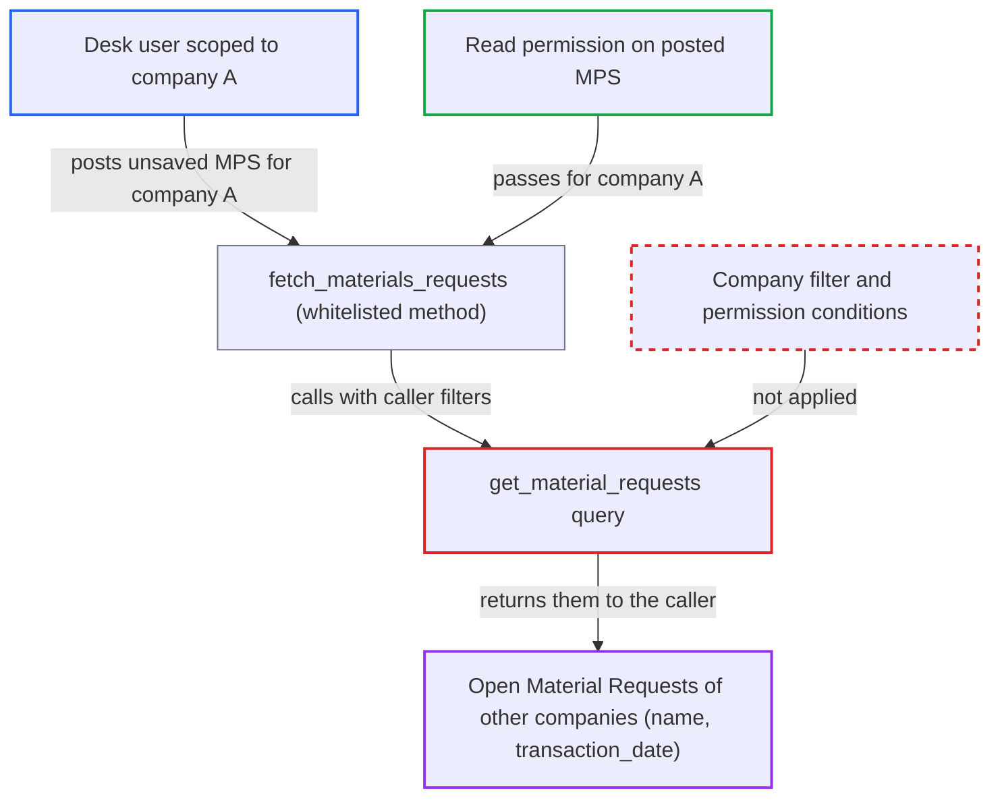

# MPS fetch_materials_requests discloses other companies' Material Requests past User Permissions

| Field | Value |
|---|---|
| ID | `find_0168uBWDn6Kf1UKUWEpNqZic` |
| Severity | **Medium** |
| Status | open |
| CWE | CWE-862 — Missing authorization |
| Created | 2026-10-27T21:24:26.639377Z |
| Claude Security | https://claude.ai/security/findings/find_0168uBWDn6Kf1UKUWEpNqZic |

## Description

A logged-in desk user limited to one company by User Permissions can list the names and transaction dates of open, submitted Material Requests that belong to other companies. Only users with read access to Master Production Schedule (MPS) can do this, and it works by default. The whitelisted `fetch_materials_requests` calls `get_material_requests`, which has no company filter and no permission conditions.

1. **Attacker (desk user scoped to company A)** posts a `run_doc_method` request for `fetch_materials_requests`. The request carries an unsaved MPS for company A and wide or empty date filters, all chosen by the caller. ([`erpnext/manufacturing/doctype/master_production_schedule/master_production_schedule.py:405-429`](https://github.com/cx-benchmark/erpnext/blob/90e7aefca73da3c440d2e8da7472fcb67838e678/erpnext/manufacturing/doctype/master_production_schedule/master_production_schedule.py#L405-L429))
2. **Permission check on the posted MPS** lets the request through. The only gate is read permission on the posted MPS, and the user's Company User Permission matches company A, so the check passes.
3. **the method `fetch_materials_requests`** calls `get_material_requests` with the caller's data. The `data` values include the type and date filters supplied in the request. ([`erpnext/manufacturing/doctype/master_production_schedule/master_production_schedule.py:405-429`](https://github.com/cx-benchmark/erpnext/blob/90e7aefca73da3c440d2e8da7472fcb67838e678/erpnext/manufacturing/doctype/master_production_schedule/master_production_schedule.py#L405-L429))
4. **the function `get_material_requests`** queries `Material Request` through a raw `frappe.qb` query. It filters only on `docstatus == 1`, status not Closed or Completed, and the type and date ranges. It has no company clause and no user-permission conditions, so open Material Requests of every company match. ([`erpnext/manufacturing/doctype/master_production_schedule/master_production_schedule.py:431-459`](https://github.com/cx-benchmark/erpnext/blob/90e7aefca73da3c440d2e8da7472fcb67838e678/erpnext/manufacturing/doctype/master_production_schedule/master_production_schedule.py#L431-L459))
5. **the method `fetch_materials_requests`** appends each result's name and `transaction_date` to `self.material_requests`. The document goes back to the caller in the `run_doc_method` response. `save()` runs only for an existing MPS, so an unsaved MPS needs only read permission. ([`erpnext/manufacturing/doctype/master_production_schedule/master_production_schedule.py:405-429`](https://github.com/cx-benchmark/erpnext/blob/90e7aefca73da3c440d2e8da7472fcb67838e678/erpnext/manufacturing/doctype/master_production_schedule/master_production_schedule.py#L405-L429))

## Assessment

The attacker is an authenticated desk user with read access to MPS, for example a Manufacturing User or Stock User. A Company User Permission limits them to company A. ERPNext creates such a permission by default when a user is linked to an Employee (`create_user_permission` defaults to 1). The attacker posts an unsaved MPS for company A to `run_doc_method` with `method=fetch_materials_requests` and wide or empty date filters. This needs no victim action. If the MPS already exists, the result is also saved into it.

Impact: The attacker learns the name and `transaction_date` of every open, submitted Material Request in other companies. That shows those companies' procurement and manufacturing activity and lets the attacker enumerate document ids. Items, quantities and other fields are not returned, the user still cannot open those requests, and nothing is modified beyond the attacker's own MPS. Within the user's own company the same two fields are already available to planners.

## Recommendation

`get_material_requests` builds an unscoped query over `Material Request` that ignores permissions. The whitelisted `fetch_materials_requests` therefore returns and stores documents of companies the caller may not read. The sibling queries are company-scoped.

Fix criteria: The query returns only Material Requests of the MPS's company, and ideally only those the caller may read under role and User Permissions. To verify, call the method as a user scoped to company A with no date filters. No Material Request of company B may appear in the response or in the saved MPS.

## Evidence

**https://github.com/cx-benchmark/erpnext**

- [`erpnext/manufacturing/doctype/master_production_schedule/master_production_schedule.py:431-459`](https://github.com/cx-benchmark/erpnext/blob/90e7aefca73da3c440d2e8da7472fcb67838e678/erpnext/manufacturing/doctype/master_production_schedule/master_production_schedule.py#L431-L459)
- [`erpnext/manufacturing/doctype/master_production_schedule/master_production_schedule.py:405-429`](https://github.com/cx-benchmark/erpnext/blob/90e7aefca73da3c440d2e8da7472fcb67838e678/erpnext/manufacturing/doctype/master_production_schedule/master_production_schedule.py#L405-L429)
- [`erpnext/manufacturing/doctype/master_production_schedule/master_production_schedule.py:244-250`](https://github.com/cx-benchmark/erpnext/blob/90e7aefca73da3c440d2e8da7472fcb67838e678/erpnext/manufacturing/doctype/master_production_schedule/master_production_schedule.py#L244-L250)
- [`erpnext/manufacturing/doctype/production_plan/services/sales_order_planning.py:44-73`](https://github.com/cx-benchmark/erpnext/blob/90e7aefca73da3c440d2e8da7472fcb67838e678/erpnext/manufacturing/doctype/production_plan/services/sales_order_planning.py#L44-L73)
- [`erpnext/manufacturing/doctype/master_production_schedule/master_production_schedule.json:199-245`](https://github.com/cx-benchmark/erpnext/blob/90e7aefca73da3c440d2e8da7472fcb67838e678/erpnext/manufacturing/doctype/master_production_schedule/master_production_schedule.json#L199-L245)
- [`erpnext/setup/doctype/employee/employee.py:230-233`](https://github.com/cx-benchmark/erpnext/blob/90e7aefca73da3c440d2e8da7472fcb67838e678/erpnext/setup/doctype/employee/employee.py#L230-L233)

