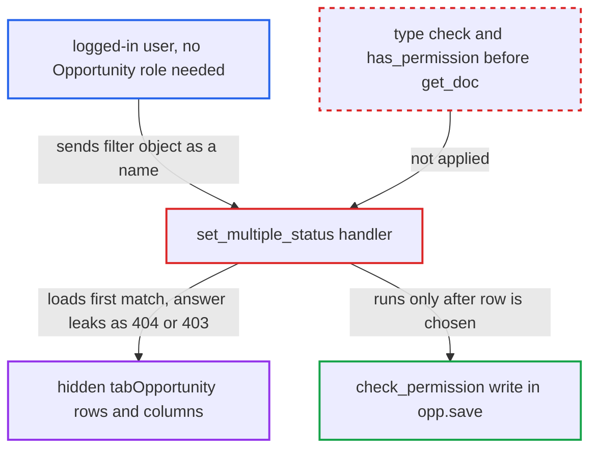

# Opportunity set_multiple_status accepts filter dicts as names, giving a row oracle

| Field | Value |
|---|---|
| ID | `find_01NbJEgB9eZo2MsugvWqUa6F` |
| Severity | **Medium** |
| Status | open |
| CWE | CWE-943 — Data query injection |
| Created | 2026-10-27T22:04:30.604409Z |
| Claude Security | https://claude.ai/security/findings/find_01NbJEgB9eZo2MsugvWqUa6F |

## Description

Any logged-in user can learn the contents of Opportunity rows they are not allowed to read, one yes/no answer per request. This includes rows hidden by User Permissions and Company Restriction. The whitelisted `set_multiple_status` passes each parsed `names` element to `frappe.get_doc` without checking it is a string. A filter object is therefore accepted, and write permission is checked only afterwards in `opp.save()`.

1. **logged-in user** POSTs to the `set_multiple_status` endpoint with a filter object inside `names`. The request uses `names='[{"company":"Other Co","contact_email":["like","a%"]}]'` and `status=x`, and no Opportunity role is needed. ([`erpnext/crm/doctype/opportunity/opportunity.py:565-571`](https://github.com/cx-benchmark/erpnext/blob/90e7aefca73da3c440d2e8da7472fcb67838e678/erpnext/crm/doctype/opportunity/opportunity.py#L565-L571))
2. **the handler `set_multiple_status`** parses `names` with `frappe.parse_json` and keeps every element as it is. The `str | list[str]` annotation accepts a JSON string, and `parse_json` then returns whatever the JSON holds, objects included. ([`erpnext/crm/doctype/opportunity/opportunity.py:565-571`](https://github.com/cx-benchmark/erpnext/blob/90e7aefca73da3c440d2e8da7472fcb67838e678/erpnext/crm/doctype/opportunity/opportunity.py#L565-L571))
3. **the call `frappe.get_doc("Opportunity", name)`** treats the object as a set of query filters and loads the first matching row. In the pinned Frappe a dict in the name position becomes filters with operators such as `like`, `>` and `between`, and no permission check runs on the chosen row. ([`erpnext/support/doctype/service_level_agreement/service_level_agreement.py:220`](https://github.com/cx-benchmark/erpnext/blob/90e7aefca73da3c440d2e8da7472fcb67838e678/erpnext/support/doctype/service_level_agreement/service_level_agreement.py#L220))
4. **`opp.save()`** checks write permission only after the row has been chosen. No match gives `DoesNotExistError` (404). A match the caller may not write gives `PermissionError` (403). A match the caller may write goes on to validation, where an invalid `status` fails and nothing is written. ([`erpnext/crm/doctype/opportunity/opportunity.py:565-571`](https://github.com/cx-benchmark/erpnext/blob/90e7aefca73da3c440d2e8da7472fcb67838e678/erpnext/crm/doctype/opportunity/opportunity.py#L565-L571))
5. **attacker** reads the response code and narrows the filter request by request. A 404 means no row matched. A 403, or a validation error on a writable row, means one did. Repeated `like`, `>` or range probes recover the column values.

## Assessment

Any logged-in user can do this, with no Opportunity role and no victim action. A Sales User fenced by User Permissions (Company, Territory, Customer Group) or by the Company Restriction hook in `hooks.py:373` can also reach rows hidden from them. A user with no Opportunity role gets 403 on every hit. The endpoint is live because the Opportunity list view's "Set as Open/Closed" menu calls it. The report assumes Frappe `>=17.0.0-dev,<18`, which is not in the checkout. It assumes a dict name is resolved as filters, whitelist validation accepts a string for `str | list[str]`, and `DoesNotExistError` maps to 404 and `PermissionError` to 403. The report also notes an unverified caveat: `frappe.client.get(filters=…)` in the pinned Frappe may offer a similar oracle if it loads the document before checking permission.

Impact: The attacker gets a blind read of any column of any `tabOpportunity` row, one bit per request. This covers `party_name`, `customer_name`, `contact_email`, `contact_mobile`, `phone`, `opportunity_amount`, `annual_revenue`, `sales_stage`, `company` and `territory`. The read is limited to that one table. Nothing is written when `status` is invalid, and a permitted match only gets a status change the caller could already make.

## Recommendation

Elements of the parsed `names` list are used as document names without a type check. A dict therefore becomes a database filter, and the matching row is loaded before any permission check. The 404 and 403 outcomes then reveal whether a hidden row matches.

Fix criteria: Every `names` element must be a non-empty string before any database lookup. Write permission on that specific Opportunity must be checked before the document is loaded, or the not-found and not-permitted outcomes must be indistinguishable. To verify, send a dict element such as `{"name":["like","%"]}` and a filter matching only a forbidden row. Both must return the same refusal, whether or not a row matches.

## Evidence

**https://github.com/cx-benchmark/erpnext**

- [`erpnext/crm/doctype/opportunity/opportunity.py:565-571`](https://github.com/cx-benchmark/erpnext/blob/90e7aefca73da3c440d2e8da7472fcb67838e678/erpnext/crm/doctype/opportunity/opportunity.py#L565-L571)
- [`erpnext/support/doctype/issue/issue.py:309-320`](https://github.com/cx-benchmark/erpnext/blob/90e7aefca73da3c440d2e8da7472fcb67838e678/erpnext/support/doctype/issue/issue.py#L309-L320)
- [`erpnext/tests/permission_test_utils.py:53-54`](https://github.com/cx-benchmark/erpnext/blob/90e7aefca73da3c440d2e8da7472fcb67838e678/erpnext/tests/permission_test_utils.py#L53-L54)
- [`erpnext/crm/doctype/opportunity/opportunity.json:677-702`](https://github.com/cx-benchmark/erpnext/blob/90e7aefca73da3c440d2e8da7472fcb67838e678/erpnext/crm/doctype/opportunity/opportunity.json#L677-L702)
- [`erpnext/hooks.py:373`](https://github.com/cx-benchmark/erpnext/blob/90e7aefca73da3c440d2e8da7472fcb67838e678/erpnext/hooks.py#L373)
- [`erpnext/support/doctype/service_level_agreement/service_level_agreement.py:220`](https://github.com/cx-benchmark/erpnext/blob/90e7aefca73da3c440d2e8da7472fcb67838e678/erpnext/support/doctype/service_level_agreement/service_level_agreement.py#L220)
- [`erpnext/crm/doctype/opportunity/opportunity_list.js:10-19`](https://github.com/cx-benchmark/erpnext/blob/90e7aefca73da3c440d2e8da7472fcb67838e678/erpnext/crm/doctype/opportunity/opportunity_list.js#L10-L19)

