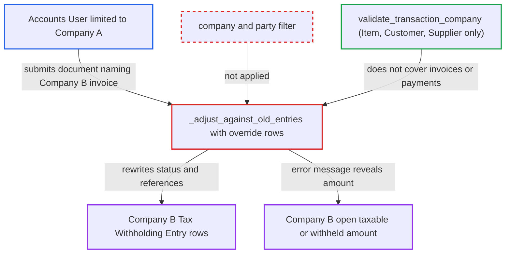

# Overridden Tax Withholding Entry rows rewrite other companies' withholding records

| Field | Value |
|---|---|
| ID | `find_01QQYnta1ssgPckkXJ8KZsBw` |
| Severity | **Medium** |
| Status | open |
| CWE | CWE-639 — Insecure direct object reference |
| Created | 2026-10-27T21:33:26.695737Z |
| Claude Security | https://claude.ai/security/findings/find_01QQYnta1ssgPckkXJ8KZsBw |

## Description

A user limited to Company A, such as an `Accounts User`, can rewrite another company's tax withholding records and read part of that company's data. The rewrite changes Company B's later TDS/TCS calculations. The attack needs a document with `override_tax_withholding_entries` set. `_adjust_against_old_entries` finds and changes stored rows by document name alone, with no company or party filter.

1. **Attacker (Accounts User limited to Company A)** saves a Company-A document with `override_tax_withholding_entries` set. The document can be a Debit Note Journal Entry or a Purchase Invoice with `apply_tds`. One row names a Company-B invoice in `taxable_name`, sets `withholding_name` to the attacker's own document and sets `tax_rate` to 0. ([`erpnext/accounts/doctype/tax_withholding_entry/tax_withholding_entry.py:380-390`](https://github.com/cx-benchmark/erpnext/blob/90e7aefca73da3c440d2e8da7472fcb67838e678/erpnext/accounts/doctype/tax_withholding_entry/tax_withholding_entry.py#L380-L390))
2. **Dynamic Link fields** accept the foreign document names. User Permissions are not checked on Dynamic Links, and `validate_transaction_company` covers only Item, Customer and Supplier references. ([`erpnext/stock/doctype/company_restriction/company_restriction.py:14`](https://github.com/cx-benchmark/erpnext/blob/90e7aefca73da3c440d2e8da7472fcb67838e678/erpnext/stock/doctype/company_restriction/company_restriction.py#L14))
3. **the controller `_process_withholding_entries`** validates the override rows. It checks only that taxable and withholding are not both foreign and that `withholding_amount` equals `taxable_amount * tax_rate`, so the foreign row passes. ([`erpnext/accounts/doctype/tax_withholding_entry/tax_withholding_entry.py:1149-1161`](https://github.com/cx-benchmark/erpnext/blob/90e7aefca73da3c440d2e8da7472fcb67838e678/erpnext/accounts/doctype/tax_withholding_entry/tax_withholding_entry.py#L1149-L1161))
4. **the first submit** runs `_adjust_against_old_entries` and throws on an unmatched amount. The `frappe.throw` message reports the remaining open amount of the Company-B document. ([`erpnext/accounts/doctype/tax_withholding_entry/tax_withholding_entry.py:118-216`](https://github.com/cx-benchmark/erpnext/blob/90e7aefca73da3c440d2e8da7472fcb67838e678/erpnext/accounts/doctype/tax_withholding_entry/tax_withholding_entry.py#L118-L216))
5. **Attacker** resubmits with the exact amount from the error message. The row now matches completely, so the complete-match path is taken. ([`erpnext/accounts/doctype/tax_withholding_entry/tax_withholding_entry.py:107-116`](https://github.com/cx-benchmark/erpnext/blob/90e7aefca73da3c440d2e8da7472fcb67838e678/erpnext/accounts/doctype/tax_withholding_entry/tax_withholding_entry.py#L107-L116))
6. **`_adjust_against_old_entries`** rewrites Company B's stored rows with `frappe.db.set_value`. The lookup filters only by category, status, doctype/name and `docstatus`. Matched rows become `Duplicate` and point at the attacker's document. A partial match also inserts a copied row into the victim document's child table. ([`erpnext/accounts/doctype/tax_withholding_entry/tax_withholding_entry.py:118-216`](https://github.com/cx-benchmark/erpnext/blob/90e7aefca73da3c440d2e8da7472fcb67838e678/erpnext/accounts/doctype/tax_withholding_entry/tax_withholding_entry.py#L118-L216))
7. **Company B's threshold and catch-up queries** no longer count the rewritten rows. These queries look only for `Under Withheld` and `Over Withheld` rows, so later TDS/TCS amounts for Company B come out wrong. ([`erpnext/accounts/doctype/tax_withholding_entry/tax_withholding_entry.py:709-750`](https://github.com/cx-benchmark/erpnext/blob/90e7aefca73da3c440d2e8da7472fcb67838e678/erpnext/accounts/doctype/tax_withholding_entry/tax_withholding_entry.py#L709-L750))

## Assessment

The attacker is an `Accounts User` restricted by User Permissions to Company A. Through `/api/resource` they save a Company-A Debit Note Journal Entry or a Purchase Invoice with `apply_tds`, a tax category shared with a Company-A account (an `Accounts User` may add one), and `override_tax_withholding_entries` set to 1. Sales Invoice and Payment Entry also support the override and are further entry points. The attack needs no victim action. It assumes the pinned Frappe >=17,\<18 checks User Permissions only on Link fields, not Dynamic Links, as the repository's comments in `accounts_receivable.py` and `payment_ledger.py` state.

Impact: The attacker can change Company B's `Tax Withholding Entry` rows. They are set to `Duplicate`, re-pointed at a Company-A document and possibly given extra inserted rows. This makes Company B's later threshold, catch-up and advance-offset calculations, and the tax rows they post, wrong. No Company-B GL entry or invoice total is written directly. Cancelling the attacker's document restores the rows. Each probe also discloses one open amount.

## Recommendation

(1) Stored `Tax Withholding Entry` rows are matched and rewritten by document reference alone. Under override the caller supplies that reference. Nothing ties it to the submitting document's company or checks the user's permission on the referenced document.

Fix criteria: Every override row's taxable and withholding documents must belong to the submitting document's company (and party), and the user must be permitted on them. `_adjust_against_old_entries` and `_clear_old_references` must restrict their lookups to that company. A Company-A document naming a Company-B invoice or payment is rejected, and Company B's withholding rows stay unchanged.

(2) The unmatched-amount error from `frappe.throw` reports a remaining amount computed from another document's stored rows. This discloses data of documents the caller cannot read.

Fix criteria: The validation error does not reveal amounts derived from documents the user cannot read. Probing with an oversized amount against a foreign document returns no amount information.

## Evidence

**https://github.com/cx-benchmark/erpnext**

- [`erpnext/accounts/doctype/tax_withholding_entry/tax_withholding_entry.py:118-216`](https://github.com/cx-benchmark/erpnext/blob/90e7aefca73da3c440d2e8da7472fcb67838e678/erpnext/accounts/doctype/tax_withholding_entry/tax_withholding_entry.py#L118-L216)
- [`erpnext/accounts/doctype/tax_withholding_entry/tax_withholding_entry.py:107-116`](https://github.com/cx-benchmark/erpnext/blob/90e7aefca73da3c440d2e8da7472fcb67838e678/erpnext/accounts/doctype/tax_withholding_entry/tax_withholding_entry.py#L107-L116)
- [`erpnext/accounts/doctype/tax_withholding_entry/tax_withholding_entry.py:380-390`](https://github.com/cx-benchmark/erpnext/blob/90e7aefca73da3c440d2e8da7472fcb67838e678/erpnext/accounts/doctype/tax_withholding_entry/tax_withholding_entry.py#L380-L390)
- [`erpnext/accounts/doctype/tax_withholding_entry/tax_withholding_entry.py:1149-1161`](https://github.com/cx-benchmark/erpnext/blob/90e7aefca73da3c440d2e8da7472fcb67838e678/erpnext/accounts/doctype/tax_withholding_entry/tax_withholding_entry.py#L1149-L1161)
- [`erpnext/accounts/doctype/tax_withholding_entry/tax_withholding_entry.py:709-750`](https://github.com/cx-benchmark/erpnext/blob/90e7aefca73da3c440d2e8da7472fcb67838e678/erpnext/accounts/doctype/tax_withholding_entry/tax_withholding_entry.py#L709-L750)
- [`erpnext/accounts/doctype/tax_withholding_entry/tax_withholding_entry.json`](https://github.com/cx-benchmark/erpnext/blob/90e7aefca73da3c440d2e8da7472fcb67838e678/erpnext/accounts/doctype/tax_withholding_entry/tax_withholding_entry.json)
- [`erpnext/accounts/doctype/journal_entry/journal_entry.py:241-251`](https://github.com/cx-benchmark/erpnext/blob/90e7aefca73da3c440d2e8da7472fcb67838e678/erpnext/accounts/doctype/journal_entry/journal_entry.py#L241-L251)
- [`erpnext/accounts/doctype/purchase_invoice/purchase_invoice.py:722`](https://github.com/cx-benchmark/erpnext/blob/90e7aefca73da3c440d2e8da7472fcb67838e678/erpnext/accounts/doctype/purchase_invoice/purchase_invoice.py#L722)
- [`erpnext/stock/doctype/company_restriction/company_restriction.py:14`](https://github.com/cx-benchmark/erpnext/blob/90e7aefca73da3c440d2e8da7472fcb67838e678/erpnext/stock/doctype/company_restriction/company_restriction.py#L14)

