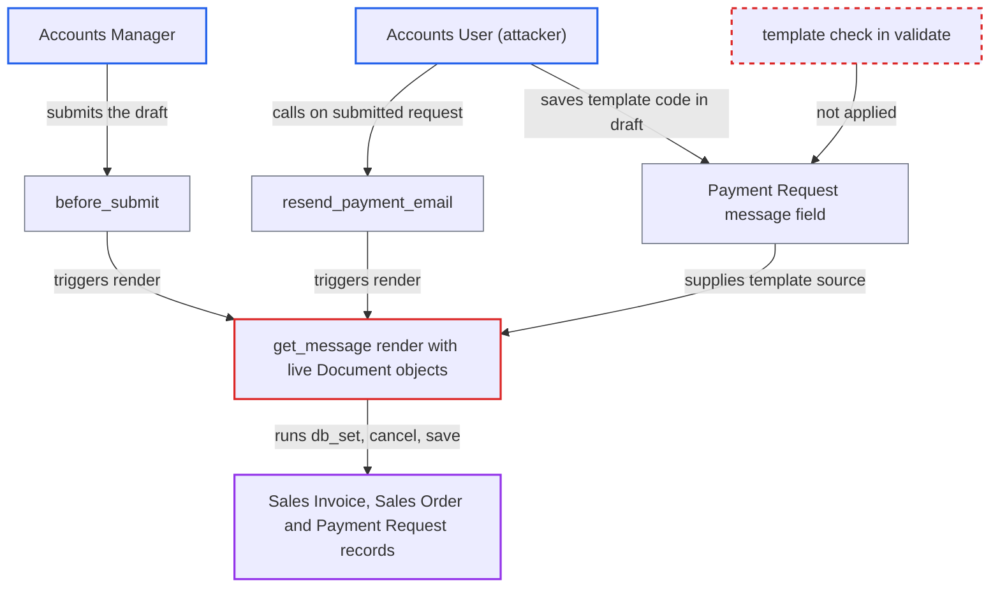

# Payment Request message rendered with live Document objects lets Accounts User tamper with invoices

| Field | Value |
|---|---|
| ID | `find_011yeNynaUibUaZsEraj759Z` |
| Severity | **Medium** |
| Status | open |
| CWE | CWE-1336 — Server-Side Template Injection |
| Created | 2026-10-27T21:25:03.119690Z |
| Claude Security | https://claude.ai/security/findings/find_011yeNynaUibUaZsEraj759Z |

## Description

An Accounts User can change or cancel financial documents they have no right to change, such as submitted Sales Invoices and Sales Orders. They do it by saving a Payment Request draft whose `message` text contains template code. The code is `get_message()`, which renders that text with live document objects, so template tags can call methods like `db_set` and `cancel`. The report assumes Frappe behaves this way, and that library is not in the checkout.

1. **Accounts User** saves a draft Inward Payment Request whose `message` holds template code. `message` is a plain editable `Text` field, and the form's examples tell users to write `{{ doc.… }}` tags, so a payload such as `{{ doc.db_set('outstanding_amount', 0) }}` looks normal. ([`erpnext/accounts/doctype/payment_request/payment_request.json:334-347`](https://github.com/cx-benchmark/erpnext/blob/90e7aefca73da3c440d2e8da7472fcb67838e678/erpnext/accounts/doctype/payment_request/payment_request.json#L334-L347))
2. **`validate()`** accepts the draft without checking `message`. It checks the reference document, company, bank account, print format and amounts, but never the template content, so the payload is stored. ([`erpnext/accounts/doctype/payment_request/payment_request.py:133-146`](https://github.com/cx-benchmark/erpnext/blob/90e7aefca73da3c440d2e8da7472fcb67838e678/erpnext/accounts/doctype/payment_request/payment_request.py#L133-L146))
3. **Accounts Manager** submits the draft in the normal approval step. Accounts User cannot submit, but Accounts Manager can, and for an Inward request with a payment gateway `before_submit()` calls `send_email()` and `make_communication_entry()`. ([`erpnext/accounts/doctype/payment_request/payment_request.py:294-317`](https://github.com/cx-benchmark/erpnext/blob/90e7aefca73da3c440d2e8da7472fcb67838e678/erpnext/accounts/doctype/payment_request/payment_request.py#L294-L317))
4. **`send_email()`** calls `get_message()` while building the email. This happens synchronously, before the mail job is queued, so the template runs inside the submitting request and in that user's session. ([`erpnext/accounts/doctype/payment_request/payment_request.py:659-686`](https://github.com/cx-benchmark/erpnext/blob/90e7aefca73da3c440d2e8da7472fcb67838e678/erpnext/accounts/doctype/payment_request/payment_request.py#L659-L686))
5. **`get_message()`** renders the stored `message` with the live referenced document and the live Payment Request. `restrict_globals=True` removes only the `frappe` namespace, so the template can still call public methods such as `db_set`, `cancel`, `save` and `flags.update` on `doc` and `payment_request`. ([`erpnext/accounts/doctype/payment_request/payment_request.py:688-698`](https://github.com/cx-benchmark/erpnext/blob/90e7aefca73da3c440d2e8da7472fcb67838e678/erpnext/accounts/doctype/payment_request/payment_request.py#L688-L698))
6. **Accounts User** calls the whitelisted `resend_payment_email()` on the submitted request. This needs only `email` permission, which Accounts User has. It works with or without a gateway, and the stored message is re-rendered in the attacker's own session. ([`erpnext/accounts/doctype/payment_request/payment_request.py:642-657`](https://github.com/cx-benchmark/erpnext/blob/90e7aefca73da3c440d2e8da7472fcb67838e678/erpnext/accounts/doctype/payment_request/payment_request.py#L642-L657))

## Assessment

The attacker is an authenticated desk user with the Accounts User role who can read the target Sales Invoice or Sales Order. They save a draft Inward Payment Request against it, with a payload in `message` such as `{{ doc.db_set('outstanding_amount', 0) }}`, `{{ doc.items[0].db_set('rate', 0) }}`, `{{ payment_request.db_set('status', 'Paid') }}` or `{{ doc.flags.update({'ignore_permissions': 1}) }}{{ doc.cancel() }}`. There are two ways to run it. First, an Accounts Manager submits the draft, which needs a payment gateway on the request; the payload then runs in the manager's session. Second, the attacker calls `resend_payment_email()` once the request is submitted, which runs it in their own session. That path needs no gateway and applies to a submitted Inward, non-Phone request that is not Initiated or Paid. The report assumes Frappe's `render_template` uses jinja2's `SandboxedEnvironment`, that `restrict_globals` strips only globals, and that Document methods carry no `unsafe_callable` or `alters_data` marker.

Impact: The payload can overwrite any column of the referenced submitted invoice or order and its child rows, such as `outstanding_amount`, `grand_total`, `status`, `docstatus` and rates. `db_set` skips permission checks, validation, the immutability of submitted documents and GL entries. The payload can also cancel invoices or orders the role cannot cancel, and mark the Payment Request Paid. Rendered output goes only to data the attacker can already read.

## Recommendation

(1) `get_message()` passes live `Document` instances (`doc` and `payment_request`) into a template whose source is a field that lower-privileged users can edit. Rendering therefore becomes method execution on financial documents.

Fix criteria: The template context contains only plain data, for example `as_dict()` copies or a fixed set of fields, plus pre-formatted values where the default message needs them. A draft whose message contains `{{ doc.db_set('outstanding_amount', 0) }}` leaves every document unchanged when an Accounts Manager submits it. The same holds for `{{ doc.flags.update({'ignore_permissions':1}) }}{{ doc.cancel() }}`, and when the request is re-sent via `resend_payment_email`.

(2) `validate()` accepts any template source in `message`, so abusive templates are stored for later execution.

Fix criteria: Saving a Payment Request validates `message` as a template, for example with `validate_template(..., restrict_globals=True)` as other templates in this repo are validated. The render itself also stays restricted for templates that pass validation.

## Evidence

**https://github.com/cx-benchmark/erpnext**

- [`erpnext/accounts/doctype/payment_request/payment_request.py:688-698`](https://github.com/cx-benchmark/erpnext/blob/90e7aefca73da3c440d2e8da7472fcb67838e678/erpnext/accounts/doctype/payment_request/payment_request.py#L688-L698)
- [`erpnext/accounts/doctype/payment_request/payment_request.py:642-657`](https://github.com/cx-benchmark/erpnext/blob/90e7aefca73da3c440d2e8da7472fcb67838e678/erpnext/accounts/doctype/payment_request/payment_request.py#L642-L657)
- [`erpnext/accounts/doctype/payment_request/payment_request.py:294-317`](https://github.com/cx-benchmark/erpnext/blob/90e7aefca73da3c440d2e8da7472fcb67838e678/erpnext/accounts/doctype/payment_request/payment_request.py#L294-L317)
- [`erpnext/accounts/doctype/payment_request/payment_request.py:659-686`](https://github.com/cx-benchmark/erpnext/blob/90e7aefca73da3c440d2e8da7472fcb67838e678/erpnext/accounts/doctype/payment_request/payment_request.py#L659-L686)
- [`erpnext/accounts/doctype/payment_request/payment_request.json:334-347`](https://github.com/cx-benchmark/erpnext/blob/90e7aefca73da3c440d2e8da7472fcb67838e678/erpnext/accounts/doctype/payment_request/payment_request.json#L334-L347)
- [`erpnext/accounts/doctype/payment_request/payment_request.json:490-525`](https://github.com/cx-benchmark/erpnext/blob/90e7aefca73da3c440d2e8da7472fcb67838e678/erpnext/accounts/doctype/payment_request/payment_request.json#L490-L525)
- [`erpnext/accounts/doctype/payment_request/payment_request.py:133-146`](https://github.com/cx-benchmark/erpnext/blob/90e7aefca73da3c440d2e8da7472fcb67838e678/erpnext/accounts/doctype/payment_request/payment_request.py#L133-L146)
- [`erpnext/accounts/doctype/payment_request/payment_request.py:1316-1335`](https://github.com/cx-benchmark/erpnext/blob/90e7aefca73da3c440d2e8da7472fcb67838e678/erpnext/accounts/doctype/payment_request/payment_request.py#L1316-L1335)
- [`pyproject.toml:44-45`](https://github.com/cx-benchmark/erpnext/blob/90e7aefca73da3c440d2e8da7472fcb67838e678/pyproject.toml#L44-L45)

