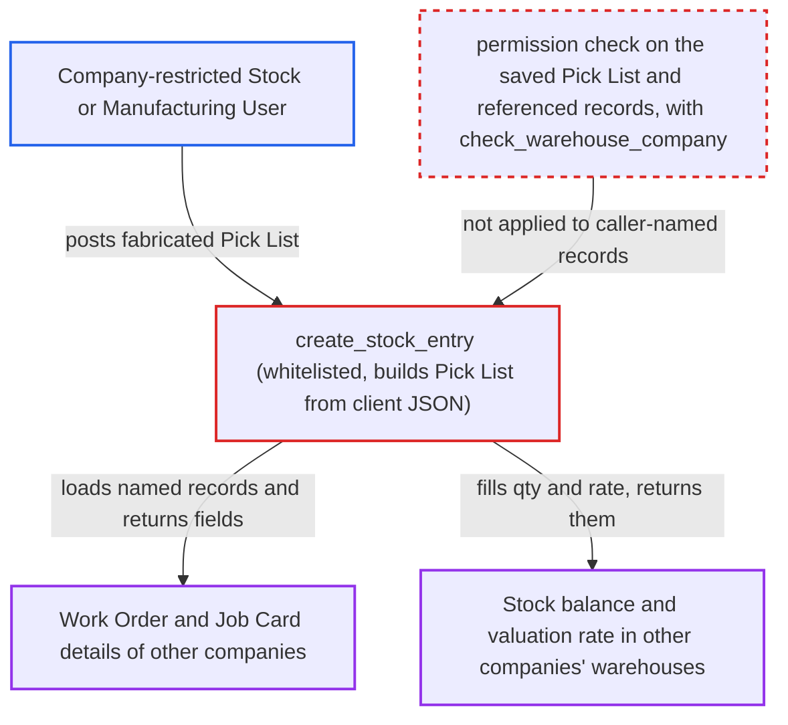

# Pick List create_stock_entry discloses other companies' Work Order, Job Card and stock valuation data

| Field | Value |
|---|---|
| ID | `find_01MorHHj1mDPy6Mgq14XJX1K` |
| Severity | **Medium** |
| Status | open |
| CWE | CWE-639 — Insecure direct object reference |
| Created | 2026-10-27T21:30:11.161626Z |
| Claude Security | https://claude.ai/security/findings/find_01MorHHj1mDPy6Mgq14XJX1K |

## Description

A logged-in Stock User or Manufacturing User limited to one company can read other companies' Work Order, Job Card and stock valuation data. The attacker POSTs a made-up Pick List to the whitelisted `create_stock_entry`. It builds the document from the caller's JSON, so its read check only screens values the caller wrote. Later lookups of the named Work Order, Material Request and warehouse are not permission-checked. The disclosure is read-only.

1. **Company-restricted user** posts a fabricated Pick List to `create_stock_entry`. The JSON sets `company` to the user's own company A, and names another company's Work Order and a warehouse of company B in `locations[].warehouse`. ([`erpnext/stock/doctype/pick_list/mapper.py:369-400`](https://github.com/cx-benchmark/erpnext/blob/90e7aefca73da3c440d2e8da7472fcb67838e678/erpnext/stock/doctype/pick_list/mapper.py#L369-L400))
2. **`create_stock_entry`** builds an unsaved Pick List from the caller's JSON and runs `check_permission("read")` on it. The check screens only values the caller wrote, so it passes. The `work_order` and `material_request` links are screened only for users who hold User Permissions on those doctypes, which a Company restriction does not cover. ([`erpnext/stock/doctype/pick_list/pick_list.json:82-125`](https://github.com/cx-benchmark/erpnext/blob/90e7aefca73da3c440d2e8da7472fcb67838e678/erpnext/stock/doctype/pick_list/pick_list.json#L82-L125))
3. **`update_stock_entry_based_on_work_order`** loads the named Work Order with `frappe.get_doc` and copies its fields into the Stock Entry. No permission check runs. It copies `company`, `bom_no`, `use_multi_level_bom`, `wip_warehouse`, `project` and the BOM's `inspection_required`. ([`erpnext/stock/doctype/pick_list/mapper.py:498-529`](https://github.com/cx-benchmark/erpnext/blob/90e7aefca73da3c440d2e8da7472fcb67838e678/erpnext/stock/doctype/pick_list/mapper.py#L498-L529))
4. **`update_stock_entry_based_on_job_card`** reads the Job Card linked to a named Material Request and copies its fields. This applies when the Material Request has a `job_card`. It copies `work_order`, `bom_no` or `semi_fg_bom`, the remaining quantity, `wip_warehouse` and `project`, without a read check. Stock User has no Job Card read access. ([`erpnext/stock/doctype/pick_list/mapper.py:441-478`](https://github.com/cx-benchmark/erpnext/blob/90e7aefca73da3c440d2e8da7472fcb67838e678/erpnext/stock/doctype/pick_list/mapper.py#L441-L478))
5. **`stock_entry.set_missing_values()`** fills each row's `actual_qty` and `basic_rate` for the caller's chosen item and warehouse. The rate comes from `_get_incoming_rate` without `check_warehouse_company`, which the whitelisted rate endpoint does apply. ([`erpnext/stock/doctype/stock_entry/stock_entry.py:786-800`](https://github.com/cx-benchmark/erpnext/blob/90e7aefca73da3c440d2e8da7472fcb67838e678/erpnext/stock/doctype/stock_entry/stock_entry.py#L786-L800))
6. **`create_stock_entry`** returns the whole Stock Entry with `as_dict()`. The response carries the other company's manufacturing details plus the stock balance and valuation rate. ([`erpnext/stock/doctype/pick_list/mapper.py:369-400`](https://github.com/cx-benchmark/erpnext/blob/90e7aefca73da3c440d2e8da7472fcb67838e678/erpnext/stock/doctype/pick_list/mapper.py#L369-L400))

## Assessment

The attacker is a logged-in Stock User or Manufacturing User whose Company User Permission limits them to Company A. They send a POST to `/api/method/erpnext.stock.doctype.pick_list.mapper.create_stock_entry` with a Pick List they wrote themselves. It sets `company` to "A", sets `purpose` to "Material Transfer for Manufacture", and names another company's Work Order in `work_order`. It also has a `locations` row with a warehouse of company B. A Material Request name works as another way in, because its `job_card` is read the same way. Work Order names are sequential, so they are easy to guess. The report assumes Frappe `>=17.0.0-dev,<18`, which is not in the checkout. It assumes `Document.check_permission` on an unsaved document applies User Permissions only to that document's own link fields. It also assumes `frappe.get_doc` and `frappe.db.get_value` apply no permission check.

Impact: The attacker reads other companies' Work Order data (company, BOM, WIP warehouse, project) and Job Card data (work order, BOM, pending quantity, project). They also read the stock balance and valuation rate of chosen items in other companies' warehouses. The disclosure is limited to these fields, and nothing is saved or changed.

## Recommendation

`create_stock_entry` trusts a client-built Pick List. Its only check runs on link values the caller wrote. It then reads the Work Order, Material Request, Job Card and warehouse stock that the caller names, with no permission check.

Fix criteria: Either the source Pick List is loaded from the database by name with a read permission check, ignoring client field values, or every referenced Work Order, Material Request, Job Card and warehouse is authorised for the caller. That authorisation includes User Permissions and `check_warehouse_company`. To verify, a Company-A-restricted Stock User posts a fabricated Pick List naming Company B's Work Order or warehouse. They get a permission error, and the response holds no BOM, project, quantity or rate.

## Evidence

**https://github.com/cx-benchmark/erpnext**

- [`erpnext/stock/doctype/pick_list/mapper.py:369-400`](https://github.com/cx-benchmark/erpnext/blob/90e7aefca73da3c440d2e8da7472fcb67838e678/erpnext/stock/doctype/pick_list/mapper.py#L369-L400)
- [`erpnext/stock/doctype/pick_list/mapper.py:498-529`](https://github.com/cx-benchmark/erpnext/blob/90e7aefca73da3c440d2e8da7472fcb67838e678/erpnext/stock/doctype/pick_list/mapper.py#L498-L529)
- [`erpnext/stock/doctype/pick_list/mapper.py:441-478`](https://github.com/cx-benchmark/erpnext/blob/90e7aefca73da3c440d2e8da7472fcb67838e678/erpnext/stock/doctype/pick_list/mapper.py#L441-L478)
- [`erpnext/stock/doctype/pick_list/pick_list.json:82-125`](https://github.com/cx-benchmark/erpnext/blob/90e7aefca73da3c440d2e8da7472fcb67838e678/erpnext/stock/doctype/pick_list/pick_list.json#L82-L125)
- [`erpnext/stock/doctype/pick_list/mapper.py:566-580`](https://github.com/cx-benchmark/erpnext/blob/90e7aefca73da3c440d2e8da7472fcb67838e678/erpnext/stock/doctype/pick_list/mapper.py#L566-L580)
- [`erpnext/stock/doctype/stock_entry/stock_entry.py:786-800`](https://github.com/cx-benchmark/erpnext/blob/90e7aefca73da3c440d2e8da7472fcb67838e678/erpnext/stock/doctype/stock_entry/stock_entry.py#L786-L800)
- [`erpnext/stock/doctype/stock_entry_detail/stock_entry_detail.py:203-214`](https://github.com/cx-benchmark/erpnext/blob/90e7aefca73da3c440d2e8da7472fcb67838e678/erpnext/stock/doctype/stock_entry_detail/stock_entry_detail.py#L203-L214)
- [`erpnext/stock/utils.py:347-361`](https://github.com/cx-benchmark/erpnext/blob/90e7aefca73da3c440d2e8da7472fcb67838e678/erpnext/stock/utils.py#L347-L361)
- [`erpnext/stock/doctype/pick_list/mapper.py:31-36`](https://github.com/cx-benchmark/erpnext/blob/90e7aefca73da3c440d2e8da7472fcb67838e678/erpnext/stock/doctype/pick_list/mapper.py#L31-L36)

