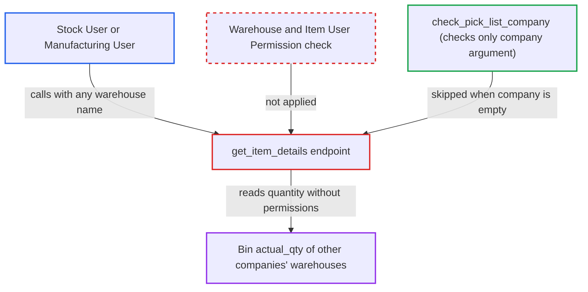

# Pick List get_item_details returns Bin qty for warehouses outside caller's company/user permissions

| Field | Value |
|---|---|
| ID | `find_01Pibv3e7z3zzPVQU4kJtN11` |
| Severity | **Medium** |
| Status | open |
| CWE | CWE-862 — Missing Authorization |
| Created | 2026-10-27T21:53:01.971920Z |
| Claude Security | https://claude.ai/security/findings/find_01Pibv3e7z3zzPVQU4kJtN11 |

## Description

A logged-in Stock User or Manufacturing User can read the on-hand stock quantity of any item in any warehouse, including another company's warehouses. This holds even when Warehouse or Company User Permissions restrict them to their own site. The whitelisted `get_item_details` only checks the role and the optional `company` argument, then reads `Bin.actual_qty` without any permission check.

1. **attacker (Stock User or Manufacturing User)** calls the `get_item_details` endpoint directly with a chosen `item_code` and `warehouse`. The request goes to `/api/method/erpnext.stock.doctype.pick_list.pick_list.get_item_details`, and `company` is left out or set to the attacker's own company; default warehouse names look like `<name> - <abbr>` and can be guessed. ([`erpnext/stock/doctype/pick_list/pick_list.py:1972-1990`](https://github.com/cx-benchmark/erpnext/blob/90e7aefca73da3c440d2e8da7472fcb67838e678/erpnext/stock/doctype/pick_list/pick_list.py#L1972-L1990))
2. **the handler `get_item_details`** passes only a role-level permission check. `frappe.has_permission("Pick List", throw=True)` is called without a document, so it checks only that the caller's role can read Pick List. ([`erpnext/stock/doctype/pick_list/pick_list.py:1972-1990`](https://github.com/cx-benchmark/erpnext/blob/90e7aefca73da3c440d2e8da7472fcb67838e678/erpnext/stock/doctype/pick_list/pick_list.py#L1972-L1990))
3. **the helper `check_pick_list_company`** lets the call through. It returns immediately when `company` is empty, and otherwise checks only the `company` argument, never the company of the warehouse that is queried. ([`erpnext/stock/doctype/pick_list/pick_list.py:1924-1933`](https://github.com/cx-benchmark/erpnext/blob/90e7aefca73da3c440d2e8da7472fcb67838e678/erpnext/stock/doctype/pick_list/pick_list.py#L1924-L1933))
4. **the function `get_actual_qty`** reads `Bin.actual_qty` for the chosen item and warehouse. It uses `frappe.db.get_value` on `Bin`, which applies no User Permissions. ([`erpnext/stock/doctype/pick_list/pick_list.py:1993-1998`](https://github.com/cx-benchmark/erpnext/blob/90e7aefca73da3c440d2e8da7472fcb67838e678/erpnext/stock/doctype/pick_list/pick_list.py#L1993-L1998))
5. **the handler `get_item_details`** returns `actual_qty` to the attacker. No Warehouse or Item User Permission check happens before the value is returned. ([`erpnext/stock/doctype/pick_list/pick_list.py:1972-1990`](https://github.com/cx-benchmark/erpnext/blob/90e7aefca73da3c440d2e8da7472fcb67838e678/erpnext/stock/doctype/pick_list/pick_list.py#L1972-L1990))

## Assessment

The attacker is a logged-in Stock User or Manufacturing User, roles that can read Pick List. Warehouse or Company User Permissions fence them to their own company or warehouse. They call the endpoint directly, leaving out `company` or passing their own. No victim action and no non-default setting is needed. The Pick List form limits the warehouse picker to `frm.doc.company`, but that limit exists only in the client and does not stop a direct call.

Impact: The attacker can read the on-hand quantity of any item in any warehouse, including other companies' warehouses and items restricted to other companies. Each call returns one item and warehouse pair, and only the quantity. The report notes no valuation, no document names, no write path and no effect on availability.

## Recommendation

`get_item_details` reads the Bin quantity for a caller-chosen warehouse after only a role-level check and a check of the optional `company` argument. Neither check covers the warehouse's own company or the caller's Warehouse and Item User Permissions.

Fix criteria: Before any Bin figure is returned, the call fails with a PermissionError if the caller lacks User Permission on the `warehouse` or `item_code`, or if the warehouse's own company is outside the caller's allowed companies, as `get_stock_balance` enforces. The `company` argument, or its absence, does not decide this. Verify that a user fenced to Company A or to one warehouse who requests a Company B warehouse gets no `actual_qty`. Also verify that the Pick List form still fills quantities for permitted warehouses.

## Evidence

**https://github.com/cx-benchmark/erpnext**

- [`erpnext/stock/doctype/pick_list/pick_list.py:1972-1990`](https://github.com/cx-benchmark/erpnext/blob/90e7aefca73da3c440d2e8da7472fcb67838e678/erpnext/stock/doctype/pick_list/pick_list.py#L1972-L1990)
- [`erpnext/stock/doctype/pick_list/pick_list.py:1993-1998`](https://github.com/cx-benchmark/erpnext/blob/90e7aefca73da3c440d2e8da7472fcb67838e678/erpnext/stock/doctype/pick_list/pick_list.py#L1993-L1998)
- [`erpnext/stock/doctype/pick_list/pick_list.py:1924-1933`](https://github.com/cx-benchmark/erpnext/blob/90e7aefca73da3c440d2e8da7472fcb67838e678/erpnext/stock/doctype/pick_list/pick_list.py#L1924-L1933)
- [`erpnext/stock/utils.py:116-130`](https://github.com/cx-benchmark/erpnext/blob/90e7aefca73da3c440d2e8da7472fcb67838e678/erpnext/stock/utils.py#L116-L130)
- [`erpnext/stock/get_item_details.py:1743-1764`](https://github.com/cx-benchmark/erpnext/blob/90e7aefca73da3c440d2e8da7472fcb67838e678/erpnext/stock/get_item_details.py#L1743-L1764)
- [`erpnext/stock/doctype/pick_list/pick_list.js:12-20`](https://github.com/cx-benchmark/erpnext/blob/90e7aefca73da3c440d2e8da7472fcb67838e678/erpnext/stock/doctype/pick_list/pick_list.js#L12-L20)

