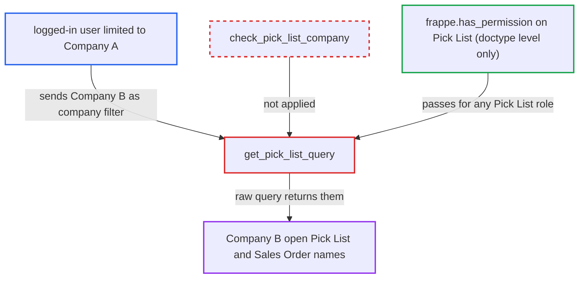

# Pick List link query returns other companies' open pick lists and sales orders

| Field | Value |
|---|---|
| ID | `find_01LQ2qGBErzfBY1YCHB8FmCc` |
| Severity | **Medium** |
| Status | open |
| CWE | CWE-862 — Missing authorization |
| Created | 2026-10-27T21:28:00.126631Z |
| Claude Security | https://claude.ai/security/findings/find_01LQ2qGBErzfBY1YCHB8FmCc |

## Description

A logged-in user restricted to one company can read another company's open Pick List names, the customer, and the linked Sales Order names. Only identifiers and the links between them leak; nothing can be changed. The user needs a Pick List role and a `Company` User Permission. The cause is `get_pick_list_query`, which uses the request's `company` filter without checking it against the caller's allowed companies.

1. **attacker** posts a request to the whitelisted method `get_pick_list_query`. The request sets `filters` to another company's name and a customer name, and may add `txt` or `sales_order` to search or test names one by one. ([`erpnext/stock/doctype/pick_list/pick_list.py:2013-2060`](https://github.com/cx-benchmark/erpnext/blob/90e7aefca73da3c440d2e8da7472fcb67838e678/erpnext/stock/doctype/pick_list/pick_list.py#L2013-L2060))
2. **the handler `get_pick_list_query`** checks only the doctype-level permission. `frappe.has_permission("Pick List", throw=True)` passes for any user with a Pick List role, whatever their `Company` User Permission says. ([`erpnext/stock/doctype/pick_list/pick_list.py:2013-2060`](https://github.com/cx-benchmark/erpnext/blob/90e7aefca73da3c440d2e8da7472fcb67838e678/erpnext/stock/doctype/pick_list/pick_list.py#L2013-L2060))
3. **the handler `get_pick_list_query`** runs a raw `frappe.qb` join of Pick List, Pick List Item and Sales Order. `Pick List.company`, `Sales Order.customer` and the optional `Pick List Item.sales_order` come straight from the request, and `frappe.qb(...).run()` adds no User Permission or permission-query conditions. ([`erpnext/stock/doctype/pick_list/pick_list.py:2013-2060`](https://github.com/cx-benchmark/erpnext/blob/90e7aefca73da3c440d2e8da7472fcb67838e678/erpnext/stock/doctype/pick_list/pick_list.py#L2013-L2060))
4. **the handler `get_pick_list_query`** returns the other company's open pick lists. It returns submitted Pick Lists in status Open or Partly Delivered, with the customer and the Sales Order names joined by ` `. ([`erpnext/stock/doctype/pick_list/pick_list.py:2013-2060`](https://github.com/cx-benchmark/erpnext/blob/90e7aefca73da3c440d2e8da7472fcb67838e678/erpnext/stock/doctype/pick_list/pick_list.py#L2013-L2060))
5. **the Delivery Note form** restricts the company only in the browser. `delivery_note.js` passes `company: me.frm.doc.company` as `get_query_filters`, so a direct `/api/method` call can send any company. ([`erpnext/stock/doctype/delivery_note/delivery_note.js:213-240`](https://github.com/cx-benchmark/erpnext/blob/90e7aefca73da3c440d2e8da7472fcb67838e678/erpnext/stock/doctype/delivery_note/delivery_note.js#L213-L240))

## Assessment

The attacker is a logged-in user with a Pick List role such as Stock User or Manufacturing User. A `Company` User Permission confines them to Company A. They POST to `/api/method/erpnext.stock.doctype.pick_list.pick_list.get_pick_list_query` with `filters` naming Company B and a customer. They can add `txt` or `sales_order` to search the names or test them one by one. No victim action is needed.

Impact: The attacker learns which submitted, open Pick Lists exist for a named customer in a company outside their permissions, and which Sales Orders those lists serve. They also learn that the customer has open orders there. No other fields are returned and nothing can be changed.

## Recommendation

`get_pick_list_query` scopes results by a company taken from the request and never checks it against the caller's `Company` User Permissions. The raw `frappe.qb` query applies no permission conditions on Pick List or Sales Order.

Fix criteria: A caller whose `Company` User Permissions exclude the requested company gets a permission error or an empty result, for example by applying the module's existing `check_pick_list_company` or a permission-aware query. Test: a Stock User restricted to Company A calls the method with Company B's name and a customer with open Company B pick lists, and receives no Company B pick list or Sales Order names. An unrestricted user and a user querying their own company see the same results as before.

## Evidence

**https://github.com/cx-benchmark/erpnext**

- [`erpnext/stock/doctype/pick_list/pick_list.py:2013-2060`](https://github.com/cx-benchmark/erpnext/blob/90e7aefca73da3c440d2e8da7472fcb67838e678/erpnext/stock/doctype/pick_list/pick_list.py#L2013-L2060)
- [`erpnext/stock/doctype/pick_list/pick_list.py:1924-1948`](https://github.com/cx-benchmark/erpnext/blob/90e7aefca73da3c440d2e8da7472fcb67838e678/erpnext/stock/doctype/pick_list/pick_list.py#L1924-L1948)
- [`erpnext/stock/doctype/company_restriction/company_restriction.py:60-66`](https://github.com/cx-benchmark/erpnext/blob/90e7aefca73da3c440d2e8da7472fcb67838e678/erpnext/stock/doctype/company_restriction/company_restriction.py#L60-L66)
- [`erpnext/stock/doctype/delivery_note/delivery_note.js:213-240`](https://github.com/cx-benchmark/erpnext/blob/90e7aefca73da3c440d2e8da7472fcb67838e678/erpnext/stock/doctype/delivery_note/delivery_note.js#L213-L240)

