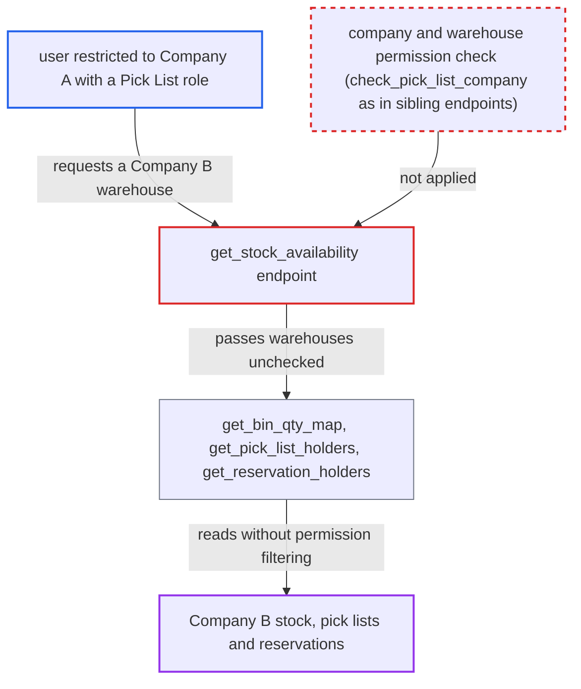

# Pick List stock availability endpoint discloses other companies' stock, pick lists and reservations

| Field | Value |
|---|---|
| ID | `find_019AenbyTEihoJVrxZq5qkWz` |
| Severity | **Medium** |
| Status | open |
| CWE | CWE-862 — Missing authorization |
| Created | 2026-10-27T21:27:24.273354Z |
| Claude Security | https://claude.ai/security/findings/find_019AenbyTEihoJVrxZq5qkWz |

## Description

A logged-in user restricted to one company can read another company's stock levels. They can also read the names of its pick lists, stock reservations, and sales and work orders. The attacker needs a Pick List role such as Stock User or Manufacturing User. The endpoint `get_stock_availability` checks only the doctype-level permission and never checks the requested warehouses against the caller's companies. The data is read-only.

1. **attacker** posts a request to the `get_stock_availability` endpoint with a foreign warehouse. The attacker is a logged-in user with a Pick List role who is limited to Company A by a Company User Permission. They send `items` with an `item_code` and a warehouse such as `Stores - B`, which is easy to guess because default warehouse names follow `<name> - <abbr>`. ([`erpnext/stock/doctype/pick_list/pick_list.py:1476-1494`](https://github.com/cx-benchmark/erpnext/blob/90e7aefca73da3c440d2e8da7472fcb67838e678/erpnext/stock/doctype/pick_list/pick_list.py#L1476-L1494))
2. **the endpoint `get_stock_availability`** passes the doctype-level permission check. `frappe.has_permission("Pick List", throw=True)` is called without a `doc`, so it checks roles only and does not apply User Permissions. ([`erpnext/stock/doctype/pick_list/pick_list.py:1476-1494`](https://github.com/cx-benchmark/erpnext/blob/90e7aefca73da3c440d2e8da7472fcb67838e678/erpnext/stock/doctype/pick_list/pick_list.py#L1476-L1494))
3. **the helpers `get_bin_qty_map`, `get_pick_list_holders` and `get_reservation_holders`** query the supplied warehouses through `frappe.qb`. The helpers apply no permission filtering, so they return Bin quantities, open Pick Lists and open Stock Reservation Entry rows from every company. ([`erpnext/stock/doctype/pick_list/pick_list.py:1464-1473`](https://github.com/cx-benchmark/erpnext/blob/90e7aefca73da3c440d2e8da7472fcb67838e678/erpnext/stock/doctype/pick_list/pick_list.py#L1464-L1473))
4. **the function `get_availability_row`** returns the combined data to the caller. The response holds on-hand quantity, pick list names, statuses, batches and held quantities. It also holds reservation names, `voucher_type`, `voucher_no` and reserved quantities, all for Company B.

## Assessment

The attacker is a logged-in user with a Pick List role, such as Stock User or Manufacturing User. A Company User Permission limits them to Company A. They need no victim action. They call `/api/method/erpnext.stock.doctype.pick_list.pick_list.get_stock_availability` with `items` naming an item and a warehouse of another company. The report gives no other way in.

Impact: The attacker can read, per item and warehouse, another company's on-hand quantity. They can also read the names, statuses and quantities of its Pick Lists, Stock Reservation Entries and linked Sales Orders or Work Orders. Nothing can be modified. The data is limited to stock positions and document identifiers.

## Recommendation

`get_stock_availability` authorises only at doctype level. It never checks that the caller-supplied warehouses belong to companies or warehouses the caller's User Permissions allow. Its `frappe.qb` helpers then return other companies' Bin, Pick List and Stock Reservation Entry rows.

Fix criteria: Before any data is returned, each requested warehouse resolves to a company the caller is allowed, as `check_pick_list_company` and `pos_invoice.get_stock_availability` enforce. Each warehouse also satisfies any Warehouse User Permission. To verify, a user restricted to Company A who requests a Company B warehouse gets a PermissionError or no rows. Unrestricted users see no change.

## Evidence

**https://github.com/cx-benchmark/erpnext**

- [`erpnext/stock/doctype/pick_list/pick_list.py:1476-1494`](https://github.com/cx-benchmark/erpnext/blob/90e7aefca73da3c440d2e8da7472fcb67838e678/erpnext/stock/doctype/pick_list/pick_list.py#L1476-L1494)
- [`erpnext/stock/doctype/pick_list/pick_list.py:1464-1473`](https://github.com/cx-benchmark/erpnext/blob/90e7aefca73da3c440d2e8da7472fcb67838e678/erpnext/stock/doctype/pick_list/pick_list.py#L1464-L1473)
- [`erpnext/stock/doctype/pick_list/pick_list.py:1348-1371`](https://github.com/cx-benchmark/erpnext/blob/90e7aefca73da3c440d2e8da7472fcb67838e678/erpnext/stock/doctype/pick_list/pick_list.py#L1348-L1371)
- [`erpnext/stock/doctype/pick_list/pick_list.py:1406-1440`](https://github.com/cx-benchmark/erpnext/blob/90e7aefca73da3c440d2e8da7472fcb67838e678/erpnext/stock/doctype/pick_list/pick_list.py#L1406-L1440)
- [`erpnext/stock/doctype/pick_list/pick_list.py:1924-1934`](https://github.com/cx-benchmark/erpnext/blob/90e7aefca73da3c440d2e8da7472fcb67838e678/erpnext/stock/doctype/pick_list/pick_list.py#L1924-L1934)
- [`erpnext/accounts/doctype/pos_invoice/pos_invoice.py:912-935`](https://github.com/cx-benchmark/erpnext/blob/90e7aefca73da3c440d2e8da7472fcb67838e678/erpnext/accounts/doctype/pos_invoice/pos_invoice.py#L912-L935)

