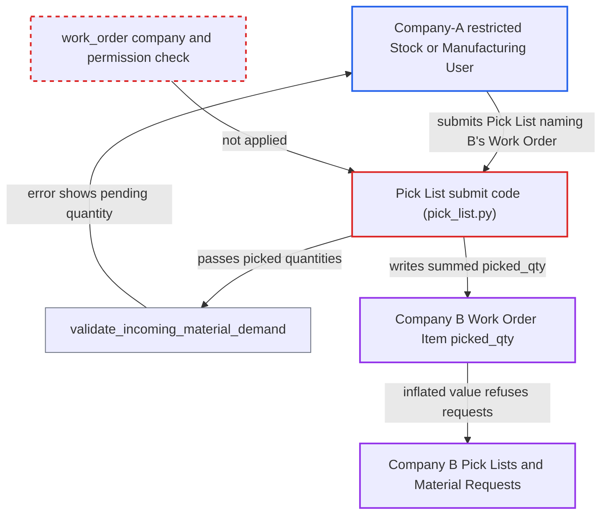

# Pick List work_order link lets a company-restricted user alter another company's Work Order picked quantities

| Field | Value |
|---|---|
| ID | `find_01F3pjfxvi4Ut9LEMHmwwbdh` |
| Severity | **Medium** |
| Status | open |
| CWE | CWE-639 — Insecure Direct Object Reference |
| Created | 2026-10-27T22:31:58.262445Z |
| Claude Security | https://claude.ai/security/findings/find_01F3pjfxvi4Ut9LEMHmwwbdh |

## Description

A user restricted to Company A can submit a Pick List that names Company B's Work Order. This changes B's picked quantities and shows B's pending raw-material quantities. The attacker needs a Stock User or Manufacturing User role, and the Work Order name must be guessed. The cause is that `PickList` never checks that its `work_order` belongs to its own company.

1. **Company-A restricted user** creates a Company-A Pick List whose `work_order` is a guessed Company-B Work Order. The Pick List uses purpose Material Transfer for Manufacture with `pick_manually` set, and its rows use A warehouses holding free stock. The only company checks are warehouse checks and a Sales Order comparison, so nothing ties `work_order` to the company. ([`erpnext/stock/doctype/pick_list/pick_list.py:252-317`](https://github.com/cx-benchmark/erpnext/blob/90e7aefca73da3c440d2e8da7472fcb67838e678/erpnext/stock/doctype/pick_list/pick_list.py#L252-L317))
2. **the method `validate_pending_qty_in_work_order`** loads and locks the foreign Work Order on submit. It uses `get_doc(..., for_update=True)` and passes the attacker's picked quantities to the demand check, with no company or permission check first. ([`erpnext/stock/doctype/pick_list/pick_list.py:335-371`](https://github.com/cx-benchmark/erpnext/blob/90e7aefca73da3c440d2e8da7472fcb67838e678/erpnext/stock/doctype/pick_list/pick_list.py#L335-L371))
3. **the method `validate_incoming_material_demand`** throws an error that states the pending quantity. The `Only {0} {1} of {2} is pending in Work Order {3}` message appears when the picked quantity exceeds the pending quantity. It reveals Company B's pending amount and UOM for each guessed item code, and items not in the Work Order are skipped silently. ([`erpnext/manufacturing/doctype/work_order/services/required_items.py:238-266`](https://github.com/cx-benchmark/erpnext/blob/90e7aefca73da3c440d2e8da7472fcb67838e678/erpnext/manufacturing/doctype/work_order/services/required_items.py#L238-L266))
4. **the method `update_picked_qty_in_work_order`** loads Company B's Work Order with a plain `frappe.get_doc` on submit. It runs from `on_submit` and does not compare the Work Order's company with the Pick List's company. ([`erpnext/stock/doctype/pick_list/pick_list.py:642-649`](https://github.com/cx-benchmark/erpnext/blob/90e7aefca73da3c440d2e8da7472fcb67838e678/erpnext/stock/doctype/pick_list/pick_list.py#L642-L649))
5. **the method `update_picked_qty_for_required_items`** writes the summed picked quantity into each `Work Order Item.picked_qty` row with `db_set`. The sum covers all submitted Pick Lists that name the Work Order, whatever their company, so it now includes the attacker's pick. `db_set` does no permission check. ([`erpnext/manufacturing/doctype/work_order/services/required_items.py:294-325`](https://github.com/cx-benchmark/erpnext/blob/90e7aefca73da3c440d2e8da7472fcb67838e678/erpnext/manufacturing/doctype/work_order/services/required_items.py#L294-L325))
6. **Company B's users** have their own Pick Lists and Material Requests for that quantity refused. The same demand check now treats the attacker's quantity as already picked, so it throws `Exceeds Pending Qty`. B's Work Order mappings also propose less material. ([`erpnext/stock/doctype/material_request/material_request.py:367-380`](https://github.com/cx-benchmark/erpnext/blob/90e7aefca73da3c440d2e8da7472fcb67838e678/erpnext/stock/doctype/material_request/material_request.py#L367-L380))

## Assessment

The attacker is a desk user with Stock User or Manufacturing User rights to create and submit Pick Lists. A Company User Permission restricts them to Company A. They need no victim action, and default settings apply. They must guess a Company-B Work Order name, which follows the sequential pattern `MFG-WO-.YYYY.-`, and the item codes in it. They need free stock in A warehouses, which they can receive themselves. The report assumes that Frappe (`>=17.0.0-dev,<18`, not in the checkout) checks a Link on save or submit only when the user holds User Permissions on that Link's target doctype. A Company-only restriction then does not screen `work_order`. If Company B restricts its raw-material Items to B through Company Restriction (opt-in), `validate_transaction_company` blocks those rows. By default Items are unrestricted.

Impact: The attacker changes `picked_qty` on another company's Work Order rows, which is a roll-up field with no ledger effect. Company B's Pick Lists and Material Requests for that quantity are refused, and its Work Order mappings propose less material. B's company-restricted users cannot read or cancel the Company-A Pick List, and only an unrestricted user can. The error message also leaks B's pending raw-material quantities for the guessed items.

## Recommendation

`PickList` trusts the caller-set `work_order` link. It validates against that Work Order and writes into it, through `validate_pending_qty_in_work_order` and `update_picked_qty_in_work_order` → `update_picked_qty_for_required_items`. It never checks that the Work Order's company matches the Pick List's company or that the caller may use that Work Order.

Fix criteria: A Pick List whose `work_order` belongs to another company, or which the submitting user may not access under their User Permissions, is rejected at validate or before_submit. This happens before any pending-quantity message is built. Test: a Company-A-restricted Stock User submits a Pick List naming a Company-B Work Order and gets a validation or permission error. That Work Order's `Work Order Item.picked_qty` values stay unchanged.

## Evidence

**https://github.com/cx-benchmark/erpnext**

- [`erpnext/stock/doctype/pick_list/pick_list.py:642-649`](https://github.com/cx-benchmark/erpnext/blob/90e7aefca73da3c440d2e8da7472fcb67838e678/erpnext/stock/doctype/pick_list/pick_list.py#L642-L649)
- [`erpnext/manufacturing/doctype/work_order/services/required_items.py:294-325`](https://github.com/cx-benchmark/erpnext/blob/90e7aefca73da3c440d2e8da7472fcb67838e678/erpnext/manufacturing/doctype/work_order/services/required_items.py#L294-L325)
- [`erpnext/stock/doctype/pick_list/pick_list.py:335-371`](https://github.com/cx-benchmark/erpnext/blob/90e7aefca73da3c440d2e8da7472fcb67838e678/erpnext/stock/doctype/pick_list/pick_list.py#L335-L371)
- [`erpnext/manufacturing/doctype/work_order/services/required_items.py:238-266`](https://github.com/cx-benchmark/erpnext/blob/90e7aefca73da3c440d2e8da7472fcb67838e678/erpnext/manufacturing/doctype/work_order/services/required_items.py#L238-L266)
- [`erpnext/stock/doctype/pick_list/pick_list.py:252-317`](https://github.com/cx-benchmark/erpnext/blob/90e7aefca73da3c440d2e8da7472fcb67838e678/erpnext/stock/doctype/pick_list/pick_list.py#L252-L317)
- [`erpnext/stock/doctype/company_restriction/company_restriction.py:244-296`](https://github.com/cx-benchmark/erpnext/blob/90e7aefca73da3c440d2e8da7472fcb67838e678/erpnext/stock/doctype/company_restriction/company_restriction.py#L244-L296)
- [`erpnext/stock/doctype/material_request/material_request.py:367-380`](https://github.com/cx-benchmark/erpnext/blob/90e7aefca73da3c440d2e8da7472fcb67838e678/erpnext/stock/doctype/material_request/material_request.py#L367-L380)
- [`erpnext/manufacturing/doctype/work_order/mapper.py:611-628`](https://github.com/cx-benchmark/erpnext/blob/90e7aefca73da3c440d2e8da7472fcb67838e678/erpnext/manufacturing/doctype/work_order/mapper.py#L611-L628)
- [`erpnext/stock/doctype/pick_list/pick_list.py:1924-1960`](https://github.com/cx-benchmark/erpnext/blob/90e7aefca73da3c440d2e8da7472fcb67838e678/erpnext/stock/doctype/pick_list/pick_list.py#L1924-L1960)
- [`erpnext/manufacturing/doctype/work_order/work_order.json`](https://github.com/cx-benchmark/erpnext/blob/90e7aefca73da3c440d2e8da7472fcb67838e678/erpnext/manufacturing/doctype/work_order/work_order.json)

