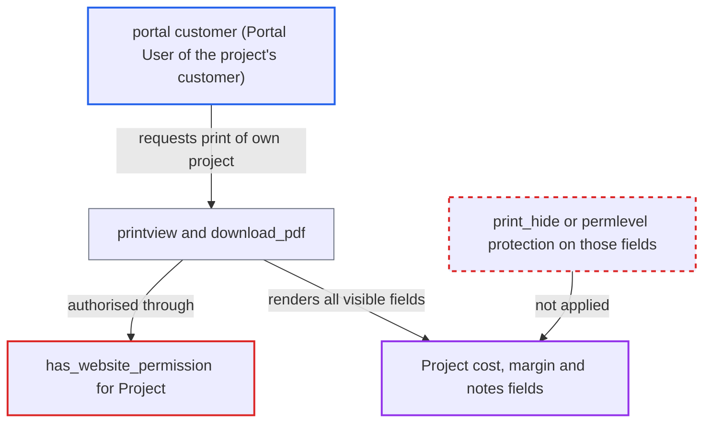

# Portal customers can print Project cost, margin and notes fields via Frappe print view

| Field | Value |
|---|---|
| ID | `find_01HJb4Hm1Vcogg52iJDMrJK9` |
| Severity | **Medium** |
| Status | open |
| CWE | CWE-200 — Information Exposure |
| Created | 2026-10-27T21:28:45.066164Z |
| Claude Security | https://claude.ai/security/findings/find_01HJb4Hm1Vcogg52iJDMrJK9 |

## Description

A portal customer can read a vendor's internal cost, margin and notes data for their own projects by opening the print view or PDF download. The attacker must be a Customer-role Portal User of the project's customer. The Project website permission returns True for printing, and the costing, margin and `notes` fields are not hidden from print.

1. **portal customer** lists their own project names on `/project`. The portal list, built by `get_project_list`, still returns project names, and the attacker needs a name to address the print view. ([`erpnext/projects/doctype/project/project.py:40`](https://github.com/cx-benchmark/erpnext/blob/90e7aefca73da3c440d2e8da7472fcb67838e678/erpnext/projects/doctype/project/project.py#L40))
2. **portal customer** requests `/printview?doctype=Project&name=<name>&format=Standard` or the `download_pdf` endpoint. ERPNext already links portal users to `/printview` for other documents that carry website permission, so this route is reachable for them. ([`erpnext/templates/pages/order.html:30-32`](https://github.com/cx-benchmark/erpnext/blob/90e7aefca73da3c440d2e8da7472fcb67838e678/erpnext/templates/pages/order.html#L30-L32))
3. **Frappe print permission check `validate_print_permission`** accepts the request through the Project website permission. The `has_website_permission["Project"]` hook is registered in `erpnext/hooks.py`, and Frappe accepts it as print authorisation (the report assumes this Frappe behaviour; the Frappe code is not in the checkout). ([`erpnext/hooks.py:387`](https://github.com/cx-benchmark/erpnext/blob/90e7aefca73da3c440d2e8da7472fcb67838e678/erpnext/hooks.py#L387))
4. **the function `has_website_permission`** returns True for the customer's portal user. It returns True for any Customer-role user who is a Portal User of the project's `customer`, for every `ptype`, with no field-level restriction. ([`erpnext/controllers/website_list_for_contact.py:296-311`](https://github.com/cx-benchmark/erpnext/blob/90e7aefca73da3c440d2e8da7472fcb67838e678/erpnext/controllers/website_list_for_contact.py#L296-L311))
5. **Standard print format** renders every permlevel-0 field that has a value and is not `print_hide`. `estimated_costing`, `total_costing_amount`, `total_purchase_cost`, `total_sales_amount`, `total_billable_amount`, `total_billed_amount`, `total_consumed_material_cost`, `cost_center`, `gross_margin`, `per_gross_margin` and `notes` are all permlevel 0 and not `print_hide`, so they appear in the output. ([`erpnext/projects/doctype/project/project.json:300-400`](https://github.com/cx-benchmark/erpnext/blob/90e7aefca73da3c440d2e8da7472fcb67838e678/erpnext/projects/doctype/project/project.json#L300-L400))

## Assessment

The attacker is a Customer-role portal user listed as a Portal User of customer X. They first get their project names from `/project`. They then request `/printview` for the Project with `format=Standard`, or call `frappe.utils.print_format.download_pdf`. No victim action and no non-default setting are needed. The report assumes Frappe 17 (`>=17.0.0-dev,<18` per `pyproject.toml`), where `validate_print_permission` accepts `frappe.has_website_permission`. It also assumes the Standard layout hides only `print_hide` fields and permlevel>0 fields the user cannot read. Neither assumption is in the checkout. `Project` is not submittable, so no draft-print setting blocks the request. `Project.before_print` hides nothing.

Impact: The customer can read the vendor's internal figures for each project linked to them. These are estimated cost, timesheet labour cost, purchase and consumed-material cost, billed and billable totals, cost center, gross margin, margin percentage and internal notes. Access is read-only and limited to that customer's own projects.

## Recommendation

`Project` is portal-visible through `has_website_permission`, but its costing, margin and `notes` fields have no print or permlevel protection. The website permission therefore gives portal customers the full printed document instead of the curated portal view.

Fix criteria: A portal customer with website permission on a Project cannot get its costing, billing, margin, cost center or notes through the print view, the PDF download or any other website-permission consumer. This can be done by print-hiding or raising the permlevel of those fields, or by limiting the Project website permission to the portal page and `read` only. Print a customer's project as that customer's portal user and confirm none of those fields appear. Confirm that desk users still see them.

## Evidence

**https://github.com/cx-benchmark/erpnext**

- [`erpnext/projects/doctype/project/project.json:300-400`](https://github.com/cx-benchmark/erpnext/blob/90e7aefca73da3c440d2e8da7472fcb67838e678/erpnext/projects/doctype/project/project.json#L300-L400)
- [`erpnext/hooks.py:387`](https://github.com/cx-benchmark/erpnext/blob/90e7aefca73da3c440d2e8da7472fcb67838e678/erpnext/hooks.py#L387)
- [`erpnext/controllers/website_list_for_contact.py:296-311`](https://github.com/cx-benchmark/erpnext/blob/90e7aefca73da3c440d2e8da7472fcb67838e678/erpnext/controllers/website_list_for_contact.py#L296-L311)
- [`erpnext/projects/doctype/project/project.py:40`](https://github.com/cx-benchmark/erpnext/blob/90e7aefca73da3c440d2e8da7472fcb67838e678/erpnext/projects/doctype/project/project.py#L40)
- [`erpnext/templates/pages/test_projects.py:116-131`](https://github.com/cx-benchmark/erpnext/blob/90e7aefca73da3c440d2e8da7472fcb67838e678/erpnext/templates/pages/test_projects.py#L116-L131)
- [`erpnext/templates/pages/order.html:30-32`](https://github.com/cx-benchmark/erpnext/blob/90e7aefca73da3c440d2e8da7472fcb67838e678/erpnext/templates/pages/order.html#L30-L32)
- [`erpnext/projects/doctype/timesheet/timesheet.json`](https://github.com/cx-benchmark/erpnext/blob/90e7aefca73da3c440d2e8da7472fcb67838e678/erpnext/projects/doctype/timesheet/timesheet.json)

