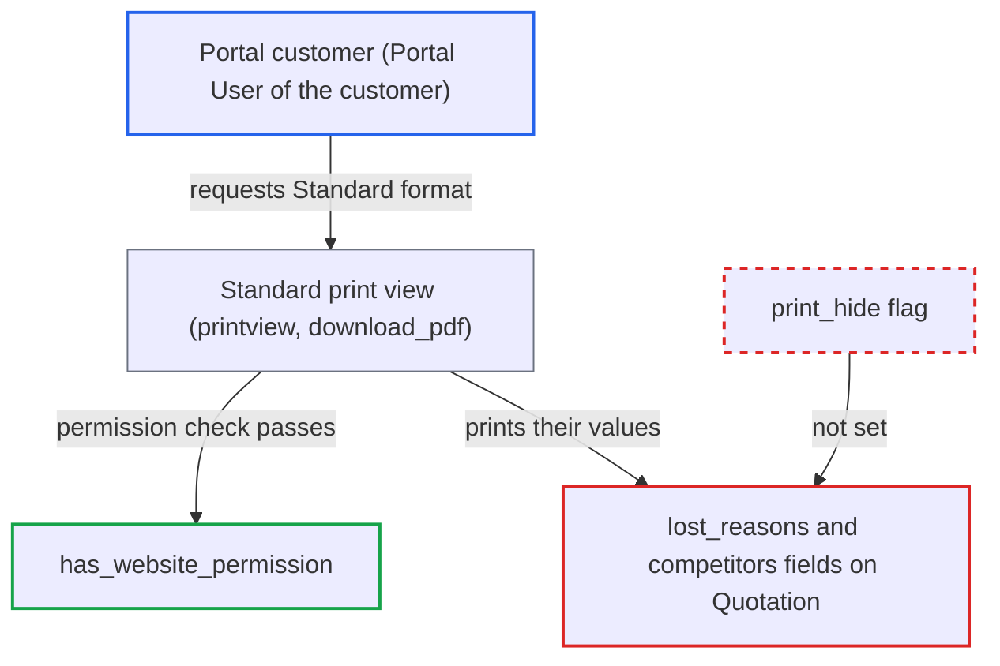

# Portal customers can print Quotation lost reasons and competitors via Standard print view

| Field | Value |
|---|---|
| ID | `find_01EuDbdFPtwnxyM9JfY4aoaN` |
| Severity | **Medium** |
| Status | open |
| CWE | CWE-200 — Information Exposure |
| Created | 2026-10-27T21:52:41.454985Z |
| Claude Security | https://claude.ai/security/findings/find_01EuDbdFPtwnxyM9JfY4aoaN |

## Description

A portal customer can read the vendor's internal lost-deal analysis for their own Quotations: the lost reasons and the competitors recorded. The customer must be a Portal User of the quoted customer, and the Quotation must have been marked Lost. The fields `lost_reasons` and `competitors` in `quotation.json` are not `print_hide`, so the Standard print view shows them.

1. **sales team** marks a submitted Quotation as Lost through `declare_enquiry_lost`. The method adds rows to `lost_reasons` and `competitors` and saves. `docstatus` stays 1, so the Quotation stays listed and printable. ([`erpnext/selling/doctype/quotation/quotation.py:360-398`](https://github.com/cx-benchmark/erpnext/blob/90e7aefca73da3c440d2e8da7472fcb67838e678/erpnext/selling/doctype/quotation/quotation.py#L360-L398))
2. **Quotation doctype definition** leaves `lost_reasons` and `competitors` printable. Both are Table MultiSelect fields at permlevel 0 with no `print_hide`, unlike `order_lost_reason` and `status`, which are hidden. ([`erpnext/selling/doctype/quotation/quotation.json:918-926`](https://github.com/cx-benchmark/erpnext/blob/90e7aefca73da3c440d2e8da7472fcb67838e678/erpnext/selling/doctype/quotation/quotation.json#L918-L926))
3. **portal customer** finds the Lost Quotation in the `/quotations` list. The list filters only on `docstatus = 1`, so lost Quotations still appear.
4. **portal customer** requests `/printview` for that Quotation with `format=Standard`, or uses `download_pdf`. The portal Print link uses the `default_print_format` Property Setter or falls back to `Standard`. The user can also type `format=Standard` into the URL. ([`erpnext/templates/pages/order.py:26-34`](https://github.com/cx-benchmark/erpnext/blob/90e7aefca73da3c440d2e8da7472fcb67838e678/erpnext/templates/pages/order.py#L26-L34))
5. **`has_website_permission`** authorises the request. It returns True for any `ptype` when `quotation_to` is Customer and `party_name` is one of the user's Portal User customers. `hooks.py` maps Quotation to it. ([`erpnext/controllers/website_list_for_contact.py:296-321`](https://github.com/cx-benchmark/erpnext/blob/90e7aefca73da3c440d2e8da7472fcb67838e678/erpnext/controllers/website_list_for_contact.py#L296-L321))
6. **Standard print layout** prints the lost reasons and competitors. The `before_print` hook hides only `discount_amount` and the item and tax templates, so neither field is removed. ([`erpnext/controllers/accounts_controller.py:682-707`](https://github.com/cx-benchmark/erpnext/blob/90e7aefca73da3c440d2e8da7472fcb67838e678/erpnext/controllers/accounts_controller.py#L682-L707))

## Assessment

The attacker is a portal user with the Customer role who is listed as a Portal User of the quoted customer. The Quotation must have `quotation_to` set to Customer, with that customer as `party_name`. The vendor must already have marked it Lost. No victim action is needed. The attacker opens `/quotations`, then requests `/printview?doctype=Quotation&name=<name>&format=Standard`, or uses `download_pdf`. Fresh installs set the default print format `Quotation Classic`, which omits these fields. The attacker can still select `format=Standard` in the URL. The report also lists assumptions about the pinned Frappe version (`>=17.0.0-dev,<18`), which was not in the checkout. `validate_print_permission` accepts `frappe.has_website_permission(doc)`. The Standard layout prints every permlevel-0, non-`print_hide` field that has a value. `format_value` renders a Table MultiSelect as its comma-joined link values.

Impact: The customer reads the vendor's lost-reason labels and the competitor list recorded for their own deals. The portal page itself shows only Submitted or Expired. The exposure is read-only and limited to these two fields on that customer's own Quotations. The free-text `order_lost_reason` stays hidden.

## Recommendation

The internal fields `lost_reasons` and `competitors` on Quotation are neither `print_hide` nor at a higher permlevel. Portal customers have print access to their submitted Quotations through `has_website_permission`, so the Standard layout shows them the vendor's lost-deal analysis.

Fix criteria: A portal customer who prints or downloads their Quotation in any format, Standard included, does not see lost reasons or competitors. To verify, declare a Quotation Lost with a reason and a competitor. Then request `/printview?doctype=Quotation&name=<name>&format=Standard` and `download_pdf` as a Portal User of that customer, and confirm neither value appears. Desk sales users must still see both on the form.

## Evidence

**https://github.com/cx-benchmark/erpnext**

- [`erpnext/selling/doctype/quotation/quotation.json:918-926`](https://github.com/cx-benchmark/erpnext/blob/90e7aefca73da3c440d2e8da7472fcb67838e678/erpnext/selling/doctype/quotation/quotation.json#L918-L926)
- [`erpnext/selling/doctype/quotation/quotation.json:943-949`](https://github.com/cx-benchmark/erpnext/blob/90e7aefca73da3c440d2e8da7472fcb67838e678/erpnext/selling/doctype/quotation/quotation.json#L943-L949)
- [`erpnext/selling/doctype/quotation/quotation.json:869-893`](https://github.com/cx-benchmark/erpnext/blob/90e7aefca73da3c440d2e8da7472fcb67838e678/erpnext/selling/doctype/quotation/quotation.json#L869-L893)
- [`erpnext/selling/doctype/quotation/quotation.json:1025-1031`](https://github.com/cx-benchmark/erpnext/blob/90e7aefca73da3c440d2e8da7472fcb67838e678/erpnext/selling/doctype/quotation/quotation.json#L1025-L1031)
- [`erpnext/selling/doctype/quotation/quotation.py:360-398`](https://github.com/cx-benchmark/erpnext/blob/90e7aefca73da3c440d2e8da7472fcb67838e678/erpnext/selling/doctype/quotation/quotation.py#L360-L398)
- [`erpnext/hooks.py:378`](https://github.com/cx-benchmark/erpnext/blob/90e7aefca73da3c440d2e8da7472fcb67838e678/erpnext/hooks.py#L378)
- [`erpnext/controllers/website_list_for_contact.py:296-321`](https://github.com/cx-benchmark/erpnext/blob/90e7aefca73da3c440d2e8da7472fcb67838e678/erpnext/controllers/website_list_for_contact.py#L296-L321)
- [`erpnext/templates/pages/order.py:26-34`](https://github.com/cx-benchmark/erpnext/blob/90e7aefca73da3c440d2e8da7472fcb67838e678/erpnext/templates/pages/order.py#L26-L34)
- [`erpnext/controllers/accounts_controller.py:682-707`](https://github.com/cx-benchmark/erpnext/blob/90e7aefca73da3c440d2e8da7472fcb67838e678/erpnext/controllers/accounts_controller.py#L682-L707)

