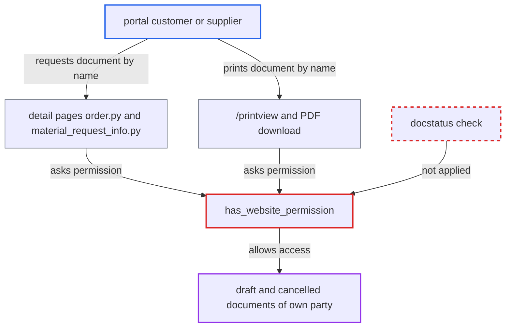

# Portal detail and print pages open draft and cancelled documents the portal list hides

| Field | Value |
|---|---|
| ID | `find_01QpWUbQ1A1Gt1QSaqmGpuVy` |
| Severity | **Medium** |
| Status | open |
| CWE | CWE-863 — Improper Authorization |
| Created | 2026-10-27T21:47:12.037804Z |
| Claude Security | https://claude.ai/security/findings/find_01QpWUbQ1A1Gt1QSaqmGpuVy |

## Description

A portal customer or supplier can open and print draft and cancelled documents of their own party that the portal list hides. These include quotations, orders, invoices, delivery notes, material requests and timesheets, and the pages show items, rates, discounts, taxes, totals and terms. The cause is `has_website_permission`, which checks only party membership and ignores `docstatus` and `ptype`. Access is read-only and limited to the user's own party.

1. **portal user** spots a gap in their sequential document list. The list shows only released documents, and names are sequential, so a missing number points to a hidden draft or cancelled name. ([`erpnext/controllers/website_list_for_contact.py:105`](https://github.com/cx-benchmark/erpnext/blob/90e7aefca73da3c440d2e8da7472fcb67838e678/erpnext/controllers/website_list_for_contact.py#L105))
2. **portal user** requests the document by name, for example `/orders/<name>` or `/material-requests/<name>`. The detail pages load the document named in the URL and add no `docstatus` check. ([`erpnext/templates/pages/order.py:16-37`](https://github.com/cx-benchmark/erpnext/blob/90e7aefca73da3c440d2e8da7472fcb67838e678/erpnext/templates/pages/order.py#L16-L37))
3. **the page code in `order.py` and `material_request_info.py`** calls `has_website_permission` to decide whether to render. `material_request_info.py` works the same way, with no state check of its own. ([`erpnext/templates/pages/material_request_info.py:13-21`](https://github.com/cx-benchmark/erpnext/blob/90e7aefca73da3c440d2e8da7472fcb67838e678/erpnext/templates/pages/material_request_info.py#L13-L21))
4. **`has_website_permission`** returns True when the document's party is one of the user's Portal User parties. Its filters hold only `name` and the party, never `docstatus`, and `ptype` is ignored, so drafts (`docstatus 0`) and cancelled documents (`docstatus 2`) pass. ([`erpnext/controllers/website_list_for_contact.py:296-311`](https://github.com/cx-benchmark/erpnext/blob/90e7aefca73da3c440d2e8da7472fcb67838e678/erpnext/controllers/website_list_for_contact.py#L296-L311))
5. **the portal page** renders the unreleased document. The page shows items, quantities, rates, discounts, taxes, totals and terms. ([`erpnext/templates/pages/order.py:16-37`](https://github.com/cx-benchmark/erpnext/blob/90e7aefca73da3c440d2e8da7472fcb67838e678/erpnext/templates/pages/order.py#L16-L37))
6. **portal user** can alternatively print the document through `/printview` or a PDF download. Frappe's print view authorises on the same hook, which `hooks.py` wires to Timesheet and the other doctypes, so draft Timesheets can be printed too. ([`erpnext/hooks.py:376-387`](https://github.com/cx-benchmark/erpnext/blob/90e7aefca73da3c440d2e8da7472fcb67838e678/erpnext/hooks.py#L376-L387))

## Assessment

The attacker is a portal user with the Customer or Supplier role, listed as a Portal User of a party. No victim action is needed. They take a document name missing from their sequential list and request one of `/quotations/<name>`, `/orders/<name>`, `/invoices/<name>`, `/shipments/<name>` or `/material-requests/<name>`. Or they request `/printview?doctype=<DT>&name=<name>`. The detail-page route needs only the assumption that `frappe.has_website_permission` dispatches to the `hooks.py` entry. The print route also assumes `printview.validate_print_permission` accepts website permission, and that Print Settings allow drafts and block cancelled documents by default. These assumptions concern the pinned Frappe, which is not in the checkout. A draft Quotation labelled "Pending" in `order.html:67` may be a customer's own cart quotation that is meant to open. A vendor-authored draft is not.

Impact: The attacker reads unreleased documents of their own party: drafts the business is still preparing or re-pricing, which may never be released. Cancelled documents are exposed too, but they were visible while submitted, so this adds little. Access is read-only and limited to the attacker's own party.

## Recommendation

`has_website_permission` grants portal access by party membership alone. It lacks the `docstatus` rule that the portal list applies at `:105`, and the generic `order` and `material_request_info` pages add no state check. By-name detail and print access is therefore wider than the list.

Fix criteria: A portal user can open or print by name only documents the portal list would show them. That means submitted documents, plus drafts only where the list shows them (Supplier Quotation, Purchase Invoice, and at most a portal user's own cart quotation). Vendor drafts and cancelled documents are never shown. To verify, request the detail page and `/printview` for a draft and a cancelled Quotation, Sales Order, Sales Invoice, Delivery Note, Material Request and Timesheet of the user's own party. Each must return a permission error. Submitted ones must still open.

## Evidence

**https://github.com/cx-benchmark/erpnext**

- [`erpnext/controllers/website_list_for_contact.py:296-311`](https://github.com/cx-benchmark/erpnext/blob/90e7aefca73da3c440d2e8da7472fcb67838e678/erpnext/controllers/website_list_for_contact.py#L296-L311)
- [`erpnext/controllers/website_list_for_contact.py:105`](https://github.com/cx-benchmark/erpnext/blob/90e7aefca73da3c440d2e8da7472fcb67838e678/erpnext/controllers/website_list_for_contact.py#L105)
- [`erpnext/templates/pages/order.py:16-37`](https://github.com/cx-benchmark/erpnext/blob/90e7aefca73da3c440d2e8da7472fcb67838e678/erpnext/templates/pages/order.py#L16-L37)
- [`erpnext/templates/pages/material_request_info.py:13-21`](https://github.com/cx-benchmark/erpnext/blob/90e7aefca73da3c440d2e8da7472fcb67838e678/erpnext/templates/pages/material_request_info.py#L13-L21)
- [`erpnext/hooks.py:376-387`](https://github.com/cx-benchmark/erpnext/blob/90e7aefca73da3c440d2e8da7472fcb67838e678/erpnext/hooks.py#L376-L387)
- [`erpnext/templates/pages/rfq.py:15-17`](https://github.com/cx-benchmark/erpnext/blob/90e7aefca73da3c440d2e8da7472fcb67838e678/erpnext/templates/pages/rfq.py#L15-L17)
- [`erpnext/projects/doctype/timesheet/timesheet.py:669`](https://github.com/cx-benchmark/erpnext/blob/90e7aefca73da3c440d2e8da7472fcb67838e678/erpnext/projects/doctype/timesheet/timesheet.py#L669)

