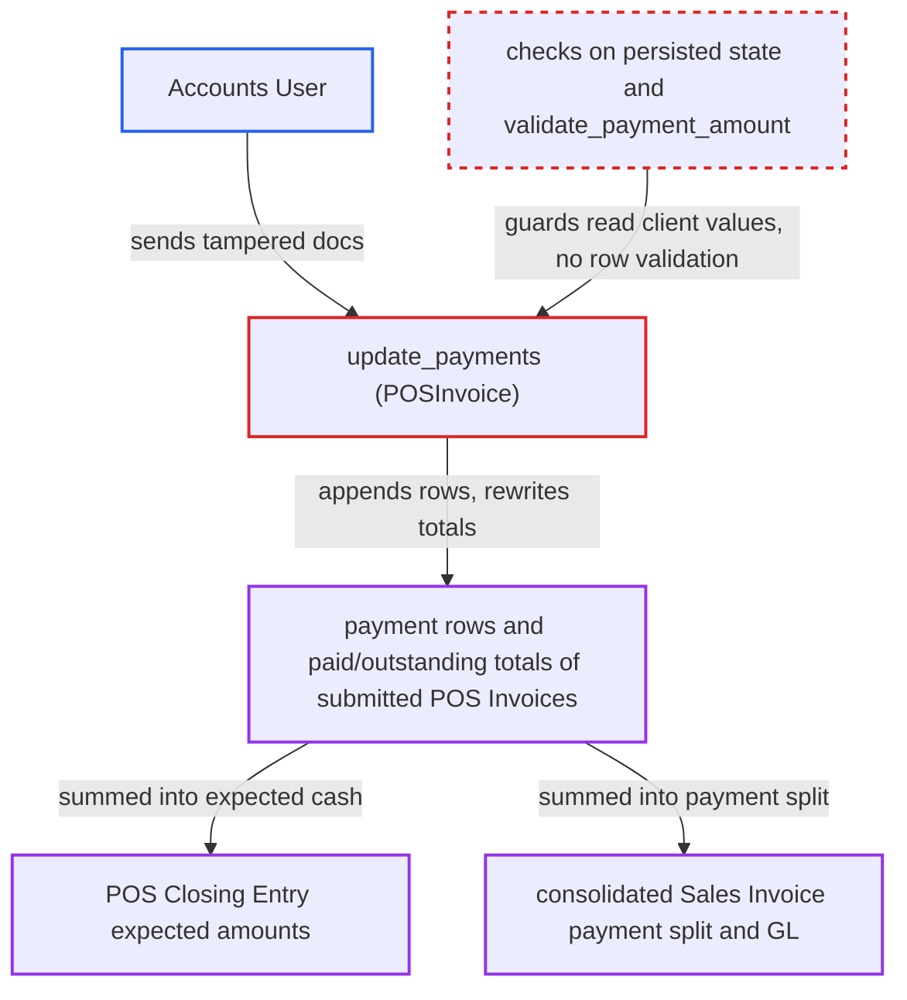

# POS Invoice update_payments trusts client-sent state to rewrite payments of submitted invoices

| Field | Value |
|---|---|
| ID | `find_01BZWytXfnNw6UiSs8uZ3NkQ` |
| Severity | **Medium** |
| Status | open |
| CWE | CWE-807 — Reliance on Untrusted Inputs |
| Created | 2026-10-27T21:23:41.093533Z |
| Claude Security | https://claude.ai/security/findings/find_01BZWytXfnNw6UiSs8uZ3NkQ |

## Description

A logged-in `Accounts User` can rewrite the payment rows and the paid, outstanding and change totals of submitted POS Invoices. This can hide a cash shortfall at closing and change the cash/bank split posted to the ledger. The attacker sends a tampered document to `update_payments`, whose two guards read the client's values before `self.reload()`. The appended rows get no validation.

1. **Accounts User** calls `run_doc_method` with `method=update_payments` and a tampered `docs` JSON. The JSON is a fully paid, unconsolidated invoice with `paid_amount` lowered (for example 99.999 for a total of 100), plus `payments` rows such as Cash -100 and Credit Card 100. ([`erpnext/accounts/doctype/pos_invoice/pos_invoice.js:326-331`](https://github.com/cx-benchmark/erpnext/blob/90e7aefca73da3c440d2e8da7472fcb67838e678/erpnext/accounts/doctype/pos_invoice/pos_invoice.js#L326-L331))
2. **Frappe `run_doc_method`** builds `self` from the client's JSON. The report assumes Frappe only checks that `modified` matches and the docstatus, so the client's `status` and `paid_amount` are kept. ([`erpnext/accounts/doctype/pos_invoice/pos_invoice.js:326-331`](https://github.com/cx-benchmark/erpnext/blob/90e7aefca73da3c440d2e8da7472fcb67838e678/erpnext/accounts/doctype/pos_invoice/pos_invoice.js#L326-L331))
3. **`update_payments`** checks the `Consolidated` status and `paid_amount >= total` before `self.reload()`. Both guards read the client-supplied values, so a fully paid or consolidated invoice passes. ([`erpnext/accounts/doctype/pos_invoice/pos_invoice.py:864-909`](https://github.com/cx-benchmark/erpnext/blob/90e7aefca73da3c440d2e8da7472fcb67838e678/erpnext/accounts/doctype/pos_invoice/pos_invoice.py#L864-L909))
4. **`create_payments_on_invoice`** appends the caller's rows without checks. It copies negative or oversized amounts as given and accepts any Mode of Payment that has an account for the company. ([`erpnext/accounts/doctype/pos_invoice/pos_invoice.py:1147-1158`](https://github.com/cx-benchmark/erpnext/blob/90e7aefca73da3c440d2e8da7472fcb67838e678/erpnext/accounts/doctype/pos_invoice/pos_invoice.py#L1147-L1158))
5. **`update_payments`** saves the rows with `flags.ignore_validate_update_after_submit`. `save()` then skips `validate()`, so `validate_payment_amount` never rejects the negative row. ([`erpnext/accounts/doctype/pos_invoice/pos_invoice.py:562-575`](https://github.com/cx-benchmark/erpnext/blob/90e7aefca73da3c440d2e8da7472fcb67838e678/erpnext/accounts/doctype/pos_invoice/pos_invoice.py#L562-L575))
6. **`update_payments`** writes `paid_amount`, `outstanding_amount` and `change_amount` with a raw `frappe.qb.update`. The new `paid_amount` is the client's value plus the new rows, so the caller chooses all three totals. ([`erpnext/accounts/doctype/pos_invoice/pos_invoice.py:864-909`](https://github.com/cx-benchmark/erpnext/blob/90e7aefca73da3c440d2e8da7472fcb67838e678/erpnext/accounts/doctype/pos_invoice/pos_invoice.py#L864-L909))
7. **POS Closing Entry and consolidation** sum the tampered payment rows. Expected amounts per mode of payment and the consolidated Sales Invoice's payment split are computed from these rows. ([`erpnext/accounts/doctype/pos_closing_entry/pos_closing_entry.py:293-338`](https://github.com/cx-benchmark/erpnext/blob/90e7aefca73da3c440d2e8da7472fcb67838e678/erpnext/accounts/doctype/pos_closing_entry/pos_closing_entry.py#L293-L338))

## Assessment

The attacker is an authenticated `Accounts User`, who has read, write and submit on POS Invoice but no cancel. No victim action is needed. Default POS Profile settings are enough. `allow_partial_payment` defaults to 0, so on a default profile the method should never write. The tampered `docs` makes it writable for every submitted POS Invoice the caller can write, their own or other cashiers'. The shipped UI already sends the whole document with `frm.call`, and a caller can send any values in it. The Frappe behaviour is an assumption, because the framework is not in the checkout.

Impact: The attacker changes payment rows and paid, outstanding and change totals of submitted POS Invoices, which the role cannot otherwise change. This can move expected cash to another mode in the POS Closing Entry and hide a cash shortfall. Before consolidation it also changes the cash/bank/receivable split of the consolidated Sales Invoice in the GL. Reach is limited to POS payment data the user can already write.

## Recommendation

(1) The `Consolidated` and already-paid guards, and the base `paid_amount` for the new totals, are read from the client-built document before `reload()`. The client's `status` and `paid_amount` therefore decide whether a submitted invoice may change and what totals are stored.

Fix criteria: Every precondition and every stored total derives only from the persisted invoice and its stored payment rows, whatever the client sends in `docs`. Sending a tampered `docs` (lowered `paid_amount`, altered `status`) for a fully paid and for a consolidated invoice is refused and nothing is written.

(2) `update_payments` and `create_payments_on_invoice` append caller-supplied rows to a submitted invoice without the payment validations the normal save path enforces: sign, amount against outstanding, and allowed modes.

Fix criteria: A non-positive amount on a non-return invoice, an amount beyond the outstanding balance (outside the change-amount logic), and a mode of payment not configured on the invoice's POS Profile are all rejected. The stored invoice satisfies the same invariants as `validate_payment_amount`. Replaying such requests as an Accounts User against a partly paid invoice changes no row or total.

## Evidence

**https://github.com/cx-benchmark/erpnext**

- [`erpnext/accounts/doctype/pos_invoice/pos_invoice.py:864-909`](https://github.com/cx-benchmark/erpnext/blob/90e7aefca73da3c440d2e8da7472fcb67838e678/erpnext/accounts/doctype/pos_invoice/pos_invoice.py#L864-L909)
- [`erpnext/accounts/doctype/pos_invoice/pos_invoice.js:326-331`](https://github.com/cx-benchmark/erpnext/blob/90e7aefca73da3c440d2e8da7472fcb67838e678/erpnext/accounts/doctype/pos_invoice/pos_invoice.js#L326-L331)
- [`erpnext/accounts/doctype/pos_invoice/pos_invoice.json:1668-1679`](https://github.com/cx-benchmark/erpnext/blob/90e7aefca73da3c440d2e8da7472fcb67838e678/erpnext/accounts/doctype/pos_invoice/pos_invoice.json#L1668-L1679)
- [`erpnext/accounts/doctype/pos_profile/pos_profile.json:460-466`](https://github.com/cx-benchmark/erpnext/blob/90e7aefca73da3c440d2e8da7472fcb67838e678/erpnext/accounts/doctype/pos_profile/pos_profile.json#L460-L466)
- [`erpnext/accounts/doctype/pos_invoice/pos_invoice.py:1147-1158`](https://github.com/cx-benchmark/erpnext/blob/90e7aefca73da3c440d2e8da7472fcb67838e678/erpnext/accounts/doctype/pos_invoice/pos_invoice.py#L1147-L1158)
- [`erpnext/accounts/doctype/pos_invoice/pos_invoice.py:562-575`](https://github.com/cx-benchmark/erpnext/blob/90e7aefca73da3c440d2e8da7472fcb67838e678/erpnext/accounts/doctype/pos_invoice/pos_invoice.py#L562-L575)
- [`erpnext/accounts/doctype/pos_closing_entry/pos_closing_entry.py:293-338`](https://github.com/cx-benchmark/erpnext/blob/90e7aefca73da3c440d2e8da7472fcb67838e678/erpnext/accounts/doctype/pos_closing_entry/pos_closing_entry.py#L293-L338)
- [`erpnext/accounts/doctype/pos_invoice_merge_log/pos_invoice_merge_log.py:277-308`](https://github.com/cx-benchmark/erpnext/blob/90e7aefca73da3c440d2e8da7472fcb67838e678/erpnext/accounts/doctype/pos_invoice_merge_log/pos_invoice_merge_log.py#L277-L308)

