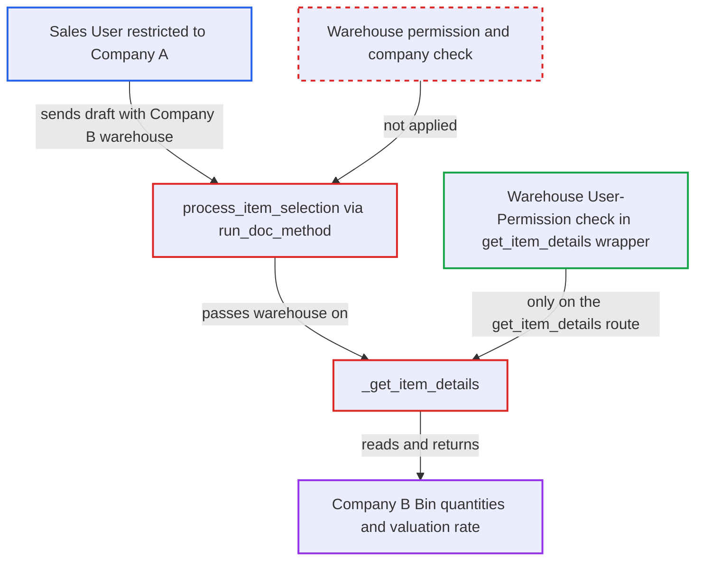

# process_item_selection fetches bin qty and valuation for unpermitted warehouses on client-built drafts

| Field | Value |
|---|---|
| ID | `find_015xVe5XAw1zKRZwHbsCeN1C` |
| Severity | **Medium** |
| Status | open |
| CWE | CWE-862 — Missing Authorization |
| Created | 2026-10-27T21:53:02.040292Z |
| Claude Security | https://claude.ai/security/findings/find_015xVe5XAw1zKRZwHbsCeN1C |

## Description

A logged-in user restricted to one company can read another company's stock quantities and inventory valuation rates, one item at a time. The attacker needs read access to a selling or buying transaction and sends a draft naming the other company's warehouse. The whitelisted method `process_item_selection` reaches `_get_item_details` without the Warehouse User-Permission check or a warehouse-to-company check.

1. **Attacker (Sales User restricted to Company A)** posts a `run_doc_method` request for `process_item_selection`. The request carries a draft Sales Order with `company` set to Company A, `set_warehouse` set to a Company B warehouse such as 'Finished Goods - B', and one item row. ([`erpnext/utilities/transaction_base.py:360-398`](https://github.com/cx-benchmark/erpnext/blob/90e7aefca73da3c440d2e8da7472fcb67838e678/erpnext/utilities/transaction_base.py#L360-L398))
2. **Frappe `run_doc_method`** builds the unsaved document and checks only read permission. The draft's own `company` is Company A, so the read check passes, and the foreign `set_warehouse` is not rejected. ([`erpnext/utilities/transaction_base.py:360-398`](https://github.com/cx-benchmark/erpnext/blob/90e7aefca73da3c440d2e8da7472fcb67838e678/erpnext/utilities/transaction_base.py#L360-L398))
3. **the method `fetch_item_details`** copies the draft's warehouse and company values into the pricing context. It forwards `set_warehouse`, `item.warehouse`, `is_internal_customer`, `is_internal_supplier` and `company` from the client document. ([`erpnext/utilities/transaction_base.py:306-358`](https://github.com/cx-benchmark/erpnext/blob/90e7aefca73da3c440d2e8da7472fcb67838e678/erpnext/utilities/transaction_base.py#L306-L358))
4. **the function `_get_item_details`** uses the caller's `set_warehouse` as given. `get_item_warehouse_` prefers `ctx.set_warehouse` verbatim, and only the fallback defaults go through the permission filter. The Warehouse permission check exists only in the whitelisted `get_item_details` wrapper. ([`erpnext/stock/get_item_details.py:774-801`](https://github.com/cx-benchmark/erpnext/blob/90e7aefca73da3c440d2e8da7472fcb67838e678/erpnext/stock/get_item_details.py#L774-L801))
5. **the function `update_bin_details`** reads Bin `actual_qty`, `projected_qty` and `reserved_qty` for that warehouse. For Sales Order and Quotation, `set_valuation_rate` also reads the Bin `valuation_rate` of the same warehouse. ([`erpnext/stock/get_item_details.py:447-456`](https://github.com/cx-benchmark/erpnext/blob/90e7aefca73da3c440d2e8da7472fcb67838e678/erpnext/stock/get_item_details.py#L447-L456))
6. **the method `process_item_selection`** writes the values into the item row and returns the document. The returned row carries `actual_qty`, `projected_qty`, `valuation_rate` and `gross_profit` for the other company's warehouse. ([`erpnext/utilities/transaction_base.py:360-398`](https://github.com/cx-benchmark/erpnext/blob/90e7aefca73da3c440d2e8da7472fcb67838e678/erpnext/utilities/transaction_base.py#L360-L398))

## Assessment

The attacker is an authenticated user with read access to a selling or buying transaction (Quotation, Sales Order, Delivery Note, Sales Invoice, Purchase Order, Material Request and others). They are restricted by a Company User Permission. No victim action and no special configuration are needed. A second route is `get_mapped_doc` wrappers that accept a client `target_doc` carrying `set_warehouse`. These reach `_get_item_details` through `set_missing_values` and `set_missing_item_details`. Separately, if Accounts Settings `fetch_valuation_rate_for_internal_transaction` is on and the draft sets `is_internal_customer=1`, `handle_internal_parties` also calls the unguarded `_get_incoming_rate` for the row's warehouse and stores the result in `rate`. The report's read-check behaviour is an assumption for frappe >=17.0.0-dev,\<18, which is not in the checkout.

Impact: The attacker reads another company's on-hand, projected and reserved quantities and valuation rate for any item in any warehouse. This is repeatable per item. The draft is never saved, so nothing is changed and the effect is read-only disclosure of stock and cost data.

## Recommendation

`process_item_selection` and the shared `_get_item_details` trust `set_warehouse` and the row `warehouse` from a client-built draft. They read Bin quantities and valuation without the Warehouse User-Permission check and without tying the warehouse to the document's company.

Fix criteria: Every whitelisted route into `_get_item_details` enforces the caller's Warehouse and Company User Permissions on the warehouse actually used (`out.warehouse`, `ctx.set_warehouse`, `ctx.warehouse`, `ctx.from_warehouse`). Warehouses that do not belong to `self.company` are rejected. For example, the `require_user_permission("Warehouse", ...)` check can move into `_get_item_details` for client-originated calls, or into `process_item_selection`. A Company-A-restricted Sales User who calls `run_doc_method process_item_selection` with a Company B `set_warehouse` gets a PermissionError and no `actual_qty` or `valuation_rate`. Normal item selection in the user's own warehouses still works.

## Evidence

**https://github.com/cx-benchmark/erpnext**

- [`erpnext/utilities/transaction_base.py:360-398`](https://github.com/cx-benchmark/erpnext/blob/90e7aefca73da3c440d2e8da7472fcb67838e678/erpnext/utilities/transaction_base.py#L360-L398)
- [`erpnext/utilities/transaction_base.py:306-358`](https://github.com/cx-benchmark/erpnext/blob/90e7aefca73da3c440d2e8da7472fcb67838e678/erpnext/utilities/transaction_base.py#L306-L358)
- [`erpnext/stock/get_item_details.py:86-95`](https://github.com/cx-benchmark/erpnext/blob/90e7aefca73da3c440d2e8da7472fcb67838e678/erpnext/stock/get_item_details.py#L86-L95)
- [`erpnext/stock/get_item_details.py:447-456`](https://github.com/cx-benchmark/erpnext/blob/90e7aefca73da3c440d2e8da7472fcb67838e678/erpnext/stock/get_item_details.py#L447-L456)
- [`erpnext/stock/get_item_details.py:304-324`](https://github.com/cx-benchmark/erpnext/blob/90e7aefca73da3c440d2e8da7472fcb67838e678/erpnext/stock/get_item_details.py#L304-L324)
- [`erpnext/stock/get_item_details.py:774-801`](https://github.com/cx-benchmark/erpnext/blob/90e7aefca73da3c440d2e8da7472fcb67838e678/erpnext/stock/get_item_details.py#L774-L801)
- [`erpnext/utilities/transaction_base.py:412-450`](https://github.com/cx-benchmark/erpnext/blob/90e7aefca73da3c440d2e8da7472fcb67838e678/erpnext/utilities/transaction_base.py#L412-L450)

