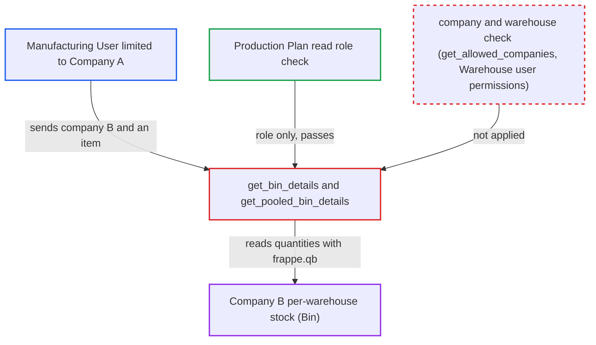

# Production Plan get_bin_details returns any company's per-warehouse stock, ignoring Company user permissions

| Field | Value |
|---|---|
| ID | `find_01HrCfChYx1xAq2R6GM333p8` |
| Severity | **Medium** |
| Status | open |
| CWE | CWE-862 — Missing authorization |
| Created | 2026-10-27T21:25:03.047561Z |
| Claude Security | https://claude.ai/security/findings/find_01HrCfChYx1xAq2R6GM333p8 |

## Description

A logged-in Manufacturing User limited to Company A can read Company B's per-warehouse stock for any item. The data is read-only: warehouse names plus actual, projected, ordered, reserved-for-production and planned quantities, with no prices or valuation. The whitelisted `get_bin_details` and `get_pooled_bin_details` only check the Production Plan read role. They take `company` from the request and query Bin without applying Company or Warehouse user permissions.

1. **attacker (Manufacturing User limited to Company A)** posts a request to the `get_bin_details` endpoint. The request sets `row` with an `item_code` and sets `company` to Company B. It can also set `all_warehouse=1`, or use `get_pooled_bin_details` with a Company B `for_warehouse` or an empty one. ([`erpnext/manufacturing/doctype/production_plan/services/planning_queries.py:30-46`](https://github.com/cx-benchmark/erpnext/blob/90e7aefca73da3c440d2e8da7472fcb67838e678/erpnext/manufacturing/doctype/production_plan/services/planning_queries.py#L30-L46))
2. **the handler `get_bin_details`** checks only the role-level Production Plan read permission. `frappe.has_permission("Production Plan", "read", throw=True)` is called with no document, so every Manufacturing User passes whatever their Company User Permissions say. ([`erpnext/manufacturing/doctype/production_plan/services/planning_queries.py:30-46`](https://github.com/cx-benchmark/erpnext/blob/90e7aefca73da3c440d2e8da7472fcb67838e678/erpnext/manufacturing/doctype/production_plan/services/planning_queries.py#L30-L46))
3. **the helper `_bin_warehouse_subquery`** selects every warehouse of the company named in the request. It filters on `Warehouse.company` equal to the caller's value. A caller-named warehouse is looked up with `frappe.db.get_value` and never checked. ([`erpnext/manufacturing/doctype/production_plan/services/planning_queries.py:54-65`](https://github.com/cx-benchmark/erpnext/blob/90e7aefca73da3c440d2e8da7472fcb67838e678/erpnext/manufacturing/doctype/production_plan/services/planning_queries.py#L54-L65))
4. **the handler `get_bin_details`** queries Bin with `frappe.qb` and returns the rows. The query builder applies no user permissions, so the response lists each Company B warehouse holding the item with its quantities. `get_pooled_bin_details` returns the same figures summed. ([`erpnext/manufacturing/doctype/production_plan/services/planning_queries.py:49-51`](https://github.com/cx-benchmark/erpnext/blob/90e7aefca73da3c440d2e8da7472fcb67838e678/erpnext/manufacturing/doctype/production_plan/services/planning_queries.py#L49-L51))
5. **attacker** repeats the request for each item. This builds up Company B's stock position item by item. No victim action is needed.

## Assessment

The attacker is an authenticated desk user with Production Plan read, which means the Manufacturing User role, and is restricted to Company A by Company User Permissions. They send a POST to `/api/method/erpnext.manufacturing.doctype.production_plan.services.planning_queries.get_bin_details` with `row={"item_code":"<item>"}` and `company` set to Company B. They may add `all_warehouse=1`. The second entry point is `get_pooled_bin_details`, which takes a `for_warehouse` that may be any Company B warehouse or empty. In-process callers in `material_request.py` and `sub_assembly_queries.py` reach the same function.

Impact: The attacker reads another company's stock position for any item they name: warehouse names and actual, projected, ordered, reserved-for-production and planned quantities. Nothing is modified and availability is unaffected. No valuation or prices are returned.

## Recommendation

`get_bin_details` and `get_pooled_bin_details` take `company` and the warehouse from the request. After only a doctype-level Production Plan check, they query Bin with the permission-blind query builder, so Company and Warehouse user permissions never limit whose stock is returned.

Fix criteria: The warehouses queried are limited to the companies in `get_allowed_companies`, as `_authorize_mr_request` does, and any named warehouse is within the caller's Warehouse user permissions. Call both endpoints as a user restricted to Company A with `company=B`, with a Company B `for_warehouse`, and with no warehouse. Each call must raise a permission error or return no Company B rows. Unrestricted users and the form's own calls must keep working.

## Evidence

**https://github.com/cx-benchmark/erpnext**

- [`erpnext/manufacturing/doctype/production_plan/services/planning_queries.py:30-46`](https://github.com/cx-benchmark/erpnext/blob/90e7aefca73da3c440d2e8da7472fcb67838e678/erpnext/manufacturing/doctype/production_plan/services/planning_queries.py#L30-L46)
- [`erpnext/manufacturing/doctype/production_plan/services/planning_queries.py:54-65`](https://github.com/cx-benchmark/erpnext/blob/90e7aefca73da3c440d2e8da7472fcb67838e678/erpnext/manufacturing/doctype/production_plan/services/planning_queries.py#L54-L65)
- [`erpnext/manufacturing/doctype/production_plan/services/planning_queries.py:49-51`](https://github.com/cx-benchmark/erpnext/blob/90e7aefca73da3c440d2e8da7472fcb67838e678/erpnext/manufacturing/doctype/production_plan/services/planning_queries.py#L49-L51)
- [`erpnext/manufacturing/doctype/production_plan/services/material_request.py:218-229`](https://github.com/cx-benchmark/erpnext/blob/90e7aefca73da3c440d2e8da7472fcb67838e678/erpnext/manufacturing/doctype/production_plan/services/material_request.py#L218-L229)
- [`erpnext/manufacturing/doctype/production_plan/production_plan.js:983-998`](https://github.com/cx-benchmark/erpnext/blob/90e7aefca73da3c440d2e8da7472fcb67838e678/erpnext/manufacturing/doctype/production_plan/production_plan.js#L983-L998)
- [`erpnext/stock/doctype/bin/bin.json`](https://github.com/cx-benchmark/erpnext/blob/90e7aefca73da3c440d2e8da7472fcb67838e678/erpnext/stock/doctype/bin/bin.json)

