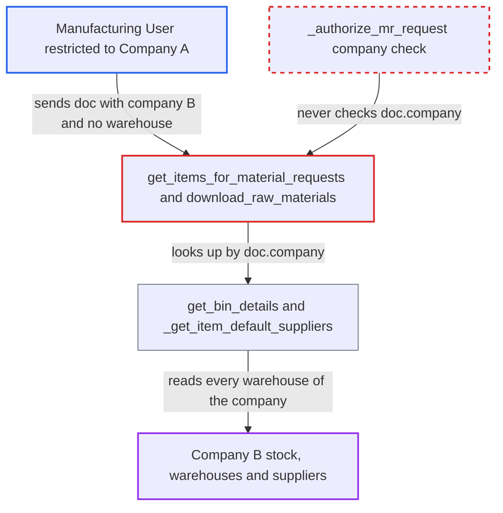

# Production Plan raw-material endpoints never authorize the caller-supplied company, exposing its stock

| Field | Value |
|---|---|
| ID | `find_01LNGrmu13drpN6bBJFhyyum` |
| Severity | **Medium** |
| Status | open |
| CWE | CWE-862 — Missing Authorization |
| Created | 2026-10-27T21:40:20.452495Z |
| Claude Security | https://claude.ai/security/findings/find_01LNGrmu13drpN6bBJFhyyum |

## Description

A Manufacturing User restricted to Company A can read Company B's stock position. This covers per-item and per-warehouse quantities, warehouse names and default suppliers. The attack is a single request to `get_items_for_material_requests` or `download_raw_materials` with `doc.company` set to Company B and no warehouse named. The guard `_authorize_mr_request` only checks warehouses named in the request and never checks `doc.company` or `doc.raw_material_group_warehouse`.

1. **Attacker (Manufacturing User limited to Company A)** posts a crafted `doc` to a whitelisted endpoint. The `doc` JSON sets `company` to Company B, uses a non-existent plan `name`, lists one `po_items` row and names no warehouse. ([`erpnext/manufacturing/doctype/production_plan/services/material_request.py:167-196`](https://github.com/cx-benchmark/erpnext/blob/90e7aefca73da3c440d2e8da7472fcb67838e678/erpnext/manufacturing/doctype/production_plan/services/material_request.py#L167-L196))
2. **the guard `_authorize_mr_request`** lets the request through. It checks Company User Permission only for warehouses named in the request. With none named its loop runs zero times. The doc-level check runs only for an existing plan name, so a non-existent name skips it. ([`erpnext/manufacturing/doctype/production_plan/services/material_request.py:204-229`](https://github.com/cx-benchmark/erpnext/blob/90e7aefca73da3c440d2e8da7472fcb67838e678/erpnext/manufacturing/doctype/production_plan/services/material_request.py#L204-L229))
3. **the builder `_mr_item_for_details`** calls `get_bin_details` with the caller-chosen company. For a plain item row `warehouse` is None, because `_plain_item_details` reads a non-existent `Item.default_warehouse`, so no warehouse narrows the lookup. ([`erpnext/manufacturing/doctype/production_plan/services/material_request.py:473-519`](https://github.com/cx-benchmark/erpnext/blob/90e7aefca73da3c440d2e8da7472fcb67838e678/erpnext/manufacturing/doctype/production_plan/services/material_request.py#L473-L519))
4. **the query `_bin_warehouse_subquery`** selects every warehouse of Company B. It filters only on `Warehouse.company == company`, and the Bin query is plain `frappe.qb`, which applies no user permissions. ([`erpnext/manufacturing/doctype/production_plan/services/planning_queries.py:54-65`](https://github.com/cx-benchmark/erpnext/blob/90e7aefca73da3c440d2e8da7472fcb67838e678/erpnext/manufacturing/doctype/production_plan/services/planning_queries.py#L54-L65))
5. **the row builder `_material_request_item_row`** returns Company B's quantities to the caller. The returned rows carry `actual_qty`, `projected_qty`, `ordered_qty` and `reserved_qty_for_production`, even when the requested quantity is zero. ([`erpnext/manufacturing/doctype/production_plan/services/material_request.py:812-851`](https://github.com/cx-benchmark/erpnext/blob/90e7aefca73da3c440d2e8da7472fcb67838e678/erpnext/manufacturing/doctype/production_plan/services/material_request.py#L812-L851))
6. **the endpoint `download_raw_materials`** adds a line for every Company B warehouse and its default suppliers. When `for_warehouse` is absent, `_append_other_warehouse_bins` emits each warehouse with its quantities. `_get_item_default_suppliers` adds Company B's default supplier for purchase items. ([`erpnext/manufacturing/doctype/production_plan/services/material_request.py:915-1000`](https://github.com/cx-benchmark/erpnext/blob/90e7aefca73da3c440d2e8da7472fcb67838e678/erpnext/manufacturing/doctype/production_plan/services/material_request.py#L915-L1000))

## Assessment

The attacker is a logged-in desk user with the Manufacturing User role. Their Company User Permission restricts them to Company A. They need no user interaction and no special deployment state. They POST to `/api/method/erpnext.manufacturing.doctype.production_plan.production_plan.download_raw_materials` or to `get_items_for_material_requests`. The `doc` has `company` set to Company B, a non-existent `name` and no warehouse. A Company B `raw_material_group_warehouse` also gets past the check. The report assumes that `frappe.has_permission(doctype, ptype)` without a doc checks only roles, and that `frappe.qb` queries apply no user permissions. It says this is not in the checkout.

Impact: The attacker can read another company's stock position: actual, projected, ordered and reserved quantities per item and per warehouse, the names of that company's warehouses, and its default suppliers for purchase items. This can be repeated for any item. It is read-only. Nothing is modified and service is unaffected.

## Recommendation

`_authorize_mr_request` applies the Company User Permission only to warehouses named in the request. The data is selected by the caller-chosen `doc.company`, plus `raw_material_group_warehouse` and the derived default and source warehouses. The check and the selector disagree, so a request naming no warehouse passes unchecked.

Fix criteria: Every company and warehouse that `get_items_for_material_requests` and `download_raw_materials` use to read Bin, Item Default or Item Group data is within the caller's allowed companies. A request whose `doc.company` or `raw_material_group_warehouse` is outside them is refused. Test: a Company-A-restricted Manufacturing User calls either endpoint with `company=B` and no warehouse, or with a Company B `raw_material_group_warehouse`. The call gets a `PermissionError` and returns no Company B quantities, warehouse names or suppliers. Unrestricted users and the form's own calls keep working.

## Evidence

**https://github.com/cx-benchmark/erpnext**

- [`erpnext/manufacturing/doctype/production_plan/services/material_request.py:204-229`](https://github.com/cx-benchmark/erpnext/blob/90e7aefca73da3c440d2e8da7472fcb67838e678/erpnext/manufacturing/doctype/production_plan/services/material_request.py#L204-L229)
- [`erpnext/manufacturing/doctype/production_plan/services/material_request.py:167-196`](https://github.com/cx-benchmark/erpnext/blob/90e7aefca73da3c440d2e8da7472fcb67838e678/erpnext/manufacturing/doctype/production_plan/services/material_request.py#L167-L196)
- [`erpnext/manufacturing/doctype/production_plan/services/material_request.py:473-519`](https://github.com/cx-benchmark/erpnext/blob/90e7aefca73da3c440d2e8da7472fcb67838e678/erpnext/manufacturing/doctype/production_plan/services/material_request.py#L473-L519)
- [`erpnext/manufacturing/doctype/production_plan/services/planning_queries.py:54-65`](https://github.com/cx-benchmark/erpnext/blob/90e7aefca73da3c440d2e8da7472fcb67838e678/erpnext/manufacturing/doctype/production_plan/services/planning_queries.py#L54-L65)
- [`erpnext/manufacturing/doctype/production_plan/services/material_request.py:812-851`](https://github.com/cx-benchmark/erpnext/blob/90e7aefca73da3c440d2e8da7472fcb67838e678/erpnext/manufacturing/doctype/production_plan/services/material_request.py#L812-L851)
- [`erpnext/manufacturing/doctype/production_plan/services/material_request.py:915-1000`](https://github.com/cx-benchmark/erpnext/blob/90e7aefca73da3c440d2e8da7472fcb67838e678/erpnext/manufacturing/doctype/production_plan/services/material_request.py#L915-L1000)
- [`erpnext/manufacturing/doctype/production_plan/services/material_request.py:578-628`](https://github.com/cx-benchmark/erpnext/blob/90e7aefca73da3c440d2e8da7472fcb67838e678/erpnext/manufacturing/doctype/production_plan/services/material_request.py#L578-L628)
- [`erpnext/stock/doctype/company_restriction/company_restriction.py:62-68`](https://github.com/cx-benchmark/erpnext/blob/90e7aefca73da3c440d2e8da7472fcb67838e678/erpnext/stock/doctype/company_restriction/company_restriction.py#L62-L68)
- [`erpnext/manufacturing/doctype/production_plan/production_plan.json`](https://github.com/cx-benchmark/erpnext/blob/90e7aefca73da3c440d2e8da7472fcb67838e678/erpnext/manufacturing/doctype/production_plan/production_plan.json)

