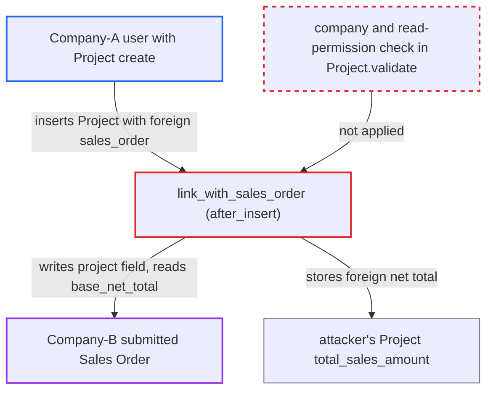

# Project.sales_order links any company's Sales Order, writing its project field and reading its total

| Field | Value |
|---|---|
| ID | `find_01YUZohf2bkug8QbErfgyaFT` |
| Severity | **Medium** |
| Status | open |
| CWE | CWE-862 — Missing Authorization |
| Created | 2026-10-27T22:45:18.889263Z |
| Claude Security | https://claude.ai/security/findings/find_01YUZohf2bkug8QbErfgyaFT |

## Description

A Company-A employee with Project create rights can read the net total of any Company-B Sales Order. They can also overwrite the `project` field on Company B's submitted orders. The attacker only needs to be a desk user fenced by a Company User Permission. The cause is that `Project.validate` never checks that `sales_order` belongs to the Project's company, and `link_with_sales_order` writes to the order with `frappe.db.set_value`.

1. **Company-A user** creates a Project with a Company-B Sales Order name. The user sets `company` to their own company A and `sales_order` to a guessable Company-B order name, through the normal desk or REST insert. ([`erpnext/projects/doctype/project/project.py:114-122`](https://github.com/cx-benchmark/erpnext/blob/90e7aefca73da3c440d2e8da7472fcb67838e678/erpnext/projects/doctype/project/project.py#L114-L122))
2. **`Project.validate`** accepts the foreign `sales_order`. It never compares `Sales Order.company` with `self.company` and never checks read permission on the Sales Order. ([`erpnext/projects/doctype/project/project.py:114-122`](https://github.com/cx-benchmark/erpnext/blob/90e7aefca73da3c440d2e8da7472fcb67838e678/erpnext/projects/doctype/project/project.py#L114-L122))
3. **the hook `link_with_sales_order`** writes the Project's name into the foreign Sales Order's `project` field. When the order has no project yet, `frappe.db.set_value` writes straight to the submitted order of another company, with no permission or company check. ([`erpnext/projects/doctype/project/project.py:281-304`](https://github.com/cx-benchmark/erpnext/blob/90e7aefca73da3c440d2e8da7472fcb67838e678/erpnext/projects/doctype/project/project.py#L281-L304))
4. **`update_sales_amount`** copies the foreign order's `base_net_total` into the attacker's Project. It sums `base_net_total` of submitted Sales Orders whose `project` equals the new Project, and the result is stored in `total_sales_amount`, which the attacker can read. ([`erpnext/projects/doctype/project/project.py:467-476`](https://github.com/cx-benchmark/erpnext/blob/90e7aefca73da3c440d2e8da7472fcb67838e678/erpnext/projects/doctype/project/project.py#L467-L476))
5. **`link_with_sales_order`** shows a message naming the other project when the order is already linked. The `msgprint` reveals the name of the Company-B project that owns the order. ([`erpnext/projects/doctype/project/project.py:281-304`](https://github.com/cx-benchmark/erpnext/blob/90e7aefca73da3c440d2e8da7472fcb67838e678/erpnext/projects/doctype/project/project.py#L281-L304))
6. **attacker** deletes the Project and repeats with the next Sales Order name. `on_trash` clears `project` on every linked Sales Order, so the attacker can step through the sequential names (`SAL-ORD-.YYYY.-`) one order at a time. ([`erpnext/projects/doctype/project/project.py:305-306`](https://github.com/cx-benchmark/erpnext/blob/90e7aefca73da3c440d2e8da7472fcb67838e678/erpnext/projects/doctype/project/project.py#L305-L306))

## Assessment

The attacker is an authenticated Company-A desk user with Project create rights (Projects User or Projects Manager). They are fenced to their company by a Company User Permission. No victim action is needed. They insert a Project through the desk or REST with `company` set to A and `sales_order` set to a Company-B order name. Those names are sequential, so they are easy to guess. A second way in is `create_duplicate_project`, which copies the caller-supplied `prev_doc` including `sales_order`. The report assumes Frappe checks a Link against User Permissions only when the user has permission rows on the target doctype, which a Company-restricted user normally lacks for Sales Order. The only company filter on the picker in `project.js` runs in the browser.

Impact: The attacker learns the net total of any Company-B Sales Order, one figure per order. For orders that are already linked, they also learn the name of the Company-B project. They also set the `project` field on Company B's submitted orders to a project Company B cannot read. That field cannot be corrected without cancel and amend, because `project` is not `allow_on_submit` on Sales Order. Order-by-project reporting becomes wrong. Delivery Notes and Sales Invoices made from the order inherit the foreign project and fail validation until the field is cleared by hand.

## Recommendation

`Project.validate` accepts a `sales_order` from another company and does not check that the user can read it. `link_with_sales_order` then writes to that order with `frappe.db.set_value`, which bypasses permissions.

Fix criteria: Inserting or saving a Project whose `sales_order` belongs to a different company, or that the user cannot read, is refused before any write. The back-link write only touches a Sales Order of the Project's own company. A Company-A user creating a Project with a Company-B Sales Order gets an error. The Sales Order's `project` and the Project's `total_sales_amount` stay unchanged. The already-linked message does not reveal the other project's name.

## Evidence

**https://github.com/cx-benchmark/erpnext**

- [`erpnext/projects/doctype/project/project.py:281-304`](https://github.com/cx-benchmark/erpnext/blob/90e7aefca73da3c440d2e8da7472fcb67838e678/erpnext/projects/doctype/project/project.py#L281-L304)
- [`erpnext/projects/doctype/project/project.py:114-122`](https://github.com/cx-benchmark/erpnext/blob/90e7aefca73da3c440d2e8da7472fcb67838e678/erpnext/projects/doctype/project/project.py#L114-L122)
- [`erpnext/projects/doctype/project/project.py:467-476`](https://github.com/cx-benchmark/erpnext/blob/90e7aefca73da3c440d2e8da7472fcb67838e678/erpnext/projects/doctype/project/project.py#L467-L476)
- [`erpnext/projects/doctype/project/project.py:305-306`](https://github.com/cx-benchmark/erpnext/blob/90e7aefca73da3c440d2e8da7472fcb67838e678/erpnext/projects/doctype/project/project.py#L305-L306)
- [`erpnext/projects/doctype/project/project.js:45-57`](https://github.com/cx-benchmark/erpnext/blob/90e7aefca73da3c440d2e8da7472fcb67838e678/erpnext/projects/doctype/project/project.js#L45-L57)
- [`erpnext/selling/doctype/sales_order/sales_order.json`](https://github.com/cx-benchmark/erpnext/blob/90e7aefca73da3c440d2e8da7472fcb67838e678/erpnext/selling/doctype/sales_order/sales_order.json)

