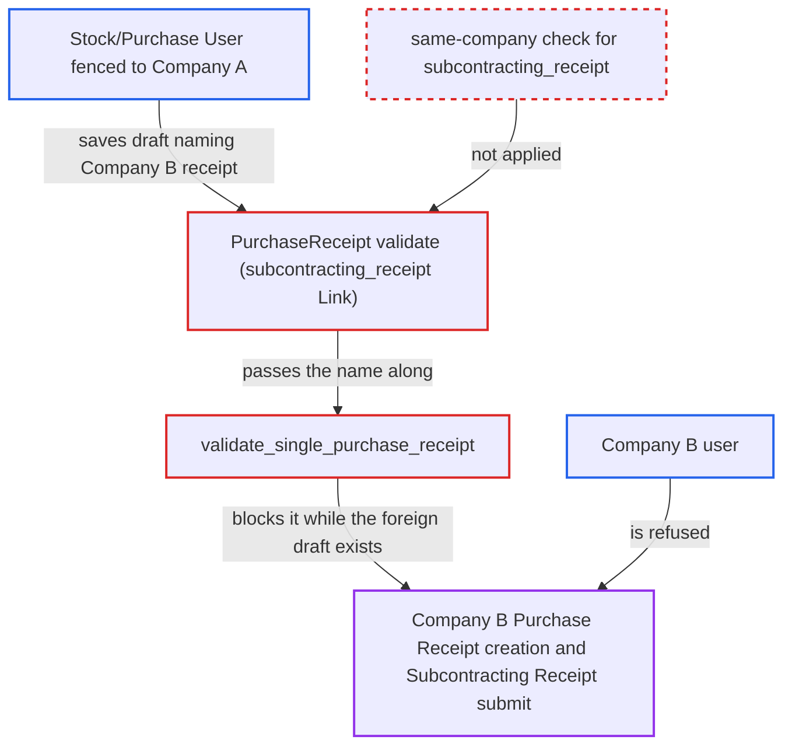

# Purchase Receipt subcontracting_receipt link accepted across companies, blocking another company's receipt flow

| Field | Value |
|---|---|
| ID | `find_01VqRjm8TNbAp12bgNbuXxcB` |
| Severity | **Medium** |
| Status | open |
| CWE | CWE-639 — Missing Authorization |
| Created | 2026-10-27T22:31:06.954743Z |
| Claude Security | https://claude.ai/security/findings/find_01VqRjm8TNbAp12bgNbuXxcB |

## Description

A user fenced to one company can block another company's Purchase Receipt flow, and can learn whether that company has already made a receipt. The attacker needs a Stock User or Purchase User role that can create Purchase Receipts. The Purchase Receipt code never checks that the `subcontracting_receipt` it names belongs to its own company, and the uniqueness check counts receipts of every company.

1. **Attacker (Stock/Purchase User fenced to Company A)** saves a Company-A draft Purchase Receipt that names a Company-B Subcontracting Receipt. The attacker guesses a sequential `MAT-SCR-…` name and sets it in `subcontracting_receipt`. The Link accepts it because the document only has to exist, drafts included, and Company User Permissions do not restrict this Link. ([`erpnext/stock/doctype/purchase_receipt/purchase_receipt.py:286-287`](https://github.com/cx-benchmark/erpnext/blob/90e7aefca73da3c440d2e8da7472fcb67838e678/erpnext/stock/doctype/purchase_receipt/purchase_receipt.py#L286-L287))
2. **the check `validate_single_purchase_receipt`** counts the foreign draft as the one allowed receipt. It treats any non-cancelled Purchase Receipt (draft or submitted, any company) that names the Subcontracting Receipt as the one receipt allowed against it. ([`erpnext/subcontracting/doctype/subcontracting_receipt/mapper.py:283-297`](https://github.com/cx-benchmark/erpnext/blob/90e7aefca73da3c440d2e8da7472fcb67838e678/erpnext/subcontracting/doctype/subcontracting_receipt/mapper.py#L283-L297))
3. **Company B user** tries to create a Purchase Receipt from its own Subcontracting Receipt. `make_purchase_receipt` calls `validate_no_purchase_receipt_made`, which fails with `Purchase Receipt {A's PR} is already made against Subcontracting Receipt {B's SCR}`. ([`erpnext/subcontracting/doctype/subcontracting_receipt/mapper.py:32-47`](https://github.com/cx-benchmark/erpnext/blob/90e7aefca73da3c440d2e8da7472fcb67838e678/erpnext/subcontracting/doctype/subcontracting_receipt/mapper.py#L32-L47))
4. **Company B user** cannot submit its own Subcontracting Receipt when `auto_create_purchase_receipt` is enabled. The submit calls `auto_create_purchase_receipt`, which runs the same check and is refused. Company B cannot see or cancel the Company-A draft. ([`erpnext/subcontracting/doctype/subcontracting_receipt/mapper.py:32-47`](https://github.com/cx-benchmark/erpnext/blob/90e7aefca73da3c440d2e8da7472fcb67838e678/erpnext/subcontracting/doctype/subcontracting_receipt/mapper.py#L32-L47))

## Assessment

The attacker is a desk user with the Stock User or Purchase User role, able to create Purchase Receipts and fenced to Company A by a Company User Permission. They save a Company-A draft with their own supplier, items and warehouses, through REST or the form. They set `subcontracting_receipt` to a guessed Company-B name. No victim action is needed, and default settings are enough. The auto-create route additionally needs `auto_create_purchase_receipt` on in Buying Settings. The report assumes that Frappe's `has_user_permission` only checks Link fields whose target doctype has user-permission records. Frappe is not in the checkout.

Impact: The attacker can stop Company B from creating a Purchase Receipt for a Subcontracting Receipt, or from submitting it when auto-creation is on. Company B cannot remove the draft. The error message also reveals whether Company B already made a Purchase Receipt for that Subcontracting Receipt, and its name. No Company B data is changed.

## Recommendation

`PurchaseReceipt` trusts the `subcontracting_receipt` Link without checking that the Subcontracting Receipt belongs to the same company and supplier, or that the caller may read it. `validate_single_purchase_receipt` also counts receipts of other companies.

Fix criteria: A Purchase Receipt naming a Subcontracting Receipt of another company (or another supplier) is rejected before `validate_single_purchase_receipt` runs. The uniqueness check considers only receipts of the same company. A Company-A-fenced user saving a draft Purchase Receipt against a Company-B Subcontracting Receipt is refused. Company B can still create its Purchase Receipt and submit its Subcontracting Receipt.

## Evidence

**https://github.com/cx-benchmark/erpnext**

- [`erpnext/stock/doctype/purchase_receipt/purchase_receipt.py:286-287`](https://github.com/cx-benchmark/erpnext/blob/90e7aefca73da3c440d2e8da7472fcb67838e678/erpnext/stock/doctype/purchase_receipt/purchase_receipt.py#L286-L287)
- [`erpnext/subcontracting/doctype/subcontracting_receipt/mapper.py:283-297`](https://github.com/cx-benchmark/erpnext/blob/90e7aefca73da3c440d2e8da7472fcb67838e678/erpnext/subcontracting/doctype/subcontracting_receipt/mapper.py#L283-L297)
- [`erpnext/subcontracting/doctype/subcontracting_receipt/mapper.py:32-47`](https://github.com/cx-benchmark/erpnext/blob/90e7aefca73da3c440d2e8da7472fcb67838e678/erpnext/subcontracting/doctype/subcontracting_receipt/mapper.py#L32-L47)

