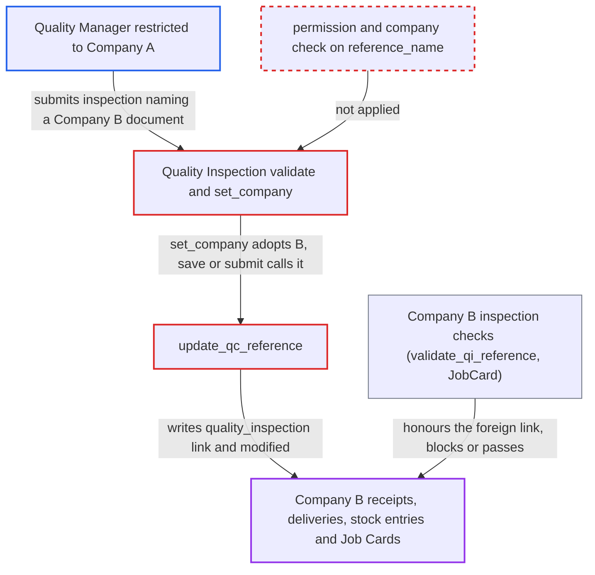

# Quality Inspection links onto other companies' stock documents and Job Cards via unchecked reference_name

| Field | Value |
|---|---|
| ID | `find_01FhApwFK35r2y2ULfvTxSJu` |
| Severity | **Medium** |
| Status | open |
| CWE | CWE-862 — Missing Authorization |
| Created | 2026-10-27T22:03:58.442049Z |
| Claude Security | https://claude.ai/security/findings/find_01FhApwFK35r2y2ULfvTxSJu |

## Description

A Quality Manager limited to Company A can write inspection links onto Company B's receipts, deliveries, stock entries and Job Cards. This can block B from submitting them, or let an attacker-authored `Accepted` inspection satisfy B's inspection-required control. Only link fields and `modified` change. `validate` never checks permission or company on `reference_name`, and `set_company` then silently switches `company` to B.

1. **Quality Manager restricted to Company A** submits a Quality Inspection that points at a Company B document. The request sets `company` to A (or leaves it blank), `reference_type` to a type such as Purchase Receipt or Job Card, `reference_name` to the Company B document, an `item_code` from it, and status `Rejected` or `Accepted`. ([`erpnext/stock/doctype/quality_inspection/quality_inspection.json`](https://github.com/cx-benchmark/erpnext/blob/90e7aefca73da3c440d2e8da7472fcb67838e678/erpnext/stock/doctype/quality_inspection/quality_inspection.json))
2. **Frappe permission check** lets the request through on the value of `company`. User Permissions apply to the Link field `company`, which says A, but not to the Dynamic Link `reference_name`. ([`erpnext/stock/doctype/quality_inspection/quality_inspection.json`](https://github.com/cx-benchmark/erpnext/blob/90e7aefca73da3c440d2e8da7472fcb67838e678/erpnext/stock/doctype/quality_inspection/quality_inspection.json))
3. **the `validate` method** accepts the reference without checking it. It never checks that the user may read or write the referenced document, or that the document belongs to the inspection's company. ([`erpnext/stock/doctype/quality_inspection/quality_inspection.py:76-109`](https://github.com/cx-benchmark/erpnext/blob/90e7aefca73da3c440d2e8da7472fcb67838e678/erpnext/stock/doctype/quality_inspection/quality_inspection.py#L76-L109))
4. **the `set_company` method** replaces `company` with the company of the referenced document. This runs after the permission check, so the inspection becomes a Company B record without any error. ([`erpnext/stock/doctype/quality_inspection/quality_inspection.py:76-109`](https://github.com/cx-benchmark/erpnext/blob/90e7aefca73da3c440d2e8da7472fcb67838e678/erpnext/stock/doctype/quality_inspection/quality_inspection.py#L76-L109))
5. **the hooks `on_update` and `on_submit`** call `update_qc_reference`. `on_update` calls it when `action_if_quality_inspection_is_not_submitted` is `Warn` or unset, and `on_submit` calls it under the shipped default `Stop`. ([`erpnext/stock/doctype/quality_inspection/quality_inspection.py:228-241`](https://github.com/cx-benchmark/erpnext/blob/90e7aefca73da3c440d2e8da7472fcb67838e678/erpnext/stock/doctype/quality_inspection/quality_inspection.py#L228-L241))
6. **the function `update_qc_reference`** writes the inspection link into Company B's documents with raw `frappe.qb.update` queries. It fills empty `quality_inspection` values on item rows and rewrites the parent's `modified`. For a Job Card it overwrites `Job Card.quality_inspection` at any docstatus, replacing B's own inspection. ([`erpnext/stock/doctype/quality_inspection/quality_inspection.py:287-338`](https://github.com/cx-benchmark/erpnext/blob/90e7aefca73da3c440d2e8da7472fcb67838e678/erpnext/stock/doctype/quality_inspection/quality_inspection.py#L287-L338))
7. **Company B's own controls** honour the attacker's inspection. `validate_qi_reference` accepts it because type, name and item match. A `Rejected` inspection then blocks submission, and an `Accepted` one satisfies the inspection-required check. ([`erpnext/stock/services/quality_inspection_service.py:84-193`](https://github.com/cx-benchmark/erpnext/blob/90e7aefca73da3c440d2e8da7472fcb67838e678/erpnext/stock/services/quality_inspection_service.py#L84-L193))

## Assessment

The attacker needs a login with the `Quality Manager` role, the only role that may create or submit Quality Inspections. The login may be restricted by User Permission to Company A. No victim action is needed. The attacker submits through `savedocs` or `frappe.client.insert`. Document names are sequential, and a link-validation error shows which names exist. The Job Card overwrite works at any docstatus. The Stock Settings defaults are `Stop` for `action_if_quality_inspection_is_not_submitted` and for `action_if_quality_inspection_is_rejected`. `allow_to_make_quality_inspection_after_purchase_or_delivery` is 0. The report assumes Frappe applies User Permissions only to Link fields. That assumption is for the version pinned in `pyproject.toml`, which is not in the checkout.

Impact: The attacker writes `quality_inspection` and `modified` on another company's documents, and can overwrite a submitted Job Card's inspection link. A `Rejected` link blocks Company B from submitting its receipt, delivery, stock entry or Job Card until someone clears or cancels the foreign inspection. An `Accepted` link satisfies B's inspection-required control. The insert response also shows the referenced document's company and whether it has a row for the item. The attacker can only write link fields and cannot change amounts or the ledger.

## Recommendation

(1) Quality Inspection trusts the Dynamic Link `reference_name`. It checks neither the user's permission on the referenced document nor that document's company, and `set_company` silently adopts that company after Frappe's permission checks have run.

Fix criteria: Saving or submitting an inspection fails unless the user has permission on the referenced document and its company equals the inspection's company as permission-checked. `set_company` no longer switches the company silently. A Company A Quality Manager who references a Company B Purchase Receipt, Stock Entry or Job Card gets a permission or company error. B's item rows, `Job Card.quality_inspection` and `modified` stay unchanged.

(2) The Job Card branch of `update_qc_reference` overwrites `Job Card.quality_inspection` whatever the Job Card's docstatus is and whatever inspection is already linked.

Fix criteria: Linking only fills an empty value, or replaces this same inspection, on a non-cancelled Job Card. Clearing only removes this inspection's own link. Submitting a second inspection against a Job Card that already has a linked inspection leaves the existing link intact.

## Evidence

**https://github.com/cx-benchmark/erpnext**

- [`erpnext/stock/doctype/quality_inspection/quality_inspection.py:76-109`](https://github.com/cx-benchmark/erpnext/blob/90e7aefca73da3c440d2e8da7472fcb67838e678/erpnext/stock/doctype/quality_inspection/quality_inspection.py#L76-L109)
- [`erpnext/stock/doctype/quality_inspection/quality_inspection.py:287-338`](https://github.com/cx-benchmark/erpnext/blob/90e7aefca73da3c440d2e8da7472fcb67838e678/erpnext/stock/doctype/quality_inspection/quality_inspection.py#L287-L338)
- [`erpnext/stock/doctype/quality_inspection/quality_inspection.py:228-241`](https://github.com/cx-benchmark/erpnext/blob/90e7aefca73da3c440d2e8da7472fcb67838e678/erpnext/stock/doctype/quality_inspection/quality_inspection.py#L228-L241)
- [`erpnext/stock/services/quality_inspection_service.py:84-193`](https://github.com/cx-benchmark/erpnext/blob/90e7aefca73da3c440d2e8da7472fcb67838e678/erpnext/stock/services/quality_inspection_service.py#L84-L193)
- [`erpnext/manufacturing/doctype/job_card/job_card.py:1044-1066`](https://github.com/cx-benchmark/erpnext/blob/90e7aefca73da3c440d2e8da7472fcb67838e678/erpnext/manufacturing/doctype/job_card/job_card.py#L1044-L1066)
- [`erpnext/stock/doctype/stock_settings/stock_settings.json`](https://github.com/cx-benchmark/erpnext/blob/90e7aefca73da3c440d2e8da7472fcb67838e678/erpnext/stock/doctype/stock_settings/stock_settings.json)
- [`erpnext/stock/doctype/quality_inspection/quality_inspection.json`](https://github.com/cx-benchmark/erpnext/blob/90e7aefca73da3c440d2e8da7472fcb67838e678/erpnext/stock/doctype/quality_inspection/quality_inspection.json)

