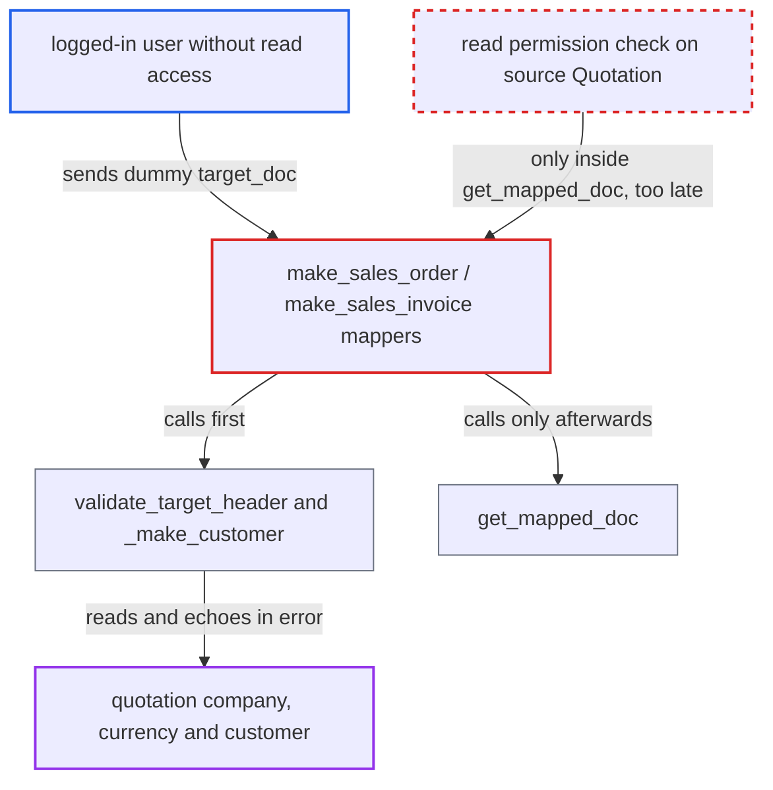

# Quotation mappers echo company, currency and customer of unreadable quotations in errors

| Field | Value |
|---|---|
| ID | `find_014NDXQkSpYu14zCdup44AyY` |
| Severity | **Medium** |
| Status | open |
| CWE | CWE-209 — Information exposure through error message |
| Created | 2026-10-27T21:10:06.721474Z |
| Claude Security | https://claude.ai/security/findings/find_014NDXQkSpYu14zCdup44AyY |

## Description

Any logged-in user can learn the company, currency and customer of quotations they are not allowed to read. This includes draft quotations, and only quotations that have not expired are exposed. The mappers `make_sales_order` and `make_sales_invoice` read the quotation and put its real values into an error message before the read-permission check runs.

1. **logged-in user** posts a crafted request to `make_sales_order` or `make_sales_invoice`. The request gives a `source_name` such as `SAL-QTN-....` and a `target_doc` with a non-empty `items` list and a dummy `customer`. Quotation names follow a sequential naming series, so they can be enumerated.
2. **the mapper `_make_sales_order`** calls `_make_customer` and `validate_target_header` before `get_mapped_doc`. `get_mapped_doc` is the only place the read permission on the Quotation is enforced, so it runs too late. The same order is used in `_make_sales_invoice`. ([`erpnext/selling/doctype/quotation/mapper.py:60-66`](https://github.com/cx-benchmark/erpnext/blob/90e7aefca73da3c440d2e8da7472fcb67838e678/erpnext/selling/doctype/quotation/mapper.py#L60-L66))
3. **`_make_customer`** loads the quotation's party and the Customer without checking permissions. It uses `frappe.db.get_value` and `frappe.get_doc`, so `customer.name` is the real customer of a quotation the caller may not read. ([`erpnext/selling/doctype/quotation/mapper.py:266-290`](https://github.com/cx-benchmark/erpnext/blob/90e7aefca73da3c440d2e8da7472fcb67838e678/erpnext/selling/doctype/quotation/mapper.py#L266-L290))
4. **`validate_target_header`** compares the quotation's `company`, `currency` and the customer name with the caller's `target_doc` values. It skips any field the caller leaves empty, so a dummy value in one field is enough to trigger a mismatch. ([`erpnext/selling/doctype/quotation/mapper.py:15-38`](https://github.com/cx-benchmark/erpnext/blob/90e7aefca73da3c440d2e8da7472fcb67838e678/erpnext/selling/doctype/quotation/mapper.py#L15-L38))
5. **`validate_target_header`** throws an error that contains the real value from the quotation. The `frappe.throw` message embeds the source value, so the caller reads the customer, company or currency in the error response. ([`erpnext/selling/doctype/quotation/mapper.py:15-38`](https://github.com/cx-benchmark/erpnext/blob/90e7aefca73da3c440d2e8da7472fcb67838e678/erpnext/selling/doctype/quotation/mapper.py#L15-L38))
6. **`make_sales_invoice` and `make_revision`** also reveal quotation status before any permission check. The `Lost` check in `make_sales_invoice` and `validate_can_be_revised` in `make_revision` show whether the quotation is `Lost` or `Ordered`. ([`erpnext/selling/doctype/quotation/mapper.py:180-184`](https://github.com/cx-benchmark/erpnext/blob/90e7aefca73da3c440d2e8da7472fcb67838e678/erpnext/selling/doctype/quotation/mapper.py#L180-L184))

## Assessment

The attacker is any logged-in user who cannot read the target quotation, for example an employee limited to another Company by User Permissions. The attacker does not need the Sales Order or Sales Invoice create right. No victim action is needed. The attacker sends a POST to `/api/method/erpnext.selling.doctype.quotation.mapper.make_sales_order` or `make_sales_invoice` with a `source_name` and a `target_doc` like `{"doctype":"Sales Order","items":[{}],"customer":"x"}`. A dummy `company` or `currency` returns those fields the same way. Draft quotations leak too, because the docstatus validation also lives in `get_mapped_doc`. With the default setting, `validate_quotation_expiry` throws a generic message for quotations whose `valid_till` has passed. Open and undated quotations are therefore exposed.

Impact: The attacker learns the issuing company, the currency and the customer of quotations they may not read. This crosses the company and user-permission isolation. Items, rates and totals are not exposed, so the loss is limited. Side effects such as a customer auto-created from a Lead are rolled back when the request throws, and nothing persists.

## Recommendation

The whitelisted mappers read the source Quotation and its customer, and echo their values in error messages, before the caller's read permission on that Quotation is verified. The only check is inside `get_mapped_doc`, which runs later.

Fix criteria: The mappers verify read permission on the source Quotation, including user permissions, before any of its values is read, compared or echoed. `validate_target_header`, `_make_customer`, `validate_quotation_expiry`, the `Lost` check and `validate_can_be_revised` run only after that check. A user without access to a quotation receives only a generic `PermissionError`, whatever `target_doc` is supplied. The message contains no company, currency, customer or status.

## Evidence

**https://github.com/cx-benchmark/erpnext**

- [`erpnext/selling/doctype/quotation/mapper.py:15-38`](https://github.com/cx-benchmark/erpnext/blob/90e7aefca73da3c440d2e8da7472fcb67838e678/erpnext/selling/doctype/quotation/mapper.py#L15-L38)
- [`erpnext/selling/doctype/quotation/mapper.py:60-66`](https://github.com/cx-benchmark/erpnext/blob/90e7aefca73da3c440d2e8da7472fcb67838e678/erpnext/selling/doctype/quotation/mapper.py#L60-L66)
- [`erpnext/selling/doctype/quotation/mapper.py:266-290`](https://github.com/cx-benchmark/erpnext/blob/90e7aefca73da3c440d2e8da7472fcb67838e678/erpnext/selling/doctype/quotation/mapper.py#L266-L290)
- [`erpnext/selling/doctype/quotation/mapper.py:180-184`](https://github.com/cx-benchmark/erpnext/blob/90e7aefca73da3c440d2e8da7472fcb67838e678/erpnext/selling/doctype/quotation/mapper.py#L180-L184)

