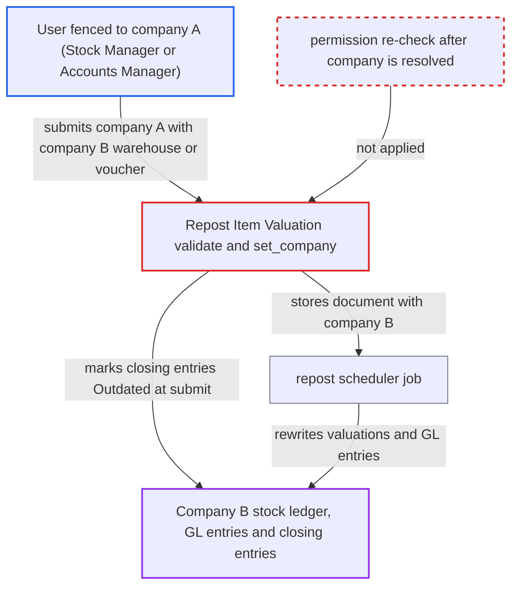

# Repost Item Valuation company overwritten in validate after permission check enables cross-company repost

| Field | Value |
|---|---|
| ID | `find_01XbyQX76V8cMZQzPRHkF5tD` |
| Severity | **Medium** |
| Status | open |
| CWE | CWE-863 — Incorrect Authorization |
| Created | 2026-10-27T21:31:09.469489Z |
| Claude Security | https://claude.ai/security/findings/find_01XbyQX76V8cMZQzPRHkF5tD |

## Description

A user restricted to company A, with a role that can create and submit `Repost Item Valuation` (Stock Manager or Accounts Manager), can make stock valuations and accounting entries in company B be recalculated. The permission check runs on the `company` the caller sends. `validate()` then calls `set_company()`, which replaces `company` with the one from the referenced `voucher_no` or `warehouse`, and nothing re-checks permission afterwards.

1. **Attacker restricted to company A** submits a `Repost Item Valuation` document with `company` set to A but pointing at a company-B `warehouse` or `voucher_no`. The payload can use `based_on` set to "Item and Warehouse" with a company-B `warehouse` and `item_code`, or "Transaction" with a company-B voucher. It carries an old `posting_date` and optional `allow_zero_rate`, `recreate_stock_ledgers` or `recalculate_valuation_rate`.
2. **Frappe `Document.insert()`** runs the submit and create permission checks before `validate()`. The checks, including the User Permission on the `company` link field, see only company A, which the attacker is allowed to use. No permission check is repeated after `validate()`. ([`erpnext/stock/doctype/repost_item_valuation/repost_item_valuation.py:102-117`](https://github.com/cx-benchmark/erpnext/blob/90e7aefca73da3c440d2e8da7472fcb67838e678/erpnext/stock/doctype/repost_item_valuation/repost_item_valuation.py#L102-L117))
3. **the method `set_company()`** checks write permission and then overwrites `self.company` with company B. `check_permission("write")` runs while `company` still holds the caller's value. The overwrite uses the company of the referenced voucher or warehouse, so the stored document carries company B. ([`erpnext/stock/doctype/repost_item_valuation/repost_item_valuation.py:348-355`](https://github.com/cx-benchmark/erpnext/blob/90e7aefca73da3c440d2e8da7472fcb67838e678/erpnext/stock/doctype/repost_item_valuation/repost_item_valuation.py#L348-L355))
4. **the method `reset_field_values`** forces `allow_negative_stock` to 1 for the repost. The recalculation therefore goes through negative-stock states. `allow_zero_rate`, `recreate_stock_ledgers`, `recalculate_valuation_rate` and `posting_date` stay as the caller chose. ([`erpnext/stock/doctype/repost_item_valuation/repost_item_valuation.py:334-339`](https://github.com/cx-benchmark/erpnext/blob/90e7aefca73da3c440d2e8da7472fcb67838e678/erpnext/stock/doctype/repost_item_valuation/repost_item_valuation.py#L334-L339))
5. **the method `on_submit`** calls `mark_closing_entries_outdated(self.company, self.posting_date)` with company B. Company B's completed Stock Closing Entries become `Outdated` at submit time, before any background job runs. ([`erpnext/stock/doctype/repost_item_valuation/repost_item_valuation.py:373-391`](https://github.com/cx-benchmark/erpnext/blob/90e7aefca73da3c440d2e8da7472fcb67838e678/erpnext/stock/doctype/repost_item_valuation/repost_item_valuation.py#L373-L391))
6. **the scheduled `repost()` job** runs the repost against company B. It rewrites `valuation_rate` on the voucher's items and cancels and re-posts its stock ledger entries. It re-derives later stock ledger valuations and deletes and regenerates the GL entries of every affected voucher in `doc.company`. ([`erpnext/stock/doctype/repost_item_valuation/repost_item_valuation.py:667-700`](https://github.com/cx-benchmark/erpnext/blob/90e7aefca73da3c440d2e8da7472fcb67838e678/erpnext/stock/doctype/repost_item_valuation/repost_item_valuation.py#L667-L700))

## Assessment

The attacker is an authenticated user with a role that has create and submit on `Repost Item Valuation` (Stock Manager or Accounts Manager). A Company User Permission limits them to company A. They send the document through `/api/resource/Repost Item Valuation` or `frappe.client.submit`. Another way in is the report endpoints `stock_and_account_value_comparison.create_reposting_entries` and `stock_ledger_invariant_check.create_reposting_entries`, which build these documents from user-supplied `company` and voucher rows and rely on the same document-level check. The `warehouse` and dynamic `voucher_no` links are only permission-checked for doctypes the user has User Permissions on, so a fence on `Company` alone does not stop them. No victim interaction is needed. The hourly `repost_entries` scheduler job then runs the repost.

Impact: The attacker can change financial-integrity data of a company they are not allowed to touch. Company B's Stock Closing Entries are set to `Outdated`, stock valuations are recomputed from a chosen date, and GL entries of affected vouchers are regenerated. The attacker triggers this but does not fully control the resulting values. The pending repost can also block company B's stock closing and freeze operations, a limited availability effect. The report also notes a minor exposure of company B's error logs through the repost document.

## Recommendation

`validate()` takes the real `company` from the referenced voucher or warehouse only after Frappe's create and submit permission checks ran on the caller-supplied `company`. The User Permission fence is therefore applied to the wrong value.

Fix criteria: The company a repost runs against is authorised. Either `set_company` (and `validate`) re-runs `self.check_permission("create")` and `self.check_permission("submit")` after resolving the real company, or the document refuses with `frappe.throw` when the resolved company differs from the submitted one. The caller's read access to the referenced `warehouse` or `voucher_no` is also verified, for example with `erpnext.require_permission`. To confirm, submit a repost as a Stock Manager restricted to company A against a company-B warehouse or voucher. It must raise a PermissionError, leave company B's closing entries un-flipped to `Outdated`, and queue no repost.

## Evidence

**https://github.com/cx-benchmark/erpnext**

- [`erpnext/stock/doctype/repost_item_valuation/repost_item_valuation.py:348-355`](https://github.com/cx-benchmark/erpnext/blob/90e7aefca73da3c440d2e8da7472fcb67838e678/erpnext/stock/doctype/repost_item_valuation/repost_item_valuation.py#L348-L355)
- [`erpnext/stock/doctype/repost_item_valuation/repost_item_valuation.py:102-117`](https://github.com/cx-benchmark/erpnext/blob/90e7aefca73da3c440d2e8da7472fcb67838e678/erpnext/stock/doctype/repost_item_valuation/repost_item_valuation.py#L102-L117)
- [`erpnext/stock/doctype/repost_item_valuation/repost_item_valuation.py:334-339`](https://github.com/cx-benchmark/erpnext/blob/90e7aefca73da3c440d2e8da7472fcb67838e678/erpnext/stock/doctype/repost_item_valuation/repost_item_valuation.py#L334-L339)
- [`erpnext/stock/doctype/repost_item_valuation/repost_item_valuation.py:373-391`](https://github.com/cx-benchmark/erpnext/blob/90e7aefca73da3c440d2e8da7472fcb67838e678/erpnext/stock/doctype/repost_item_valuation/repost_item_valuation.py#L373-L391)
- [`erpnext/stock/doctype/repost_item_valuation/repost_item_valuation.py:667-700`](https://github.com/cx-benchmark/erpnext/blob/90e7aefca73da3c440d2e8da7472fcb67838e678/erpnext/stock/doctype/repost_item_valuation/repost_item_valuation.py#L667-L700)

