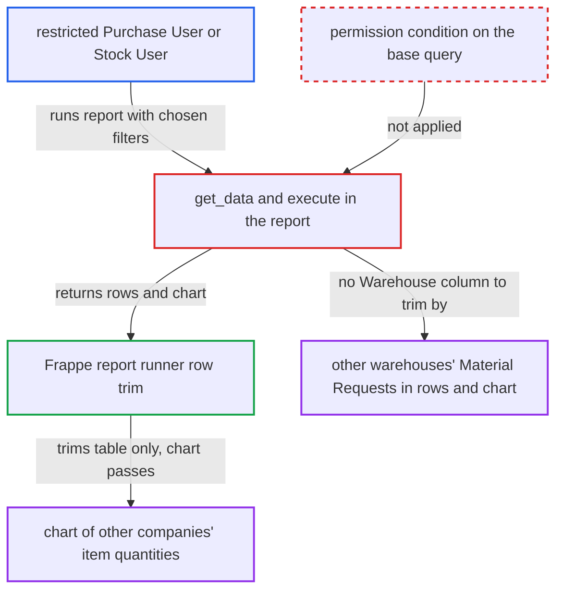

# Requested Items to Order and Receive builds its chart from unpermitted Material Requests

| Field | Value |
|---|---|
| ID | `find_01CL1t9CUyu6uAyegmS9igqE` |
| Severity | **Medium** |
| Status | open |
| CWE | CWE-862 — Missing authorization |
| Created | 2026-10-27T21:26:29.322903Z |
| Claude Security | https://claude.ai/security/findings/find_01CL1t9CUyu6uAyegmS9igqE |

## Description

A logged-in Purchase User or Stock User can see other companies' open purchase demand, meaning item codes with quantities to order, ordered, received and to receive, even when User Permissions limit them to one company. The report's chart is built from unfiltered rows and Frappe's runner does not trim it. The cause is `get_data`, which adds no permission condition. Warehouse-restricted users also get other warehouses' Material Requests in both the table and the chart.

1. **attacker (restricted Purchase User or Stock User)** calls the report runner with chosen filters. The call goes to `/api/method/frappe.desk.query_report.run` with `report_name` `Requested Items to Order and Receive` and filters such as `company` set to another company, plus optionally a `material_request` or `item_code`. ([`erpnext/buying/report/requested_items_to_order_and_receive/requested_items_to_order_and_receive.json`](https://github.com/cx-benchmark/erpnext/blob/90e7aefca73da3c440d2e8da7472fcb67838e678/erpnext/buying/report/requested_items_to_order_and_receive/requested_items_to_order_and_receive.json))
2. **the function `get_data`** reads open purchase Material Request lines of every company. The `frappe.qb` query has no permission or match condition, and `get_conditions` adds only the caller's own filters, so the attacker can isolate one company, one Material Request or one period. ([`erpnext/buying/report/requested_items_to_order_and_receive/requested_items_to_order_and_receive.py:37-76`](https://github.com/cx-benchmark/erpnext/blob/90e7aefca73da3c440d2e8da7472fcb67838e678/erpnext/buying/report/requested_items_to_order_and_receive/requested_items_to_order_and_receive.py#L37-L76))
3. **the function `execute`** builds the chart from the unscoped rows. `prepare_data` and `prepare_chart_data` sum `qty_to_order`, `ordered_qty`, `received_qty` and `qty_to_receive` per `item_code`, with item codes as chart labels (up to 30), and the chart is returned as the fourth value. ([`erpnext/buying/report/requested_items_to_order_and_receive/requested_items_to_order_and_receive.py:124-198`](https://github.com/cx-benchmark/erpnext/blob/90e7aefca73da3c440d2e8da7472fcb67838e678/erpnext/buying/report/requested_items_to_order_and_receive/requested_items_to_order_and_receive.py#L124-L198))
4. **Frappe report runner** drops table rows outside the user's permissions but returns the chart unchanged. The trim works only on the Link columns `material_request` and `company`, and the chart is built before it, so the table comes back empty while the chart still shows the other company's quantities. ([`erpnext/buying/report/requested_items_to_order_and_receive/requested_items_to_order_and_receive.py:201-296`](https://github.com/cx-benchmark/erpnext/blob/90e7aefca73da3c440d2e8da7472fcb67838e678/erpnext/buying/report/requested_items_to_order_and_receive/requested_items_to_order_and_receive.py#L201-L296))
5. **attacker** reads the item-level quantities from the chart. For warehouse-restricted users the report has no Warehouse column, so the trim cannot apply and other warehouses' Material Requests appear in rows and chart. ([`erpnext/stock/doctype/material_request/material_request.json:287-291`](https://github.com/cx-benchmark/erpnext/blob/90e7aefca73da3c440d2e8da7472fcb67838e678/erpnext/stock/doctype/material_request/material_request.json#L287-L291))

## Assessment

The attacker is an authenticated Purchase User or Stock User whose User Permissions limit them to Company A. They need no victim action. They set the `company` filter to Company B, and can add a Company B `material_request` name (series-named, so guessable), an `item_code` or a narrow date range to isolate one company, one request or one period. A second route exists for users restricted by Warehouse: Material Request's `set_warehouse` limits their Material Request list, but the report has no Warehouse column, so they get other warehouses' Material Requests in the rows and the chart. The report assumes the Frappe runner behaves as described, but the Frappe code is not in the checkout.

Impact: The attacker can read other companies' open procurement demand per item: quantities to order, ordered, received and to receive. The disclosure is read-only. No prices, parties or ledgers are exposed and nothing is modified.

## Recommendation

`get_data` reads Material Request lines without the session user's permission conditions, and `execute` builds the chart from those rows. The runner does not trim the chart, and restrictions with no matching Link column, such as Warehouse, are never applied.

Fix criteria: The base query returns only Material Requests the user may read under their User Permissions (Company, Warehouse and other Material Request links), so table rows and chart come from the same permitted set. A Purchase User restricted to Company A running the report with `company` blank, `company=B`, or a Company B `material_request` gets no Company B rows and a chart with no Company B quantities. A user restricted to Warehouse W gets no Material Request whose `set_warehouse` is another warehouse.

## Evidence

**https://github.com/cx-benchmark/erpnext**

- [`erpnext/buying/report/requested_items_to_order_and_receive/requested_items_to_order_and_receive.py:37-76`](https://github.com/cx-benchmark/erpnext/blob/90e7aefca73da3c440d2e8da7472fcb67838e678/erpnext/buying/report/requested_items_to_order_and_receive/requested_items_to_order_and_receive.py#L37-L76)
- [`erpnext/buying/report/requested_items_to_order_and_receive/requested_items_to_order_and_receive.py:13-25`](https://github.com/cx-benchmark/erpnext/blob/90e7aefca73da3c440d2e8da7472fcb67838e678/erpnext/buying/report/requested_items_to_order_and_receive/requested_items_to_order_and_receive.py#L13-L25)
- [`erpnext/buying/report/requested_items_to_order_and_receive/requested_items_to_order_and_receive.py:124-198`](https://github.com/cx-benchmark/erpnext/blob/90e7aefca73da3c440d2e8da7472fcb67838e678/erpnext/buying/report/requested_items_to_order_and_receive/requested_items_to_order_and_receive.py#L124-L198)
- [`erpnext/buying/report/requested_items_to_order_and_receive/requested_items_to_order_and_receive.py:100-115`](https://github.com/cx-benchmark/erpnext/blob/90e7aefca73da3c440d2e8da7472fcb67838e678/erpnext/buying/report/requested_items_to_order_and_receive/requested_items_to_order_and_receive.py#L100-L115)
- [`erpnext/buying/report/requested_items_to_order_and_receive/requested_items_to_order_and_receive.py:201-296`](https://github.com/cx-benchmark/erpnext/blob/90e7aefca73da3c440d2e8da7472fcb67838e678/erpnext/buying/report/requested_items_to_order_and_receive/requested_items_to_order_and_receive.py#L201-L296)
- [`erpnext/stock/doctype/material_request/material_request.json:287-291`](https://github.com/cx-benchmark/erpnext/blob/90e7aefca73da3c440d2e8da7472fcb67838e678/erpnext/stock/doctype/material_request/material_request.json#L287-L291)
- [`erpnext/buying/report/requested_items_to_order_and_receive/requested_items_to_order_and_receive.json`](https://github.com/cx-benchmark/erpnext/blob/90e7aefca73da3c440d2e8da7472fcb67838e678/erpnext/buying/report/requested_items_to_order_and_receive/requested_items_to_order_and_receive.json)
- [`erpnext/buying/report/purchase_order_analysis/purchase_order_analysis.py:103-104`](https://github.com/cx-benchmark/erpnext/blob/90e7aefca73da3c440d2e8da7472fcb67838e678/erpnext/buying/report/purchase_order_analysis/purchase_order_analysis.py#L103-L104)
- [`erpnext/buying/report/procurement_tracker/procurement_tracker.py:261-262`](https://github.com/cx-benchmark/erpnext/blob/90e7aefca73da3c440d2e8da7472fcb67838e678/erpnext/buying/report/procurement_tracker/procurement_tracker.py#L261-L262)

