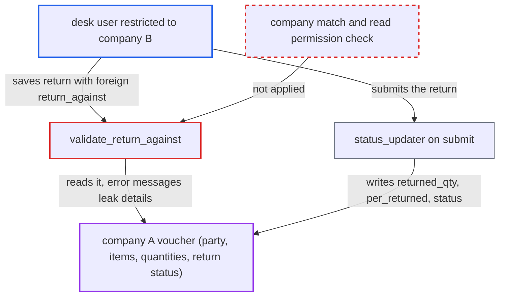

# Return documents accept return_against from another company without authorization

| Field | Value |
|---|---|
| ID | `find_01EqZ4b6gdGBUEaetfnaYxs6` |
| Severity | **Medium** |
| Status | open |
| CWE | CWE-639 — Insecure direct object reference |
| Created | 2026-10-27T21:28:45.007172Z |
| Claude Security | https://claude.ai/security/findings/find_01EqZ4b6gdGBUEaetfnaYxs6 |

## Description

A desk user restricted to one company can read and modify another company's Delivery Note, Purchase Receipt or Subcontracting Receipt through a return document. They can learn the other company's customer or supplier, items and quantities, and can overwrite its return status. The attacker needs create and submit rights on the document and a guessable voucher name. `validate_return_against` accepts a `return_against` from a different company and checks no permission on it.

1. **attacker** saves a return in their own company that points at another company's voucher. The attacker is a user whose User Permission limits them to company B. They save a Delivery Note with `is_return=1`, `return_against` set to a company A Delivery Note name, and a customer, through the REST API.
2. **the function `validate_return_against`** loads the referenced document and only compares the party. It uses `frappe.get_doc`, which skips permission checks. The company comparison at line 55 only decides whether to run the posting-date, exchange-rate and update-stock checks, so a company mismatch is accepted. ([`erpnext/controllers/sales_and_purchase_return.py:33-88`](https://github.com/cx-benchmark/erpnext/blob/90e7aefca73da3c440d2e8da7472fcb67838e678/erpnext/controllers/sales_and_purchase_return.py#L33-L88))
3. **the function `validate_return_against`** echoes the other company's party in the `Party Mismatch` error. The error text contains the customer or supplier of the referenced document, so the attacker learns who company A's voucher belongs to. ([`erpnext/controllers/sales_and_purchase_return.py:33-88`](https://github.com/cx-benchmark/erpnext/blob/90e7aefca73da3c440d2e8da7472fcb67838e678/erpnext/controllers/sales_and_purchase_return.py#L33-L88))
4. **the function `validate_returned_items`** reports the other company's items and quantities in its error messages. It reads the referenced document's item rows with `frappe.get_all` and no permission check. The messages `Returned Item {1} does not exist in {2} {3}` and `Cannot return more than {1} for Item {2}` reveal which items and how many units the voucher holds. ([`erpnext/controllers/sales_and_purchase_return.py:89-199`](https://github.com/cx-benchmark/erpnext/blob/90e7aefca73da3c440d2e8da7472fcb67838e678/erpnext/controllers/sales_and_purchase_return.py#L89-L199))
5. **attacker** submits the return. The `status_updater` configuration of the return treats `return_against` as the parent document to update. ([`erpnext/stock/doctype/delivery_note/delivery_note.py:218-249`](https://github.com/cx-benchmark/erpnext/blob/90e7aefca73da3c440d2e8da7472fcb67838e678/erpnext/stock/doctype/delivery_note/delivery_note.py#L218-L249))
6. **the function `StatusUpdater.update_prevdoc_status`** writes `returned_qty`, `per_returned` and `status` into the other company's voucher. `_update_children` uses raw SQL and `_update_percent_field` uses `db_set`. Neither applies permissions, so the write lands in whatever document `return_against` names. ([`erpnext/controllers/status_updater.py:644-701`](https://github.com/cx-benchmark/erpnext/blob/90e7aefca73da3c440d2e8da7472fcb67838e678/erpnext/controllers/status_updater.py#L644-L701))
7. **the function `get_rate_for_return`** values the return's stock ledger entry from the other company's Stock Ledger Entry. The attacker's company therefore books inventory at company A's valuation rate. ([`erpnext/controllers/sales_and_purchase_return.py:930-1010`](https://github.com/cx-benchmark/erpnext/blob/90e7aefca73da3c440d2e8da7472fcb67838e678/erpnext/controllers/sales_and_purchase_return.py#L930-L1010))

## Assessment

The attacker is a desk user with create and submit rights on Delivery Note or Purchase Receipt (for example `Stock User`, `Sales User` or `Delivery User`). A User Permission on `Company` restricts them to company B. They call the REST API and need no victim interaction. This works in default deployments. Voucher names follow sequential series such as `MAT-DN-.YYYY.-`, so they can be guessed. A second route exists for `Subcontracting Receipt`: `SubcontractingController.validate` does not call `super().validate()`, so the return validation never runs there at all. Invoices are partly protected, because `validate_return_against_account` and the GL account and company validation reject a foreign `debit_to` or `credit_to` on submit. The party leak at save time still applies to them.

Impact: The attacker can enumerate the party, item codes and returnable quantities of another company's vouchers by name. They can overwrite `returned_qty`, `per_returned` and `status` (for example `Return Issued`) on those vouchers. This also blocks that company's own legitimate returns with `Cannot return more than 0`. The attacker's company books inventory at the other company's valuation rate. The other company's GL entries are not altered, so the impact is limited.

## Recommendation

(1) `validate_return_against` accepts a `return_against` document from a different company and runs no permission check on it. A user-controlled link therefore bypasses the isolation that User Permissions provide.

Fix criteria: A return is rejected when `return_against` belongs to a different company than the return. The referenced document must also pass a read-permission check for the current user, or the party-mismatch and item messages must not disclose its data. Saving a Delivery Note return in company B against a company A Delivery Note fails before any party or item detail is disclosed. It also fails before any `returned_qty` or `per_returned` update is written to company A's document.

(2) `SubcontractingController.validate` skips `AccountsController.validate`, so `validate_return` is never run for Subcontracting Receipt returns.

Fix criteria: Subcontracting Receipt returns run the same `return_against` validation as other return documents: existence, same supplier, same company and permission. A Subcontracting Receipt return against another company's receipt is rejected at save.

## Evidence

**https://github.com/cx-benchmark/erpnext**

- [`erpnext/controllers/sales_and_purchase_return.py:33-88`](https://github.com/cx-benchmark/erpnext/blob/90e7aefca73da3c440d2e8da7472fcb67838e678/erpnext/controllers/sales_and_purchase_return.py#L33-L88)
- [`erpnext/controllers/sales_and_purchase_return.py:89-199`](https://github.com/cx-benchmark/erpnext/blob/90e7aefca73da3c440d2e8da7472fcb67838e678/erpnext/controllers/sales_and_purchase_return.py#L89-L199)
- [`erpnext/controllers/accounts_controller.py:325-331`](https://github.com/cx-benchmark/erpnext/blob/90e7aefca73da3c440d2e8da7472fcb67838e678/erpnext/controllers/accounts_controller.py#L325-L331)
- [`erpnext/stock/doctype/delivery_note/delivery_note.py:218-249`](https://github.com/cx-benchmark/erpnext/blob/90e7aefca73da3c440d2e8da7472fcb67838e678/erpnext/stock/doctype/delivery_note/delivery_note.py#L218-L249)
- [`erpnext/controllers/status_updater.py:644-701`](https://github.com/cx-benchmark/erpnext/blob/90e7aefca73da3c440d2e8da7472fcb67838e678/erpnext/controllers/status_updater.py#L644-L701)
- [`erpnext/controllers/sales_and_purchase_return.py:930-1010`](https://github.com/cx-benchmark/erpnext/blob/90e7aefca73da3c440d2e8da7472fcb67838e678/erpnext/controllers/sales_and_purchase_return.py#L930-L1010)
- [`erpnext/controllers/subcontracting_controller.py:63-72`](https://github.com/cx-benchmark/erpnext/blob/90e7aefca73da3c440d2e8da7472fcb67838e678/erpnext/controllers/subcontracting_controller.py#L63-L72)

