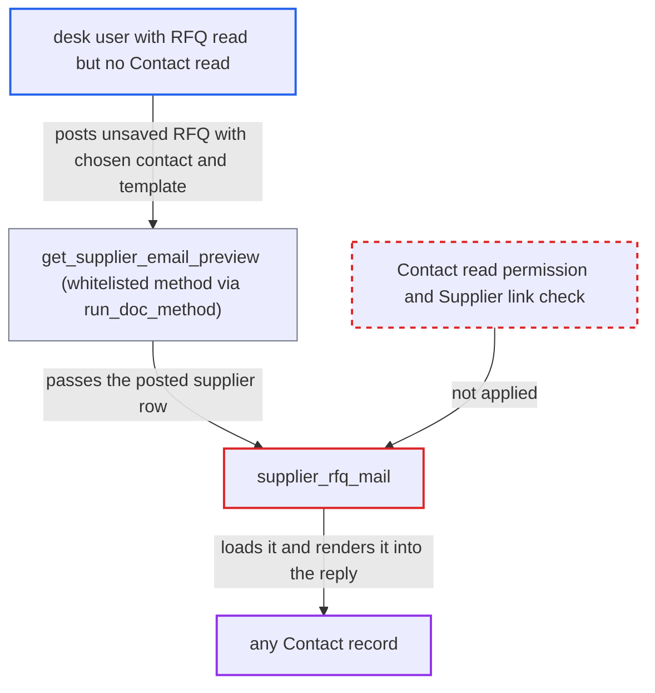

# RFQ email preview discloses any Contact record to RFQ readers without Contact access

| Field | Value |
|---|---|
| ID | `find_01KcfCHkF17b1JrUQQCE5r5g` |
| Severity | **Medium** |
| Status | open |
| CWE | CWE-862 — Missing authorization |
| Created | 2026-10-27T21:28:00.272403Z |
| Claude Security | https://claude.ai/security/findings/find_01KcfCHkF17b1JrUQQCE5r5g |

## Description

A desk user who can read Request for Quotation (RFQ) but has no Contact access, such as a Stock User or Manufacturing Manager, can read the full record of any Contact they can name. That includes emails, phones, address, linked parties and the linked user. `supplier_rfq_mail` loads the Contact named in a client-posted supplier row with no permission check and no check that it belongs to the row's Supplier. The attacker must know or guess the Contact name.

1. **attacker with RFQ read** posts an unsaved RFQ to `/api/method/run_doc_method`. The request uses `method=get_supplier_email_preview` and `args={supplier:'S'}`. The `docs` JSON holds `__islocal:1`, a `suppliers` row whose `contact` names the target Contact, and `message_for_supplier` set to `{{ contact }}`. ([`erpnext/stock/doctype/pick_list/pick_list.py:721-729`](https://github.com/cx-benchmark/erpnext/blob/90e7aefca73da3c440d2e8da7472fcb67838e678/erpnext/stock/doctype/pick_list/pick_list.py#L721-L729))
2. **`run_doc_method`** accepts the call on RFQ read permission alone. Manufacturing Manager, Purchase Manager, Purchase User and Stock User all have level-0 read on RFQ, and that is the only gate. ([`erpnext/buying/doctype/request_for_quotation/request_for_quotation.json:405-444`](https://github.com/cx-benchmark/erpnext/blob/90e7aefca73da3c440d2e8da7472fcb67838e678/erpnext/buying/doctype/request_for_quotation/request_for_quotation.json#L405-L444))
3. **the method `get_supplier_email_preview`** picks the posted `suppliers` row matching `supplier` and calls `supplier_rfq_mail` with `preview=True`. The row comes from the client's JSON, so the attacker controls its `contact` value. ([`erpnext/buying/doctype/request_for_quotation/request_for_quotation.py:188-198`](https://github.com/cx-benchmark/erpnext/blob/90e7aefca73da3c440d2e8da7472fcb67838e678/erpnext/buying/doctype/request_for_quotation/request_for_quotation.py#L188-L198))
4. **`supplier_rfq_mail`** loads the named Contact with `frappe.get_doc` and adds `contact.as_dict()` to the template context. No check is made that the caller may read the Contact, or that the Contact is linked to the row's Supplier. ([`erpnext/buying/doctype/request_for_quotation/request_for_quotation.py:317-319`](https://github.com/cx-benchmark/erpnext/blob/90e7aefca73da3c440d2e8da7472fcb67838e678/erpnext/buying/doctype/request_for_quotation/request_for_quotation.py#L317-L319))
5. **`supplier_rfq_mail`** renders the caller-supplied message against that context and returns the text. With `{{ contact }}` as the message, the response contains the whole Contact record. ([`erpnext/buying/doctype/request_for_quotation/request_for_quotation.py:337-351`](https://github.com/cx-benchmark/erpnext/blob/90e7aefca73da3c440d2e8da7472fcb67838e678/erpnext/buying/doctype/request_for_quotation/request_for_quotation.py#L337-L351))

## Assessment

The attacker is a logged-in desk user with read on Request for Quotation but no read on Contact, for example a Stock User or Manufacturing Manager. No victim action is needed. The attacker sends one request to `/api/method/run_doc_method` and must know or guess the name of the Contact to read. Frappe builds the document from the posted `docs` JSON, so the attacker controls both the row's `contact` value and the message template.

Impact: The attacker can read the full record of any Contact they can name: name, designation, `email_ids`, `phone_nos`, address, linked parties (`links`) and linked `user`. This includes supplier, lead and user contacts that no Customer link would grant. The attacker gets no write or availability impact.

## Recommendation

`supplier_rfq_mail` loads whatever Contact the client-posted supplier row names and exposes it to a template the caller wrote. It never checks that the caller may read that Contact, or that the Contact is linked to the row's Supplier.

Fix criteria: The preview exposes a Contact only when the caller may read it, or when it is linked to the row's Supplier and the caller may read that Supplier. Optionally, the preview runs only on the stored RFQ rather than posted JSON. To verify, call `get_supplier_email_preview` through `run_doc_method` as a Stock User, with an unsaved RFQ naming an unrelated Contact and `{{ contact }}` as the message. The call must be refused, or return no Contact data.

## Evidence

**https://github.com/cx-benchmark/erpnext**

- [`erpnext/buying/doctype/request_for_quotation/request_for_quotation.py:317-319`](https://github.com/cx-benchmark/erpnext/blob/90e7aefca73da3c440d2e8da7472fcb67838e678/erpnext/buying/doctype/request_for_quotation/request_for_quotation.py#L317-L319)
- [`erpnext/buying/doctype/request_for_quotation/request_for_quotation.py:188-198`](https://github.com/cx-benchmark/erpnext/blob/90e7aefca73da3c440d2e8da7472fcb67838e678/erpnext/buying/doctype/request_for_quotation/request_for_quotation.py#L188-L198)
- [`erpnext/buying/doctype/request_for_quotation/request_for_quotation.py:337-351`](https://github.com/cx-benchmark/erpnext/blob/90e7aefca73da3c440d2e8da7472fcb67838e678/erpnext/buying/doctype/request_for_quotation/request_for_quotation.py#L337-L351)
- [`erpnext/buying/doctype/request_for_quotation/request_for_quotation.json:405-444`](https://github.com/cx-benchmark/erpnext/blob/90e7aefca73da3c440d2e8da7472fcb67838e678/erpnext/buying/doctype/request_for_quotation/request_for_quotation.json#L405-L444)
- [`erpnext/stock/doctype/delivery_trip/delivery_trip.py:473-476`](https://github.com/cx-benchmark/erpnext/blob/90e7aefca73da3c440d2e8da7472fcb67838e678/erpnext/stock/doctype/delivery_trip/delivery_trip.py#L473-L476)
- [`erpnext/stock/doctype/pick_list/pick_list.py:721-729`](https://github.com/cx-benchmark/erpnext/blob/90e7aefca73da3c440d2e8da7472fcb67838e678/erpnext/stock/doctype/pick_list/pick_list.py#L721-L729)

