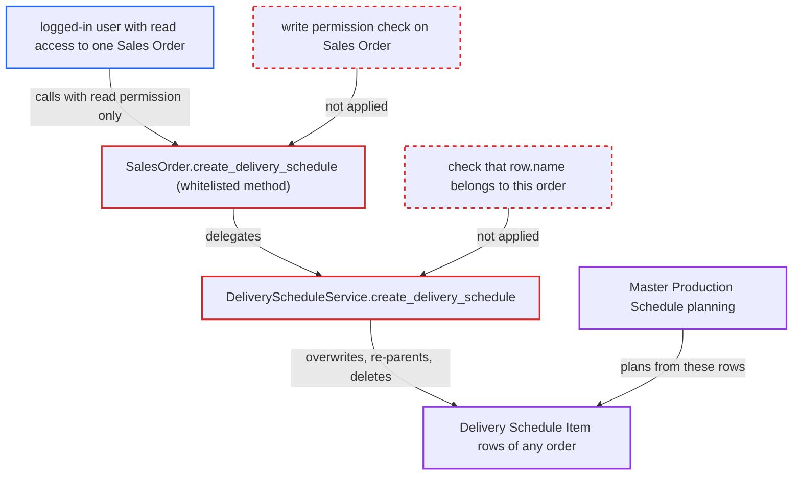

# Sales Order create_delivery_schedule writes any Delivery Schedule Item with read permission only

| Field | Value |
|---|---|
| ID | `find_01RpuR4TgdM31X9qnUzU4g9v` |
| Severity | **Medium** |
| Status | open |
| CWE | CWE-862 — Missing authorization |
| Created | 2026-10-27T21:07:44.936604Z |
| Claude Security | https://claude.ai/security/findings/find_01RpuR4TgdM31X9qnUzU4g9v |

## Description

A logged-in user with only read access to a Sales Order can create, overwrite and delete that order's delivery schedule rows. A user who can read or write one order can also move schedule rows out of any other order, including another company's. The cause is the `create_delivery_schedule` method on `SalesOrder`, which never checks write permission. The service behind it also saves rows picked by a caller-supplied `row.name` with `ignore_permissions=True`.

1. **attacker** lists Delivery Schedule Item records to learn the names of the rows to target. The names are random hashes. Any Sales User can list them, because the doctype has no `company` field for company User Permissions to bind to. ([`erpnext/selling/doctype/delivery_schedule_item/delivery_schedule_item.json`](https://github.com/cx-benchmark/erpnext/blob/90e7aefca73da3c440d2e8da7472fcb67838e678/erpnext/selling/doctype/delivery_schedule_item/delivery_schedule_item.json))
2. **attacker** posts a `run_doc_method` request with `method=create_delivery_schedule` for a Sales Order they can read. The `args` hold a `child_row` and a `schedules` list. Each schedule entry carries a victim row's `name`, a `qty`, and an empty `delivery_date`. ([`erpnext/selling/doctype/sales_order/sales_order.py:785-787`](https://github.com/cx-benchmark/erpnext/blob/90e7aefca73da3c440d2e8da7472fcb67838e678/erpnext/selling/doctype/sales_order/sales_order.py#L785-L787))
3. **Frappe `run_doc_method`** lets the call through after checking read permission only. `create_delivery_schedule` has no `self.check_permission("write")`, unlike `create_stock_reservation_entries`, so a read-only role passes. The report marks this behaviour of Frappe as an assumption. ([`erpnext/selling/doctype/sales_order/sales_order.py:785-787`](https://github.com/cx-benchmark/erpnext/blob/90e7aefca73da3c440d2e8da7472fcb67838e678/erpnext/selling/doctype/sales_order/sales_order.py#L785-L787))
4. **the service `DeliveryScheduleService.create_delivery_schedule`** loads each Delivery Schedule Item by the caller-supplied `row.name` and overwrites it. Nothing checks that the row belongs to the current order. The row is rewritten with the caller's data and `sales_order = self.doc.name`, then saved with `ignore_permissions=True`. ([`erpnext/selling/doctype/sales_order/services/delivery_schedule.py:22-72`](https://github.com/cx-benchmark/erpnext/blob/90e7aefca73da3c440d2e8da7472fcb67838e678/erpnext/selling/doctype/sales_order/services/delivery_schedule.py#L22-L72))
5. **the service `DeliveryScheduleService.create_delivery_schedule`** bulk-deletes the current order's other schedule rows for `child_row.name`. The delete runs without any permission check. ([`erpnext/selling/doctype/sales_order/services/delivery_schedule.py:22-72`](https://github.com/cx-benchmark/erpnext/blob/90e7aefca73da3c440d2e8da7472fcb67838e678/erpnext/selling/doctype/sales_order/services/delivery_schedule.py#L22-L72))
6. **the service `update_delivery_date_based_on_schedule`** skips the only permission-checked call, `self.doc.save()`, when no row has a `delivery_date`. `delivery_date` is not mandatory on Delivery Schedule Item, so a request with only empty dates is valid and the writes commit. ([`erpnext/selling/doctype/sales_order/services/delivery_schedule.py:22-72`](https://github.com/cx-benchmark/erpnext/blob/90e7aefca73da3c440d2e8da7472fcb67838e678/erpnext/selling/doctype/sales_order/services/delivery_schedule.py#L22-L72))
7. **Master Production Schedule** plans production from the tampered rows. `get_sales_order_schedules` reads Delivery Schedule Item rows per company, so changed or moved rows change that company's plan. ([`erpnext/manufacturing/doctype/master_production_schedule/master_production_schedule.py:321-345`](https://github.com/cx-benchmark/erpnext/blob/90e7aefca73da3c440d2e8da7472fcb67838e678/erpnext/manufacturing/doctype/master_production_schedule/master_production_schedule.py#L321-L345))

## Assessment

The attacker is a logged-in desk user with read access to at least one Sales Order. Examples are `Accounts User`, `Stock User`, or a company-scoped Sales User. They send a `run_doc_method` request for `create_delivery_schedule` on an order they can read, with only empty dates so the permission-checked save is skipped. A user with write access to their own order can send dates too. Any user who can read or write one order can also use a victim row's `name` to move rows from other orders, including other companies' orders, into their own order. The report notes victim row names can be listed by any Sales User.

Impact: The attacker can create, overwrite, re-parent and delete Delivery Schedule Item rows of orders they cannot write, across companies. This corrupts delivery schedules and the Master Production Schedule built from them. No stock, ledger or invoice data changes and nothing is disclosed, so the damage is limited to planning data.

## Recommendation

(1) The whitelisted `create_delivery_schedule` method does privileged writes (`save(ignore_permissions=True)` and a bulk delete), but the framework only checked read permission on the Sales Order.

Fix criteria: `create_delivery_schedule` requires write permission on the Sales Order, and submit permission for submitted orders. This check runs before any Delivery Schedule Item is created, changed or deleted, whether or not a delivery date is supplied. A user with read-only access to the order gets `PermissionError` and no row changes.

(2) The caller-supplied `row.name` decides which Delivery Schedule Item gets overwritten, with no check that it belongs to the current Sales Order and item row.

Fix criteria: Only schedule rows whose `sales_order` equals the current order, and whose `sales_order_item` is a row of that order, can be updated. Any other name is rejected. Passing the name of another order's row fails and leaves that row unchanged.

## Evidence

**https://github.com/cx-benchmark/erpnext**

- [`erpnext/selling/doctype/sales_order/services/delivery_schedule.py:22-72`](https://github.com/cx-benchmark/erpnext/blob/90e7aefca73da3c440d2e8da7472fcb67838e678/erpnext/selling/doctype/sales_order/services/delivery_schedule.py#L22-L72)
- [`erpnext/selling/doctype/sales_order/sales_order.py:785-787`](https://github.com/cx-benchmark/erpnext/blob/90e7aefca73da3c440d2e8da7472fcb67838e678/erpnext/selling/doctype/sales_order/sales_order.py#L785-L787)
- [`erpnext/selling/doctype/sales_order/sales_order.json`](https://github.com/cx-benchmark/erpnext/blob/90e7aefca73da3c440d2e8da7472fcb67838e678/erpnext/selling/doctype/sales_order/sales_order.json)
- [`erpnext/selling/doctype/delivery_schedule_item/delivery_schedule_item.json`](https://github.com/cx-benchmark/erpnext/blob/90e7aefca73da3c440d2e8da7472fcb67838e678/erpnext/selling/doctype/delivery_schedule_item/delivery_schedule_item.json)
- [`erpnext/manufacturing/doctype/master_production_schedule/master_production_schedule.py:321-345`](https://github.com/cx-benchmark/erpnext/blob/90e7aefca73da3c440d2e8da7472fcb67838e678/erpnext/manufacturing/doctype/master_production_schedule/master_production_schedule.py#L321-L345)

