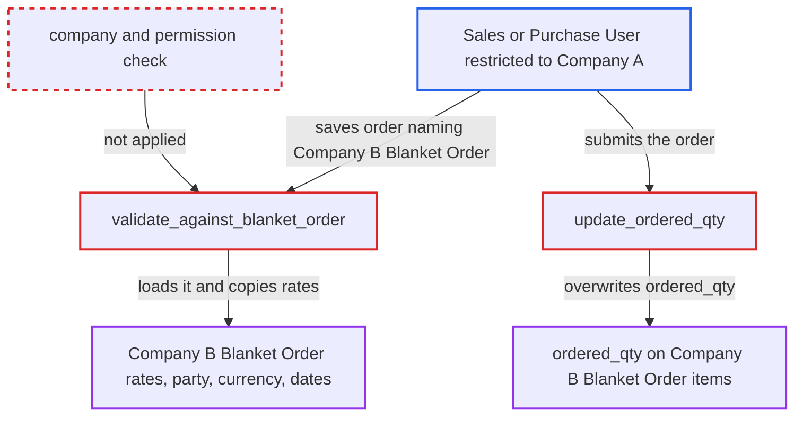

# Sales/Purchase Order rows use another company's Blanket Order, exposing its rates and consuming its quantity

| Field | Value |
|---|---|
| ID | `find_01LpBCkGoc2z8WfatidLf114` |
| Severity | **Medium** |
| Status | open |
| CWE | CWE-639 — Insecure Direct Object Reference |
| Created | 2026-10-27T22:03:39.909419Z |
| Claude Security | https://claude.ai/security/findings/find_01LpBCkGoc2z8WfatidLf114 |

## Description

A Sales User or Purchase User limited to one company can read another company's Blanket Order rates, customer or supplier, currency and validity dates. They can also use up that company's agreed quantity. The user only needs to name the other company's Blanket Order on an order row. `validate_against_blanket_order` never compares the Blanket Order's company with the order's company and never checks the user's rights on it.

1. **Attacker (Sales User restricted to Company A)** saves a Company-A Sales Order whose item row sets `blanket_order` to a guessed Company-B name. The name follows the sequential pattern `MFG-BLR-.YYYY.-`, and `SalesOrder.validate` calls `validate_against_blanket_order` on every save. ([`erpnext/selling/doctype/sales_order/sales_order.py:253-268`](https://github.com/cx-benchmark/erpnext/blob/90e7aefca73da3c440d2e8da7472fcb67838e678/erpnext/selling/doctype/sales_order/sales_order.py#L253-L268))
2. **the function `validate_against_blanket_order`** loads the named Blanket Order with `frappe.get_doc` and `for_update=True`. There is no permission check and no comparison of `bo_doc.company` with `order_doc.company`. ([`erpnext/manufacturing/doctype/blanket_order/blanket_order.py:410-426`](https://github.com/cx-benchmark/erpnext/blob/90e7aefca73da3c440d2e8da7472fcb67838e678/erpnext/manufacturing/doctype/blanket_order/blanket_order.py#L410-L426))
3. **the function `validate_order_matches`** checks only Blanket Order type, customer or supplier, and currency. Its error messages reveal the foreign agreement's customer or supplier and currency, and other `throw` messages reveal its validity dates, so the attacker retries with the right values until the save passes. ([`erpnext/manufacturing/doctype/blanket_order/blanket_order.py:144-167`](https://github.com/cx-benchmark/erpnext/blob/90e7aefca73da3c440d2e8da7472fcb67838e678/erpnext/manufacturing/doctype/blanket_order/blanket_order.py#L144-L167))
4. **the function `set_order_rates`** copies the foreign agreed per-item `rate` into `row.blanket_order_rate` and repeats it in an alert. The attacker thus sees rates they cannot read through any sanctioned route. ([`erpnext/manufacturing/doctype/blanket_order/blanket_order.py:169-187`](https://github.com/cx-benchmark/erpnext/blob/90e7aefca73da3c440d2e8da7472fcb67838e678/erpnext/manufacturing/doctype/blanket_order/blanket_order.py#L169-L187))
5. **Attacker** submits the order, which makes `update_blanket_order` call `update_ordered_qty`. This also runs on cancel, and the same call is made from the Purchase Order code. ([`erpnext/controllers/stock_controller.py:416-419`](https://github.com/cx-benchmark/erpnext/blob/90e7aefca73da3c440d2e8da7472fcb67838e678/erpnext/controllers/stock_controller.py#L416-L419))
6. **the function `update_ordered_qty`** sums the quantities of all submitted orders that link the Blanket Order, whatever their company, and writes `ordered_qty` with `db_set`. The attacker's Company-A order is counted against Company B's agreement. ([`erpnext/manufacturing/doctype/blanket_order/blanket_order.py:294-321`](https://github.com/cx-benchmark/erpnext/blob/90e7aefca73da3c440d2e8da7472fcb67838e678/erpnext/manufacturing/doctype/blanket_order/blanket_order.py#L294-L321))
7. **the function `validate_qty_can_be_ordered`** refuses the owning company's later orders once the remaining quantity is used up. Company B's own orders against its agreement are blocked beyond what the inflated `ordered_qty` leaves. ([`erpnext/manufacturing/doctype/blanket_order/blanket_order.py:110-128`](https://github.com/cx-benchmark/erpnext/blob/90e7aefca73da3c440d2e8da7472fcb67838e678/erpnext/manufacturing/doctype/blanket_order/blanket_order.py#L110-L128))

## Assessment

The attacker is a Sales User, or a Purchase User on purchase orders, restricted by User Permission to Company A. They have create, write and submit rights on orders, and no victim action is needed. They guess a Company-B Blanket Order name and use the error messages to find the matching customer or supplier and currency (customers are global by default). The report assumes Frappe >=17.0.0-dev,\<18, which is not in the checkout. It assumes that save-time permission checks on a Link field apply only when the user has User Permissions on the target doctype, and that Link validation only checks that the record exists and is not cancelled.

Impact: The attacker learns another company's negotiated per-item Blanket Order rates, its customer or supplier, currency and validity, though they cannot read Blanket Orders at all. Submitting overwrites `ordered_qty` on the foreign agreement, so its fulfilment tracking is wrong and the owning company's orders against it can be refused. The impact is limited to the pricing and quantity tracking of the agreements targeted.

## Recommendation

`validate_against_blanket_order` and `validate_order_matches` accept a Blanket Order of any company and do not check that the caller may use it. Its rates are then copied into the caller's order, and its quantities are consumed through `update_ordered_qty`.

Fix criteria: An order row is rejected when the Blanket Order's `company` differs from the order's `company`, or when the user's User Permissions or permission checks do not allow that Blanket Order. Saving a Company-A order that names a Company-B Blanket Order fails with a validation or permission error. No `blanket_order_rate` is populated from it. The Company-B Blanket Order's `ordered_qty` stays unchanged.

## Evidence

**https://github.com/cx-benchmark/erpnext**

- [`erpnext/manufacturing/doctype/blanket_order/blanket_order.py:410-426`](https://github.com/cx-benchmark/erpnext/blob/90e7aefca73da3c440d2e8da7472fcb67838e678/erpnext/manufacturing/doctype/blanket_order/blanket_order.py#L410-L426)
- [`erpnext/manufacturing/doctype/blanket_order/blanket_order.py:144-167`](https://github.com/cx-benchmark/erpnext/blob/90e7aefca73da3c440d2e8da7472fcb67838e678/erpnext/manufacturing/doctype/blanket_order/blanket_order.py#L144-L167)
- [`erpnext/manufacturing/doctype/blanket_order/blanket_order.py:169-187`](https://github.com/cx-benchmark/erpnext/blob/90e7aefca73da3c440d2e8da7472fcb67838e678/erpnext/manufacturing/doctype/blanket_order/blanket_order.py#L169-L187)
- [`erpnext/manufacturing/doctype/blanket_order/blanket_order.py:294-321`](https://github.com/cx-benchmark/erpnext/blob/90e7aefca73da3c440d2e8da7472fcb67838e678/erpnext/manufacturing/doctype/blanket_order/blanket_order.py#L294-L321)
- [`erpnext/manufacturing/doctype/blanket_order/blanket_order.py:110-128`](https://github.com/cx-benchmark/erpnext/blob/90e7aefca73da3c440d2e8da7472fcb67838e678/erpnext/manufacturing/doctype/blanket_order/blanket_order.py#L110-L128)
- [`erpnext/controllers/stock_controller.py:416-419`](https://github.com/cx-benchmark/erpnext/blob/90e7aefca73da3c440d2e8da7472fcb67838e678/erpnext/controllers/stock_controller.py#L416-L419)
- [`erpnext/selling/doctype/sales_order/sales_order.py:253-268`](https://github.com/cx-benchmark/erpnext/blob/90e7aefca73da3c440d2e8da7472fcb67838e678/erpnext/selling/doctype/sales_order/sales_order.py#L253-L268)
- [`erpnext/controllers/queries.py:835-869`](https://github.com/cx-benchmark/erpnext/blob/90e7aefca73da3c440d2e8da7472fcb67838e678/erpnext/controllers/queries.py#L835-L869)
- [`erpnext/stock/get_item_details.py:2028-2080`](https://github.com/cx-benchmark/erpnext/blob/90e7aefca73da3c440d2e8da7472fcb67838e678/erpnext/stock/get_item_details.py#L2028-L2080)
- [`erpnext/manufacturing/doctype/blanket_order/blanket_order.json`](https://github.com/cx-benchmark/erpnext/blob/90e7aefca73da3c440d2e8da7472fcb67838e678/erpnext/manufacturing/doctype/blanket_order/blanket_order.json)

