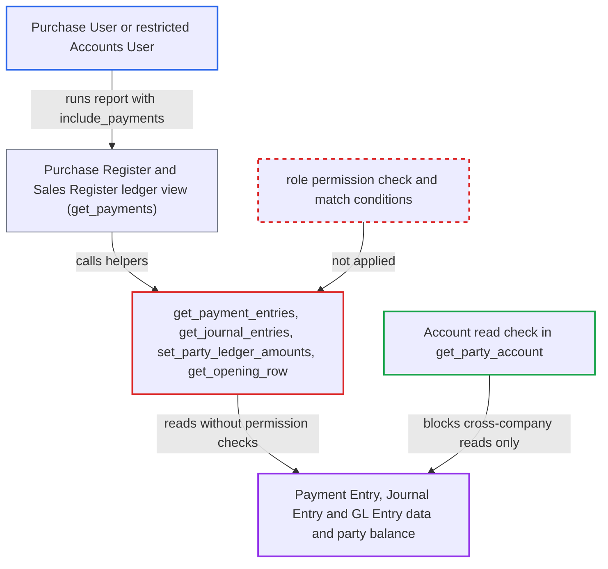

# Sales/Purchase Register ledger view returns Payment/Journal/GL entries without permission checks

| Field | Value |
|---|---|
| ID | `find_01QfQ4gJRsBgzy9c4nLeQEeL` |
| Severity | **Medium** |
| Status | open |
| CWE | CWE-862 — Missing Authorization |
| Created | 2026-10-27T21:16:27.128734Z |
| Claude Security | https://claude.ai/security/findings/find_01QfQ4gJRsBgzy9c4nLeQEeL |

## Description

A logged-in user can read payment and journal vouchers and ledger balances that their role or User Permissions do not allow. A stock `Purchase User` can read every supplier's vouchers in the Purchase Register. An Accounts User restricted by User Permissions can see rows outside those limits in the Sales Register or Purchase Register. The attack needs `include_payments=1` and a customer or supplier the caller can read. The cause is that `get_payment_entries`, `get_journal_entries`, `set_party_ledger_amounts` and `get_opening_row` in `erpnext/accounts/report/utils.py` run raw queries with no permission check.

1. **authenticated desk user** calls the report API for Purchase Register with the ledger view on. The request goes to `/api/method/frappe.desk.query_report.run` with `report_name=Purchase Register` and filters `company`, `supplier`, `include_payments:1`, `from_date` and `to_date`. A `Purchase User` passes the report's role check, because that role is in the report's roles. ([`erpnext/accounts/report/purchase_register/purchase_register.json:18-30`](https://github.com/cx-benchmark/erpnext/blob/90e7aefca73da3c440d2e8da7472fcb67838e678/erpnext/accounts/report/purchase_register/purchase_register.json#L18-L30))
2. **the report's `_execute`** calls `get_payments` because `include_payments` is set. The payments half of the report appends the party's vouchers to the output, while the invoice half applies `build_match_conditions("Purchase Invoice")`. ([`erpnext/accounts/report/purchase_register/purchase_register.py:532-541`](https://github.com/cx-benchmark/erpnext/blob/90e7aefca73da3c440d2e8da7472fcb67838e678/erpnext/accounts/report/purchase_register/purchase_register.py#L532-L541))
3. **`get_payment_entries`** selects the party's submitted Payment Entries. The query uses only company, date, cost-center and dimension filters. It makes no role check on Payment Entry and applies no `build_match_conditions("Payment Entry")`. It returns names, posting dates, amounts, remarks, mode of payment, project and cost center. ([`erpnext/accounts/report/utils.py:323-372`](https://github.com/cx-benchmark/erpnext/blob/90e7aefca73da3c440d2e8da7472fcb67838e678/erpnext/accounts/report/utils.py#L323-L372))
4. **`get_journal_entries`** selects the party's Journal Entry rows. It returns names, dates, remarks, totals, debit, credit and project, with no permission check or match conditions. ([`erpnext/accounts/report/utils.py:284-320`](https://github.com/cx-benchmark/erpnext/blob/90e7aefca73da3c440d2e8da7472fcb67838e678/erpnext/accounts/report/utils.py#L284-L320))
5. **`set_party_ledger_amounts`** reads GL Entry debit and credit amounts for the listed Payment Entries. The query carries no GL Entry permission conditions. ([`erpnext/accounts/report/utils.py:375-394`](https://github.com/cx-benchmark/erpnext/blob/90e7aefca73da3c440d2e8da7472fcb67838e678/erpnext/accounts/report/utils.py#L375-L394))
6. **`get_opening_row`** sums GL Entry debit and credit for the party into an opening-balance row. The sum covers all cost centers and projects. The only check is read access on the Customer or Supplier document, not on GL Entry. ([`erpnext/accounts/report/utils.py:494-512`](https://github.com/cx-benchmark/erpnext/blob/90e7aefca73da3c440d2e8da7472fcb67838e678/erpnext/accounts/report/utils.py#L494-L512))
7. **the report** returns the vouchers and the balance to the caller. The caller gets data they have no right to read. A `Purchase User` has no permission on Payment Entry, Journal Entry or GL Entry, since those grant access only to Accounts User, Accounts Manager and, for Journal Entry and GL Entry, Auditor. ([`erpnext/accounts/doctype/payment_entry/payment_entry.json:829-870`](https://github.com/cx-benchmark/erpnext/blob/90e7aefca73da3c440d2e8da7472fcb67838e678/erpnext/accounts/doctype/payment_entry/payment_entry.json#L829-L870))

## Assessment

The attacker is an authenticated desk user. One case is the stock `Purchase User` role, which has no Payment Entry, Journal Entry or GL Entry permission. The other is an Accounts User whose access is narrowed by Cost Center or Project User Permissions, or by an `if_owner` rule. The attacker needs read access to the target customer or supplier. They also need read access to the party account in the company, which the `Account` check in `get_party_account` enforces. The attacker sets `include_payments=1` ("Show Ledger View") and a customer or supplier, in either Purchase Register or Sales Register. The default role setup is enough, and no victim action is needed.

Impact: The attacker can read payment and journal vouchers and the party's ledger balance that their role or User Permissions do not allow. The balance is the opening row and covers the whole company. This is read-only disclosure and can be repeated for any customer or supplier the caller can read. Cross-company reads are blocked by the `Account` check in `get_party_account`. The report names no write or availability impact.

## Recommendation

`get_payment_entries`, `get_journal_entries`, `set_party_ledger_amounts` and `get_opening_row` in `erpnext/accounts/report/utils.py` query Payment Entry, Journal Entry and GL Entry with `frappe.qb`. They apply neither a role-permission check nor user-permission match conditions. The ledger view of both registers therefore discloses vouchers and balances the caller may not read.

Fix criteria: The ledger view returns only the Payment Entries, Journal Entries and GL amounts the session user may read. Users without read on those doctypes, such as a stock `Purchase User`, get no payment rows and no opening balance. Users with User Permission or `if_owner` restrictions see only permitted rows, and their opening balance is computed from permitted GL entries only. Run Purchase Register with `include_payments=1` as a `Purchase User` and confirm no payment rows or opening balance appear. Run Sales Register as a Cost-Center-restricted Accounts User and confirm only permitted rows appear.

## Evidence

**https://github.com/cx-benchmark/erpnext**

- [`erpnext/accounts/report/utils.py:323-372`](https://github.com/cx-benchmark/erpnext/blob/90e7aefca73da3c440d2e8da7472fcb67838e678/erpnext/accounts/report/utils.py#L323-L372)
- [`erpnext/accounts/report/utils.py:284-320`](https://github.com/cx-benchmark/erpnext/blob/90e7aefca73da3c440d2e8da7472fcb67838e678/erpnext/accounts/report/utils.py#L284-L320)
- [`erpnext/accounts/report/utils.py:375-394`](https://github.com/cx-benchmark/erpnext/blob/90e7aefca73da3c440d2e8da7472fcb67838e678/erpnext/accounts/report/utils.py#L375-L394)
- [`erpnext/accounts/report/utils.py:494-512`](https://github.com/cx-benchmark/erpnext/blob/90e7aefca73da3c440d2e8da7472fcb67838e678/erpnext/accounts/report/utils.py#L494-L512)
- [`erpnext/accounts/report/purchase_register/purchase_register.py:532-541`](https://github.com/cx-benchmark/erpnext/blob/90e7aefca73da3c440d2e8da7472fcb67838e678/erpnext/accounts/report/purchase_register/purchase_register.py#L532-L541)
- [`erpnext/accounts/report/purchase_register/purchase_register.json:18-30`](https://github.com/cx-benchmark/erpnext/blob/90e7aefca73da3c440d2e8da7472fcb67838e678/erpnext/accounts/report/purchase_register/purchase_register.json#L18-L30)
- [`erpnext/accounts/doctype/payment_entry/payment_entry.json:829-870`](https://github.com/cx-benchmark/erpnext/blob/90e7aefca73da3c440d2e8da7472fcb67838e678/erpnext/accounts/doctype/payment_entry/payment_entry.json#L829-L870)
- [`erpnext/accounts/report/sales_register/sales_register.py:548-557`](https://github.com/cx-benchmark/erpnext/blob/90e7aefca73da3c440d2e8da7472fcb67838e678/erpnext/accounts/report/sales_register/sales_register.py#L548-L557)

