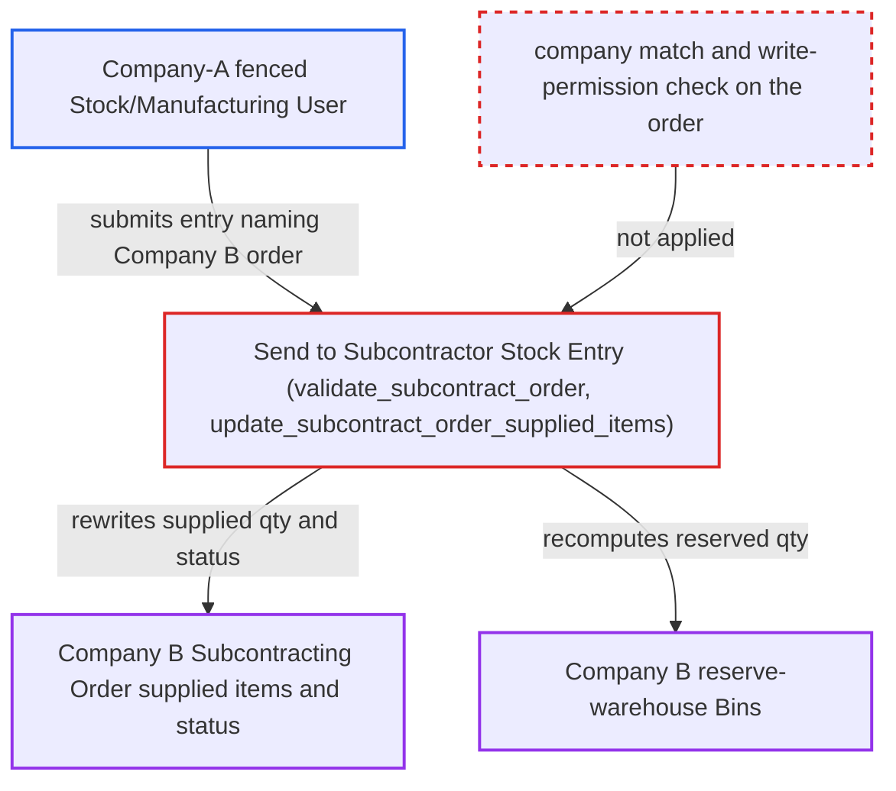

# Send to Subcontractor Stock Entry rewrites another company's Subcontracting Order supplied quantities

| Field | Value |
|---|---|
| ID | `find_017XYRDR5uhtSnpYqF5pFQhA` |
| Severity | **Medium** |
| Status | open |
| CWE | CWE-639 — Missing Authorization |
| Created | 2026-10-27T22:32:57.432579Z |
| Claude Security | https://claude.ai/security/findings/find_017XYRDR5uhtSnpYqF5pFQhA |

## Description

A user limited to Company A can change another company's Subcontracting Order and its reserved-stock figures. The attacker needs the Stock User or Manufacturing User role, fenced to Company A by a Company User Permission, and the name of a Company B order. The cause is that `validate_subcontract_order` and `StockEntry` never check that the order in `subcontracting_order` belongs to the entry's `company`, or that the user may write it. The roll-up then uses writes that skip permission checks.

1. **attacker (Company-A desk user)** asks for the finished good of a Company B order's raw material. The whitelisted `get_item_details` calls `_resolve_subcontract_item`, which returns the foreign order's `main_item_code`, and this gives the attacker the `subcontracted_item` value needed later. ([`erpnext/stock/doctype/stock_entry/stock_entry.py:1594-1609`](https://github.com/cx-benchmark/erpnext/blob/90e7aefca73da3c440d2e8da7472fcb67838e678/erpnext/stock/doctype/stock_entry/stock_entry.py#L1594-L1609))
2. **attacker** creates a Company-A Stock Entry of purpose `Send to Subcontractor` that names a Company B order. The entry sets `subcontracting_order` to a guessed sequential `SC-ORD-…` name and moves Company-A stock between Company-A warehouses, with a quantity within the limit the error messages reveal.
3. **the function `validate_subcontract_order`** loads the foreign order and checks only quantities. It never compares the order's `company` with the entry's `company` and never checks the caller's permission on the order, so validation passes. ([`erpnext/stock/doctype/stock_entry/services/subcontracting.py:20-47`](https://github.com/cx-benchmark/erpnext/blob/90e7aefca73da3c440d2e8da7472fcb67838e678/erpnext/stock/doctype/stock_entry/services/subcontracting.py#L20-L47))
4. **the helper `get_order_rm_detail`** binds the attacker's rows to Company B's Supplied Item rows. It finds each row by parent, raw-material item code and main item code and writes it with `db_set`, so the attacker needs no child-row hash. ([`erpnext/stock/doctype/stock_entry/services/subcontracting.py:107-120`](https://github.com/cx-benchmark/erpnext/blob/90e7aefca73da3c440d2e8da7472fcb67838e678/erpnext/stock/doctype/stock_entry/services/subcontracting.py#L107-L120))
5. **the function `update_subcontract_order_supplied_items`** rewrites the foreign order's supplied quantities on submit. It recomputes `supplied_qty`, `returned_qty` and `total_supplied_qty` for every Supplied Item row and saves them with `frappe.db.set_value`, which does no permission check. `_update_reserved_qty_for_subcontracting` then recomputes `reserved_qty_for_sub_contracting` in Company B's reserve-warehouse Bins. ([`erpnext/stock/doctype/stock_entry/services/subcontracting.py:189-229`](https://github.com/cx-benchmark/erpnext/blob/90e7aefca73da3c440d2e8da7472fcb67838e678/erpnext/stock/doctype/stock_entry/services/subcontracting.py#L189-L229))
6. **the method `update_subcontracting_order_status`** sets the foreign order's status through the no-permission helper. `set_subcontracting_order_status` uses `db_set` to set the status to `Material Transferred` or `Partial Material Transferred`. It also updates ordered, reserved and subcontracted quantities on Company B's records. ([`erpnext/stock/doctype/stock_entry/stock_entry.py:1949-1957`](https://github.com/cx-benchmark/erpnext/blob/90e7aefca73da3c440d2e8da7472fcb67838e678/erpnext/stock/doctype/stock_entry/stock_entry.py#L1949-L1957))

## Assessment

The attacker is a desk user with the Stock User or Manufacturing User role, fenced to Company A by a Company User Permission. That permission does not help, because Frappe Company User Permissions constrain only Link fields whose target doctype carries user-permission records. The attacker must guess a Company B order name, which is sequential (`SC-ORD-…`). They submit the entry through REST or the form. Default settings are enough: `backflush_raw_materials_of_subcontract_based_on` is BOM and stock reservation is off. No victim action is needed. The report assumes Frappe (pinned `>=17.0.0-dev,<18`, not in the checkout) behaves this way: `has_user_permission` checks only Link fields whose target has user-permission records, and `db.set_value` and `db_set` perform no permission check.

Impact: The attacker sets `supplied_qty` and `total_supplied_qty` on another company's Subcontracting Order rows, changes its status, and changes that company's Bin `reserved_qty_for_sub_contracting`. This is limited to the subcontracting roll-up fields, and no ledger postings are made in Company B. Company B's own transfers against the order are refused by `_validate_transfer_qty` while the entry exists, and its Subcontracting Receipt backflush can consume from a supplier warehouse that never received goods. In `Material Transferred for Subcontract` mode the backflush picks up the attacker's Company-A warehouse rows and fails `validate_warehouse_company`. Company B cannot see or cancel the Company-A entry. Validation errors and `_resolve_subcontract_item` also reveal which items the order supplies, the required and allowed quantities, and the finished good.

## Recommendation

`StockEntry` trusts the `subcontracting_order` (and `purchase_order`) Link without checking that the order belongs to the entry's company or that the caller may write it. It then updates the order's child rows, status and Bins with permission-bypassing writes.

Fix criteria: A Stock Entry whose `subcontracting_order`, `subcontracting_inward_order` or `purchase_order` names a document of another company is rejected at validate. The referenced order must pass a write-permission check for the submitting user before `update_subcontract_order_supplied_items`, `set_subcontracting_order_status` or any Bin update runs. The check must run before the quantity validations, so their messages cannot be used to probe the order. Verify that a Company-A-fenced user who submits a Send to Subcontractor entry against a Company-B order is refused, with no change to that order's Supplied Item rows, status or Bins.

## Evidence

**https://github.com/cx-benchmark/erpnext**

- [`erpnext/stock/doctype/stock_entry/services/subcontracting.py:20-47`](https://github.com/cx-benchmark/erpnext/blob/90e7aefca73da3c440d2e8da7472fcb67838e678/erpnext/stock/doctype/stock_entry/services/subcontracting.py#L20-L47)
- [`erpnext/stock/doctype/stock_entry/services/subcontracting.py:107-120`](https://github.com/cx-benchmark/erpnext/blob/90e7aefca73da3c440d2e8da7472fcb67838e678/erpnext/stock/doctype/stock_entry/services/subcontracting.py#L107-L120)
- [`erpnext/stock/doctype/stock_entry/services/subcontracting.py:189-229`](https://github.com/cx-benchmark/erpnext/blob/90e7aefca73da3c440d2e8da7472fcb67838e678/erpnext/stock/doctype/stock_entry/services/subcontracting.py#L189-L229)
- [`erpnext/stock/doctype/stock_entry/stock_entry.py:1949-1957`](https://github.com/cx-benchmark/erpnext/blob/90e7aefca73da3c440d2e8da7472fcb67838e678/erpnext/stock/doctype/stock_entry/stock_entry.py#L1949-L1957)
- [`erpnext/stock/doctype/stock_entry/stock_entry.py:1594-1609`](https://github.com/cx-benchmark/erpnext/blob/90e7aefca73da3c440d2e8da7472fcb67838e678/erpnext/stock/doctype/stock_entry/stock_entry.py#L1594-L1609)

