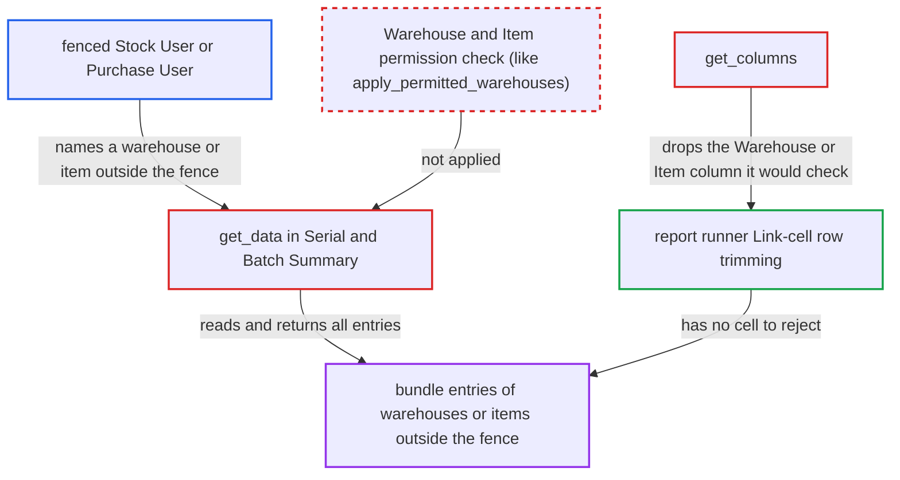

# Serial and Batch Summary drops the filtered Warehouse/Item column, bypassing user-permission trimming

| Field | Value |
|---|---|
| ID | `find_01BA8Cqf9AwoymXog8BBaBtF` |
| Severity | **Medium** |
| Status | open |
| CWE | CWE-862 — Missing Authorization |
| Created | 2026-10-27T21:56:39.674161Z |
| Claude Security | https://claude.ai/security/findings/find_01BA8Cqf9AwoymXog8BBaBtF |

## Description

A logged-in Stock User or Purchase User who is restricted by User Permissions can read serial and batch movement data for warehouses or items outside their restriction. The data includes quantities, `incoming_rate`, `stock_value_difference` and voucher references. The user only has to name the warehouse or item in the report filters. `get_data` reads with the permission-ignoring `frappe.get_all`, and `get_columns` removes the column the runner would have checked.

1. **fenced Stock User or Purchase User** requests the Serial and Batch Summary report with a leaf warehouse outside their Warehouse User Permission. The request is a POST to `/api/method/frappe.desk.query_report.run` with `report_name` and `filters` such as `warehouse`, `from_date` and `to_date`, and the role checks on the report and on Serial and Batch Bundle `report` both pass. ([`erpnext/stock/doctype/serial_and_batch_bundle/serial_and_batch_bundle.json:273-413`](https://github.com/cx-benchmark/erpnext/blob/90e7aefca73da3c440d2e8da7472fcb67838e678/erpnext/stock/doctype/serial_and_batch_bundle/serial_and_batch_bundle.json#L273-L413))
2. **the report definition** lets the filter values through unvalidated. The report has an empty `filters` table, so the runner validates no filter value. ([`erpnext/stock/report/serial_and_batch_summary/serial_and_batch_summary.json:17-37`](https://github.com/cx-benchmark/erpnext/blob/90e7aefca73da3c440d2e8da7472fcb67838e678/erpnext/stock/report/serial_and_batch_summary/serial_and_batch_summary.json#L17-L37))
3. **`get_filter_conditions`** narrows the query to the chosen warehouse, item and other filters. It never checks that the caller may see the warehouse or item they named. ([`erpnext/stock/report/serial_and_batch_summary/serial_and_batch_summary.py:45-76`](https://github.com/cx-benchmark/erpnext/blob/90e7aefca73da3c440d2e8da7472fcb67838e678/erpnext/stock/report/serial_and_batch_summary/serial_and_batch_summary.py#L45-L76))
4. **`get_data`** reads every matching bundle entry with `frappe.get_all`. `frappe.get_all` ignores permissions, and no Warehouse, Company or Item User Permission condition is added. ([`erpnext/stock/report/serial_and_batch_summary/serial_and_batch_summary.py:20-42`](https://github.com/cx-benchmark/erpnext/blob/90e7aefca73da3c440d2e8da7472fcb67838e678/erpnext/stock/report/serial_and_batch_summary/serial_and_batch_summary.py#L20-L42))
5. **`get_columns`** leaves out the `warehouse` column, or the `item_code` column when `item_code` is filtered. The `warehouse` column is dropped when the filtered warehouse is a leaf warehouse, so the filtered dimension is missing from the result. ([`erpnext/stock/report/serial_and_batch_summary/serial_and_batch_summary.py:132-155`](https://github.com/cx-benchmark/erpnext/blob/90e7aefca73da3c440d2e8da7472fcb67838e678/erpnext/stock/report/serial_and_batch_summary/serial_and_batch_summary.py#L132-L155))
6. **the report runner** returns all rows because no remaining cell can be rejected. The runner trims only rows whose Link cells fall outside the user's permissions, and the remaining Link cells (Company, bundle, DocType, Serial No, Batch) hold no warehouse or item value. ([`erpnext/stock/report/utils.py:19-44`](https://github.com/cx-benchmark/erpnext/blob/90e7aefca73da3c440d2e8da7472fcb67838e678/erpnext/stock/report/utils.py#L19-L44))

## Assessment

The attacker is a logged-in Stock User or Purchase User whose Warehouse User Permission limits them to one store. These are the roles that pass both the report role check and the Serial and Batch Bundle `report` check. They name a leaf warehouse they cannot see. Default warehouse names are guessable. An Item-fenced user can do the same by naming another item in `item_code`. The trimming that is the only remaining control is, by the report's assumption, part of Frappe 17.0.0-dev up to but not including 18. That code is not in the checkout. The report cites three fork commits as support: c80af77d, 286bcfc9 and 3de4e80a.

Impact: The attacker can read the serial and batch movement history of warehouses or items outside their User Permissions. This covers serial and batch IDs, quantities, `incoming_rate`, `stock_value_difference`, voucher type and number, and posting dates. It is read-only. It is limited to serial- or batch-tracked items in the named warehouse or item, and a Company User Permission still removes other companies' rows.

## Recommendation

`get_data` reads bundles with the permission-ignoring `frappe.get_all`. `get_columns` removes the Warehouse or Item Link column for the filtered dimension. The runner's link-column trimming, the only control left, therefore cannot act on the warehouse or item the caller chose.

Fix criteria: Rows are limited to bundle entries whose warehouse, item and company the running user may read under their User Permissions, intersected with the caller's filters, whichever columns are displayed. A request whose `warehouse` or `item_code` lies outside those permissions returns no rows or raises PermissionError. A Warehouse-fenced Stock User who runs the report for a leaf warehouse outside the fence gets no rows. An Item-fenced user who names another item gets no rows. Unrestricted users see unchanged output.

## Evidence

**https://github.com/cx-benchmark/erpnext**

- [`erpnext/stock/report/serial_and_batch_summary/serial_and_batch_summary.py:20-42`](https://github.com/cx-benchmark/erpnext/blob/90e7aefca73da3c440d2e8da7472fcb67838e678/erpnext/stock/report/serial_and_batch_summary/serial_and_batch_summary.py#L20-L42)
- [`erpnext/stock/report/serial_and_batch_summary/serial_and_batch_summary.py:45-76`](https://github.com/cx-benchmark/erpnext/blob/90e7aefca73da3c440d2e8da7472fcb67838e678/erpnext/stock/report/serial_and_batch_summary/serial_and_batch_summary.py#L45-L76)
- [`erpnext/stock/report/serial_and_batch_summary/serial_and_batch_summary.py:132-155`](https://github.com/cx-benchmark/erpnext/blob/90e7aefca73da3c440d2e8da7472fcb67838e678/erpnext/stock/report/serial_and_batch_summary/serial_and_batch_summary.py#L132-L155)
- [`erpnext/stock/report/utils.py:19-44`](https://github.com/cx-benchmark/erpnext/blob/90e7aefca73da3c440d2e8da7472fcb67838e678/erpnext/stock/report/utils.py#L19-L44)
- [`erpnext/stock/report/serial_and_batch_summary/serial_and_batch_summary.json:17-37`](https://github.com/cx-benchmark/erpnext/blob/90e7aefca73da3c440d2e8da7472fcb67838e678/erpnext/stock/report/serial_and_batch_summary/serial_and_batch_summary.json#L17-L37)
- [`erpnext/stock/doctype/serial_and_batch_bundle/serial_and_batch_bundle.json:273-413`](https://github.com/cx-benchmark/erpnext/blob/90e7aefca73da3c440d2e8da7472fcb67838e678/erpnext/stock/doctype/serial_and_batch_bundle/serial_and_batch_bundle.json#L273-L413)
- [`erpnext/stock/report/stock_ledger/stock_ledger.py:822-836`](https://github.com/cx-benchmark/erpnext/blob/90e7aefca73da3c440d2e8da7472fcb67838e678/erpnext/stock/report/stock_ledger/stock_ledger.py#L822-L836)

