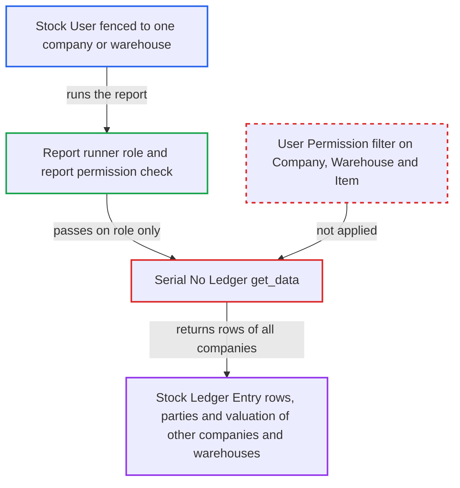

# Serial No Ledger report ignores Company, Warehouse and Item user permissions

| Field | Value |
|---|---|
| ID | `find_011vbqkAJ6ceVTfZp9vs2WKX` |
| Severity | **Medium** |
| Status | open |
| CWE | CWE-862 — Missing authorization |
| Created | 2026-10-27T21:14:54.670339Z |
| Claude Security | https://claude.ai/security/findings/find_011vbqkAJ6ceVTfZp9vs2WKX |

## Description

A Stock User or Accounts Manager who is restricted by User Permissions to one company or warehouse can read the serial and batch movement history of every other company and warehouse. The rows include voucher numbers, valuation rates and customers or suppliers. The cause is `get_data` in the Serial No Ledger report, which passes the caller's filters to a raw query and never applies the user's Company, Warehouse or Item permissions. This is read-only and limited to entries that carry serial numbers or bundles.

1. **Attacker (restricted Stock User)** posts a report run request for Serial No Ledger. The request goes to `/api/method/frappe.desk.query_report.run` with `report_name=Serial No Ledger`. The filters name any item or a Company-B warehouse, or leave out `item_code` and `warehouse` entirely. ([`erpnext/stock/report/serial_no_ledger/serial_no_ledger.js:7-21`](https://github.com/cx-benchmark/erpnext/blob/90e7aefca73da3c440d2e8da7472fcb67838e678/erpnext/stock/report/serial_no_ledger/serial_no_ledger.js#L7-L21))
2. **Frappe report runner** checks only the report's roles and the `report` permission on Stock Ledger Entry. Stock User and Accounts Manager hold that permission, and the report's JSON `filters` table is empty, so no filter value is checked against User Permissions. ([`erpnext/stock/doctype/stock_ledger_entry/stock_ledger_entry.json:372-385`](https://github.com/cx-benchmark/erpnext/blob/90e7aefca73da3c440d2e8da7472fcb67838e678/erpnext/stock/doctype/stock_ledger_entry/stock_ledger_entry.json#L372-L385))
3. **the function `get_data`** passes the caller's filters to `get_stock_ledger_entries` with no permission condition. No Company, Warehouse or Item permission is added, so the caller's filters alone set the scope. ([`erpnext/stock/report/serial_no_ledger/serial_no_ledger.py:100-106`](https://github.com/cx-benchmark/erpnext/blob/90e7aefca73da3c440d2e8da7472fcb67838e678/erpnext/stock/report/serial_no_ledger/serial_no_ledger.py#L100-L106))
4. **the helper `get_stock_ledger_entries`** runs a raw `frappe.db.sql` over `tabStock Ledger Entry`. It adds only the `posting_datetime`, `item_code` and `warehouse` conditions the caller gave, so User Permission match conditions never apply and entries of every company come back. ([`erpnext/stock/stock_ledger.py:2594-2610`](https://github.com/cx-benchmark/erpnext/blob/90e7aefca73da3c440d2e8da7472fcb67838e678/erpnext/stock/stock_ledger.py#L2594-L2610))
5. **the report code** adds counterparties, serial numbers and valuation to each row. It fetches the customer or supplier with permission-less `frappe.db.get_value` and reads `Serial and Batch Entry` with `frappe.get_all`, which does not apply user permissions. ([`erpnext/stock/report/serial_no_ledger/serial_no_ledger.py:116-170`](https://github.com/cx-benchmark/erpnext/blob/90e7aefca73da3c440d2e8da7472fcb67838e678/erpnext/stock/report/serial_no_ledger/serial_no_ledger.py#L116-L170))

## Assessment

The attacker is an authenticated desk user with the Stock User or Accounts Manager role. On a multi-company site they are fenced by User Permissions to Company A or to a warehouse W. They call the report endpoint directly with filters naming any item or a Company-B warehouse, or with no `item_code` or `warehouse`. The browser form requires `item_code`, but the server does not enforce it. No other precondition is named.

Impact: The attacker reads the serial and batch movement history outside their permitted scope. This covers dates, voucher types and numbers, company, warehouse, per-unit valuation rate, and the customer or supplier on buying and selling vouchers. There is no write or availability impact.

## Recommendation

`get_data` forwards the caller's filters to the Stock Ledger Entry query without intersecting them with the user's permitted Companies, Warehouses and Items. The caller therefore chooses the row scope, and party and bundle lookups run on rows the user may not see.

Fix criteria: Returned rows are limited to Stock Ledger Entries whose company, warehouse and item the running user may read under their User Permissions, intersected with the caller's filters. This also holds when `item_code` or `warehouse` is omitted. Party and bundle lookups run only for permitted rows. Verify with a Stock User restricted to Company A: running the report for a Company-B item, or with no filters, returns no Company-B rows.

## Evidence

**https://github.com/cx-benchmark/erpnext**

- [`erpnext/stock/report/serial_no_ledger/serial_no_ledger.py:100-106`](https://github.com/cx-benchmark/erpnext/blob/90e7aefca73da3c440d2e8da7472fcb67838e678/erpnext/stock/report/serial_no_ledger/serial_no_ledger.py#L100-L106)
- [`erpnext/stock/stock_ledger.py:2531-2545`](https://github.com/cx-benchmark/erpnext/blob/90e7aefca73da3c440d2e8da7472fcb67838e678/erpnext/stock/stock_ledger.py#L2531-L2545)
- [`erpnext/stock/stock_ledger.py:2594-2610`](https://github.com/cx-benchmark/erpnext/blob/90e7aefca73da3c440d2e8da7472fcb67838e678/erpnext/stock/stock_ledger.py#L2594-L2610)
- [`erpnext/stock/report/serial_no_ledger/serial_no_ledger.py:116-170`](https://github.com/cx-benchmark/erpnext/blob/90e7aefca73da3c440d2e8da7472fcb67838e678/erpnext/stock/report/serial_no_ledger/serial_no_ledger.py#L116-L170)
- [`erpnext/stock/report/serial_no_ledger/serial_no_ledger.py:175-194`](https://github.com/cx-benchmark/erpnext/blob/90e7aefca73da3c440d2e8da7472fcb67838e678/erpnext/stock/report/serial_no_ledger/serial_no_ledger.py#L175-L194)
- [`erpnext/stock/report/serial_no_ledger/serial_no_ledger.js:7-21`](https://github.com/cx-benchmark/erpnext/blob/90e7aefca73da3c440d2e8da7472fcb67838e678/erpnext/stock/report/serial_no_ledger/serial_no_ledger.js#L7-L21)
- [`erpnext/stock/report/serial_no_ledger/serial_no_ledger.json:1-34`](https://github.com/cx-benchmark/erpnext/blob/90e7aefca73da3c440d2e8da7472fcb67838e678/erpnext/stock/report/serial_no_ledger/serial_no_ledger.json#L1-L34)
- [`erpnext/stock/doctype/stock_ledger_entry/stock_ledger_entry.json:372-385`](https://github.com/cx-benchmark/erpnext/blob/90e7aefca73da3c440d2e8da7472fcb67838e678/erpnext/stock/doctype/stock_ledger_entry/stock_ledger_entry.json#L372-L385)
- [`erpnext/stock/report/stock_ledger/stock_ledger.py:822-836`](https://github.com/cx-benchmark/erpnext/blob/90e7aefca73da3c440d2e8da7472fcb67838e678/erpnext/stock/report/stock_ledger/stock_ledger.py#L822-L836)

