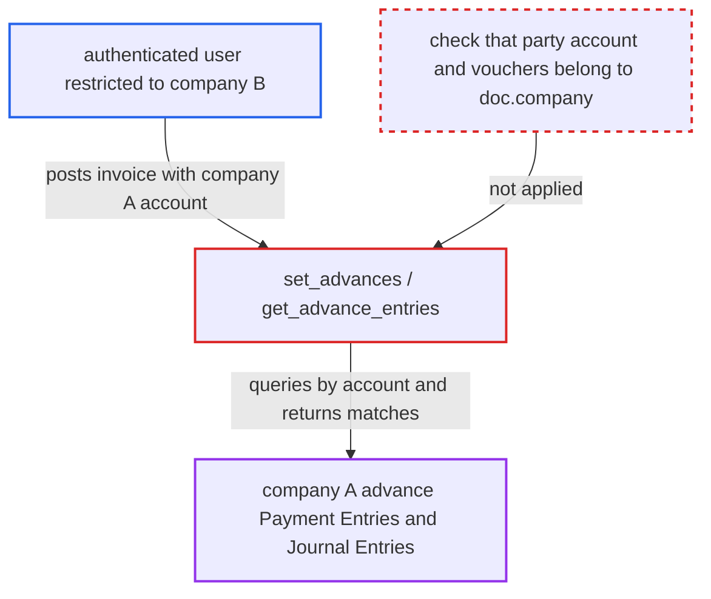

# set_advances uses client-supplied party account to list another company's advance payments

| Field | Value |
|---|---|
| ID | `find_01M5JnCkyHNqJiefe451P3NL` |
| Severity | **Medium** |
| Status | open |
| CWE | CWE-639 — Authorization bypass |
| Created | 2026-10-27T21:26:47.480487Z |
| Claude Security | https://claude.ai/security/findings/find_01M5JnCkyHNqJiefe451P3NL |

## Description

A logged-in user restricted to one company can read another company's open advance payments for a shared customer or supplier. The result shows voucher names, remarks, amounts, exchange rates and accounts. The attack needs only read access to Sales or Purchase Invoice and a posted unsaved invoice that names the other company's account. The cause is `get_advance_entries`, which trusts the client-supplied `debit_to` or `credit_to`, and the advance queries have no company filter.

1. **attacker** posts an unsaved invoice to `run_doc_method` with `method=set_advances`. The invoice sets `company` to the attacker's allowed company B, names a shared customer or supplier, and puts company A's receivable or payable account (for example `Debtors - A`) in `debit_to` or `credit_to`. ([`erpnext/controllers/accounts_controller.py:1172-1176`](https://github.com/cx-benchmark/erpnext/blob/90e7aefca73da3c440d2e8da7472fcb67838e678/erpnext/controllers/accounts_controller.py#L1172-L1176))
2. **`get_advance_entries`** builds `party_account` from the client's `debit_to` or `credit_to`. The company-bound account from `get_party_account(..., company=doc.company)` is only appended beside the client value, so company A's account stays in the list. ([`erpnext/accounts/services/advances.py:62-104`](https://github.com/cx-benchmark/erpnext/blob/90e7aefca73da3c440d2e8da7472fcb67838e678/erpnext/accounts/services/advances.py#L62-L104))
3. **`get_common_query`** selects Payment Entry rows by `paid_from` or `paid_to` in `party_account` and by party. The `payment_entry.company` filter is added only when a `condition` is passed, and this path passes none. ([`erpnext/accounts/services/advances.py:445-531`](https://github.com/cx-benchmark/erpnext/blob/90e7aefca73da3c440d2e8da7472fcb67838e678/erpnext/accounts/services/advances.py#L445-L531))
4. **`get_advance_journal_entries`** selects advance Journal Entry Account rows whose `account` is in `party_account`. This query has no company filter at all. ([`erpnext/accounts/services/advances.py:339-393`](https://github.com/cx-benchmark/erpnext/blob/90e7aefca73da3c440d2e8da7472fcb67838e678/erpnext/accounts/services/advances.py#L339-L393))
5. **`set_advances`** copies each match into the `advances` table of the document, which the response returns. It copies `reference_name`, `reference_row`, `remarks`, the full `advance_amount`, `ref_exchange_rate` and the account, so the attacker sees company A's advances. ([`erpnext/accounts/services/advances.py:27-59`](https://github.com/cx-benchmark/erpnext/blob/90e7aefca73da3c440d2e8da7472fcb67838e678/erpnext/accounts/services/advances.py#L27-L59))

## Assessment

The attacker is an authenticated desk user with read access to Sales Invoice (for example Accounts User) or Purchase Invoice (for example Accounts User or Purchase User). A User Permission limits this user to company B. The attacker needs a customer or supplier shared with company A. A party that is company-restricted away from the user's companies is blocked. The `restrict_to_companies` setting is off by default. The attacker calls `run_doc_method` directly with a forged invoice, so no victim action is needed.

Impact: The attacker learns the names, remarks (often payment reference or cheque details), amounts, exchange rates and accounts of open advance Payment Entries and Journal Entries of a company their permissions exclude. This is limited to open advance vouchers for a named party and account. Nothing is saved, because the document stays in memory.

## Recommendation

`get_advance_entries` uses the client-supplied `debit_to` or `credit_to` as a query key. The Payment Entry and Journal Entry advance queries have no company restriction. A user restricted to one company can therefore read another company's advance vouchers.

Fix criteria: The party account used for the advance lookup belongs to `doc.company`. Both advance queries return only vouchers of `doc.company`, a company the caller may read. To verify, call `set_advances` through `run_doc_method` on an unsaved invoice of an allowed company whose `debit_to` or `credit_to` is another company's account. The call must either fail or return no voucher of that other company.

## Evidence

**https://github.com/cx-benchmark/erpnext**

- [`erpnext/accounts/services/advances.py:62-104`](https://github.com/cx-benchmark/erpnext/blob/90e7aefca73da3c440d2e8da7472fcb67838e678/erpnext/accounts/services/advances.py#L62-L104)
- [`erpnext/accounts/services/advances.py:445-531`](https://github.com/cx-benchmark/erpnext/blob/90e7aefca73da3c440d2e8da7472fcb67838e678/erpnext/accounts/services/advances.py#L445-L531)
- [`erpnext/accounts/services/advances.py:339-393`](https://github.com/cx-benchmark/erpnext/blob/90e7aefca73da3c440d2e8da7472fcb67838e678/erpnext/accounts/services/advances.py#L339-L393)
- [`erpnext/accounts/services/advances.py:27-59`](https://github.com/cx-benchmark/erpnext/blob/90e7aefca73da3c440d2e8da7472fcb67838e678/erpnext/accounts/services/advances.py#L27-L59)
- [`erpnext/controllers/accounts_controller.py:1172-1176`](https://github.com/cx-benchmark/erpnext/blob/90e7aefca73da3c440d2e8da7472fcb67838e678/erpnext/controllers/accounts_controller.py#L1172-L1176)
- [`erpnext/public/js/controllers/transaction.js:2889-2900`](https://github.com/cx-benchmark/erpnext/blob/90e7aefca73da3c440d2e8da7472fcb67838e678/erpnext/public/js/controllers/transaction.js#L2889-L2900)
- [`erpnext/stock/doctype/pick_list/pick_list.py:722-727`](https://github.com/cx-benchmark/erpnext/blob/90e7aefca73da3c440d2e8da7472fcb67838e678/erpnext/stock/doctype/pick_list/pick_list.py#L722-L727)
- [`erpnext/stock/doctype/company_restriction/company_restriction.py:191-202`](https://github.com/cx-benchmark/erpnext/blob/90e7aefca73da3c440d2e8da7472fcb67838e678/erpnext/stock/doctype/company_restriction/company_restriction.py#L191-L202)

