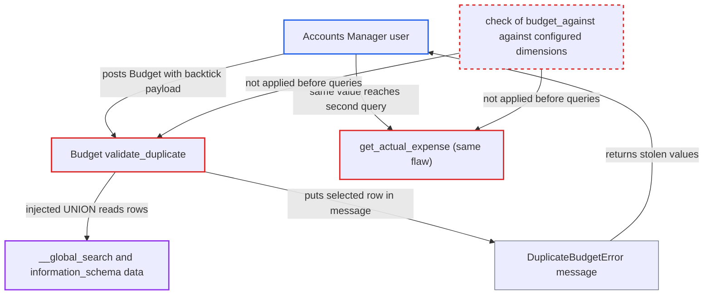

# SQL injection via Budget budget_against Select used as pypika column identifier

| Field | Value |
|---|---|
| ID | `find_01BB1PVu6FuPb2n9RQALHaZ7` |
| Severity | **Medium** |
| Status | open |
| CWE | CWE-89 — SQL injection |
| Created | 2026-10-27T22:14:34.785099Z |
| Claude Security | https://claude.ai/security/findings/find_01BB1PVu6FuPb2n9RQALHaZ7 |

## Description

A user with the `Accounts Manager` role can read data from other tables in the database, including every company's customer, supplier, employee and lead contact details, whatever their permissions or company. The attacker sends a Budget whose `budget_against` value contains a backtick. `Budget.validate_duplicate` and `get_actual_expense` turn that value into a SQL column name without escaping it, and Select options are checked only after `validate()`. Only reads are possible.

1. **attacker with the `Accounts Manager` role** posts a Budget to `/api/method/frappe.client.insert`. The `budget_against` value is the payload, and the scrubbed payload is added as an extra key of the document JSON with the value `1`. ([`erpnext/accounts/doctype/budget/budget.json`](https://github.com/cx-benchmark/erpnext/blob/90e7aefca73da3c440d2e8da7472fcb67838e678/erpnext/accounts/doctype/budget/budget.json))
2. **the controller `validate()`** accepts the value because the extra key exists. The only check is that `self.get(frappe.scrub(self.budget_against))` is truthy, and the attacker's extra key makes it true. Select options are checked later, in `_validate()`, so they do not stop the request. ([`erpnext/accounts/doctype/budget/budget.py:70-80`](https://github.com/cx-benchmark/erpnext/blob/90e7aefca73da3c440d2e8da7472fcb67838e678/erpnext/accounts/doctype/budget/budget.py#L70-L80))
3. **the method `validate_duplicate`** uses the scrubbed value as a query column name. `frappe.scrub` only lowercases the value and maps spaces and hyphens to `_`. pypika wraps the name in backticks without escaping, so a backtick in the value ends the identifier and the rest is parsed as SQL. The payload uses `/**/` for spaces and `#` to end the statement. ([`erpnext/accounts/doctype/budget/budget.py:112-139`](https://github.com/cx-benchmark/erpnext/blob/90e7aefca73da3c440d2e8da7472fcb67838e678/erpnext/accounts/doctype/budget/budget.py#L112-L139))
4. **the database** runs the injected UNION SELECT and returns an attacker-chosen row. The query runs as the site's DB user, and the injected row stands in for a duplicate Budget. ([`erpnext/accounts/doctype/budget/budget.py:112-139`](https://github.com/cx-benchmark/erpnext/blob/90e7aefca73da3c440d2e8da7472fcb67838e678/erpnext/accounts/doctype/budget/budget.py#L112-L139))
5. **the method `validate_duplicate`** puts the row's `name` and `account` values into the `DuplicateBudgetError` message. `frappe.throw` returns this message to the caller, so the stolen values come back in the error response. Changing the `LIMIT` offset reads further rows. ([`erpnext/accounts/doctype/budget/budget.py:142-149`](https://github.com/cx-benchmark/erpnext/blob/90e7aefca73da3c440d2e8da7472fcb67838e678/erpnext/accounts/doctype/budget/budget.py#L142-L149))

## Assessment

The attacker is a desk user with the `Accounts Manager` role. This is the only role with create permission on Budget, and it is not the trusted System Manager. They need a Budget for their own company, account and fiscal year. No victim action is needed. A second sink takes the same value: `get_actual_expense`, reached from `validate_existing_expenses`, builds a column key for the GL Entry query from it. On a default MariaDB, table names are case-sensitive and `frappe.scrub` lowercases the value, so only lowercase-named tables can be reached. A deployment with `lower_case_table_names=1` exposes every table. The report assumes (Frappe is not in the checkout) that `validate` runs before Select validation, that unknown keys are kept, that pypika does not escape identifiers, that `frappe.throw` messages reach the caller, and that stacked queries are impossible.

Impact: The attacker can read any lowercase-named table through the site's DB user. This includes `__global_search`, which holds every company's Customer, Supplier, Employee and Lead names, tax IDs, emails and phone numbers with no permission or company filter. It also includes `information_schema`, which holds the schema and the live SQL of other connections in `processlist.info`. No writes are possible, but expensive queries such as `sleep` or cross joins can tie up database and worker capacity.

## Recommendation

`Budget.budget_against` is a Select whose options are checked only after `validate()`. The code turns it into a column name with `frappe.scrub` in `validate_duplicate` and `get_actual_expense`, so an attacker-controlled string reaches pypika's unescaped identifier quoting.

Fix criteria: `validate()` rejects any `budget_against` that is not a configured budget dimension (Cost Center, Project or an Accounting Dimension document type) before any query is built. The column used in `validate_duplicate` and `get_actual_expense` comes from that validated mapping. To verify, insert a Budget whose `budget_against` contains a backtick, plus the matching extra key. The request must fail with a validation error, and no SQL containing the value may run.

## Evidence

**https://github.com/cx-benchmark/erpnext**

- [`erpnext/accounts/doctype/budget/budget.py:112-139`](https://github.com/cx-benchmark/erpnext/blob/90e7aefca73da3c440d2e8da7472fcb67838e678/erpnext/accounts/doctype/budget/budget.py#L112-L139)
- [`erpnext/accounts/doctype/budget/budget.py:142-149`](https://github.com/cx-benchmark/erpnext/blob/90e7aefca73da3c440d2e8da7472fcb67838e678/erpnext/accounts/doctype/budget/budget.py#L142-L149)
- [`erpnext/accounts/doctype/budget/budget.py:70-80`](https://github.com/cx-benchmark/erpnext/blob/90e7aefca73da3c440d2e8da7472fcb67838e678/erpnext/accounts/doctype/budget/budget.py#L70-L80)
- [`erpnext/accounts/doctype/budget/budget.py:757-802`](https://github.com/cx-benchmark/erpnext/blob/90e7aefca73da3c440d2e8da7472fcb67838e678/erpnext/accounts/doctype/budget/budget.py#L757-L802)
- [`erpnext/accounts/doctype/budget/budget.json`](https://github.com/cx-benchmark/erpnext/blob/90e7aefca73da3c440d2e8da7472fcb67838e678/erpnext/accounts/doctype/budget/budget.json)

