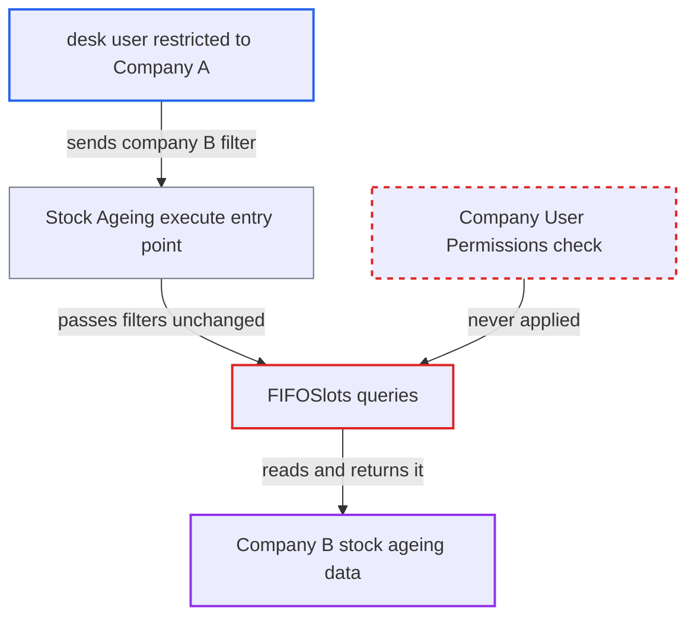

# Stock Ageing report does not apply Company user permissions

| Field | Value |
|---|---|
| ID | `find_0183131hCU91NTQCnuwHcQiE` |
| Severity | **Medium** |
| Status | open |
| CWE | CWE-862 — Missing authorization |
| Created | 2026-10-27T21:17:14.478583Z |
| Claude Security | https://claude.ai/security/findings/find_0183131hCU91NTQCnuwHcQiE |

## Description

A logged-in desk user restricted to Company A can read Company B's stock ageing data. This covers item-wise quantities, stock value per age bucket and ages, and per-warehouse figures when `show_warehouse_wise_stock` is set. It needs a report role such as Stock User and no Warehouse User Permission. The cause is that `FIFOSlots` in the Stock Ageing report scopes every query by the caller's `company` filter and never checks Company User Permissions.

1. **attacker** sends a direct call to `frappe.desk.query_report.run` for the Stock Ageing report with a company they are not allowed to see. The `company` filter is `reqd` and defaults to the user's company only in the desk UI, so a direct call can name any company, for example `company=B`. ([`erpnext/stock/report/stock_ageing/stock_ageing.js:6-13`](https://github.com/cx-benchmark/erpnext/blob/90e7aefca73da3c440d2e8da7472fcb67838e678/erpnext/stock/report/stock_ageing/stock_ageing.js#L6-L13))
2. **Frappe report runner** lets the call through on role and `report` permission alone. Stock User holds `report` on Item, so it passes the role-level gate. The report says it assumes Frappe does not filter Script Report rows by Company User Permissions, and the Frappe code is not in the checkout. ([`erpnext/stock/report/stock_ageing/stock_ageing.json:15-44`](https://github.com/cx-benchmark/erpnext/blob/90e7aefca73da3c440d2e8da7472fcb67838e678/erpnext/stock/report/stock_ageing/stock_ageing.json#L15-L44))
3. **the report function `execute`** runs `FIFOSlots(filters).generate()` with the caller's filters unchanged. No step checks the requested company against the user's Company User Permissions. ([`erpnext/stock/report/stock_ageing/stock_ageing.py:39-48`](https://github.com/cx-benchmark/erpnext/blob/90e7aefca73da3c440d2e8da7472fcb67838e678/erpnext/stock/report/stock_ageing/stock_ageing.py#L39-L48))
4. **the method `_get_stock_ledger_entries`** reads Stock Ledger Entry rows for the requested company. It filters `sle.company == filters.company` and narrows only by Warehouse User Permissions, which this attacker does not have. ([`erpnext/stock/report/stock_ageing/stock_ageing.py:1125-1183`](https://github.com/cx-benchmark/erpnext/blob/90e7aefca73da3c440d2e8da7472fcb67838e678/erpnext/stock/report/stock_ageing/stock_ageing.py#L1125-L1183))
5. **the Serial and Batch Bundle and prefetch queries** read more rows for the same caller-chosen company. `_get_bundle_wise_serial_nos`, `_get_bundle_wise_batch_nos`, `_prefetch_batchwise_valuations` and `_prefetch_valuation_methods` add no permission predicate at all. ([`erpnext/stock/report/stock_ageing/stock_ageing.py:1185-1255`](https://github.com/cx-benchmark/erpnext/blob/90e7aefca73da3c440d2e8da7472fcb67838e678/erpnext/stock/report/stock_ageing/stock_ageing.py#L1185-L1255))
6. **the report** returns the aggregated rows to the attacker. The rows hold per-item quantities, stock value per age bucket, and average, earliest and latest age, for any as-on date. ([`erpnext/stock/report/stock_ageing/stock_ageing.py:39-48`](https://github.com/cx-benchmark/erpnext/blob/90e7aefca73da3c440d2e8da7472fcb67838e678/erpnext/stock/report/stock_ageing/stock_ageing.py#L39-L48))

## Assessment

The attacker is an authenticated desk user with a report role: Item Manager, Stock Manager, Stock User, Sales User, Purchase User, Maintenance User, Accounts User or Manufacturing User. Their User Permission limits them to Company A, and they have no Warehouse User Permission. They call `/api/method/frappe.desk.query_report.run` with `report_name=Stock Ageing` and filters such as `company` set to B, `to_date`, `range` and `show_warehouse_wise_stock`. The report relies on an assumption about Frappe `>=17.0.0-dev,<18`, which is not in the checkout: that `frappe.desk.query_report.run` checks only the report's roles and `report` permission on the ref doctype. The report's columns have no Company link, so a row filter based on link columns could not apply a company limit either.

Impact: The attacker learns another company's item-wise and warehouse-wise stock quantities, stock value per age bucket and stock ages, at any as-on date. This is aggregate inventory data only: no transactions, parties or prices. There is no write or availability impact.

## Recommendation

Every query in `FIFOSlots` takes its company scope from the caller's `company` filter. That filter is never checked against, or intersected with, the companies the user's Company User Permissions allow.

Fix criteria: The requested `company` must be one the running user's Company User Permissions allow (applicable to Stock Ledger Entry). Otherwise the report returns nothing or raises PermissionError, on the ledger, bundle and prefetch queries alike. Verify: a Stock User restricted to Company A who requests Stock Ageing for `company=B` gets no rows.

## Evidence

**https://github.com/cx-benchmark/erpnext**

- [`erpnext/stock/report/stock_ageing/stock_ageing.py:1125-1183`](https://github.com/cx-benchmark/erpnext/blob/90e7aefca73da3c440d2e8da7472fcb67838e678/erpnext/stock/report/stock_ageing/stock_ageing.py#L1125-L1183)
- [`erpnext/stock/report/stock_ageing/stock_ageing.py:1185-1255`](https://github.com/cx-benchmark/erpnext/blob/90e7aefca73da3c440d2e8da7472fcb67838e678/erpnext/stock/report/stock_ageing/stock_ageing.py#L1185-L1255)
- [`erpnext/stock/report/stock_ageing/stock_ageing.py:39-48`](https://github.com/cx-benchmark/erpnext/blob/90e7aefca73da3c440d2e8da7472fcb67838e678/erpnext/stock/report/stock_ageing/stock_ageing.py#L39-L48)
- [`erpnext/stock/report/stock_ageing/stock_ageing.json:15-44`](https://github.com/cx-benchmark/erpnext/blob/90e7aefca73da3c440d2e8da7472fcb67838e678/erpnext/stock/report/stock_ageing/stock_ageing.json#L15-L44)
- [`erpnext/stock/report/stock_ageing/stock_ageing.js:6-13`](https://github.com/cx-benchmark/erpnext/blob/90e7aefca73da3c440d2e8da7472fcb67838e678/erpnext/stock/report/stock_ageing/stock_ageing.js#L6-L13)
- [`erpnext/stock/report/stock_ledger_entries_of_cancelled_vouchers/stock_ledger_entries_of_cancelled_vouchers.py:20-26`](https://github.com/cx-benchmark/erpnext/blob/90e7aefca73da3c440d2e8da7472fcb67838e678/erpnext/stock/report/stock_ledger_entries_of_cancelled_vouchers/stock_ledger_entries_of_cancelled_vouchers.py#L20-L26)

