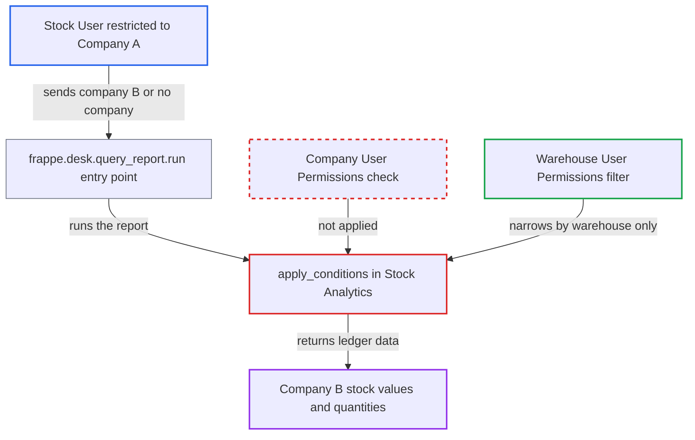

# Stock Analytics report does not apply Company user permissions

| Field | Value |
|---|---|
| ID | `find_0116rnh8KpYP8DHhLsp7enUT` |
| Severity | **Medium** |
| Status | open |
| CWE | CWE-862 — Missing authorization |
| Created | 2026-10-27T21:16:08.198681Z |
| Claude Security | https://claude.ai/security/findings/find_0116rnh8KpYP8DHhLsp7enUT |

## Description

A logged-in desk user restricted to Company A can read another company's item-wise stock quantities and stock values over time. Omitting the company filter returns data for every company on the site. This needs the Stock User, Stock Manager, Manufacturing User or Manufacturing Manager role. The cause is that `apply_conditions` in the Stock Analytics report never applies Company User Permissions.

1. **attacker** calls `/api/method/frappe.desk.query_report.run` directly. The attacker sends `report_name=Stock Analytics` with `company` set to `B` or left out, plus `from_date`, `to_date`, `range` and `value_quantity`; the `company` filter is required and defaulted only in the desk UI. ([`erpnext/stock/report/stock_analytics/stock_analytics.js:39-46`](https://github.com/cx-benchmark/erpnext/blob/90e7aefca73da3c440d2e8da7472fcb67838e678/erpnext/stock/report/stock_analytics/stock_analytics.js#L39-L46))
2. **the function `apply_conditions`** adds a company condition only if the caller sent one. The condition `sle.company == company` comes from the caller's own filter, and the only other row limit is the user's Warehouse User Permissions, so Company User Permissions are never checked. ([`erpnext/stock/report/stock_analytics/stock_analytics.py:350-354`](https://github.com/cx-benchmark/erpnext/blob/90e7aefca73da3c440d2e8da7472fcb67838e678/erpnext/stock/report/stock_analytics/stock_analytics.py#L350-L354))
3. **the function `get_stock_ledger_entries`** selects Stock Ledger Entry rows for every row that passes `apply_conditions`. It reads item, warehouse, company, actual_qty, valuation_rate, qty_after_transaction, stock_value_difference and stock_value. ([`erpnext/stock/report/stock_analytics/stock_analytics.py:305-334`](https://github.com/cx-benchmark/erpnext/blob/90e7aefca73da3c440d2e8da7472fcb67838e678/erpnext/stock/report/stock_analytics/stock_analytics.py#L305-L334))
4. **the function `get_items`** lists all stock items with no company scope. The Item restriction `get_allowed_masters_condition` drops only items flagged `restrict_to_companies`, so shared items still carry Company B's figures. ([`erpnext/stock/report/stock_analytics/stock_analytics.py:290-302`](https://github.com/cx-benchmark/erpnext/blob/90e7aefca73da3c440d2e8da7472fcb67838e678/erpnext/stock/report/stock_analytics/stock_analytics.py#L290-L302))
5. **the function `get_data`** turns the rows into per-item, per-period balances and returns them. It returns stock value, or quantity when `value_quantity=Quantity`, to the caller. ([`erpnext/stock/report/stock_analytics/stock_analytics.py:250-279`](https://github.com/cx-benchmark/erpnext/blob/90e7aefca73da3c440d2e8da7472fcb67838e678/erpnext/stock/report/stock_analytics/stock_analytics.py#L250-L279))

## Assessment

The attacker is an authenticated desk user with a report role (Stock User, Stock Manager, Manufacturing User or Manufacturing Manager). They have a User Permission limiting them to Company A and no Warehouse User Permission. They call `frappe.desk.query_report.run` for `Stock Analytics` with `company=B`, or leave `company` out. The report's `company` filter is enforced only in the client. The report does not say that any other entry point exists. It assumes `frappe.desk.query_report.run` checks only the report's roles and `report` permission on Stock Entry, and does not filter Script Report rows by Company User Permissions. That Frappe code is not in the checkout.

Impact: The attacker reads another company's item-wise stock quantities and stock values over time, or the whole site's when no company is sent. This is disclosure only. The report finds no write or availability impact.

## Recommendation

`apply_conditions` takes the company scope from the caller's filter. It never intersects that scope with the companies the running user is permitted to see.

Fix criteria: Every Stock Ledger Entry row the report uses has a `company` the running user is permitted by Company User Permissions, intersected with any caller filter. A non-permitted `company` yields nothing or a PermissionError. Verify that a Stock User restricted to Company A who requests `company=B`, or omits company, receives no Company B data.

## Evidence

**https://github.com/cx-benchmark/erpnext**

- [`erpnext/stock/report/stock_analytics/stock_analytics.py:350-354`](https://github.com/cx-benchmark/erpnext/blob/90e7aefca73da3c440d2e8da7472fcb67838e678/erpnext/stock/report/stock_analytics/stock_analytics.py#L350-L354)
- [`erpnext/stock/report/stock_analytics/stock_analytics.py:305-334`](https://github.com/cx-benchmark/erpnext/blob/90e7aefca73da3c440d2e8da7472fcb67838e678/erpnext/stock/report/stock_analytics/stock_analytics.py#L305-L334)
- [`erpnext/stock/report/stock_analytics/stock_analytics.py:290-302`](https://github.com/cx-benchmark/erpnext/blob/90e7aefca73da3c440d2e8da7472fcb67838e678/erpnext/stock/report/stock_analytics/stock_analytics.py#L290-L302)
- [`erpnext/stock/report/stock_analytics/stock_analytics.py:250-279`](https://github.com/cx-benchmark/erpnext/blob/90e7aefca73da3c440d2e8da7472fcb67838e678/erpnext/stock/report/stock_analytics/stock_analytics.py#L250-L279)
- [`erpnext/stock/report/stock_analytics/stock_analytics.js:39-46`](https://github.com/cx-benchmark/erpnext/blob/90e7aefca73da3c440d2e8da7472fcb67838e678/erpnext/stock/report/stock_analytics/stock_analytics.js#L39-L46)
- [`erpnext/stock/doctype/stock_entry/stock_entry.json:165-172`](https://github.com/cx-benchmark/erpnext/blob/90e7aefca73da3c440d2e8da7472fcb67838e678/erpnext/stock/doctype/stock_entry/stock_entry.json#L165-L172)
- [`erpnext/accounts/report/trial_balance/trial_balance.py:48-50`](https://github.com/cx-benchmark/erpnext/blob/90e7aefca73da3c440d2e8da7472fcb67838e678/erpnext/accounts/report/trial_balance/trial_balance.py#L48-L50)

