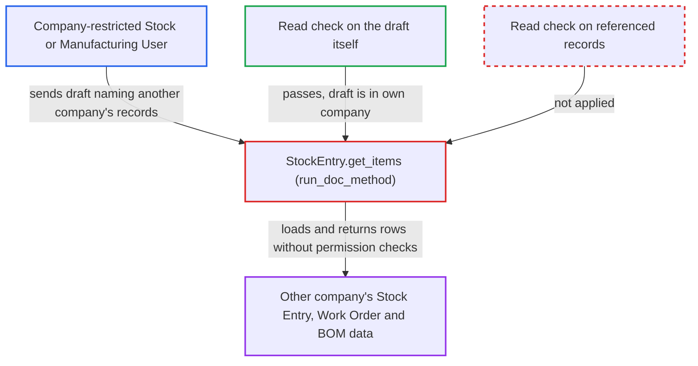

# Stock Entry get_items copies other companies' Stock Entry, Work Order and BOM data without read checks

| Field | Value |
|---|---|
| ID | `find_01RBdzxWeFyfoE4PodgKQ4sS` |
| Severity | **Medium** |
| Status | open |
| CWE | CWE-862 — Missing Authorization |
| Created | 2026-10-27T21:19:04.929635Z |
| Claude Security | https://claude.ai/security/findings/find_01RBdzxWeFyfoE4PodgKQ4sS |

## Description

A logged-in Stock User or Manufacturing User fenced to one company by a Company or Warehouse User Permission can read another company's stock and manufacturing data. This covers item lists, quantities, rates, warehouses and stock balances. The method `StockEntry.get_items` loads the Stock Entry, Work Order or BOM named in the caller's unsaved draft without checking read permission on those records. It is read-only.

1. **attacker (restricted desk user)** posts a `run_doc_method` call for `get_items` with an unsaved Stock Entry draft. The draft is in the attacker's own company, but `source_stock_entry`, `work_order` or `bom_no` points at another company's record, for example `purpose:"Disassemble"` with `source_stock_entry` set, or `purpose:"Material Issue"` with `bom_no` set.
2. **Frappe `run_doc_method`** checks read permission only on the draft itself. The draft is in the user's own company, so the check passes. The report notes the User Permission check covers only the draft's own link values. ([`erpnext/stock/doctype/company_restriction/company_restriction.py:191-223`](https://github.com/cx-benchmark/erpnext/blob/90e7aefca73da3c440d2e8da7472fcb67838e678/erpnext/stock/doctype/company_restriction/company_restriction.py#L191-L223))
3. **the method `get_items`** runs the purpose class's `add_items()` using the caller-named references. It performs no read check on the referenced Stock Entry, Work Order or BOM. ([`erpnext/stock/doctype/stock_entry/stock_entry.py:1636-1651`](https://github.com/cx-benchmark/erpnext/blob/90e7aefca73da3c440d2e8da7472fcb67838e678/erpnext/stock/doctype/stock_entry/stock_entry.py#L1636-L1651))
4. **the Disassemble and BOM code paths** load the referenced records with permission-less queries and copy their rows into the draft. Disassemble copies item, qty, `basic_rate`, warehouses and `bom_no` from any submitted `source_stock_entry`. The BOM paths return the components and rates of any submitted `bom_no`. The Work Order path returns `required_items` and additional costs. ([`erpnext/stock/doctype/stock_entry/services/disassemble.py:412-441`](https://github.com/cx-benchmark/erpnext/blob/90e7aefca73da3c440d2e8da7472fcb67838e678/erpnext/stock/doctype/stock_entry/services/disassemble.py#L412-L441))
5. **`set_actual_qty` and `calculate_rate_and_amount`** add the current stock balance and valuation rate for the copied rows. These are looked up in the other company's warehouses that were copied into the draft. ([`erpnext/stock/doctype/stock_entry/stock_entry.py:786-800`](https://github.com/cx-benchmark/erpnext/blob/90e7aefca73da3c440d2e8da7472fcb67838e678/erpnext/stock/doctype/stock_entry/stock_entry.py#L786-L800))
6. **Frappe `run_doc_method`** returns the filled draft to the attacker in `frappe.response.docs`. The response now holds the other company's data. ([`erpnext/stock/doctype/stock_entry/stock_entry.py:1636-1651`](https://github.com/cx-benchmark/erpnext/blob/90e7aefca73da3c440d2e8da7472fcb67838e678/erpnext/stock/doctype/stock_entry/stock_entry.py#L1636-L1651))

## Assessment

The attacker is a logged-in desk user with Stock User or Manufacturing User, restricted to company A by a Company or Warehouse User Permission. They call the whitelisted method through `/api/method` with `run_doc_method` and an unsaved draft in company A. The draft's `source_stock_entry`, `work_order` or `bom_no` names a record of company B. Sequential `MAT-STE-.YYYY.-` names make the records easy to enumerate. The report assumes Frappe `>=17.0.0-dev,<18`, which is not in the checkout, behaves as described. Every Stock Entry role already has role-level read on BOM, and Stock User and Manufacturing User have it on Work Order. The real gain is therefore bypassing record-level User Permissions.

Impact: The attacker can read the item composition, quantities, per-row `basic_rate` and warehouses of any submitted Stock Entry. They can also read the components and rates of any submitted BOM, a Work Order's required items and costs, and the current balance and valuation rate in those warehouses. The data is limited to these stock and manufacturing records, and nothing is written. Batch and serial values are not copied on the Disassemble path. Reserved serial and batch numbers can be added only when the Work Order reserves stock.

## Recommendation

`StockEntry.get_items` trusts the `source_stock_entry`, `work_order`, `bom_no` (and `job_card`/`subcontracting_order`) references in a caller-built draft. It loads their content with permission-less queries, so the only check that runs is the read check on the caller's own draft.

Fix criteria: Before any referenced record is read, `get_items` refuses the call unless the caller has record-level read, User Permissions included, on each referenced Stock Entry, Work Order, BOM and Job Card. This matches what `set_items_for_stock_in` and `get_disassembly_available_qty` already require. Verify with a Stock User restricted to company A who calls `get_items` with a company-B `source_stock_entry`, `work_order` or `bom_no`. The call must raise a PermissionError and return no company-B rows.

## Evidence

**https://github.com/cx-benchmark/erpnext**

- [`erpnext/stock/doctype/stock_entry/stock_entry.py:1636-1651`](https://github.com/cx-benchmark/erpnext/blob/90e7aefca73da3c440d2e8da7472fcb67838e678/erpnext/stock/doctype/stock_entry/stock_entry.py#L1636-L1651)
- [`erpnext/stock/doctype/stock_entry/services/disassemble.py:247-299`](https://github.com/cx-benchmark/erpnext/blob/90e7aefca73da3c440d2e8da7472fcb67838e678/erpnext/stock/doctype/stock_entry/services/disassemble.py#L247-L299)
- [`erpnext/stock/doctype/stock_entry/services/disassemble.py:412-441`](https://github.com/cx-benchmark/erpnext/blob/90e7aefca73da3c440d2e8da7472fcb67838e678/erpnext/stock/doctype/stock_entry/services/disassemble.py#L412-L441)
- [`erpnext/stock/doctype/stock_entry/services/disassemble.py:301-340`](https://github.com/cx-benchmark/erpnext/blob/90e7aefca73da3c440d2e8da7472fcb67838e678/erpnext/stock/doctype/stock_entry/services/disassemble.py#L301-L340)
- [`erpnext/stock/doctype/stock_entry/services/material_receipt_issue.py:51-64`](https://github.com/cx-benchmark/erpnext/blob/90e7aefca73da3c440d2e8da7472fcb67838e678/erpnext/stock/doctype/stock_entry/services/material_receipt_issue.py#L51-L64)
- [`erpnext/stock/doctype/stock_entry/services/manufacturing.py:1390-1436`](https://github.com/cx-benchmark/erpnext/blob/90e7aefca73da3c440d2e8da7472fcb67838e678/erpnext/stock/doctype/stock_entry/services/manufacturing.py#L1390-L1436)
- [`erpnext/stock/doctype/stock_entry/services/stock_entry_base.py:19-23`](https://github.com/cx-benchmark/erpnext/blob/90e7aefca73da3c440d2e8da7472fcb67838e678/erpnext/stock/doctype/stock_entry/services/stock_entry_base.py#L19-L23)
- [`erpnext/stock/doctype/stock_entry/stock_entry.py:786-800`](https://github.com/cx-benchmark/erpnext/blob/90e7aefca73da3c440d2e8da7472fcb67838e678/erpnext/stock/doctype/stock_entry/stock_entry.py#L786-L800)
- [`erpnext/stock/doctype/stock_entry/stock_entry.py:1610-1616`](https://github.com/cx-benchmark/erpnext/blob/90e7aefca73da3c440d2e8da7472fcb67838e678/erpnext/stock/doctype/stock_entry/stock_entry.py#L1610-L1616)
- [`erpnext/manufacturing/doctype/work_order/work_order.py:1333-1336`](https://github.com/cx-benchmark/erpnext/blob/90e7aefca73da3c440d2e8da7472fcb67838e678/erpnext/manufacturing/doctype/work_order/work_order.py#L1333-L1336)
- [`erpnext/stock/doctype/company_restriction/company_restriction.py:191-223`](https://github.com/cx-benchmark/erpnext/blob/90e7aefca73da3c440d2e8da7472fcb67838e678/erpnext/stock/doctype/company_restriction/company_restriction.py#L191-L223)

