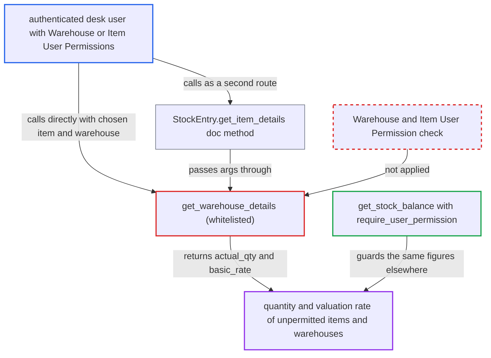

# Stock Entry get_warehouse_details discloses stock qty and valuation outside caller's User Permissions

| Field | Value |
|---|---|
| ID | `find_01TFfjpHx3iquHF8gvnNGzrR` |
| Severity | **Medium** |
| Status | open |
| CWE | CWE-862 — Missing Authorization |
| Created | 2026-10-27T21:50:25.421857Z |
| Claude Security | https://claude.ai/security/findings/find_01TFfjpHx3iquHF8gvnNGzrR |

## Description

A logged-in desk user fenced by Warehouse or Item User Permissions can read the on-hand quantity and valuation rate of any item in any warehouse, for any posting date. Only these two figures come back, and nothing is written. The whitelisted `get_warehouse_details` checks only doctype-level Item select and `check_warehouse_company`, and never checks the chosen warehouse or item against User Permissions.

1. **authenticated desk user** posts a request to the `get_warehouse_details` API method. The `args` carry an `item_code`, a `warehouse` outside the caller's User Permissions, a `posting_date`, a `posting_time` and a `qty` of -1. ([`erpnext/stock/doctype/stock_entry/stock_entry.py:2231-2255`](https://github.com/cx-benchmark/erpnext/blob/90e7aefca73da3c440d2e8da7472fcb67838e678/erpnext/stock/doctype/stock_entry/stock_entry.py#L2231-L2255))
2. **the function `get_warehouse_details`** runs only a doctype-level Item select check. Every desk user passes this check through the `Desk User` select row in `item.json`. It does not look at the chosen item or warehouse. ([`erpnext/stock/doctype/stock_entry/stock_entry.py:2231-2255`](https://github.com/cx-benchmark/erpnext/blob/90e7aefca73da3c440d2e8da7472fcb67838e678/erpnext/stock/doctype/stock_entry/stock_entry.py#L2231-L2255))
3. **the function `check_warehouse_company`** lets the request through. It acts only on Company User Permissions that apply to Item. A caller with only Warehouse or Item User Permissions passes it unconditionally. ([`erpnext/stock/utils.py:101-114`](https://github.com/cx-benchmark/erpnext/blob/90e7aefca73da3c440d2e8da7472fcb67838e678/erpnext/stock/utils.py#L101-L114))
4. **the function `get_previous_sle`** reads the stock ledger for the caller's item and warehouse. It runs raw `frappe.db.sql` on Stock Ledger Entry, filtered only by the caller's item, warehouse and date and time, with no User Permission filter. ([`erpnext/stock/stock_ledger.py:2497-2600`](https://github.com/cx-benchmark/erpnext/blob/90e7aefca73da3c440d2e8da7472fcb67838e678/erpnext/stock/stock_ledger.py#L2497-L2600))
5. **the function `_get_incoming_rate`** computes the valuation rate for the same item and warehouse. It returns the FIFO/LIFO queue rate, the moving-average `valuation_rate`, the serial or batch valuation, or the `get_valuation_rate` fallback. ([`erpnext/stock/utils.py:364-487`](https://github.com/cx-benchmark/erpnext/blob/90e7aefca73da3c440d2e8da7472fcb67838e678/erpnext/stock/utils.py#L364-L487))
6. **the function `get_warehouse_details`** returns `actual_qty` and `basic_rate` to the caller. The caller now holds stock quantity and cost data for an item or warehouse they are fenced from. ([`erpnext/stock/doctype/stock_entry/stock_entry.py:2231-2255`](https://github.com/cx-benchmark/erpnext/blob/90e7aefca73da3c440d2e8da7472fcb67838e678/erpnext/stock/doctype/stock_entry/stock_entry.py#L2231-L2255))

## Assessment

The attacker is an authenticated desk user whose access is limited by Warehouse or Item User Permissions, for example a Stock User limited to one store. No victim action is needed. They call `/api/method/erpnext.stock.doctype.stock_entry.stock_entry.get_warehouse_details` directly. The other way in is the whitelisted `StockEntry.get_item_details` doc method, which passes the caller's `args` to the same function. The role gate is also loose. Roles with no Item read, such as Manufacturing Manager and any desk user without a stock, sales, purchase or accounts role, pass on `Desk User` select. The in-code comment chooses `select` on purpose for the Stock Entry form, so this part is secondary. Users with a Company User Permission that applies to Item are still stopped by `check_warehouse_company`. The report assumes that `frappe.has_permission` called without a `doc` applies no User Permissions. This is based on the Frappe version in `pyproject.toml`, which is not in the checkout.

Impact: The attacker learns the on-hand quantity and valuation (cost) rate of items and warehouses outside their User Permissions, for any posting date. They can list them one call per item and warehouse pair. Only these two figures come back per call. Nothing is written and availability is not affected.

## Recommendation

`get_warehouse_details` reads stock ledger quantity and valuation for a caller-chosen item and warehouse after only a doctype-level Item select check and `check_warehouse_company`. It omits the Item and Warehouse User Permission checks that `get_stock_balance` and the Asset Capitalization `get_warehouse_details` apply.

Fix criteria: Before any ledger lookup, the function raises PermissionError when the caller's User Permissions do not allow `args.warehouse` (Warehouse) or `args.item_code` (Item). It also requires a stock-reading role, not just `Desk User` select. Check: a Stock User with a Warehouse User Permission for WH-A who calls it with WH-B gets PermissionError and no `actual_qty` or `basic_rate`. The same holds for an Item User Permission. The same holds for the `StockEntry.get_item_details` route. The Stock Entry form (`stock_entry.js:908-915`) still works for permitted warehouses.

## Evidence

**https://github.com/cx-benchmark/erpnext**

- [`erpnext/stock/doctype/stock_entry/stock_entry.py:2231-2255`](https://github.com/cx-benchmark/erpnext/blob/90e7aefca73da3c440d2e8da7472fcb67838e678/erpnext/stock/doctype/stock_entry/stock_entry.py#L2231-L2255)
- [`erpnext/stock/utils.py:101-114`](https://github.com/cx-benchmark/erpnext/blob/90e7aefca73da3c440d2e8da7472fcb67838e678/erpnext/stock/utils.py#L101-L114)
- [`erpnext/stock/stock_ledger.py:2497-2600`](https://github.com/cx-benchmark/erpnext/blob/90e7aefca73da3c440d2e8da7472fcb67838e678/erpnext/stock/stock_ledger.py#L2497-L2600)
- [`erpnext/stock/utils.py:364-487`](https://github.com/cx-benchmark/erpnext/blob/90e7aefca73da3c440d2e8da7472fcb67838e678/erpnext/stock/utils.py#L364-L487)
- [`erpnext/stock/utils.py:117-130`](https://github.com/cx-benchmark/erpnext/blob/90e7aefca73da3c440d2e8da7472fcb67838e678/erpnext/stock/utils.py#L117-L130)
- [`erpnext/assets/doctype/asset_capitalization/asset_capitalization.py:709-731`](https://github.com/cx-benchmark/erpnext/blob/90e7aefca73da3c440d2e8da7472fcb67838e678/erpnext/assets/doctype/asset_capitalization/asset_capitalization.py#L709-L731)
- [`erpnext/stock/tests/test_utils.py:321-333`](https://github.com/cx-benchmark/erpnext/blob/90e7aefca73da3c440d2e8da7472fcb67838e678/erpnext/stock/tests/test_utils.py#L321-L333)
- [`erpnext/stock/doctype/stock_entry/stock_entry.py:1478-1489`](https://github.com/cx-benchmark/erpnext/blob/90e7aefca73da3c440d2e8da7472fcb67838e678/erpnext/stock/doctype/stock_entry/stock_entry.py#L1478-L1489)

