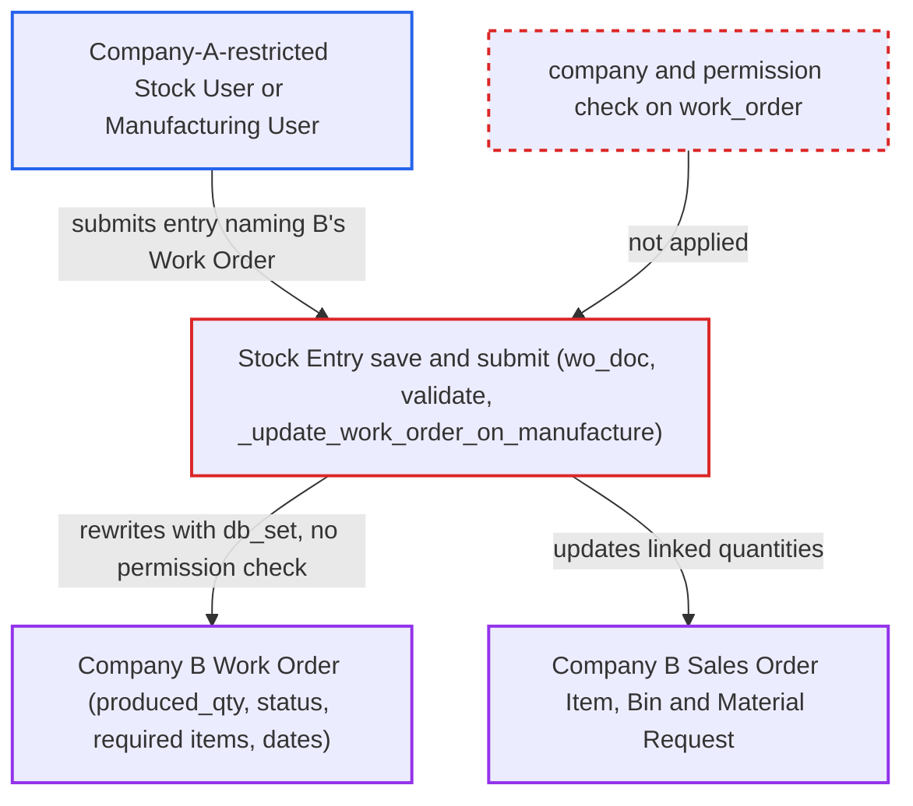

# Stock Entry work_order link lets a company-restricted user update another company's Work Order

| Field | Value |
|---|---|
| ID | `find_01NNjUg5jyGc2Z2wNfCg85xd` |
| Severity | **Medium** |
| Status | open |
| CWE | CWE-639 — Insecure Direct Object Reference |
| Created | 2026-10-27T22:33:19.615572Z |
| Claude Security | https://claude.ai/security/findings/find_01NNjUg5jyGc2Z2wNfCg85xd |

## Description

A user restricted to one company can change another company's Work Order and the records tied to it. The attacker needs a Stock User or Manufacturing User login limited by a Company User Permission to Company A. `Stock Entry.work_order` is a plain Link, and the save and submit path never checks that the Work Order belongs to the entry's `company` or that the user may access it.

1. **Company-A-restricted user** saves a Company-A Stock Entry whose `work_order` names a Company-B Work Order. The field is a Link to `Work Order` with no filter and no `ignore_user_permissions`, and the Work Order name can be guessed because names follow the sequential pattern `MFG-WO-.YYYY.-`. ([`erpnext/stock/doctype/stock_entry/stock_entry.json`](https://github.com/cx-benchmark/erpnext/blob/90e7aefca73da3c440d2e8da7472fcb67838e678/erpnext/stock/doctype/stock_entry/stock_entry.json))
2. **the property `wo_doc`** loads the foreign Work Order with a bare `frappe.get_doc`. No `check_permission` call and no `company` comparison happen, and `_validate_work_order` only checks docstatus and the Stopped or Closed status. ([`erpnext/stock/doctype/stock_entry/services/stock_entry_base.py:18-44`](https://github.com/cx-benchmark/erpnext/blob/90e7aefca73da3c440d2e8da7472fcb67838e678/erpnext/stock/doctype/stock_entry/services/stock_entry_base.py#L18-L44))
3. **the method `StockEntry.validate`** accepts the entry. It only compares the entry's rows with the Work Order's production item and quantity, and never compares the Work Order's company with `self.company`, so one raw-material row and one finished row in Company-A warehouses pass. ([`erpnext/stock/doctype/stock_entry/stock_entry.py:328-391`](https://github.com/cx-benchmark/erpnext/blob/90e7aefca73da3c440d2e8da7472fcb67838e678/erpnext/stock/doctype/stock_entry/stock_entry.py#L328-L391))
4. **Company-A-restricted user** submits the `Manufacture` entry, which runs `_update_work_order_on_manufacture`. This runs `update_work_order_qty`, `update_status`, `update_planned_qty` and `set_actual_dates` on Company B's Work Order, and `_validate_work_order` is the only check before them. ([`erpnext/stock/doctype/stock_entry/services/manufacturing.py:1164-1190`](https://github.com/cx-benchmark/erpnext/blob/90e7aefca73da3c440d2e8da7472fcb67838e678/erpnext/stock/doctype/stock_entry/services/manufacturing.py#L1164-L1190))
5. **the status service `_update_qty_for_purpose`** writes the summed finished quantity into `produced_qty` with `db_set`. `db_set` runs no permission check, and the total also goes into Company B's linked Sales Order Item `produced_qty` through `frappe.db.set_value`. ([`erpnext/manufacturing/doctype/work_order/services/status.py:214-240`](https://github.com/cx-benchmark/erpnext/blob/90e7aefca73da3c440d2e8da7472fcb67838e678/erpnext/manufacturing/doctype/work_order/services/status.py#L214-L240))
6. **the method `update_status`** sets the Work Order `status`, and `update_required_items` rewrites the required-item rows. The status becomes Completed once `produced_qty` reaches `qty`, and the Bin `reserved_qty_for_production` for B's source warehouses is recomputed. ([`erpnext/manufacturing/doctype/work_order/services/status.py:92-108`](https://github.com/cx-benchmark/erpnext/blob/90e7aefca73da3c440d2e8da7472fcb67838e678/erpnext/manufacturing/doctype/work_order/services/status.py#L92-L108))
7. **the method `update_planned_qty`** recomputes Company B's Bin `planned_qty` and updates the source Material Request. The Bin is the one for the production item in the Work Order's own `fg_warehouse`, which belongs to Company B. ([`erpnext/manufacturing/doctype/work_order/services/status.py:392-404`](https://github.com/cx-benchmark/erpnext/blob/90e7aefca73da3c440d2e8da7472fcb67838e678/erpnext/manufacturing/doctype/work_order/services/status.py#L392-L404))

## Assessment

The attacker is a Stock User or Manufacturing User restricted by a Company User Permission to Company A. They save and submit, through `/api/resource/Stock Entry`, a Company-A `Manufacture` entry whose `work_order` is a guessed Company-B name. It has one raw-material row and one finished row for that order's production item, all in Company-A warehouses, with `fg_completed_qty` at most the order's qty. The production item can be found through the finished-item auto-flag and the error messages. Another way in is a `Material Transfer for Manufacture` entry with `fg_completed_qty` 0, which rewrites the transferred quantities and status. With a non-zero quantity, `add_additional_items` calls `self.doc.save()`, and the write permission check stops the user. No victim action is needed under default settings.

Impact: The attacker can mark another company's Work Order Completed with a chosen `produced_qty`. They can also rewrite its required-item and transferred quantities and its actual dates. The linked Sales Order Item `produced_qty`, the Production Plan or Material Request, and Company B's Bin planned and reserved quantities change as well. Company B's own later Manufacture entries are refused, and the Work Order cannot be cancelled until a user with Company-A access cancels the hidden entry. Validation errors also reveal the Work Order's quantity, operations, job cards and pending material quantities. For routed orders the damage is capped at the completed operation quantity. Company B's stock and GL ledgers are untouched.

## Recommendation

(1) The Stock Entry trusts the client-supplied `work_order` Link. The submit and cancel roll-ups write the referenced Work Order with permission-free `db_set` calls, and nothing checks that the Work Order belongs to the entry's company or that the user may access it.

Fix criteria: A Stock Entry whose `work_order` names a Work Order of a different `company` is rejected during validate, and again before the submit and cancel roll-ups. The submitting user must also hold a user-permission-aware permission on that Work Order. Verify that a Company-A-restricted user who submits a `Manufacture` or `Material Transfer for Manufacture` entry against a Company-B Work Order gets an error. The Work Order's `produced_qty`, `status`, required items, Bins and Sales Order Item must stay unchanged.

(2) The validations that read the Work Order run before any ownership check. Their messages give its planned qty, operations, job cards and pending material quantities to a user who may not read it.

Fix criteria: The company or permission check runs before `validate_finished_goods`, `check_if_operations_completed`, `check_duplicate_entry_for_work_order` and `_validate_no_excess_transfer`. A user without access to the Work Order gets only a generic error that reveals nothing about it.

## Evidence

**https://github.com/cx-benchmark/erpnext**

- [`erpnext/stock/doctype/stock_entry/services/stock_entry_base.py:18-44`](https://github.com/cx-benchmark/erpnext/blob/90e7aefca73da3c440d2e8da7472fcb67838e678/erpnext/stock/doctype/stock_entry/services/stock_entry_base.py#L18-L44)
- [`erpnext/stock/doctype/stock_entry/stock_entry.py:328-391`](https://github.com/cx-benchmark/erpnext/blob/90e7aefca73da3c440d2e8da7472fcb67838e678/erpnext/stock/doctype/stock_entry/stock_entry.py#L328-L391)
- [`erpnext/stock/doctype/stock_entry/services/manufacturing.py:1164-1190`](https://github.com/cx-benchmark/erpnext/blob/90e7aefca73da3c440d2e8da7472fcb67838e678/erpnext/stock/doctype/stock_entry/services/manufacturing.py#L1164-L1190)
- [`erpnext/manufacturing/doctype/work_order/services/status.py:214-240`](https://github.com/cx-benchmark/erpnext/blob/90e7aefca73da3c440d2e8da7472fcb67838e678/erpnext/manufacturing/doctype/work_order/services/status.py#L214-L240)
- [`erpnext/manufacturing/doctype/work_order/services/status.py:92-108`](https://github.com/cx-benchmark/erpnext/blob/90e7aefca73da3c440d2e8da7472fcb67838e678/erpnext/manufacturing/doctype/work_order/services/status.py#L92-L108)
- [`erpnext/manufacturing/doctype/work_order/services/status.py:392-404`](https://github.com/cx-benchmark/erpnext/blob/90e7aefca73da3c440d2e8da7472fcb67838e678/erpnext/manufacturing/doctype/work_order/services/status.py#L392-L404)
- [`erpnext/selling/doctype/sales_order/sales_order.py:890-905`](https://github.com/cx-benchmark/erpnext/blob/90e7aefca73da3c440d2e8da7472fcb67838e678/erpnext/selling/doctype/sales_order/sales_order.py#L890-L905)
- [`erpnext/stock/doctype/stock_entry/services/material_transfer.py:566-584`](https://github.com/cx-benchmark/erpnext/blob/90e7aefca73da3c440d2e8da7472fcb67838e678/erpnext/stock/doctype/stock_entry/services/material_transfer.py#L566-L584)
- [`erpnext/stock/doctype/stock_entry/services/manufacturing.py:468-510`](https://github.com/cx-benchmark/erpnext/blob/90e7aefca73da3c440d2e8da7472fcb67838e678/erpnext/stock/doctype/stock_entry/services/manufacturing.py#L468-L510)
- [`erpnext/manufacturing/doctype/work_order/work_order.py:986-1002`](https://github.com/cx-benchmark/erpnext/blob/90e7aefca73da3c440d2e8da7472fcb67838e678/erpnext/manufacturing/doctype/work_order/work_order.py#L986-L1002)
- [`erpnext/manufacturing/doctype/work_order/work_order.py:1378-1385`](https://github.com/cx-benchmark/erpnext/blob/90e7aefca73da3c440d2e8da7472fcb67838e678/erpnext/manufacturing/doctype/work_order/work_order.py#L1378-L1385)
- [`erpnext/stock/doctype/stock_entry/stock_entry.py:2068-2105`](https://github.com/cx-benchmark/erpnext/blob/90e7aefca73da3c440d2e8da7472fcb67838e678/erpnext/stock/doctype/stock_entry/stock_entry.py#L2068-L2105)
- [`erpnext/stock/doctype/stock_entry/stock_entry.json`](https://github.com/cx-benchmark/erpnext/blob/90e7aefca73da3c440d2e8da7472fcb67838e678/erpnext/stock/doctype/stock_entry/stock_entry.json)

