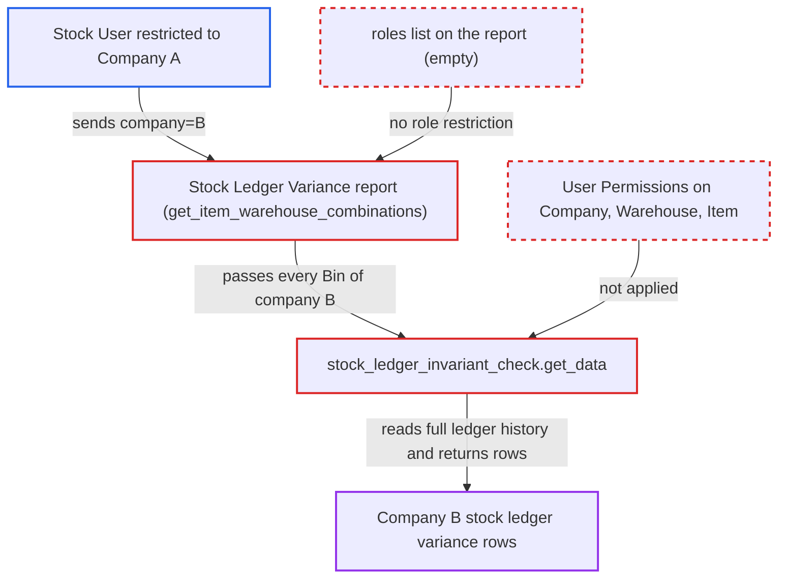

# Stock Ledger Variance report has no role list and ignores user permissions

| Field | Value |
|---|---|
| ID | `find_011UmAFUSZvtBDXRdW3bkYHs` |
| Severity | **Medium** |
| Status | open |
| CWE | CWE-862 — Missing authorization |
| Created | 2026-10-27T21:17:56.161145Z |
| Claude Security | https://claude.ai/security/findings/find_011UmAFUSZvtBDXRdW3bkYHs |

## Description

A logged-in user with the `report` permission on Stock Ledger Entry (Stock User or Accounts Manager) can read stock ledger data of companies they are not allowed to see. This includes rates, values, FIFO queue and voucher references, limited to rows that show a variance. The report has an empty `roles` list, and `get_item_warehouse_combinations` and the wrapped `get_stock_ledger_entries` ignore User Permissions. The only company scope is the caller's `company` filter.

1. **authenticated Stock User** calls `/api/method/frappe.desk.query_report.run` for the Stock Ledger Variance report. The user is restricted by User Permissions to Company A, but sends `filters={company:'B', include_disabled:1}`. `item_code` and `warehouse` filters are optional.
2. **Frappe `Report.is_permitted`** lets the call through. The report's `roles` list is empty, which Frappe reads as no role restriction. Anyone holding the `report` permission on Stock Ledger Entry passes, although the wrapped Stock Ledger Invariant Check report is limited to System Manager. ([`erpnext/stock/report/stock_ledger_variance/stock_ledger_variance.json`](https://github.com/cx-benchmark/erpnext/blob/90e7aefca73da3c440d2e8da7472fcb67838e678/erpnext/stock/report/stock_ledger_variance/stock_ledger_variance.json))
3. **`get_item_warehouse_combinations`** lists every item/warehouse Bin of the chosen company. It filters only on `warehouse.company == filters.company`. It adds no User Permission condition on Company, Warehouse or Item. ([`erpnext/stock/report/stock_ledger_variance/stock_ledger_variance.py:239-262`](https://github.com/cx-benchmark/erpnext/blob/90e7aefca73da3c440d2e8da7472fcb67838e678/erpnext/stock/report/stock_ledger_variance/stock_ledger_variance.py#L239-L262))
4. **report's `get_data`** passes each combination to `stock_ledger_invariant_check.get_data`. It returns the first differing row for each item/warehouse, with all of its fields. ([`erpnext/stock/report/stock_ledger_variance/stock_ledger_variance.py:200-236`](https://github.com/cx-benchmark/erpnext/blob/90e7aefca73da3c440d2e8da7472fcb67838e678/erpnext/stock/report/stock_ledger_variance/stock_ledger_variance.py#L200-L236))
5. **`stock_ledger_invariant_check.get_data`** reads the full Stock Ledger Entry history with `frappe.get_all`. `frappe.get_all` does not apply User Permissions, so Company B's entries are read for a user restricted to Company A. ([`erpnext/stock/report/stock_ledger_invariant_check/stock_ledger_invariant_check.py:47-53`](https://github.com/cx-benchmark/erpnext/blob/90e7aefca73da3c440d2e8da7472fcb67838e678/erpnext/stock/report/stock_ledger_invariant_check/stock_ledger_invariant_check.py#L47-L53))
6. **the report** returns the variance rows to the caller. The rows hold quantities after transaction, incoming and outgoing rates, valuation rate, stock value, FIFO queue, voucher references and batch/serial data.

## Assessment

The attacker is an authenticated desk user with the Stock User or Accounts Manager role, which carry the `report` permission on Stock Ledger Entry. They may be restricted by User Permissions to Company A. They need no other setting or victim action. They send the report request with another company's name in the `company` filter. The report document sets no roles, so no extra role is needed. Even a user with no User Permission restrictions gains a view that was meant for System Managers.

Impact: The attacker reads valuation-level stock ledger data (rates, values, FIFO queue, voucher references, batch/serial) for any company, bypassing their Company restriction. Only rows that show a variance are returned, and the report has no write or availability impact.

## Recommendation

The report's company, warehouse and item scope is only the caller's filter, with no check against the running user's User Permissions. The Report document also declares no roles, so the System Manager restriction of the wrapped report is lost.

Fix criteria: The Report declares roles at least as restrictive as Stock Ledger Invariant Check. The item/warehouse combinations and Stock Ledger Entry rows are limited to companies, warehouses and items the running user is permitted by User Permissions. A Stock User restricted to Company A cannot obtain Company B rows by sending `company=B`. A user without the declared role cannot run the report.

## Evidence

**https://github.com/cx-benchmark/erpnext**

- [`erpnext/stock/report/stock_ledger_variance/stock_ledger_variance.py:239-262`](https://github.com/cx-benchmark/erpnext/blob/90e7aefca73da3c440d2e8da7472fcb67838e678/erpnext/stock/report/stock_ledger_variance/stock_ledger_variance.py#L239-L262)
- [`erpnext/stock/report/stock_ledger_variance/stock_ledger_variance.py:200-236`](https://github.com/cx-benchmark/erpnext/blob/90e7aefca73da3c440d2e8da7472fcb67838e678/erpnext/stock/report/stock_ledger_variance/stock_ledger_variance.py#L200-L236)
- [`erpnext/stock/report/stock_ledger_variance/stock_ledger_variance.json`](https://github.com/cx-benchmark/erpnext/blob/90e7aefca73da3c440d2e8da7472fcb67838e678/erpnext/stock/report/stock_ledger_variance/stock_ledger_variance.json)
- [`erpnext/stock/report/stock_ledger_invariant_check/stock_ledger_invariant_check.py:47-53`](https://github.com/cx-benchmark/erpnext/blob/90e7aefca73da3c440d2e8da7472fcb67838e678/erpnext/stock/report/stock_ledger_invariant_check/stock_ledger_invariant_check.py#L47-L53)

