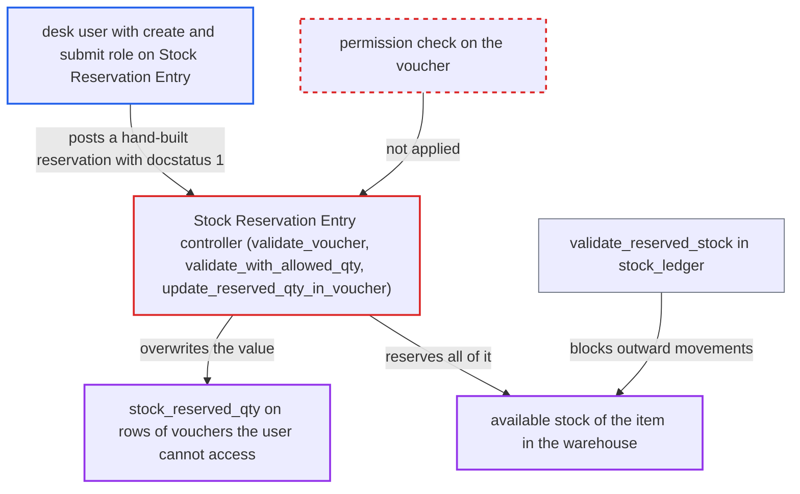

# Stock Reservation Entry can be created directly against any voucher without voucher permission

| Field | Value |
|---|---|
| ID | `find_01PpFiTbBWDo1vjTu2Yirddh` |
| Severity | **Medium** |
| Status | open |
| CWE | CWE-862 — Missing Authorization |
| Created | 2026-10-27T21:32:36.723986Z |
| Claude Security | https://claude.ai/security/findings/find_01PpFiTbBWDo1vjTu2Yirddh |

## Description

A logged-in user with a common stock or sales role can reserve all available stock of an item in a warehouse of their own company against any submitted voucher, and can overwrite `stock_reserved_qty` on voucher rows they have no permission on. The reservation then blocks outward stock movements of that item from that warehouse. The user needs a role with create and submit on Stock Reservation Entry, such as Sales User, Purchase User, Stock User or Manufacturing User. The controller never checks permission on the voucher and trusts the caller's `voucher_no`, `voucher_detail_no` and `voucher_qty`.

1. **authenticated desk user** posts a complete Stock Reservation Entry to `/api/resource/Stock Reservation Entry` with `docstatus: 1`. The doctype grants `create` and `submit` to ordinary roles, because the intended server path calls `sre.save()` and `sre.submit()` without `ignore_permissions`, and Frappe applies `in_create` and `read_only` only in the desk UI. ([`erpnext/stock/doctype/stock_reservation_entry/stock_reservation_entry.py:1985-1993`](https://github.com/cx-benchmark/erpnext/blob/90e7aefca73da3c440d2e8da7472fcb67838e678/erpnext/stock/doctype/stock_reservation_entry/stock_reservation_entry.py#L1985-L1993))
2. **`validate_voucher`** accepts the entry once `voucher_no` is a submitted document. It never checks the caller's permission on the voucher. It checks that `voucher_detail_no` belongs to the voucher for Sales Order only, not for Work Order, Production Plan, Subcontracting Order or Subcontracting Inward Order. ([`erpnext/stock/doctype/stock_reservation_entry/stock_reservation_entry.py:92-118`](https://github.com/cx-benchmark/erpnext/blob/90e7aefca73da3c440d2e8da7472fcb67838e678/erpnext/stock/doctype/stock_reservation_entry/stock_reservation_entry.py#L92-L118))
3. **`validate_with_allowed_qty`** caps `reserved_qty` using the caller's own `voucher_qty`. The payload supplies `voucher_qty`, for example 1e9, so the cap shrinks to the available stock in the warehouse. ([`erpnext/stock/doctype/stock_reservation_entry/stock_reservation_entry.py:683-712`](https://github.com/cx-benchmark/erpnext/blob/90e7aefca73da3c440d2e8da7472fcb67838e678/erpnext/stock/doctype/stock_reservation_entry/stock_reservation_entry.py#L683-L712))
4. **`update_reserved_qty_in_voucher`** writes `stock_reserved_qty` with `frappe.db.set_value` onto the row named by `voucher_detail_no`. This runs on submit and bypasses permissions on the voucher, so the Sales Order Item, Work Order Item, Production Plan Sub Assembly Item or Subcontracting Order Supplied Item row changes. ([`erpnext/stock/doctype/stock_reservation_entry/stock_reservation_entry.py:587-623`](https://github.com/cx-benchmark/erpnext/blob/90e7aefca73da3c440d2e8da7472fcb67838e678/erpnext/stock/doctype/stock_reservation_entry/stock_reservation_entry.py#L587-L623))
5. **`stock_ledger.validate_reserved_stock`** rejects outward stock ledger entries that would draw into `Bin.reserved_stock`. With stock reservation enabled, deliveries, issues and reconciliations of that item from that warehouse fail until a Stock Manager cancels the rogue reservation.

## Assessment

The attacker is an authenticated desk user restricted to company A. They hold any role with `create` and `submit` on Stock Reservation Entry: Sales User, Purchase User, Stock User, Manufacturing User, or their managers. They POST an entry with a company A warehouse, `voucher_type` set to Work Order, any submitted `voucher_no`, any Work Order Item name as `voucher_detail_no`, a huge `voucher_qty`, and `reserved_qty` equal to the available quantity. The role and company checks pass. No victim action is needed. The same route works against any submitted Sales Order, Work Order or Subcontracting Order of any company. The blocking of stock movements applies when stock reservation is enabled. The report assumes Frappe, pinned at `>=17.0.0-dev`, enforces `in_create` and `read_only` only in the UI.

Impact: The attacker can reserve the full available stock of an item in a warehouse of their own company against vouchers they have no permission on. They can overwrite `stock_reserved_qty` on rows of those vouchers. They control the value only within the warehouse's available stock. Deliveries, issues and reconciliations of that item from that warehouse are blocked until the reservation is cancelled. No data is disclosed.

## Recommendation

`StockReservationEntry.validate` and `before_submit` trust the caller-supplied `voucher_no`, `voucher_detail_no` and `voucher_qty`. They never check the caller's permission on the voucher or that the row belongs to it. Ordinary roles can create and submit the doctype, so the intended server path can save without `ignore_permissions`.

Fix criteria: An entry is accepted only if the caller has write permission on the referenced voucher, for example `frappe.has_permission(voucher_type, "write", voucher_no, throw=True)`, unless trusted server code sets `flags.ignore_permissions`. `voucher_detail_no` is verified to be a row of `voucher_no` for every voucher type. `voucher_qty` is derived from that row, not taken from the payload. To check, insert an entry via `/api/resource` as a Sales User against a Work Order they cannot read. It must raise a PermissionError, and `Work Order Item.stock_reserved_qty` must not change.

## Evidence

**https://github.com/cx-benchmark/erpnext**

- [`erpnext/stock/doctype/stock_reservation_entry/stock_reservation_entry.py:92-118`](https://github.com/cx-benchmark/erpnext/blob/90e7aefca73da3c440d2e8da7472fcb67838e678/erpnext/stock/doctype/stock_reservation_entry/stock_reservation_entry.py#L92-L118)
- [`erpnext/stock/doctype/stock_reservation_entry/stock_reservation_entry.py:683-712`](https://github.com/cx-benchmark/erpnext/blob/90e7aefca73da3c440d2e8da7472fcb67838e678/erpnext/stock/doctype/stock_reservation_entry/stock_reservation_entry.py#L683-L712)
- [`erpnext/stock/doctype/stock_reservation_entry/stock_reservation_entry.py:587-623`](https://github.com/cx-benchmark/erpnext/blob/90e7aefca73da3c440d2e8da7472fcb67838e678/erpnext/stock/doctype/stock_reservation_entry/stock_reservation_entry.py#L587-L623)
- [`erpnext/stock/doctype/stock_reservation_entry/stock_reservation_entry.py:1985-1993`](https://github.com/cx-benchmark/erpnext/blob/90e7aefca73da3c440d2e8da7472fcb67838e678/erpnext/stock/doctype/stock_reservation_entry/stock_reservation_entry.py#L1985-L1993)
- [`erpnext/stock/doctype/stock_reservation_entry/stock_reservation_entry.json`](https://github.com/cx-benchmark/erpnext/blob/90e7aefca73da3c440d2e8da7472fcb67838e678/erpnext/stock/doctype/stock_reservation_entry/stock_reservation_entry.json)

