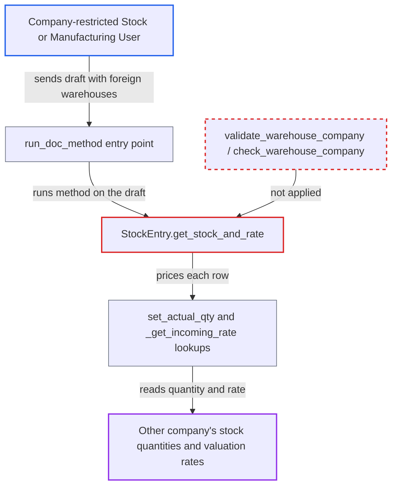

# StockEntry.get_stock_and_rate prices caller-built rows for warehouses of other companies

| Field | Value |
|---|---|
| ID | `find_01KCxgHFiSpxWhJXDT5Yidba` |
| Severity | **Medium** |
| Status | open |
| CWE | CWE-862 — Missing Authorization |
| Created | 2026-10-27T21:52:41.383913Z |
| Claude Security | https://claude.ai/security/findings/find_01KCxgHFiSpxWhJXDT5Yidba |

## Description

A logged-in user restricted to one company can read another company's stock quantities and valuation rates, item by item. The user needs read access to Stock Entry, such as a Stock User or Manufacturing User, and a Company User Permission. The whitelisted method `get_stock_and_rate` looks up stock for warehouses named in a client-built draft without checking that they belong to the draft's company or to the caller's permissions.

1. **Attacker** posts a draft Stock Entry to `run_doc_method` with `method=get_stock_and_rate`. The draft names the attacker's own company in `company` and lists rows whose `s_warehouse` or `t_warehouse` is a warehouse of another company, for example `Stores - B`.
2. **Frappe** builds the unsaved document from the JSON and checks only read permission. The company check passes because the attacker supplied their own company, and the report assumes the Warehouse link fields are skipped because the user has no Warehouse permission to test against.
3. **the method `get_stock_and_rate`** calls `set_actual_qty()` and `calculate_rate_and_amount()` on the client-built rows. No check ties the rows' warehouses to `self.company` or to the caller's permissions first. ([`erpnext/stock/doctype/stock_entry/stock_entry.py:578-583`](https://github.com/cx-benchmark/erpnext/blob/90e7aefca73da3c440d2e8da7472fcb67838e678/erpnext/stock/doctype/stock_entry/stock_entry.py#L578-L583))
4. **the row method `set_actual_qty`** reads the previous stock ledger entry for the row's warehouse. It stores `qty_after_transaction` into `actual_qty` on the row. ([`erpnext/stock/doctype/stock_entry_detail/stock_entry_detail.py:203-214`](https://github.com/cx-benchmark/erpnext/blob/90e7aefca73da3c440d2e8da7472fcb67838e678/erpnext/stock/doctype/stock_entry_detail/stock_entry_detail.py#L203-L214))
5. **`set_rate_for_outgoing_items`** calls `_get_incoming_rate` with the row's warehouse and writes the valuation into `basic_rate`. The args are built from `item.s_warehouse or item.t_warehouse`, and `_get_incoming_rate` has no company guard of its own. ([`erpnext/stock/doctype/stock_entry/stock_entry.py:786-819`](https://github.com/cx-benchmark/erpnext/blob/90e7aefca73da3c440d2e8da7472fcb67838e678/erpnext/stock/doctype/stock_entry/stock_entry.py#L786-L819))
6. **the save-time check `validate_warehouse_company`** never runs on this path. It lives in `validate_warehouse`, which runs only when a document is validated or saved, and this draft is never saved. ([`erpnext/controllers/stock_controller.py:312-331`](https://github.com/cx-benchmark/erpnext/blob/90e7aefca73da3c440d2e8da7472fcb67838e678/erpnext/controllers/stock_controller.py#L312-L331))
7. **`run_doc_method`** returns the modified document to the caller. Each row now carries `actual_qty` and `basic_rate` for the other company's warehouse. ([`erpnext/stock/doctype/stock_entry/stock_entry.py:578-583`](https://github.com/cx-benchmark/erpnext/blob/90e7aefca73da3c440d2e8da7472fcb67838e678/erpnext/stock/doctype/stock_entry/stock_entry.py#L578-L583))

## Assessment

The attacker is an authenticated desk user with read access to Stock Entry, such as a Stock User or Manufacturing User. A Company User Permission limits that user to one company, here Company A. No victim action is needed. The attacker sends a crafted Stock Entry JSON with `company` set to their own company and rows naming another company's warehouses. For example, `purpose` is `Material Issue` and `s_warehouse` is `Stores - B`. The attack depends on an assumption in the report: Frappe's `has_user_permission` skips link fields whose target doctype has no User Permission for that user, in frappe >=17.0.0-dev,\<18 per `pyproject.toml`. Many rows can go in one call, so the data can be listed in bulk.

Impact: The attacker reads another company's on-hand stock quantities and inventory valuation rates for any item and warehouse they list. Nothing is written, because the draft is never saved.

## Recommendation

The whitelisted method `get_stock_and_rate` reads stock and prices rows for warehouses taken as-is from the client-built draft. It does not tie them to `self.company` or to the caller's Warehouse and Company permissions before calling `_get_incoming_rate` or `get_previous_sle`.

Fix criteria: Before any ledger lookup, `get_stock_and_rate` refuses rows whose `s_warehouse` or `t_warehouse` fail `validate_warehouse_company(warehouse, self.company)` and the caller's Warehouse and Company User Permissions, for example through `erpnext.require_user_permission("Warehouse", ...)` or `check_warehouse_company`. A Company-A-restricted Stock User calling `run_doc_method get_stock_and_rate` with a Company-B warehouse gets a PermissionError and no `actual_qty` or `basic_rate`. A permitted draft still gets its rates.

## Evidence

**https://github.com/cx-benchmark/erpnext**

- [`erpnext/stock/doctype/stock_entry/stock_entry.py:578-583`](https://github.com/cx-benchmark/erpnext/blob/90e7aefca73da3c440d2e8da7472fcb67838e678/erpnext/stock/doctype/stock_entry/stock_entry.py#L578-L583)
- [`erpnext/stock/doctype/stock_entry/stock_entry.py:786-819`](https://github.com/cx-benchmark/erpnext/blob/90e7aefca73da3c440d2e8da7472fcb67838e678/erpnext/stock/doctype/stock_entry/stock_entry.py#L786-L819)
- [`erpnext/stock/doctype/stock_entry_detail/stock_entry_detail.py:203-214`](https://github.com/cx-benchmark/erpnext/blob/90e7aefca73da3c440d2e8da7472fcb67838e678/erpnext/stock/doctype/stock_entry_detail/stock_entry_detail.py#L203-L214)
- [`erpnext/controllers/stock_controller.py:312-331`](https://github.com/cx-benchmark/erpnext/blob/90e7aefca73da3c440d2e8da7472fcb67838e678/erpnext/controllers/stock_controller.py#L312-L331)
- [`erpnext/stock/utils.py:347-361`](https://github.com/cx-benchmark/erpnext/blob/90e7aefca73da3c440d2e8da7472fcb67838e678/erpnext/stock/utils.py#L347-L361)
- [`erpnext/stock/doctype/stock_entry/test_stock_entry.py:5651-5683`](https://github.com/cx-benchmark/erpnext/blob/90e7aefca73da3c440d2e8da7472fcb67838e678/erpnext/stock/doctype/stock_entry/test_stock_entry.py#L5651-L5683)

