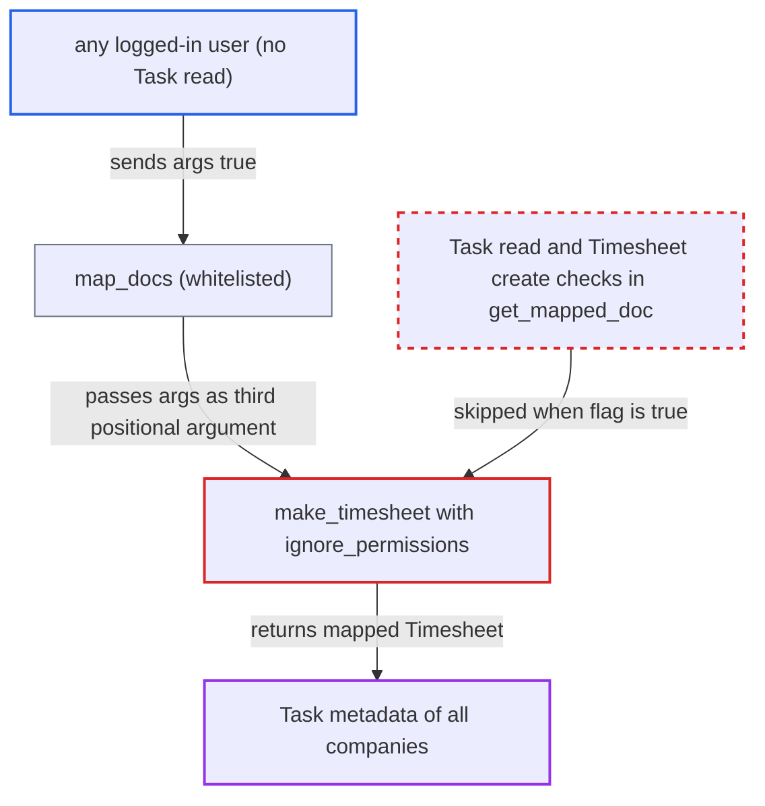

# Task make_timesheet exposes ignore_permissions as positional argument reachable through map_docs

| Field | Value |
|---|---|
| ID | `find_0145YgFbiGviz3pQ7MUaJZRy` |
| Severity | **Medium** |
| Status | open |
| CWE | CWE-807 — Authorization bypass |
| Created | 2026-10-27T21:26:07.893167Z |
| Claude Security | https://claude.ai/security/findings/find_0145YgFbiGviz3pQ7MUaJZRy |

## Description

Any logged-in user, including a portal user or one limited to another company, can read basic metadata of every Task without having Task read permission. The metadata is company, department, project, logged hours and whether the task is completed. The attacker sends `args=true` to `map_docs`, which lands in the third positional parameter of `make_timesheet`. That parameter is `ignore_permissions`, so the permission checks in `get_mapped_doc` are skipped.

1. **attacker** posts a request to `frappe.model.mapper.map_docs`. The request sets `method` to `erpnext.projects.doctype.task.task.make_timesheet`, `source_names` to a task name such as `TASK-2026-00001`, `target_doc` to `{"doctype":"Timesheet"}` and `args` to `true`. ([`erpnext/public/js/utils.js:1177-1188`](https://github.com/cx-benchmark/erpnext/blob/90e7aefca73da3c440d2e8da7472fcb67838e678/erpnext/public/js/utils.js#L1177-L1188))
2. **`map_docs`** calls the named mapper with `args` as the third positional argument. The report assumes Frappe checks only that the mapper is whitelisted and passes the decoded `args` positionally. ERPNext's own delivery note flow relies on this same behaviour. ([`erpnext/stock/doctype/delivery_note/delivery_note.js:167-171`](https://github.com/cx-benchmark/erpnext/blob/90e7aefca73da3c440d2e8da7472fcb67838e678/erpnext/stock/doctype/delivery_note/delivery_note.js#L167-L171))
3. **the receiving mapper** takes `args` in its third slot. The third slot of `make_delivery_note` is named `kwargs`, and `create_dunning` treats a bool in that slot as `ignore_permissions`. Both show that the positional slot is filled this way. ([`erpnext/selling/doctype/sales_order/mapper.py:243-256`](https://github.com/cx-benchmark/erpnext/blob/90e7aefca73da3c440d2e8da7472fcb67838e678/erpnext/selling/doctype/sales_order/mapper.py#L243-L256))
4. **the whitelisted `make_timesheet`** receives `True` as `ignore_permissions` and passes it to `get_mapped_doc`. `get_mapped_doc` is the only place that checks Task read and Timesheet create permission, and it skips both checks when the flag is truthy. ([`erpnext/projects/doctype/task/task.py:545-570`](https://github.com/cx-benchmark/erpnext/blob/90e7aefca73da3c440d2e8da7472fcb67838e678/erpnext/projects/doctype/task/task.py#L545-L570))
5. **the postprocess in `make_timesheet`** fills the unsaved Timesheet with task data. The Timesheet gets the Task's `company` and `department`, plus `parent_project` and a `time_logs` row. That row holds the task's `project`, its `actual_time` as `hours` and whether its status is `Completed`. ([`erpnext/projects/doctype/task/task.py:545-570`](https://github.com/cx-benchmark/erpnext/blob/90e7aefca73da3c440d2e8da7472fcb67838e678/erpnext/projects/doctype/task/task.py#L545-L570))
6. **attacker** repeats the request for each task name. Task names follow the sequential `TASK-.YYYY.-.#####` series, and Task read is granted only to Projects User and HR Manager, so the names are easy to guess. ([`erpnext/projects/doctype/task/task.json`](https://github.com/cx-benchmark/erpnext/blob/90e7aefca73da3c440d2e8da7472fcb67838e678/erpnext/projects/doctype/task/task.json))

## Assessment

The attacker is any logged-in user without Task read. Examples are an Employee-only desk user, a user restricted by User Permissions to another company, or a portal user. No victim action is needed, and the default configuration is exploitable. The attacker posts to `/api/method/frappe.model.mapper.map_docs` and iterates the sequential task names. Sending `ignore_permissions` by name to `make_timesheet` directly has no effect, because Frappe's `frappe.call`/`get_newargs` drops that key. The report assumes Frappe behaves as described, because Frappe is not in the checkout.

Impact: The attacker reads the company, department, project, logged hours (`actual_time`) and completed state of any Task in any company. Subject, description, the `status` value and `total_costing_amount` are not copied. Nothing is saved or modified, so the loss is limited to reading this metadata.

## Recommendation

The whitelisted `make_timesheet` takes the bypass flag `ignore_permissions` as its third positional parameter. Frappe's `map_docs` fills that slot with caller-supplied `args`, so the request decides whether `get_mapped_doc` enforces Task read and Timesheet create permissions.

Fix criteria: No request argument can make the whitelisted entry point skip permission checks, whether sent by name or delivered positionally through `map_docs` or `make_mapped_doc`. Internal callers that need a bypass use a path that is not whitelisted. As a user without Task read, a `map_docs` call with `method` set to `make_timesheet` and `args=true` raises `PermissionError`. The Task form's Timesheet button still works for permitted users.

## Evidence

**https://github.com/cx-benchmark/erpnext**

- [`erpnext/projects/doctype/task/task.py:545-570`](https://github.com/cx-benchmark/erpnext/blob/90e7aefca73da3c440d2e8da7472fcb67838e678/erpnext/projects/doctype/task/task.py#L545-L570)
- [`erpnext/public/js/utils.js:1177-1188`](https://github.com/cx-benchmark/erpnext/blob/90e7aefca73da3c440d2e8da7472fcb67838e678/erpnext/public/js/utils.js#L1177-L1188)
- [`erpnext/stock/doctype/delivery_note/delivery_note.js:167-171`](https://github.com/cx-benchmark/erpnext/blob/90e7aefca73da3c440d2e8da7472fcb67838e678/erpnext/stock/doctype/delivery_note/delivery_note.js#L167-L171)
- [`erpnext/selling/doctype/sales_order/mapper.py:243-256`](https://github.com/cx-benchmark/erpnext/blob/90e7aefca73da3c440d2e8da7472fcb67838e678/erpnext/selling/doctype/sales_order/mapper.py#L243-L256)
- [`erpnext/accounts/doctype/sales_invoice/mapper.py:591-602`](https://github.com/cx-benchmark/erpnext/blob/90e7aefca73da3c440d2e8da7472fcb67838e678/erpnext/accounts/doctype/sales_invoice/mapper.py#L591-L602)
- [`erpnext/projects/doctype/task/task.json`](https://github.com/cx-benchmark/erpnext/blob/90e7aefca73da3c440d2e8da7472fcb67838e678/erpnext/projects/doctype/task/task.json)
- [`erpnext/projects/doctype/task/task.js:9-15`](https://github.com/cx-benchmark/erpnext/blob/90e7aefca73da3c440d2e8da7472fcb67838e678/erpnext/projects/doctype/task/task.js#L9-L15)

