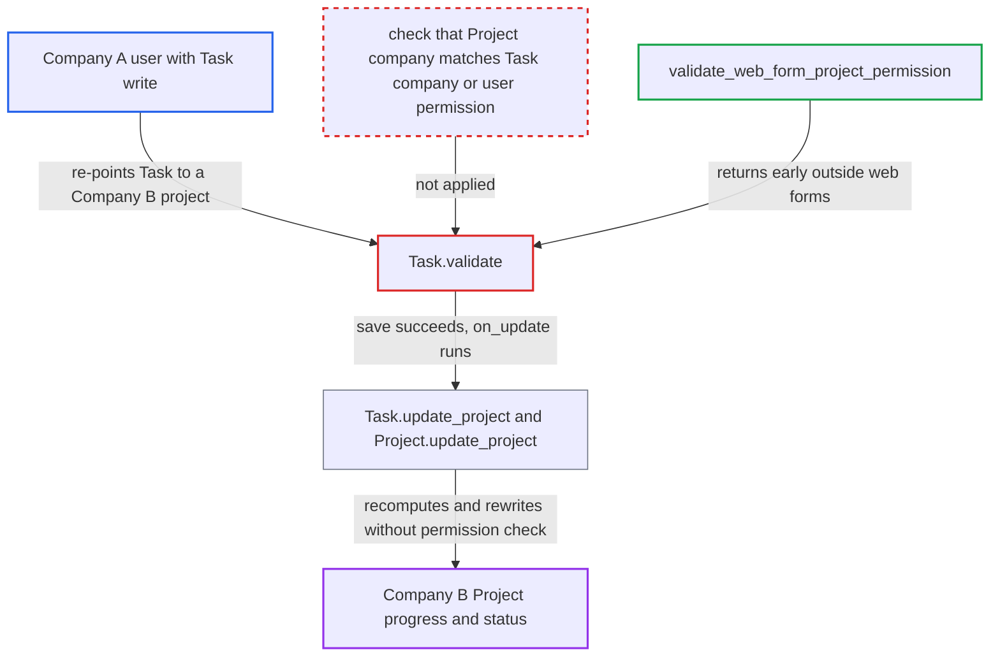

# Task re-pointed to another company's Project rewrites that Project's progress and status

| Field | Value |
|---|---|
| ID | `find_017MEK8CFfHHHmRc2VygqdHC` |
| Severity | **Medium** |
| Status | open |
| CWE | CWE-862 — Missing Authorization |
| Created | 2026-10-27T22:45:01.844453Z |
| Claude Security | https://claude.ai/security/findings/find_017MEK8CFfHHHmRc2VygqdHC |

## Description

A user restricted to Company A can change the progress and status of a Company B project. They can reopen a Completed project, or mark it Completed under `Task Weight`. The attacker needs an account with write access to Task, such as Projects User or HR Manager. `Task.validate` never checks that the Project named in `project` belongs to a company the user may access.

1. **Attacker (Company A user)** creates a Task with no project or with a Company A project. Projects User and HR Manager have create and write on Task, so an ordinary low-privilege account can do this. ([`erpnext/projects/doctype/task/task.json:443-467`](https://github.com/cx-benchmark/erpnext/blob/90e7aefca73da3c440d2e8da7472fcb67838e678/erpnext/projects/doctype/task/task.json#L443-L467))
2. **Attacker** updates the Task with `PUT /api/resource/Task/<name>`, setting `project` to a Company B project name. `project` is a plain Link, and a company-restricted user normally has no User Permission rows on Project. The Project names follow the guessable pattern `PROJ-.####`. ([`erpnext/projects/doctype/task/task.json:75-89`](https://github.com/cx-benchmark/erpnext/blob/90e7aefca73da3c440d2e8da7472fcb67838e678/erpnext/projects/doctype/task/task.json#L75-L89))
3. **Frappe permission check** checks write permission on the in-memory Task, which still has `company` A. The check runs before `company` is re-fetched, so it passes. This is in the pinned Frappe (>=17.0.0-dev), which is not in the checkout. ([`erpnext/projects/doctype/task/task.json:342-348`](https://github.com/cx-benchmark/erpnext/blob/90e7aefca73da3c440d2e8da7472fcb67838e678/erpnext/projects/doctype/task/task.json#L342-L348))
4. **the handler `Task.validate`** accepts the Task even though its project belongs to another company. It does not compare the Project's company with the Task's company or the user's companies. `validate_web_form_project_permission` returns early unless `frappe.flags.in_web_form` is set, so a desk or REST save skips it. `company` is then re-fetched as B. ([`erpnext/projects/doctype/task/task.py:84-99`](https://github.com/cx-benchmark/erpnext/blob/90e7aefca73da3c440d2e8da7472fcb67838e678/erpnext/projects/doctype/task/task.py#L84-L99))
5. **the hook `on_update`** calls `update_project`, which loads the Company B Project and runs `Project.update_project()`. The Project is loaded with `frappe.get_cached_doc`, and no permission check is made. ([`erpnext/projects/doctype/task/task.py:316-360`](https://github.com/cx-benchmark/erpnext/blob/90e7aefca73da3c440d2e8da7472fcb67838e678/erpnext/projects/doctype/task/task.py#L316-L360))
6. **the method `Project.update_project`** recomputes `percent_complete` over all tasks and overwrites `status` on the Company B Project. The attacker's Task is counted. `status` becomes "Completed" if `percent_complete` is 100 and "Open" otherwise. `db_update()` writes the whole row, and `validate_completed_status` returns early because a cached doc has no doc-before-save. ([`erpnext/projects/doctype/project/project.py:308-372`](https://github.com/cx-benchmark/erpnext/blob/90e7aefca73da3c440d2e8da7472fcb67838e678/erpnext/projects/doctype/project/project.py#L308-L372))

## Assessment

The attacker is an authenticated desk or REST user with write access on Task, such as a Projects User or HR Manager. They are restricted by a Company User Permission to Company A. They need the name of a Company B project, which is guessable (`PROJ-.####`). The impact depends on the project's calculation method. Under the default `Task Completion` method, one open foreign task reopens a Completed project. Under `Task Weight`, a completed foreign task with a very large `task_weight` (non-negative and unbounded) pushes `percent_complete` to 100 and flips the project to Completed (`get_task_progress`).

Impact: A user with no access to Company B adds a Task with content of their choosing to a Company B Project. They rewrite that Project's `percent_complete` and `status`, and its costing roll-ups are re-saved. This is planning data, not ledger data, and Company B can delete the task. Apart from the existence of a project and its date window, which leak through validation errors, nothing is read.

## Recommendation

`Task.validate` lets `project` point at a Project whose company the saving user has no permission for. The `company` fetch then silently moves the Task into that company. This breaks per-company isolation, and the only project ownership check runs for Web Forms alone.

Fix criteria: Saving a Task is refused, on both insert and update and outside Web Forms too, when its new or changed `project` belongs to a company the user has no permission for or differs from the Task's company. A `frappe.has_permission("Project", "write"/"read", project)` check or a company comparison in `validate` would do this. Re-pointing an existing Task to a Company B project as a Company A user raises a permission or validation error. The Company B Project row is unchanged afterwards.

## Evidence

**https://github.com/cx-benchmark/erpnext**

- [`erpnext/projects/doctype/task/task.py:84-99`](https://github.com/cx-benchmark/erpnext/blob/90e7aefca73da3c440d2e8da7472fcb67838e678/erpnext/projects/doctype/task/task.py#L84-L99)
- [`erpnext/projects/doctype/task/task.py:431-446`](https://github.com/cx-benchmark/erpnext/blob/90e7aefca73da3c440d2e8da7472fcb67838e678/erpnext/projects/doctype/task/task.py#L431-L446)
- [`erpnext/projects/doctype/task/task.json:342-348`](https://github.com/cx-benchmark/erpnext/blob/90e7aefca73da3c440d2e8da7472fcb67838e678/erpnext/projects/doctype/task/task.json#L342-L348)
- [`erpnext/projects/doctype/task/task.json:75-89`](https://github.com/cx-benchmark/erpnext/blob/90e7aefca73da3c440d2e8da7472fcb67838e678/erpnext/projects/doctype/task/task.json#L75-L89)
- [`erpnext/projects/doctype/task/task.py:316-360`](https://github.com/cx-benchmark/erpnext/blob/90e7aefca73da3c440d2e8da7472fcb67838e678/erpnext/projects/doctype/task/task.py#L316-L360)
- [`erpnext/projects/doctype/project/project.py:270-274`](https://github.com/cx-benchmark/erpnext/blob/90e7aefca73da3c440d2e8da7472fcb67838e678/erpnext/projects/doctype/project/project.py#L270-L274)
- [`erpnext/projects/doctype/project/project.py:308-372`](https://github.com/cx-benchmark/erpnext/blob/90e7aefca73da3c440d2e8da7472fcb67838e678/erpnext/projects/doctype/project/project.py#L308-L372)
- [`erpnext/projects/doctype/task/task.json:443-467`](https://github.com/cx-benchmark/erpnext/blob/90e7aefca73da3c440d2e8da7472fcb67838e678/erpnext/projects/doctype/task/task.json#L443-L467)
- [`erpnext/projects/doctype/task/task.py:502-519`](https://github.com/cx-benchmark/erpnext/blob/90e7aefca73da3c440d2e8da7472fcb67838e678/erpnext/projects/doctype/task/task.py#L502-L519)
- [`erpnext/controllers/accounts_controller.py:584-612`](https://github.com/cx-benchmark/erpnext/blob/90e7aefca73da3c440d2e8da7472fcb67838e678/erpnext/controllers/accounts_controller.py#L584-L612)

