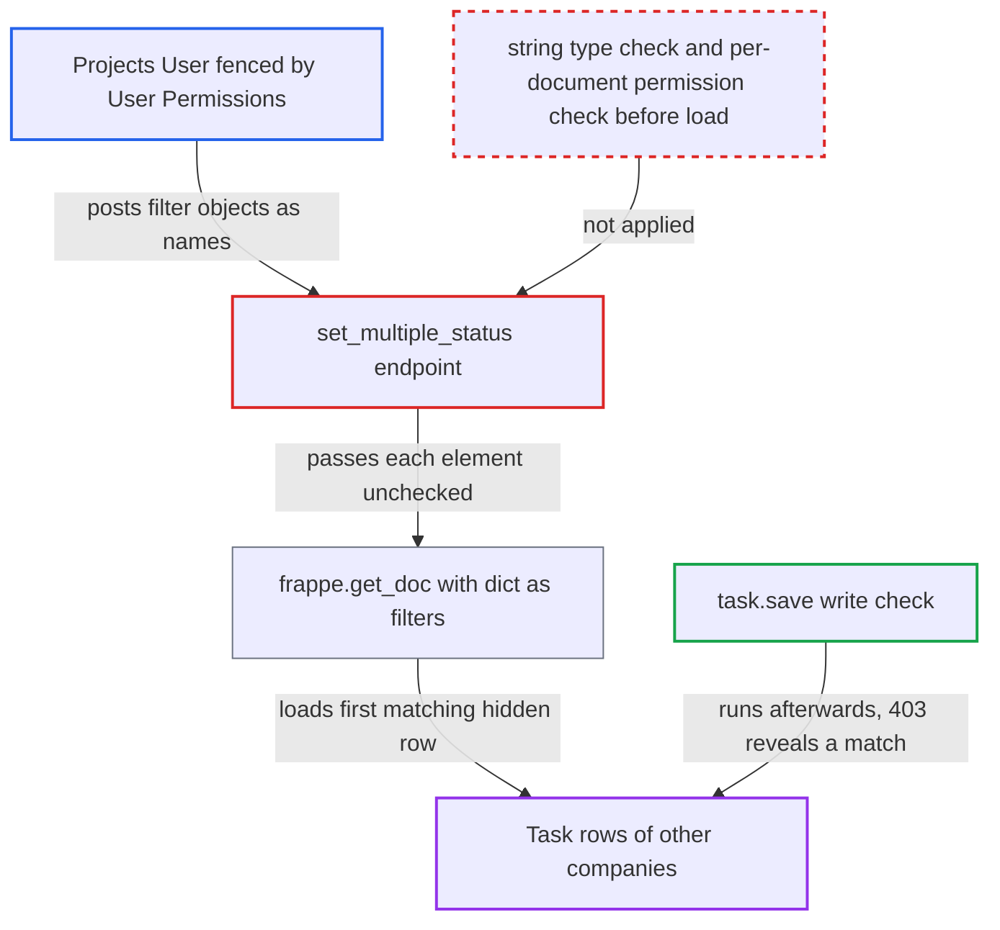

# Task set_multiple_status evaluates caller filter dicts before permission check, blind Task oracle

| Field | Value |
|---|---|
| ID | `find_01Qz27ZUHVnZnHXx9iHUfJ5M` |
| Severity | **Medium** |
| Status | open |
| CWE | CWE-943 — Query logic injection |
| Created | 2026-10-27T22:02:52.861011Z |
| Claude Security | https://claude.ai/security/findings/find_01Qz27ZUHVnZnHXx9iHUfJ5M |

## Description

A Projects User whose Task access is limited by User Permissions can read data from tasks they are not allowed to open. That includes other companies' task subjects, descriptions, projects, departments, assignees and costing and billing totals. They need only a Task write role. The data comes out one bit per request. The cause is `set_multiple_status`, which passes caller-supplied filter objects to `frappe.get_doc` before any permission check.

1. **Attacker (fenced Projects User)** posts a filter object in `names` to the endpoint. The request goes to `/api/method/erpnext.projects.doctype.task.task.set_multiple_status`, for example `names=[{"company":"Other Co","subject":["like","Merger%"]}]` with any `status`. Naming the hidden company means only hidden rows can match. ([`erpnext/projects/doctype/task/task.py:523-529`](https://github.com/cx-benchmark/erpnext/blob/90e7aefca73da3c440d2e8da7472fcb67838e678/erpnext/projects/doctype/task/task.py#L523-L529))
2. **the endpoint `set_multiple_status`** parses `names` and calls `frappe.get_doc("Task", name)` on each element. It never requires the element to be a string, so the pinned Frappe treats a dict as query filters, operators included, and loads the first matching Task without a permission check. ([`erpnext/projects/doctype/task/task.py:523-529`](https://github.com/cx-benchmark/erpnext/blob/90e7aefca73da3c440d2e8da7472fcb67838e678/erpnext/projects/doctype/task/task.py#L523-L529))
3. **`task.save()`** runs the first permission check on the row already chosen. The write check applies role permissions and User Permissions only after the row is loaded. A hidden row fails with `PermissionError` (HTTP 403) and nothing is written. ([`erpnext/projects/doctype/task/task.py:523-529`](https://github.com/cx-benchmark/erpnext/blob/90e7aefca73da3c440d2e8da7472fcb67838e678/erpnext/projects/doctype/task/task.py#L523-L529))
4. **the endpoint** answers 404 when no row matches. A miss raises `DoesNotExistError` (HTTP 404). A 404 versus a 403 tells the attacker whether a hidden row matches the filter. ([`erpnext/projects/doctype/task/task.py:523-529`](https://github.com/cx-benchmark/erpnext/blob/90e7aefca73da3c440d2e8da7472fcb67838e678/erpnext/projects/doctype/task/task.py#L523-L529))
5. **Attacker** repeats the request with narrower filters. Each answer is one true-or-false bit. Repeated narrowing, such as a binary search over a column, recovers the column's values. It can be automated.

## Assessment

The attacker is a Projects User, who has Task write under `task.json`. Their Task rows are fenced by User Permissions on Company or Project. They send a POST to the whitelisted endpoint with filter objects in `names`. No victim action is needed, and the report names no other setting or protection in the way. The report assumes the pinned Frappe (`>=17.0.0-dev,<18.0.0`, not in the checkout) resolves a dict name as filters and raises `DoesNotExistError` on a miss. It also assumes argument validation accepts a JSON string for `str | list`. It also assumes `Document._save` runs the write check before validation. Finally it assumes 404 and 403 map to those two errors. The 403 message may also name the blocking link value.

Impact: The attacker gets a blind true-or-false read of any `tabTask` column for rows their User Permissions hide. Examples are subject, description, project, department, assignee, `total_costing_amount` and `total_billing_amount`. Only the Task table is exposed. Nothing is modified, because a hidden row fails the write check before any save. A matching row the caller may write only gets a status change they could already make by name. Availability is unaffected.

## Recommendation

`set_multiple_status` passes each element of the parsed `names` list to `frappe.get_doc` without a type check. A dict therefore becomes a database filter and selects a row before any permission check. The different failures for a miss and a hidden hit then reveal whether the filter matched.

Fix criteria: Every `names` element is a non-empty string before any lookup. Write permission on that specific Task, User Permissions included, is checked before it is loaded, as the Issue endpoint does. A test with a fenced Projects User sends a dict element, a list element, and a hidden or missing Task name. All three are refused with the same error, whether or not a matching row exists. The list-view bulk action still works for permitted tasks.

## Evidence

**https://github.com/cx-benchmark/erpnext**

- [`erpnext/projects/doctype/task/task.py:523-529`](https://github.com/cx-benchmark/erpnext/blob/90e7aefca73da3c440d2e8da7472fcb67838e678/erpnext/projects/doctype/task/task.py#L523-L529)
- [`erpnext/projects/doctype/task/task.json`](https://github.com/cx-benchmark/erpnext/blob/90e7aefca73da3c440d2e8da7472fcb67838e678/erpnext/projects/doctype/task/task.json)
- [`erpnext/support/doctype/issue/issue.py:309-321`](https://github.com/cx-benchmark/erpnext/blob/90e7aefca73da3c440d2e8da7472fcb67838e678/erpnext/support/doctype/issue/issue.py#L309-L321)
- [`erpnext/buying/doctype/purchase_order/purchase_order.py:613-625`](https://github.com/cx-benchmark/erpnext/blob/90e7aefca73da3c440d2e8da7472fcb67838e678/erpnext/buying/doctype/purchase_order/purchase_order.py#L613-L625)
- [`erpnext/setup/doctype/transaction_deletion_record/transaction_deletion_record.py:1081`](https://github.com/cx-benchmark/erpnext/blob/90e7aefca73da3c440d2e8da7472fcb67838e678/erpnext/setup/doctype/transaction_deletion_record/transaction_deletion_record.py#L1081)
- [`erpnext/tests/permission_test_utils.py:53-55`](https://github.com/cx-benchmark/erpnext/blob/90e7aefca73da3c440d2e8da7472fcb67838e678/erpnext/tests/permission_test_utils.py#L53-L55)
- [`erpnext/projects/doctype/task/task_list.js:14-22`](https://github.com/cx-benchmark/erpnext/blob/90e7aefca73da3c440d2e8da7472fcb67838e678/erpnext/projects/doctype/task/task_list.js#L14-L22)

