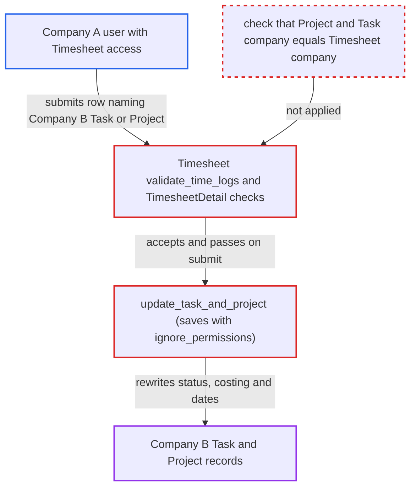

# Timesheet rows accept another company's Project/Task and rewrite their status and costing

| Field | Value |
|---|---|
| ID | `find_01Cs79mAzSttBytjWZ3iXGg1` |
| Severity | **Medium** |
| Status | open |
| CWE | CWE-862 — Missing Authorization |
| Created | 2026-10-27T22:45:01.955262Z |
| Claude Security | https://claude.ai/security/findings/find_01Cs79mAzSttBytjWZ3iXGg1 |

## Description

A logged-in user fenced to Company A can change Company B's Task and Project records, which they should not be able to touch. They can force a task to `Completed`, close its assignments, and rewrite costing, billing and dates. The attacker needs a role that can submit Timesheets. The cause is that `Timesheet` never checks the company of the referenced Project or Task, and `update_task_and_project` saves them with `ignore_permissions=True`.

1. **Company A user** saves a Timesheet with `company` set to A and a Company B Project or Task in a `time_logs` row. Project and Task names come from guessable sequential series (`PROJ-.####` and `TASK-.YYYY.-.#####`), and the company filter on `time_logs.project` exists only in the browser form, so a direct REST call skips it. ([`erpnext/projects/doctype/timesheet/timesheet.js:29-36`](https://github.com/cx-benchmark/erpnext/blob/90e7aefca73da3c440d2e8da7472fcb67838e678/erpnext/projects/doctype/timesheet/timesheet.js#L29-L36))
2. **the method `validate_time_logs`** accepts the foreign references. It and the `TimesheetDetail` checks only make sure project and task agree with each other, and never compare their company with `Timesheet.company`. ([`erpnext/projects/doctype/timesheet/timesheet.py:209-223`](https://github.com/cx-benchmark/erpnext/blob/90e7aefca73da3c440d2e8da7472fcb67838e678/erpnext/projects/doctype/timesheet/timesheet.py#L209-L223))
3. **the method `update_task_and_project`** loads each referenced Task and Project and saves them on submit, cancel or update-after-submit. The saves use `ignore_permissions=True`, so the permission system never sees a write to records the user cannot access. ([`erpnext/projects/doctype/timesheet/timesheet.py:186-203`](https://github.com/cx-benchmark/erpnext/blob/90e7aefca73da3c440d2e8da7472fcb67838e678/erpnext/projects/doctype/timesheet/timesheet.py#L186-L203))
4. **the function `get_task_status`** sets the Task status to `Working`, or to `Completed` when the attacker ticked `completed` on their row. The attacker controls that checkbox on their own row, and a Completed task is never reopened by this path. ([`erpnext/projects/doctype/timesheet/timesheet.py:324-336`](https://github.com/cx-benchmark/erpnext/blob/90e7aefca73da3c440d2e8da7472fcb67838e678/erpnext/projects/doctype/timesheet/timesheet.py#L324-L336))
5. **the Task `validate_status` logic** sets `completed_on` and closes every ToDo assignment on the foreign task. This closes Company B users' assignments, and an unfinished dependency produces an error that names the dependency task. ([`erpnext/projects/doctype/task/task.py:183-203`](https://github.com/cx-benchmark/erpnext/blob/90e7aefca73da3c440d2e8da7472fcb67838e678/erpnext/projects/doctype/task/task.py#L183-L203))
6. **the Task `update_time_and_costing` logic** recomputes costing, billing, `actual_time` and actual dates from all submitted rows, including the attacker's. Hours are limited only by an overlap check against the attacker's own user or employee, so totals can be inflated. The save can also reschedule dependent tasks when the task has no expected end date. ([`erpnext/projects/doctype/task/task.py:332-355`](https://github.com/cx-benchmark/erpnext/blob/90e7aefca73da3c440d2e8da7472fcb67838e678/erpnext/projects/doctype/task/task.py#L332-L355))
7. **the Project `update_project` logic** rewrites the Project's actual dates, costing, billing, margins, `percent_complete` and status. The values are summed from all submitted rows for that project, so the attacker's rows shape them. Completing the project's open tasks this way can flip the project to `Completed`. ([`erpnext/projects/doctype/project/project.py:270-274`](https://github.com/cx-benchmark/erpnext/blob/90e7aefca73da3c440d2e8da7472fcb67838e678/erpnext/projects/doctype/project/project.py#L270-L274))

## Assessment

The attacker is an authenticated desk user fenced to Company A by a Company User Permission, who can submit Timesheets. Roles named: Projects User, Accounts User, HR User, HR Manager or Manufacturing User. They insert and submit their own Timesheet through the normal REST API with a guessable Company B Task or Project name in `time_logs`. No victim action is needed and the attack can be repeated. The report assumes, from outside the checkout, that Frappe's `has_user_permission` checks a Link field only when the user has User Permission rows on that target doctype. It also assumes `_validate_links` fetches linked values without a permission check. The report says `test_sales_order.py:1771-1797` is consistent with this. Accounts User can also set the permlevel-1 rates directly.

Impact: The attacker can rewrite a foreign company's Task and Project roll-ups: costing, billing, `actual_time`, actual dates, gross margins, `percent_complete` and status. They can force tasks to `Completed` and close the assignments on them. They cannot reopen a Completed task or project. These are planning and costing figures, not ledger postings. Smaller leaks: the foreign `project_name` is copied into the attacker's row, and errors reveal a foreign task's project, its cancelled state and the names of unfinished dependency tasks.

## Recommendation

(1) `Timesheet.validate_time_logs`, `TimesheetDetail.validate_parent_project` and `validate_task_project` accept a `project`, `parent_project` or `task` from a different company than `Timesheet.company`. This breaks the per-company isolation that vouchers enforce through `validate_company_in_accounting_dimension`.

Fix criteria: Saving or submitting a Timesheet is refused when `parent_project` or any `time_logs[].project` has `Project.company` different from `Timesheet.company`. It is also refused when any `time_logs[].task` belongs to a project of another company. To verify, a Company A user who submits a Timesheet referencing a Company B Project or Task gets a validation error, and B's Project and Task rows are unchanged.

(2) `update_task_and_project` loads and saves the referenced Task and Project with `ignore_permissions=True`, so the permission system never sees a write to records the submitting user cannot access.

Fix criteria: Before a Task or Project is updated from a Timesheet, it is shown to belong to the Timesheet's company, or the submitting user holds access to it. To verify, submitting or cancelling another company's Timesheet modifies no foreign-company Task or Project and closes no ToDo.

## Evidence

**https://github.com/cx-benchmark/erpnext**

- [`erpnext/projects/doctype/timesheet/timesheet.py:209-223`](https://github.com/cx-benchmark/erpnext/blob/90e7aefca73da3c440d2e8da7472fcb67838e678/erpnext/projects/doctype/timesheet/timesheet.py#L209-L223)
- [`erpnext/projects/doctype/timesheet_detail/timesheet_detail.py:108-126`](https://github.com/cx-benchmark/erpnext/blob/90e7aefca73da3c440d2e8da7472fcb67838e678/erpnext/projects/doctype/timesheet_detail/timesheet_detail.py#L108-L126)
- [`erpnext/projects/doctype/timesheet/timesheet.py:186-203`](https://github.com/cx-benchmark/erpnext/blob/90e7aefca73da3c440d2e8da7472fcb67838e678/erpnext/projects/doctype/timesheet/timesheet.py#L186-L203)
- [`erpnext/projects/doctype/timesheet/timesheet.py:324-336`](https://github.com/cx-benchmark/erpnext/blob/90e7aefca73da3c440d2e8da7472fcb67838e678/erpnext/projects/doctype/timesheet/timesheet.py#L324-L336)
- [`erpnext/projects/doctype/task/task.py:183-203`](https://github.com/cx-benchmark/erpnext/blob/90e7aefca73da3c440d2e8da7472fcb67838e678/erpnext/projects/doctype/task/task.py#L183-L203)
- [`erpnext/projects/doctype/task/task.py:332-355`](https://github.com/cx-benchmark/erpnext/blob/90e7aefca73da3c440d2e8da7472fcb67838e678/erpnext/projects/doctype/task/task.py#L332-L355)
- [`erpnext/projects/doctype/project/project.py:270-274`](https://github.com/cx-benchmark/erpnext/blob/90e7aefca73da3c440d2e8da7472fcb67838e678/erpnext/projects/doctype/project/project.py#L270-L274)
- [`erpnext/stock/doctype/company_restriction/company_restriction.py:256-302`](https://github.com/cx-benchmark/erpnext/blob/90e7aefca73da3c440d2e8da7472fcb67838e678/erpnext/stock/doctype/company_restriction/company_restriction.py#L256-L302)
- [`erpnext/controllers/accounts_controller.py:584-612`](https://github.com/cx-benchmark/erpnext/blob/90e7aefca73da3c440d2e8da7472fcb67838e678/erpnext/controllers/accounts_controller.py#L584-L612)
- [`erpnext/projects/doctype/timesheet/timesheet.js:29-36`](https://github.com/cx-benchmark/erpnext/blob/90e7aefca73da3c440d2e8da7472fcb67838e678/erpnext/projects/doctype/timesheet/timesheet.js#L29-L36)
- [`erpnext/projects/doctype/timesheet_detail/timesheet_detail.json`](https://github.com/cx-benchmark/erpnext/blob/90e7aefca73da3c440d2e8da7472fcb67838e678/erpnext/projects/doctype/timesheet_detail/timesheet_detail.json)

