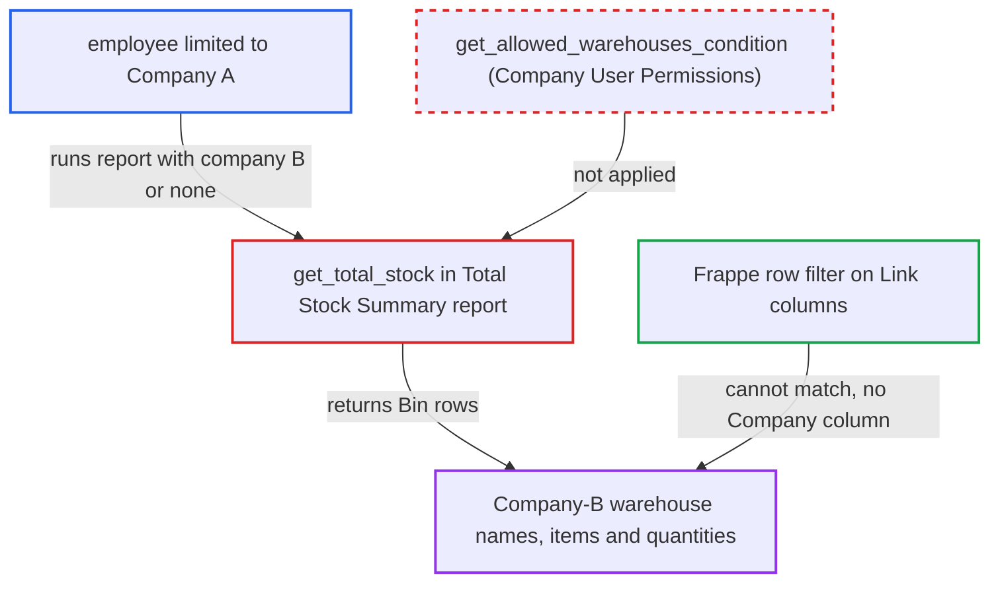

# Total Stock Summary warehouse view ignores Company user permissions

| Field | Value |
|---|---|
| ID | `find_01HjzWGnUEMUMJiidVwSvN5Y` |
| Severity | **Medium** |
| Status | open |
| CWE | CWE-862 — Missing authorization |
| Created | 2026-10-27T21:23:41.169845Z |
| Claude Security | https://claude.ai/security/findings/find_01HjzWGnUEMUMJiidVwSvN5Y |

## Description

A logged-in employee limited to one company can read another company's warehouse names, item codes, descriptions and current stock quantities through the Total Stock Summary report. The attacker needs the Stock User or Manufacturing User role (Stock Manager and Manufacturing Manager also qualify) and no Warehouse User Permissions. `get_total_stock` filters only by Warehouse User Permissions and the caller's optional `company` filter, never by Company User Permissions.

1. **attacker (employee limited to Company A)** calls the report runner for Total Stock Summary. The request goes to `/api/method/frappe.desk.query_report.run` with `filters` of `group_by` set to `Warehouse` and `company` set to `B`, or with `company` left out; the attacker has no Warehouse User Permissions.
2. **Frappe report runner** checks only the report roles and Stock Entry report permission. The report JSON has no `filters` table, so the `company` filter is declared only in the JS file and nothing validates it against the user's Company User Permissions. ([`erpnext/stock/report/total_stock_summary/total_stock_summary.json`](https://github.com/cx-benchmark/erpnext/blob/90e7aefca73da3c440d2e8da7472fcb67838e678/erpnext/stock/report/total_stock_summary/total_stock_summary.json))
3. **`get_total_stock`** builds the `Bin` query without a company permission condition. It narrows `bin.warehouse` only by Warehouse User Permissions and uses the caller's optional `company` filter, and does not call `get_allowed_warehouses_condition`. ([`erpnext/stock/report/total_stock_summary/total_stock_summary.py:50-57`](https://github.com/cx-benchmark/erpnext/blob/90e7aefca73da3c440d2e8da7472fcb67838e678/erpnext/stock/report/total_stock_summary/total_stock_summary.py#L50-L57))
4. **Frappe row filter** lets the Company-B rows through. In Warehouse mode the rows have only `Warehouse` and `Item` Link columns and no `Company` column, so a Company User Permission never matches them. ([`erpnext/stock/report/total_stock_summary/total_stock_summary.py:21-33`](https://github.com/cx-benchmark/erpnext/blob/90e7aefca73da3c440d2e8da7472fcb67838e678/erpnext/stock/report/total_stock_summary/total_stock_summary.py#L21-L33))
5. **attacker** receives the Company-B data. The response lists every Company-B warehouse name with the item code, description and current quantity held there.

## Assessment

The attacker is a logged-in employee with the Stock User or Manufacturing User role, limited by a Company User Permission to Company A and holding no Warehouse permission. They run the report in `group_by=Warehouse` mode, which is the JS default. They either set `company` to another company or leave it out. No victim action is needed. In `group_by=Company` mode each row's `Company` Link column is filtered by the desk, so that mode does not leak for an apply-to-all Company permission.

Impact: The attacker learns another company's warehouse names and its per-warehouse, per-item current stock quantities and item descriptions. No stock values are included, and the report is read-only, so nothing can be changed. The same data is not visible to them through the `Bin` list, because `Bin.company` is restricted by their permission.

## Recommendation

`get_total_stock` scopes `Bin` rows only by Warehouse User Permissions and the caller's `company` filter, and never by the companies the running user is permitted. Warehouse-mode rows have no Company column, so the framework's row filter cannot make up for it.

Fix criteria: `Bin` rows are limited to warehouses whose company the user's Company User Permissions allow, in both group-by modes. A requested `company` outside that set returns no rows or raises a PermissionError. Verify: a Stock User limited to Company A who runs the report with `group_by=Warehouse` and `company=B`, or with no company, gets no Company-B warehouse rows.

## Evidence

**https://github.com/cx-benchmark/erpnext**

- [`erpnext/stock/report/total_stock_summary/total_stock_summary.py:50-57`](https://github.com/cx-benchmark/erpnext/blob/90e7aefca73da3c440d2e8da7472fcb67838e678/erpnext/stock/report/total_stock_summary/total_stock_summary.py#L50-L57)
- [`erpnext/stock/report/total_stock_summary/total_stock_summary.py:21-33`](https://github.com/cx-benchmark/erpnext/blob/90e7aefca73da3c440d2e8da7472fcb67838e678/erpnext/stock/report/total_stock_summary/total_stock_summary.py#L21-L33)
- [`erpnext/stock/report/total_stock_summary/total_stock_summary.json`](https://github.com/cx-benchmark/erpnext/blob/90e7aefca73da3c440d2e8da7472fcb67838e678/erpnext/stock/report/total_stock_summary/total_stock_summary.json)
- [`erpnext/stock/doctype/company_restriction/company_restriction.py:62-81`](https://github.com/cx-benchmark/erpnext/blob/90e7aefca73da3c440d2e8da7472fcb67838e678/erpnext/stock/doctype/company_restriction/company_restriction.py#L62-L81)
- [`erpnext/stock/report/stock_projected_qty/stock_projected_qty.py:287-288`](https://github.com/cx-benchmark/erpnext/blob/90e7aefca73da3c440d2e8da7472fcb67838e678/erpnext/stock/report/stock_projected_qty/stock_projected_qty.py#L287-L288)

