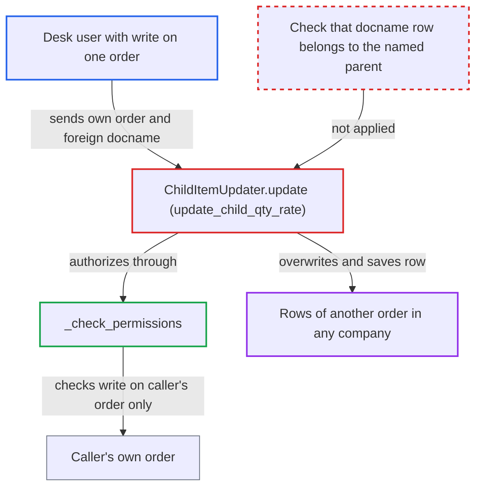

# Update Items API edits item rows of any order via unchecked child docname

| Field | Value |
|---|---|
| ID | `find_014PPyqezaKUhVHgUAtyH4qG` |
| Severity | **Medium** |
| Status | open |
| CWE | CWE-639 — Insecure direct object reference |
| Created | 2026-10-27T21:14:59.514424Z |
| Claude Security | https://claude.ai/security/findings/find_014PPyqezaKUhVHgUAtyH4qG |

## Description

A logged-in desk user with write access to one order can change quantity, rate, UOM, dates and BOM on rows of any other Sales Order, Purchase Order, Quotation or Supplier Quotation, including other companies' orders. The attacker needs the target row's name. In `ChildItemUpdater.update()`, the `docname` of each row is loaded globally and never checked against the order the caller named. The only permission check runs on the caller's own order.

1. **Attacker (desk user)** obtains the name of a row in a victim order. The row name is a random hash. The report says it appears as `so_detail`, `sales_order_item` or `purchase_order_item` on linked documents, and the whitelisted `make_production_plan` mapper also returns it for open Sales Orders with BOM-backed lines.
2. **Attacker** calls the whitelisted `update_child_qty_rate` with their own order and a foreign `docname`. `parent_doctype`, `parent_doctype_name` and `trans_items` are all caller-controlled, so the attacker names an order they may write and puts the victim row in `trans_items` with new `qty` and `rate`. ([`erpnext/accounts/services/child_item_update.py:519-523`](https://github.com/cx-benchmark/erpnext/blob/90e7aefca73da3c440d2e8da7472fcb67838e678/erpnext/accounts/services/child_item_update.py#L519-L523))
3. **`_check_permissions`** checks write permission only on the caller-named order. It calls `check_permission` on `self.parent`, which is the attacker's own order, so the check passes. ([`erpnext/accounts/services/child_item_update.py:286-296`](https://github.com/cx-benchmark/erpnext/blob/90e7aefca73da3c440d2e8da7472fcb67838e678/erpnext/accounts/services/child_item_update.py#L286-L296))
4. **`ChildItemUpdater.update()`** loads the victim row by its global name. It calls `frappe.get_doc` with `d.get("docname")` and never checks that the row's `parent`, `parenttype` or `parentfield` match the caller's order. ([`erpnext/accounts/services/child_item_update.py:93-96`](https://github.com/cx-benchmark/erpnext/blob/90e7aefca73da3c440d2e8da7472fcb67838e678/erpnext/accounts/services/child_item_update.py#L93-L96))
5. **`ChildItemUpdater.update()`** overwrites the row from the request and saves it with permissions ignored. It sets `qty`, `description`, `rate` with derived discount and margin, `uom`, `conversion_factor`, dates, `bom_no` and `fg_item_qty`. It saves with `ignore_validate_update_after_submit` and `save(ignore_permissions=True)`, so the real parent gets no write, workflow, approval or status check. ([`erpnext/accounts/services/child_item_update.py:113-149`](https://github.com/cx-benchmark/erpnext/blob/90e7aefca73da3c440d2e8da7472fcb67838e678/erpnext/accounts/services/child_item_update.py#L113-L149))
6. **`validate_and_delete_children`** lets the foreign `docname` through. The foreign name is not in `parent.items`, so it is neither rejected nor deleted. The attacker keeps their own rows by listing them too. ([`erpnext/accounts/services/child_item_update.py:707-714`](https://github.com/cx-benchmark/erpnext/blob/90e7aefca73da3c440d2e8da7472fcb67838e678/erpnext/accounts/services/child_item_update.py#L707-L714))
7. **`_post_update`** recalculates and saves only the caller's order. The victim order is never recalculated. Its rows keep stale `amount`, `stock_qty` and totals next to the new `qty` and `rate`. ([`erpnext/accounts/services/child_item_update.py:175-223`](https://github.com/cx-benchmark/erpnext/blob/90e7aefca73da3c440d2e8da7472fcb67838e678/erpnext/accounts/services/child_item_update.py#L175-L223))
8. **Delivery Note mapper** uses the tampered `qty` for later documents. Remaining quantity to deliver comes from the tampered `qty`, and the over-delivery check compares against the same field. ([`erpnext/selling/doctype/sales_order/mapper.py:337-348`](https://github.com/cx-benchmark/erpnext/blob/90e7aefca73da3c440d2e8da7472fcb67838e678/erpnext/selling/doctype/sales_order/mapper.py#L337-L348))

## Assessment

The attacker is an authenticated desk user, such as a Sales User or Purchase User, with write permission on at least one order of the same type. Company or Customer user permissions, workflow or order status may keep them out of the target order, but none of these apply to the foreign row. They need the target row's name, which they can take from linked documents (`so_detail`, `sales_order_item`, `purchase_order_item`) or from the whitelisted `make_production_plan` mapper. That mapper was separately confirmed to lack a Sales Order permission check.

Impact: The attacker can change quantity, rate, UOM, conversion factor, description, dates and BOM on rows of any submitted Sales Order, Purchase Order or Quotation in any company. This bypasses the target's permissions, workflow, approval authority and status locks. Delivery Notes can then ship more than the agreed quantity, invoices use the tampered rate, and manufacturing uses the changed `bom_no`. Confidentiality loss is small, limited to validation errors that show item code and delivered or billed bounds.

## Recommendation

`ChildItemUpdater.update()` loads existing rows by a caller-supplied global `docname` (`child_item_update.py:95`) and authorizes only the caller-named parent. A row of another order is therefore edited and saved with `ignore_permissions=True`.

Fix criteria: Every `docname` processed resolves to a row of the authorized parent document and child table, with matching `parenttype`, `parent` and `parentfield`. Otherwise the request is rejected before any write. A request naming another order's row fails and leaves that row unchanged. Requests naming only the caller's own rows still work.

## Evidence

**https://github.com/cx-benchmark/erpnext**

- [`erpnext/accounts/services/child_item_update.py:93-96`](https://github.com/cx-benchmark/erpnext/blob/90e7aefca73da3c440d2e8da7472fcb67838e678/erpnext/accounts/services/child_item_update.py#L93-L96)
- [`erpnext/accounts/services/child_item_update.py:113-149`](https://github.com/cx-benchmark/erpnext/blob/90e7aefca73da3c440d2e8da7472fcb67838e678/erpnext/accounts/services/child_item_update.py#L113-L149)
- [`erpnext/accounts/services/child_item_update.py:519-523`](https://github.com/cx-benchmark/erpnext/blob/90e7aefca73da3c440d2e8da7472fcb67838e678/erpnext/accounts/services/child_item_update.py#L519-L523)
- [`erpnext/accounts/services/child_item_update.py:286-296`](https://github.com/cx-benchmark/erpnext/blob/90e7aefca73da3c440d2e8da7472fcb67838e678/erpnext/accounts/services/child_item_update.py#L286-L296)
- [`erpnext/accounts/services/child_item_update.py:175-223`](https://github.com/cx-benchmark/erpnext/blob/90e7aefca73da3c440d2e8da7472fcb67838e678/erpnext/accounts/services/child_item_update.py#L175-L223)
- [`erpnext/accounts/services/child_item_update.py:707-714`](https://github.com/cx-benchmark/erpnext/blob/90e7aefca73da3c440d2e8da7472fcb67838e678/erpnext/accounts/services/child_item_update.py#L707-L714)
- [`erpnext/selling/doctype/sales_order/mapper.py:337-348`](https://github.com/cx-benchmark/erpnext/blob/90e7aefca73da3c440d2e8da7472fcb67838e678/erpnext/selling/doctype/sales_order/mapper.py#L337-L348)

