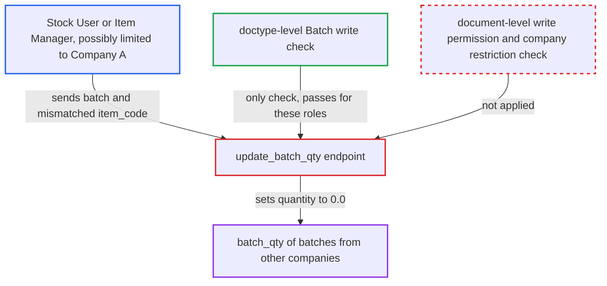

# update_batch_qty lets any Batch writer overwrite batch_qty of arbitrary batches

| Field | Value |
|---|---|
| ID | `find_014Xc8EgSzn4nbsE67MgMLKw` |
| Severity | **Medium** |
| Status | open |
| CWE | CWE-862 — Missing authorization |
| Created | 2026-10-27T21:21:36.907175Z |
| Claude Security | https://claude.ai/security/findings/find_014Xc8EgSzn4nbsE67MgMLKw |

## Description

A logged-in user with the Stock User or Item Manager role can overwrite the cached `batch_qty` of any batch on the site, including batches of items restricted to other companies. Only the displayed figure is wrong; the stock ledger is untouched. The cause is `update_batch_qty`, which checks only doctype-level write permission and trusts the caller's `selected_batches` list.

1. **attacker with Stock User or Item Manager role** posts a crafted `selected_batches` list to `update_batch_qty`. Each row names a target batch in `batch` and an unrelated item in `item_code`, and the endpoint is reachable through `/api/method/` by any logged-in user.
2. **the method `update_batch_qty`** checks only doctype-level write permission on `Batch`. The `frappe.has_permission('Batch', 'write', throw=True, ignore_share_permissions=True)` check passes for these roles. There is no document-level check, no User Permission check and no `company_restriction` check. ([`erpnext/stock/report/stock_qty_vs_batch_qty/stock_qty_vs_batch_qty.py:107-131`](https://github.com/cx-benchmark/erpnext/blob/90e7aefca73da3c440d2e8da7472fcb67838e678/erpnext/stock/report/stock_qty_vs_batch_qty/stock_qty_vs_batch_qty.py#L107-L131))
3. **the method `update_batch_qty`** calls `get_batch_qty` with the caller's `batch` and `item_code` for each row. The report's read path applies the Item company restriction through `get_allowed_masters_condition`, but this write path does not. ([`erpnext/stock/report/stock_qty_vs_batch_qty/stock_qty_vs_batch_qty.py:78-81`](https://github.com/cx-benchmark/erpnext/blob/90e7aefca73da3c440d2e8da7472fcb67838e678/erpnext/stock/report/stock_qty_vs_batch_qty/stock_qty_vs_batch_qty.py#L78-L81))
4. **the function `get_batch_qty`** returns no rows for the mismatched batch and item pair. It only returns rows for the exact `item_code` and `batch_no` combination, so the summed quantity is `0.0` whatever the real stock is. ([`erpnext/stock/doctype/batch/batch.py:272-331`](https://github.com/cx-benchmark/erpnext/blob/90e7aefca73da3c440d2e8da7472fcb67838e678/erpnext/stock/doctype/batch/batch.py#L272-L331))
5. **the method `update_batch_qty`** writes the result into `Batch.batch_qty` with `frappe.db.set_value`. `frappe.db.set_value` skips document permission checks, User Permissions and validation. `batch_qty` is a read-only field, so this endpoint is the only way a Stock User can set it. ([`erpnext/stock/doctype/batch/batch.json`](https://github.com/cx-benchmark/erpnext/blob/90e7aefca73da3c440d2e8da7472fcb67838e678/erpnext/stock/doctype/batch/batch.json))

## Assessment

The attacker is an authenticated desk user with the Stock User or Item Manager role. User Permissions may restrict them to Company A. They need no other setting and no victim action. They send a POST request to `/api/method/erpnext.stock.report.stock_qty_vs_batch_qty.stock_qty_vs_batch_qty.update_batch_qty` with `selected_batches` naming a batch of Company B and an unrelated `item_code`. Sending the true item instead writes the real quantity back.

Impact: The attacker can set `batch_qty` of any Batch to `0.0`, or back to its true value, across companies. Other users then see misleading stock figures in the Batch list view and in the batch link search. The ledger is not corrupted, and the value can be re-synced.

## Recommendation

`update_batch_qty` authorises at doctype level only. It trusts the caller-supplied batch and item pairs. It writes with `frappe.db.set_value`, which bypasses document permission and restriction checks.

Fix criteria: Each target Batch passes a document-level write permission check for the running user, including User Permissions and the Company Restriction hook. The recomputed quantity comes from the batch's own `item`, not from a caller-supplied `item_code`. A Stock User restricted to Company A cannot change `batch_qty` of a Company-B or restricted batch. A mismatching `item_code` cannot zero a batch.

## Evidence

**https://github.com/cx-benchmark/erpnext**

- [`erpnext/stock/report/stock_qty_vs_batch_qty/stock_qty_vs_batch_qty.py:107-131`](https://github.com/cx-benchmark/erpnext/blob/90e7aefca73da3c440d2e8da7472fcb67838e678/erpnext/stock/report/stock_qty_vs_batch_qty/stock_qty_vs_batch_qty.py#L107-L131)
- [`erpnext/stock/report/stock_qty_vs_batch_qty/stock_qty_vs_batch_qty.py:78-81`](https://github.com/cx-benchmark/erpnext/blob/90e7aefca73da3c440d2e8da7472fcb67838e678/erpnext/stock/report/stock_qty_vs_batch_qty/stock_qty_vs_batch_qty.py#L78-L81)
- [`erpnext/stock/doctype/batch/batch.json`](https://github.com/cx-benchmark/erpnext/blob/90e7aefca73da3c440d2e8da7472fcb67838e678/erpnext/stock/doctype/batch/batch.json)
- [`erpnext/stock/doctype/batch/batch.py:272-331`](https://github.com/cx-benchmark/erpnext/blob/90e7aefca73da3c440d2e8da7472fcb67838e678/erpnext/stock/doctype/batch/batch.py#L272-L331)

