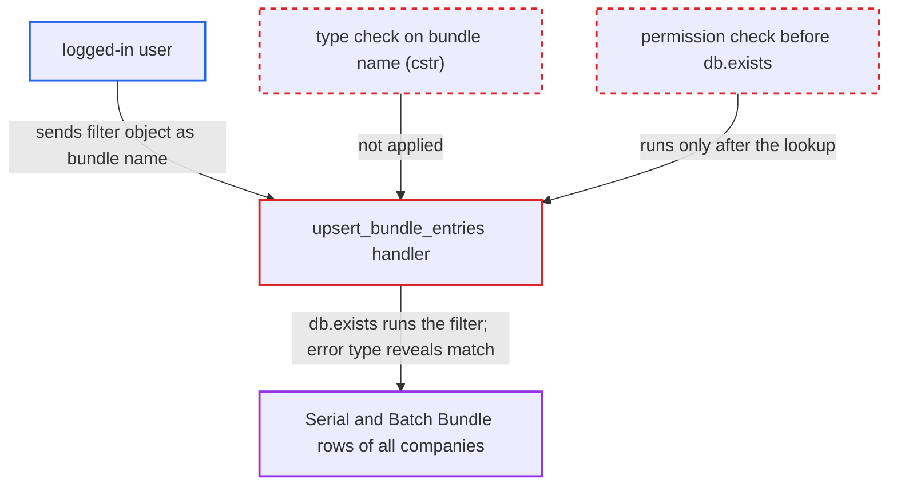

# upsert_bundle_entries resolves dict bundle name as filter, oracle over Serial and Batch Bundle

| Field | Value |
|---|---|
| ID | `find_01QoNNKLdK78UJFfbzPyPBjd` |
| Severity | **Medium** |
| Status | open |
| CWE | CWE-943 — Query logic injection |
| Created | 2026-10-27T22:22:32.586038Z |
| Claude Security | https://claude.ai/security/findings/find_01QoNNKLdK78UJFfbzPyPBjd |

## Description

Any logged-in user can learn, one yes/no answer at a time, what is stored in other companies' Serial and Batch Bundle records. Roles and User Permissions do not stop it. The whitelisted `upsert_bundle_entries` passes the caller's `serial_and_batch_bundle` value to `frappe.db.exists` without checking its type or the caller's permission. A JSON object is then run as a filter, and the error that comes back shows whether any row matched.

1. **logged-in user** posts to `upsert_bundle_entries` with a filter object as the bundle name. The method is a whitelisted POST with no role gate, and the caller picks both `doc.doctype` and `child_row.parenttype`, so `validate_parent_document` is satisfied. ([`erpnext/stock/doctype/serial_and_batch_bundle/inline_editor.py:121-140`](https://github.com/cx-benchmark/erpnext/blob/90e7aefca73da3c440d2e8da7472fcb67838e678/erpnext/stock/doctype/serial_and_batch_bundle/inline_editor.py#L121-L140))
2. **the handler `upsert_bundle_entries`** takes `serial_and_batch_bundle` from `child_row` and calls `frappe.db.exists` with it. There is no `cstr()` or `isinstance` check, and no permission check has run yet, so a dict is treated as a filter set with operators such as `like`, `>` and `<`. ([`erpnext/stock/doctype/serial_and_batch_bundle/inline_editor.py:145-146`](https://github.com/cx-benchmark/erpnext/blob/90e7aefca73da3c440d2e8da7472fcb67838e678/erpnext/stock/doctype/serial_and_batch_bundle/inline_editor.py#L145-L146))
3. **`frappe.db.exists`** evaluates the attacker's filter against `tabSerial and Batch Bundle`. It applies no role check and no User Permission, so rows of every company can match. ([`erpnext/stock/doctype/serial_and_batch_bundle/inline_editor.py:145-146`](https://github.com/cx-benchmark/erpnext/blob/90e7aefca73da3c440d2e8da7472fcb67838e678/erpnext/stock/doctype/serial_and_batch_bundle/inline_editor.py#L145-L146))
4. **the handler `upsert_bundle_entries`** on a miss with no entries supplied, throws a `ValidationError` (HTTP 417). The message is "Please add at least one Serial No or Batch to save", and it is thrown before the first permission check. ([`erpnext/stock/doctype/serial_and_batch_bundle/inline_editor.py:160-165`](https://github.com/cx-benchmark/erpnext/blob/90e7aefca73da3c440d2e8da7472fcb67838e678/erpnext/stock/doctype/serial_and_batch_bundle/inline_editor.py#L160-L165))
5. **the function `apply_incremental_changes`** on a match, fails with a different error at the `frappe.has_permission` call. The dict is passed as `doc`, and the call errors or refuses, but it can never produce the 417 `ValidationError`. ([`erpnext/stock/doctype/serial_and_batch_bundle/inline_editor.py:206-217`](https://github.com/cx-benchmark/erpnext/blob/90e7aefca73da3c440d2e8da7472fcb67838e678/erpnext/stock/doctype/serial_and_batch_bundle/inline_editor.py#L206-L217))
6. **logged-in user** repeats the request with adjusted bounds and reads each response. Each response tells whether a row matches the filter. With `like` and range operators this recovers values such as `company`, `item_code`, `avg_rate` and `total_qty`.

## Assessment

The attacker is any logged-in user, since whitelisted methods can be called by any logged-in user through /api/method and nothing before `:146` checks a role. They POST to `/api/method/erpnext.stock.doctype.serial_and_batch_bundle.inline_editor.upsert_bundle_entries`. The `doc` is `{"doctype":"Stock Entry"}`. The `child_row` is `{"parenttype":"Stock Entry","serial_and_batch_bundle":{"company":"Other Co","avg_rate":[">",500]}}`, and no entries are sent. No victim has to act. The report assumes Frappe `>=17.0.0-dev,<18`, which is not in the checkout. It assumes a dict passed to `db.exists` is applied as filters and that nested JSON values stay dicts after `parse_json`.

Impact: The attacker learns whether any row matches a filter they choose, across all companies. This works regardless of the Serial and Batch Bundle role permissions and of the caller's Company, Warehouse and Item User Permissions. Repeated requests recover `company`, `item_code`, `warehouse`, `voucher_type`, `voucher_no`, `owner`, `posting_datetime`, `avg_rate`, `total_amount` and `total_qty`. The leak is limited to one table's header columns, one bit at a time. Nothing is written, because the match branch fails at `:216` before `bundle.save`, and service is not affected.

## Recommendation

(1) `upsert_bundle_entries` takes the bundle identifier from caller JSON without requiring it to be a document name. As a result, `frappe.db.exists` at `inline_editor.py:146` runs a filter query the caller defines.

Fix criteria: Only a plain string bundle name can reach `frappe.db.exists`, `has_permission` or `get_doc`, and dict and list values are refused or coerced, as `add_serial_batch_ledgers` does at `serial_and_batch_bundle.py:2436`. Checked with `malformed_names()`: for `{"name": ["like", "%"]}` and `["like", "%"]`, the response is the same whether or not matching bundles exist.

(2) Bundle existence is tested at `:146` before any check of the caller's permission on the parent voucher or the bundle. The answer of that lookup therefore reaches callers who hold no permission.

Fix criteria: A caller without write permission on the parent doctype and on the named bundle (User Permissions included) gets the same refusal whether or not the bundle exists. Checked with a Company-fenced user who names an existing bundle of another company and then a name that does not exist: both requests return the same response.

## Evidence

**https://github.com/cx-benchmark/erpnext**

- [`erpnext/stock/doctype/serial_and_batch_bundle/inline_editor.py:145-146`](https://github.com/cx-benchmark/erpnext/blob/90e7aefca73da3c440d2e8da7472fcb67838e678/erpnext/stock/doctype/serial_and_batch_bundle/inline_editor.py#L145-L146)
- [`erpnext/stock/doctype/serial_and_batch_bundle/inline_editor.py:160-165`](https://github.com/cx-benchmark/erpnext/blob/90e7aefca73da3c440d2e8da7472fcb67838e678/erpnext/stock/doctype/serial_and_batch_bundle/inline_editor.py#L160-L165)
- [`erpnext/stock/doctype/serial_and_batch_bundle/inline_editor.py:206-217`](https://github.com/cx-benchmark/erpnext/blob/90e7aefca73da3c440d2e8da7472fcb67838e678/erpnext/stock/doctype/serial_and_batch_bundle/inline_editor.py#L206-L217)
- [`erpnext/stock/doctype/serial_and_batch_bundle/inline_editor.py:121-140`](https://github.com/cx-benchmark/erpnext/blob/90e7aefca73da3c440d2e8da7472fcb67838e678/erpnext/stock/doctype/serial_and_batch_bundle/inline_editor.py#L121-L140)
- [`erpnext/stock/doctype/serial_and_batch_bundle/serial_and_batch_bundle.py:2410-2438`](https://github.com/cx-benchmark/erpnext/blob/90e7aefca73da3c440d2e8da7472fcb67838e678/erpnext/stock/doctype/serial_and_batch_bundle/serial_and_batch_bundle.py#L2410-L2438)
- [`erpnext/stock/doctype/serial_and_batch_bundle/test_serial_and_batch_bundle.py:2658-2712`](https://github.com/cx-benchmark/erpnext/blob/90e7aefca73da3c440d2e8da7472fcb67838e678/erpnext/stock/doctype/serial_and_batch_bundle/test_serial_and_batch_bundle.py#L2658-L2712)
- [`erpnext/stock/doctype/serial_and_batch_bundle/serial_and_batch_bundle.json`](https://github.com/cx-benchmark/erpnext/blob/90e7aefca73da3c440d2e8da7472fcb67838e678/erpnext/stock/doctype/serial_and_batch_bundle/serial_and_batch_bundle.json)
- [`erpnext/setup/doctype/company/company.py:353`](https://github.com/cx-benchmark/erpnext/blob/90e7aefca73da3c440d2e8da7472fcb67838e678/erpnext/setup/doctype/company/company.py#L353)
- [`erpnext/controllers/queries.py:1287-1292`](https://github.com/cx-benchmark/erpnext/blob/90e7aefca73da3c440d2e8da7472fcb67838e678/erpnext/controllers/queries.py#L1287-L1292)

