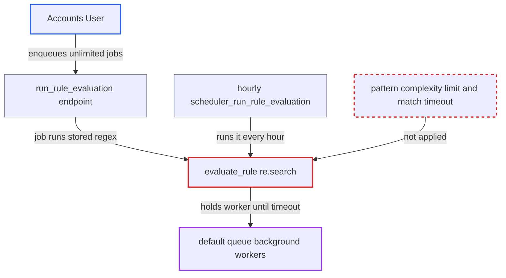

# User-supplied regex in Bank Transaction Rules enables ReDoS of background workers

| Field | Value |
|---|---|
| ID | `find_01HCSaM5VrL6sFDDuQ2Xhn4j` |
| Severity | **Medium** |
| Status | open |
| CWE | CWE-1333 — Inefficient Regular Expression Complexity |
| Created | 2026-10-27T21:19:43.783822Z |
| Claude Security | https://claude.ai/security/findings/find_01HCSaM5VrL6sFDDuQ2Xhn4j |

## Description

A logged-in user with the `Accounts User` role can stall the background workers and stop bank rule matching for every company. They do this by saving a regular expression that takes exponential time to match. The web tier keeps serving and no data is exposed. The cause is that `BankTransactionRule.validate` only checks that the pattern compiles, and `evaluate_rule` later runs it with `re.search` and no time limit.

1. **Accounts User** creates a Bank Transaction Rule with a Regex description condition. The pattern, for example `(a+)+$`, is stored in `value`, and `validate` only checks that it compiles, with no limit on complexity or length. ([`erpnext/accounts/doctype/bank_transaction_rule/bank_transaction_rule.py:137-143`](https://github.com/cx-benchmark/erpnext/blob/90e7aefca73da3c440d2e8da7472fcb67838e678/erpnext/accounts/doctype/bank_transaction_rule/bank_transaction_rule.py#L137-L143))
2. **Accounts User** submits a Bank Transaction with a crafted description. The role may create and submit these records, and `description` is an unrestricted Small Text field, so it can hold about 35 `a` characters followed by `!`. ([`erpnext/accounts/doctype/bank_transaction/bank_transaction.json:318-332`](https://github.com/cx-benchmark/erpnext/blob/90e7aefca73da3c440d2e8da7472fcb67838e678/erpnext/accounts/doctype/bank_transaction/bank_transaction.json#L318-L332))
3. **Accounts User or hourly scheduler** enqueues a rule evaluation job. Each POST to `run_rule_evaluation` needs only `read` on `Bank Transaction` and enqueues a new job with no deduplication. Otherwise `scheduler_run_rule_evaluation` does it every hour, as long as `automatically_run_rules_on_unreconciled_transactions` is on (default `1`). ([`erpnext/accounts/doctype/bank_transaction_rule/bank_transaction_rule.py:225-237`](https://github.com/cx-benchmark/erpnext/blob/90e7aefca73da3c440d2e8da7472fcb67838e678/erpnext/accounts/doctype/bank_transaction_rule/bank_transaction_rule.py#L225-L237))
4. **the job `_run_rule_evaluation`** applies every rule to every submitted, unreconciled Bank Transaction of every company. The attacker's transaction is included, so the stored pattern is run against the crafted description. ([`erpnext/accounts/doctype/bank_transaction_rule/bank_transaction_rule.py:240-293`](https://github.com/cx-benchmark/erpnext/blob/90e7aefca73da3c440d2e8da7472fcb67838e678/erpnext/accounts/doctype/bank_transaction_rule/bank_transaction_rule.py#L240-L293))
5. **the function `evaluate_rule`** calls `re.search(value, desc)` on the lower-cased pattern and description. CPython's backtracking `re` has no timeout, so one call backtracks exponentially and holds the worker at full CPU. ([`erpnext/accounts/doctype/bank_transaction_rule/bank_transaction_rule.py:201-220`](https://github.com/cx-benchmark/erpnext/blob/90e7aefca73da3c440d2e8da7472fcb67838e678/erpnext/accounts/doctype/bank_transaction_rule/bank_transaction_rule.py#L201-L220))
6. **RQ job timeout** kills the stuck job, and the same transaction stalls the next run. The `is_rule_evaluated` updates are not committed until the job ends, so the kill rolls them back and the transaction is picked up again on every later run. ([`erpnext/accounts/doctype/bank_transaction_rule/bank_transaction_rule.py:240-293`](https://github.com/cx-benchmark/erpnext/blob/90e7aefca73da3c440d2e8da7472fcb67838e678/erpnext/accounts/doctype/bank_transaction_rule/bank_transaction_rule.py#L240-L293))

## Assessment

The attacker is an authenticated desk user with the `Accounts User` role. That role can create a `Bank Transaction Rule` and create and submit a `Bank Transaction` for their company. They store a rule with `check = Regex` and a value such as `(a+)+$`. They submit a transaction whose description is about 35 or more `a` characters followed by `!`. They then POST to `erpnext.accounts.doctype.bank_transaction_rule.bank_transaction_rule.run_rule_evaluation` as often as they like. Alternatively they wait for the hourly `scheduler_run_rule_evaluation`, which is on by default. A job is also enqueued after each bank statement import. No victim action is needed.

Impact: Each stalled job holds a background worker at full CPU until the RQ timeout kills it. Repeated requests can keep every worker on the `default` queue busy, which delays other background work such as emails, imports and reposting. Rule matching stops for all companies until the rule is deleted. The web tier keeps serving, and no data is disclosed or changed, so this is degradation rather than a full outage.

## Recommendation

Low-privilege users can store arbitrary regular expressions. Shared background workers then run them with a backtracking engine against many inputs, with no complexity limit or execution timeout.

Fix criteria: A `Regex` rule can no longer stall a worker. This is done by one of these: restricting `Regex` conditions to a safe subset or a linear-time engine, enforcing a per-match timeout together with length limits on the pattern and the description, or requiring elevated privileges to author regex rules. A rule `(a+)+$` evaluated against a 40-character `aaaa...!` description must finish, or be rejected, within milliseconds. `run_rule_evaluation` must not be able to occupy a worker beyond a bounded time.

## Evidence

**https://github.com/cx-benchmark/erpnext**

- [`erpnext/accounts/doctype/bank_transaction_rule/bank_transaction_rule.py:137-143`](https://github.com/cx-benchmark/erpnext/blob/90e7aefca73da3c440d2e8da7472fcb67838e678/erpnext/accounts/doctype/bank_transaction_rule/bank_transaction_rule.py#L137-L143)
- [`erpnext/accounts/doctype/bank_transaction_rule/bank_transaction_rule.py:201-220`](https://github.com/cx-benchmark/erpnext/blob/90e7aefca73da3c440d2e8da7472fcb67838e678/erpnext/accounts/doctype/bank_transaction_rule/bank_transaction_rule.py#L201-L220)
- [`erpnext/accounts/doctype/bank_transaction_rule/bank_transaction_rule.py:240-293`](https://github.com/cx-benchmark/erpnext/blob/90e7aefca73da3c440d2e8da7472fcb67838e678/erpnext/accounts/doctype/bank_transaction_rule/bank_transaction_rule.py#L240-L293)
- [`erpnext/accounts/doctype/bank_transaction_rule/bank_transaction_rule.py:225-237`](https://github.com/cx-benchmark/erpnext/blob/90e7aefca73da3c440d2e8da7472fcb67838e678/erpnext/accounts/doctype/bank_transaction_rule/bank_transaction_rule.py#L225-L237)
- [`erpnext/hooks.py:532-541`](https://github.com/cx-benchmark/erpnext/blob/90e7aefca73da3c440d2e8da7472fcb67838e678/erpnext/hooks.py#L532-L541)
- [`erpnext/accounts/doctype/bank_transaction_rule/bank_transaction_rule.json:164-176`](https://github.com/cx-benchmark/erpnext/blob/90e7aefca73da3c440d2e8da7472fcb67838e678/erpnext/accounts/doctype/bank_transaction_rule/bank_transaction_rule.json#L164-L176)
- [`erpnext/accounts/doctype/bank_transaction/bank_transaction.json:318-332`](https://github.com/cx-benchmark/erpnext/blob/90e7aefca73da3c440d2e8da7472fcb67838e678/erpnext/accounts/doctype/bank_transaction/bank_transaction.json#L318-L332)

