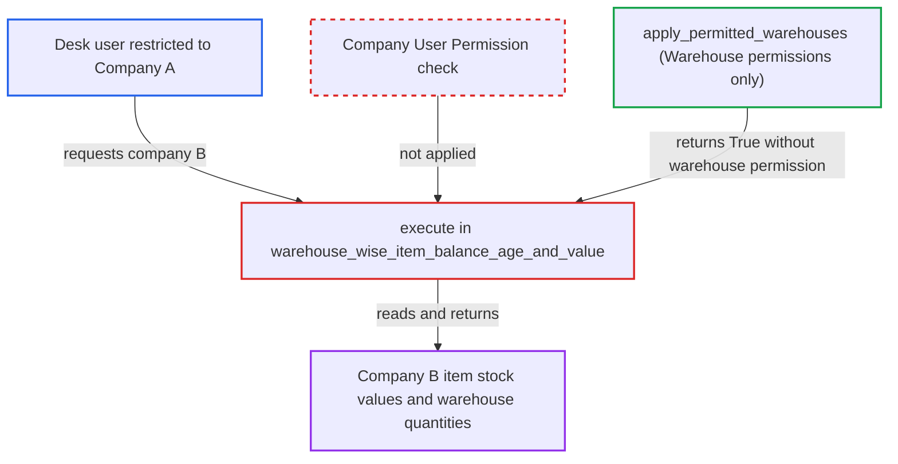

# Warehouse Wise Item Balance Age and Value report does not apply Company user permissions

| Field | Value |
|---|---|
| ID | `find_01PJqnR7Ph3GAAHdwXWrTXhq` |
| Severity | **Medium** |
| Status | open |
| CWE | CWE-862 — Missing authorization |
| Created | 2026-10-27T21:24:26.707222Z |
| Claude Security | https://claude.ai/security/findings/find_01PJqnR7Ph3GAAHdwXWrTXhq |

## Description

An employee limited to one company can read another company's stock data. The report returns item-wise stock values, average ages and per-warehouse quantities. The attacker needs a Stock User or Sales User role, a Company User Permission for Company A only, and no Warehouse User Permission. The report scopes data by the caller's `company` filter and never checks Company User Permissions.

1. **Attacker (desk user restricted to Company A)** requests the report with another company's name. The call is `/api/method/frappe.desk.query_report.run` with `report_name=Warehouse Wise Item Balance Age and Value` and filters `company` set to B plus `from_date` and `to_date`.
2. **Frappe `query_report.run`** lets the request through. It only checks the role-level `report` permission on Stock Ledger Entry, which the attacker's role has.
3. **the function `apply_permitted_warehouses`** returns True, meaning no restriction. It honours only Warehouse User Permissions, and the attacker has none, so nothing is narrowed. ([`erpnext/stock/report/warehouse_wise_item_balance_age_and_value/warehouse_wise_item_balance_age_and_value.py:94-107`](https://github.com/cx-benchmark/erpnext/blob/90e7aefca73da3c440d2e8da7472fcb67838e678/erpnext/stock/report/warehouse_wise_item_balance_age_and_value/warehouse_wise_item_balance_age_and_value.py#L94-L107))
4. **the function `get_warehouse_list`** lists every non-group warehouse of Company B. It uses `frappe.get_all`, which applies no User Permissions, and these warehouses become report columns. ([`erpnext/stock/report/warehouse_wise_item_balance_age_and_value/warehouse_wise_item_balance_age_and_value.py:138-162`](https://github.com/cx-benchmark/erpnext/blob/90e7aefca73da3c440d2e8da7472fcb67838e678/erpnext/stock/report/warehouse_wise_item_balance_age_and_value/warehouse_wise_item_balance_age_and_value.py#L138-L162))
5. **the stock ledger query and `FIFOSlots`** load Company B's ledger entries and age them. `apply_conditions` adds `sle.company == company` from the caller's filter only and checks only Warehouse permissions. ([`erpnext/stock/report/stock_analytics/stock_analytics.py:337-365`](https://github.com/cx-benchmark/erpnext/blob/90e7aefca73da3c440d2e8da7472fcb67838e678/erpnext/stock/report/stock_analytics/stock_analytics.py#L337-L365))
6. **the report** returns Company B's item values, ages and per-warehouse balances to the attacker. `execute` scopes both the SLE load and the ageing by the caller's `company` filter alone. ([`erpnext/stock/report/warehouse_wise_item_balance_age_and_value/warehouse_wise_item_balance_age_and_value.py:26-48`](https://github.com/cx-benchmark/erpnext/blob/90e7aefca73da3c440d2e8da7472fcb67838e678/erpnext/stock/report/warehouse_wise_item_balance_age_and_value/warehouse_wise_item_balance_age_and_value.py#L26-L48))

## Assessment

The attacker is an authenticated desk user with the Stock User or Sales User role. They have a Company User Permission limiting them to Company A and no Warehouse User Permission. They call the report endpoint with `company` set to B. The report roles listed are Accounts Manager, Stock User, Stock Manager and Sales User. The report does not name other ways in.

Impact: The attacker reads Company B's item-wise stock values, average ages and warehouse-wise quantities. The report says this is disclosure only, with no write or availability impact.

## Recommendation

The report's company scope (warehouse list, SLE query, FIFO ageing) is taken straight from the caller's `company` filter. It is never intersected with the companies the running user is permitted.

Fix criteria: The requested `company` must be permitted to the running user by Company User Permissions, otherwise the report returns no rows or raises PermissionError. The warehouse list and SLE rows are limited accordingly. Verify that a Sales User restricted to Company A who requests `company=B` receives no Company-B rows or columns.

## Evidence

**https://github.com/cx-benchmark/erpnext**

- [`erpnext/stock/report/warehouse_wise_item_balance_age_and_value/warehouse_wise_item_balance_age_and_value.py:26-48`](https://github.com/cx-benchmark/erpnext/blob/90e7aefca73da3c440d2e8da7472fcb67838e678/erpnext/stock/report/warehouse_wise_item_balance_age_and_value/warehouse_wise_item_balance_age_and_value.py#L26-L48)
- [`erpnext/stock/report/warehouse_wise_item_balance_age_and_value/warehouse_wise_item_balance_age_and_value.py:138-162`](https://github.com/cx-benchmark/erpnext/blob/90e7aefca73da3c440d2e8da7472fcb67838e678/erpnext/stock/report/warehouse_wise_item_balance_age_and_value/warehouse_wise_item_balance_age_and_value.py#L138-L162)
- [`erpnext/stock/report/warehouse_wise_item_balance_age_and_value/warehouse_wise_item_balance_age_and_value.py:94-107`](https://github.com/cx-benchmark/erpnext/blob/90e7aefca73da3c440d2e8da7472fcb67838e678/erpnext/stock/report/warehouse_wise_item_balance_age_and_value/warehouse_wise_item_balance_age_and_value.py#L94-L107)
- [`erpnext/stock/report/stock_analytics/stock_analytics.py:337-365`](https://github.com/cx-benchmark/erpnext/blob/90e7aefca73da3c440d2e8da7472fcb67838e678/erpnext/stock/report/stock_analytics/stock_analytics.py#L337-L365)

